# Full-Stack Architect Interview Questions & Answers

> **~500 questions** covering React, Angular, Node.js, Python, Spring Boot, Camunda, Architecture Patterns, Microservices, Cloud, DevOps, Security, Databases, and API Design.
> Each question includes a practical answer, a real-world example, and a Mermaid diagram where relevant for interview conversations and architecture discussions.
> This version is refined for interview clarity: shorter, more structured, and more decision-oriented.

---

## Table of Contents
1. [React](#1-react)
2. [Angular](#2-angular)
3. [Node.js](#3-nodejs)
4. [Python](#4-python)
5. [Spring Boot](#5-spring-boot)
6. [Camunda & BPM](#6-camunda--bpm)
7. [System Design & Architecture Patterns](#7-system-design--architecture-patterns)
8. [Microservices & Cloud](#8-microservices--cloud)
9. [DevOps, CI/CD & Testing](#9-devops-cicd--testing)
10. [Databases & API Design](#10-databases--api-design)
11. [Security](#11-security)

---

# 1. React

### Q1. What is React and how does it differ from other frontend frameworks?
**Answer:** React is a component-based UI library built around the virtual DOM and declarative rendering. It differs from Angular because Angular is a full framework with routing, DI, forms, and opinionated architecture built in; React is more flexible and typically pairs with a routing library, state library, and build tooling. Compared with Vue, React is more ecosystem-driven and JSX-based, while Vue is more template-driven and convention-based.

**Interview-ready framing:** "I choose React when I need a flexible, component-driven frontend with strong ecosystem support and good performance at scale. I use Angular when platform consistency matters more than flexibility."

**Real-world example:** Airbnb uses React to render property listings that update instantly when filters change, without full-page reloads.

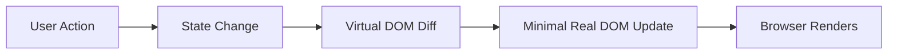

---

### Q2. Explain the React component lifecycle.
**Answer:** Class components have lifecycle methods: `constructor → componentDidMount → componentDidUpdate → componentWillUnmount`. Functional components use hooks: `useEffect` with dependency array controls mounting (`[]`), updating (`[dep]`), and cleanup (return function).

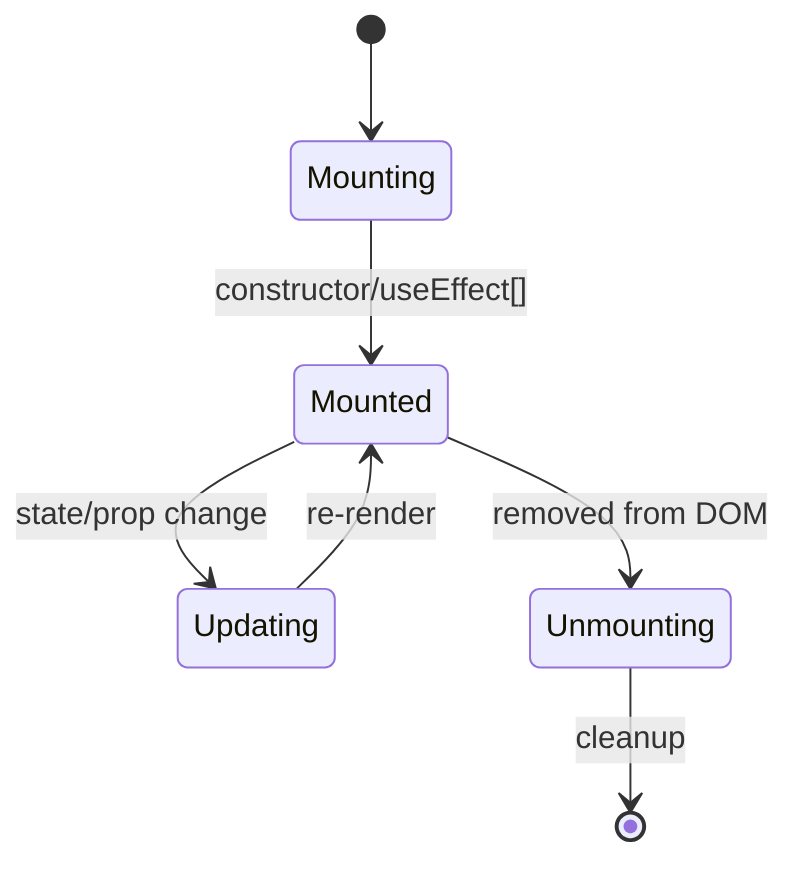

---

### Q3. What is the Virtual DOM and how does reconciliation work?
**Answer:** React keeps a lightweight in-memory tree (Virtual DOM). On state change, it renders a new virtual tree and diffs it against the previous one using a heuristic algorithm — it assumes elements of different types produce different trees, and uses `key` props to match list items. Only changed nodes are updated in the real DOM (commit phase).

**Real-world example:** A chat app with 1000 messages — only the new message node is added, not the entire list re-rendered.

---

### Q4. What are hooks and why were they introduced?
**Answer:** Hooks (React 16.8+) let functional components use state and lifecycle features without class syntax. They solve three core problems: reusing stateful logic without HOCs or render props, organizing side effects around behavior instead of lifecycle phases, and removing the `this` binding complexity that often makes class components harder to maintain. In large applications, hooks make component logic easier to test, reason about, and compose.

**Interview-ready framing:** "Hooks are the default pattern in modern React because they keep components smaller, easier to reuse, and more aligned with functional programming patterns."

| Hook | Purpose |
|------|---------|
| `useState` | Local state |
| `useEffect` | Side effects |
| `useContext` | Consume context |
| `useRef` | Mutable ref |
| `useMemo` | Cached computation |
| `useCallback` | Stable function ref |
| `useReducer` | Complex state logic |

---

### Q5. What is the difference between controlled and uncontrolled components?
**Answer:** A **controlled** component's value is driven by React state — every keystroke updates state, state drives the input. An **uncontrolled** component stores its own value in the DOM, accessed via `ref`.

```jsx
// Controlled
const [val, setVal] = useState('');
<input value={val} onChange={e => setVal(e.target.value)} />

// Uncontrolled
const ref = useRef();
<input ref={ref} />
```

**Use controlled** when you need validation on every keystroke. **Use uncontrolled** for file inputs or integrating with non-React libraries.

---

### Q6. Explain React Context API and when to use it over Redux.
**Answer:** Context provides a way to pass data through the component tree without prop drilling. It is best for low-frequency data: theme, locale, auth user. Redux (or Zustand) is better for high-frequency updates with complex state logic.

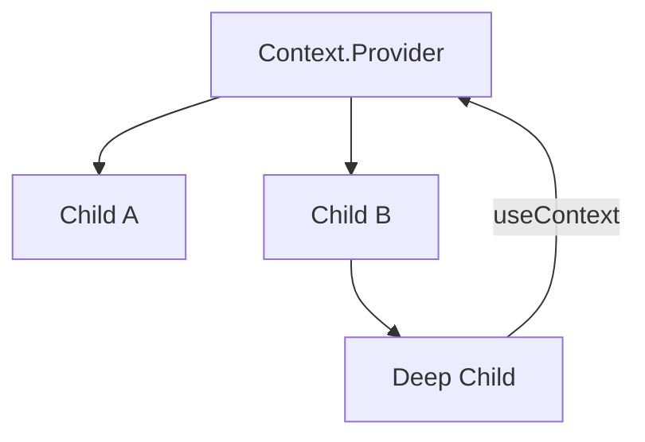

---

### Q7. What is React.memo and when should you use it?
**Answer:** `React.memo` is a HOC that skips re-rendering a functional component if its props have not changed (shallow comparison). Use it for pure, expensive child components that receive stable props.

```jsx
const ExpensiveList = React.memo(({ items }) => (
  <ul>{items.map(i => <li key={i.id}>{i.name}</li>)}</ul>
));
```

**Warning:** Do not add it everywhere — the comparison itself has a cost.

---

### Q8. Explain `useMemo` vs `useCallback`.
**Answer:**
- `useMemo(fn, deps)` caches the **return value** of `fn`.
- `useCallback(fn, deps)` caches the **function itself**.

```jsx
const sorted = useMemo(() => items.sort(...), [items]);      // cached array
const handleClick = useCallback(() => submit(id), [id]);      // stable fn ref
```

Use `useCallback` to prevent child re-renders when passing callbacks as props to `React.memo` children.

---

### Q9. What is code splitting and lazy loading in React?
**Answer:** Code splitting breaks the bundle into chunks loaded on demand. React provides `React.lazy` + `Suspense` for component-level splitting, and tools like Vite/Webpack split route-level bundles.

```jsx
const Dashboard = React.lazy(() => import('./Dashboard'));

<Suspense fallback={<Spinner />}>
  <Dashboard />
</Suspense>
```

**Real-world example:** An e-commerce app lazy-loads the checkout page only when the user clicks "Buy".

---

### Q10. What are React Server Components (RSC)?
**Answer:** React Server Components let a component render on the server and stream its output to the client without shipping the full component logic and data-fetching code to the browser. This makes them ideal for reading from databases or backend services directly, while keeping bundle size low. Client components remain responsible for interactivity and browser-only state. In practice, RSCs are most valuable in Next.js-style architectures where data access and rendering are closer to the backend.

**Interview-ready framing:** "RSCs reduce the amount of JavaScript shipped to the client and improve performance by moving expensive or sensitive server-side work to the server while keeping interactive UI on the client."

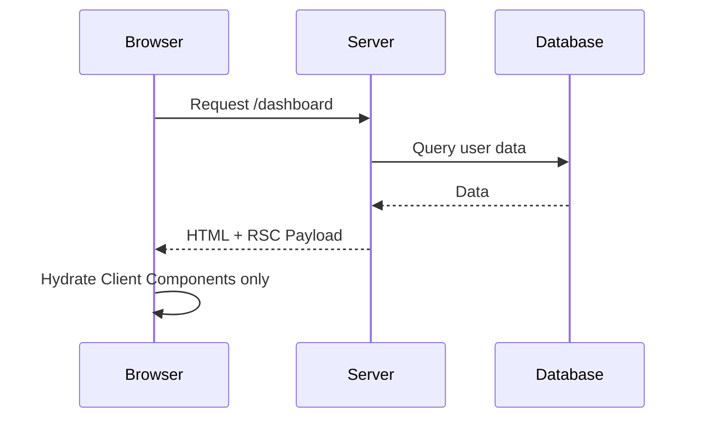

---

### Q11. Explain React's concurrent rendering and useTransition.
**Answer:** Concurrent mode lets React pause, interrupt, and restart rendering. `useTransition` marks a state update as non-urgent, keeping the UI responsive during heavy updates.

```jsx
const [isPending, startTransition] = useTransition();
startTransition(() => setFilteredList(heavyFilter(data)));
```

---

### Q12. How do you handle forms in React at scale?
**Answer:** Use libraries like **React Hook Form** (performance-focused, uncontrolled) or **Formik** (controlled). Pair with **Zod** or **Yup** for schema validation.

```jsx
const { register, handleSubmit } = useForm();
const schema = z.object({ email: z.string().email() });
```

---

### Q13. What is Redux Toolkit and how does it simplify Redux?
**Answer:** RTK provides `createSlice` (combines actions + reducer), `createAsyncThunk` (handles async), and `configureStore` (pre-configured with Redux DevTools). It eliminates boilerplate.

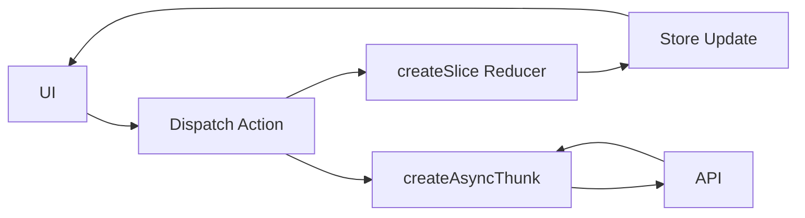

---

### Q14. How do you test React components?
**Answer:** Use **Vitest/Jest** + **React Testing Library**. Test from the user's perspective — query by role/text, fire events, assert visible output. Use **MSW** to mock APIs.

```jsx
it('shows welcome message after login', async () => {
  render(<Login />);
  await userEvent.type(screen.getByLabelText(/email/i), 'a@a.com');
  await userEvent.click(screen.getByRole('button', { name: /sign in/i }));
  expect(await screen.findByText(/welcome/i)).toBeInTheDocument();
});
```

---

### Q15. What are common React performance problems and how do you fix them?
**Answer:** React performance issues usually come from avoidable re-renders, oversized data payloads, and excessive work during render. Common fixes include memoizing expensive computations with `useMemo`, stabilizing callback references with `useCallback`, splitting large lists with virtualization, avoiding inline object/array creation in props, and using code splitting for large routes or feature modules. For data-heavy screens, prefer server pagination, query caching, and selective rendering rather than over-rendering the full tree.

| Problem | Fix |
|---------|-----|
| Unnecessary re-renders | `React.memo`, stable props, reduce state scope |
| Heavy list rendering | Virtualization, pagination, windowing |
| Repeated expensive calculations | `useMemo`, memoization, server-side filtering |
| Large bundle size | Lazy loading, route splitting, dynamic imports |
| Stale closures | Correct `useEffect` dependencies |
| Context causing re-renders | Split contexts, use selectors |

---

### Q16. What is the difference between SSR, SSG, and CSR in React?
**Answer:**
- **CSR (Client-Side Rendering):** App shell + data fetch in browser. Fast navigation, slow first load, bad SEO.
- **SSR (Server-Side Rendering):** HTML generated per request on server. Good SEO, fast first paint, more server load.
- **SSG (Static Site Generation):** HTML generated at build time. Fastest, but cannot personalise per request.

**Next.js** supports all three per route.

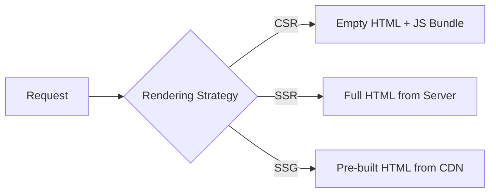

---

### Q17. How do you architect a large React application?
**Answer:** I structure a large React app around business domains or features rather than around pages alone. That means clear boundaries between UI, business logic, and API access, a reusable design system, strong typing, and sensible state ownership. In practice, I prefer feature-based folders, centralised data fetching, modular hooks, and consistent testing patterns. This keeps the app maintainable as the number of teams, pages, and shared components grows.

**Interview-ready framing:** "For large React apps, I optimize for modularity, predictable state ownership, and reusable UI primitives so the codebase remains scalable without becoming fragile."

```
src/
  features/
    orders/
      components/
      hooks/
      store/
      api/
      tests/
  shared/
    ui/
    utils/
  app/
    store.ts
    router.tsx
```

---

### Q18. Explain React's Error Boundaries.
**Answer:** Error boundaries are class components implementing `componentDidCatch` and `getDerivedStateFromError`. They catch JS errors in the component tree and show a fallback UI instead of crashing the page.

```jsx
class ErrorBoundary extends React.Component {
  state = { hasError: false };
  static getDerivedStateFromError() { return { hasError: true }; }
  componentDidCatch(err, info) { logError(err, info); }
  render() {
    return this.state.hasError
      ? <Fallback />
      : this.props.children;
  }
}
```

---

### Q19. What are React Portals and when do you use them?
**Answer:** `ReactDOM.createPortal(child, container)` renders a component outside its parent DOM hierarchy. Used for modals, tooltips, and dropdowns that need to escape CSS overflow/z-index constraints.

---

### Q20. How do you handle authentication in a React app?
**Answer:** Store JWT in an HTTP-only cookie (not localStorage, to prevent XSS). Use a global auth context or store. Protect routes with a `PrivateRoute` wrapper. Refresh tokens silently before expiry.

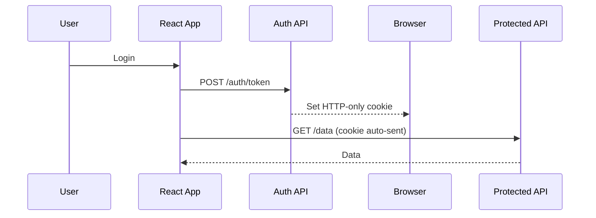


### Q21. What is React Query (TanStack Query) and why use it?
**Answer:** React Query manages server state — fetching, caching, background refetching, pagination, and mutations. It replaces manual `useEffect`-based data fetching and removes server data from Redux.

```jsx
const { data, isLoading, error } = useQuery({
  queryKey: ['orders', userId],
  queryFn: () => fetchOrders(userId),
  staleTime: 60_000,
});
```

**Real-world example:** An admin dashboard refetches order data every 30 seconds in the background without any user action.

---

### Q22. How do you implement infinite scroll or pagination in React?
**Answer:** Use `useInfiniteQuery` from TanStack Query, or manage `page` state manually. For infinite scroll, use `IntersectionObserver` to trigger loading when a sentinel element is visible.

```jsx
const { data, fetchNextPage, hasNextPage } = useInfiniteQuery({
  queryKey: ['items'],
  queryFn: ({ pageParam = 0 }) => fetchItems(pageParam),
  getNextPageParam: (last) => last.nextCursor,
});
```

---

### Q23. What is Zustand and when would you choose it over Redux?
**Answer:** Zustand is a minimal state library with no boilerplate. No actions, reducers, or providers needed. Choose Zustand for small-to-medium apps that need shared state without ceremony. Use Redux Toolkit for large teams needing strict patterns and DevTools time-travel.

```js
const useStore = create((set) => ({
  count: 0,
  increment: () => set((s) => ({ count: s.count + 1 })),
}));
```

---

### Q24. Explain micro-frontend architecture with React.
**Answer:** Micro-frontends split a large frontend into independently deployable apps composed at runtime. Tools: **Module Federation** (Webpack/Vite), **single-spa**, or **iframes**. Each team owns its slice (product listing, checkout, auth).

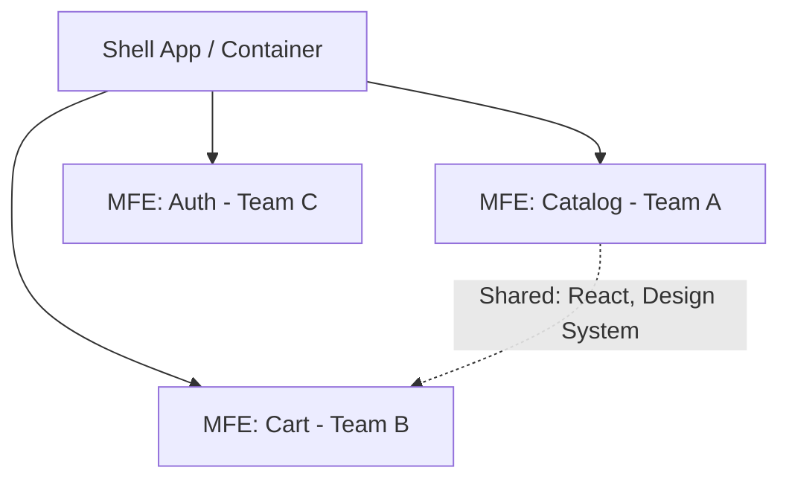

---

### Q25. How do you manage environment-specific configuration in React?
**Answer:** Use `.env` files with the tool's convention (`VITE_`, `REACT_APP_`). Never store secrets in frontend env vars — they ship to the browser. Store only public endpoints and feature flags.

---

# 2. Angular

### Q26. What is Angular's dependency injection system?
**Answer:** Angular's DI system is a hierarchical injector tree. When a component requests a service, Angular walks up the injector tree (component → module → root) and provides the nearest instance. `providedIn: 'root'` creates a singleton; providing in a lazy module creates a scoped instance.

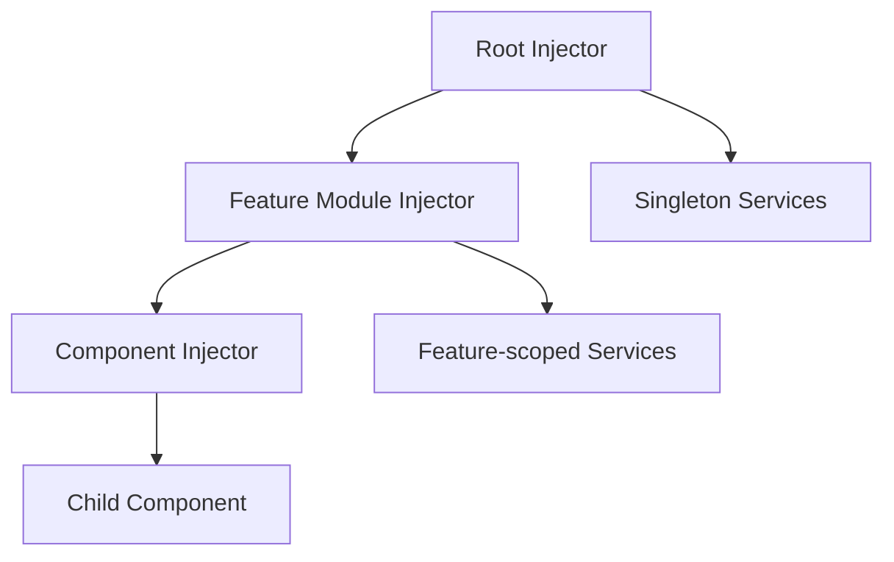

---

### Q27. What is the difference between `ChangeDetectionStrategy.Default` and `OnPush`?
**Answer:** Default checks every component on every event. OnPush checks a component only when its inputs change, an event fires inside it, an async pipe emits, or a signal it reads changes. OnPush dramatically reduces CPU cycles in large trees.

**Real-world example:** A dashboard with 200 card components — using OnPush cuts re-checks from 200 to typically 1–5 per interaction.

---

### Q28. Explain Angular signals and how they compare to RxJS.
**Answer:** Signals (Angular 17+) are synchronous reactive primitives. Reading a signal in a template automatically creates a dependency; writing triggers fine-grained updates. RxJS is for async event streams. Signals are easier to reason about for derived state; RxJS excels at complex async pipelines.

```ts
const count = signal(0);
const double = computed(() => count() * 2);
count.set(5); // double() === 10
```

---

### Q29. What are Angular standalone components?
**Answer:** Standalone components (Angular 14+) import their own dependencies directly without belonging to an `NgModule`. New projects default to standalone. They simplify bootstrapping and tree-shaking.

```ts
@Component({
  standalone: true,
  imports: [CommonModule, RouterModule],
  template: `<router-outlet />`
})
export class AppComponent {}
```

---

### Q30. How does Angular routing and lazy loading work?
**Answer:** The `Router` matches URL patterns to route definitions. Lazy-loaded routes use `loadComponent` or `loadChildren` to split code. The router downloads the chunk only when the user navigates to that path.

```ts
{
  path: 'admin',
  loadComponent: () => import('./admin/admin.component')
    .then(m => m.AdminComponent),
  canActivate: [authGuard]
}
```

---

### Q31. What is Angular's HttpClient and how do you intercept requests?
**Answer:** `HttpClient` returns Observables and supports typed responses. Interceptors (`HttpInterceptorFn`) run for every request — common uses: add auth headers, handle 401, log timing, retry.

```ts
export const authInterceptor: HttpInterceptorFn = (req, next) => {
  const token = inject(AuthService).token();
  return next(req.clone({
    setHeaders: { Authorization: `Bearer ${token}` }
  }));
};
```

---

### Q32. What are Angular guards?
**Answer:** Guards control navigation. Modern guards are plain functions returning `boolean | UrlTree`.

| Guard | Purpose |
|-------|---------|
| `canActivate` | Block route entry |
| `canDeactivate` | Warn on unsaved changes |
| `canActivateChild` | Protect child routes |
| `resolve` | Pre-fetch data before entering |
| `canMatch` | Match route conditionally |

---

### Q33. What is RxJS and what are the most important operators?
**Answer:** RxJS is a library for composing async event streams with Observables. Key operators:

| Operator | Use |
|----------|-----|
| `map` | Transform values |
| `filter` | Remove values |
| `switchMap` | Cancel previous, subscribe to new |
| `mergeMap` | Concurrent inner subscriptions |
| `concatMap` | Sequential inner subscriptions |
| `catchError` | Handle errors |
| `debounceTime` | Calm rapid events |
| `takeUntilDestroyed` | Auto-unsubscribe |

---

### Q34. How do you prevent memory leaks in Angular?
**Answer:** Unsubscribe from Observables in `ngOnDestroy`. Modern options: `takeUntilDestroyed()`, `async` pipe (auto-unsubscribes), or `DestroyRef` with `takeUntilDestroyed`.

```ts
effect(() => {
  const sub = source$.subscribe(...);
  return () => sub.unsubscribe(); // cleanup
});
```

---

### Q35. What is Angular's new control flow syntax?
**Answer:** Angular 17 introduced built-in `@if`, `@for`, `@switch` block syntax that replaces structural directives.

```html
@for (item of items; track item.id) {
  <app-item [data]="item" />
} @empty {
  <p>No items found</p>
}
```

`track` replaces `trackBy` and is required for performance.

---

### Q36. What is `@defer` in Angular?
**Answer:** `@defer` lazy-loads a template block based on a trigger (viewport, interaction, idle, timer).

```html
@defer (on viewport) {
  <app-heavy-chart />
} @placeholder {
  <div>Loading chart...</div>
}
```

---

### Q37. How do you test Angular components?
**Answer:** Use `TestBed` for integration tests, `HttpTestingController` for HTTP, Jasmine/Jest for unit, and Playwright/Cypress for E2E.

```ts
it('shows user name', () => {
  mockService.getUser.and.returnValue(of({ name: 'Asha' }));
  fixture.detectChanges();
  expect(fixture.nativeElement.querySelector('h1').textContent).toContain('Asha');
});
```

---

### Q38. What is NgRx and when should you use it?
**Answer:** NgRx is Redux for Angular with Actions, Reducers, Effects, and Selectors. Use it for large apps with complex shared state. For simpler needs, services with signals or BehaviorSubject are sufficient.

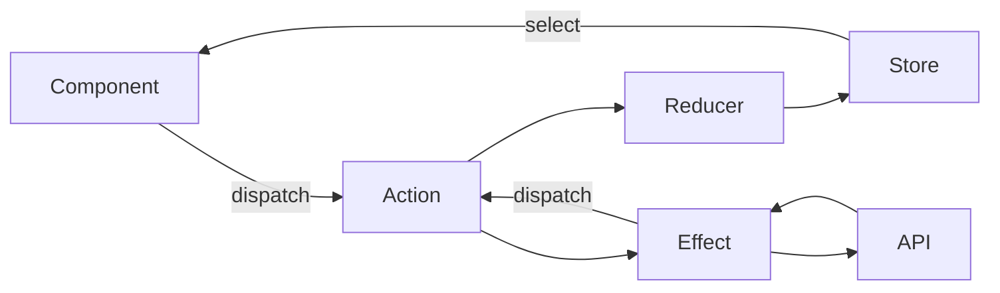

---

### Q39. How do you structure a large Angular application?
**Answer:** Domain-driven feature modules or standalone routes. Enforce boundaries with Nx or ESLint rules.

```
libs/
  feature-orders/      (UI components)
  data-access-orders/  (store, services)
  ui-shared/           (design system)
  util-auth/           (guards, interceptors)
apps/
  shop/
  admin/
```

---

### Q40. What is Angular Universal and when do you use it?
**Answer:** Angular Universal adds SSR to Angular. Use it for SEO, social previews, and faster first contentful paint. Pair with `TransferState` to avoid re-fetching data the server already loaded.

---

### Q41. What is the Angular CDK and when do you use it?
**Answer:** The Component Dev Kit provides unstyled, accessible UI primitives: drag-and-drop, virtual scrolling, overlay, focus management, and portal. Use it to build custom components without coupling to Angular Material's visual design.

---

### Q42. How does Angular's new application builder (esbuild) improve build performance?
**Answer:** The new builder uses esbuild (native Go binary) instead of Webpack. Typical results: 2–10× faster builds and near-instant HMR. Enabled by `@angular-devkit/build-angular:application` in `angular.json`.

---

# 3. Node.js

### Q43. What is the Node.js event loop and how does it work?
**Answer:** Node.js runs JavaScript on a single thread. I/O and timers are delegated to the OS or libuv thread pool. When they complete, callbacks queue in one of the event loop phases.

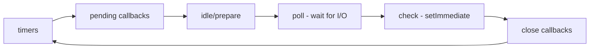

`process.nextTick` and Promise microtasks run between every phase transition.

---

### Q44. What is the difference between `process.nextTick`, `setImmediate`, and `setTimeout(0)`?
**Answer:**
- `nextTick`: runs before the next event loop phase (can starve I/O if abused).
- `setImmediate`: runs in the check phase after I/O.
- `setTimeout(fn, 0)`: runs in the timers phase, minimum 1ms actual delay.

```js
console.log('1');
setTimeout(() => console.log('2 timeout'), 0);
setImmediate(() => console.log('3 immediate'));
process.nextTick(() => console.log('4 nextTick'));
Promise.resolve().then(() => console.log('5 promise'));
// Output: 1, 4, 5, 2, 3
```

---

### Q45. What are Node.js streams and when do you use them?
**Answer:** Streams process data in chunks without loading everything into memory. Types: Readable, Writable, Duplex, Transform.

```js
import { createReadStream, createWriteStream } from 'fs';
import { pipeline } from 'stream/promises';
import { createGzip } from 'zlib';

await pipeline(
  createReadStream('big.csv'),
  createGzip(),
  createWriteStream('big.csv.gz')
);
```

**Real-world example:** Streaming a 2GB log file through gzip to S3 without exceeding 50MB of RAM.

---

### Q46. How do you build a REST API with Express and best practices?
**Answer:** Layer the app: router → controller → service → repository. Use middleware for validation, auth, and error handling. Never trust user input.

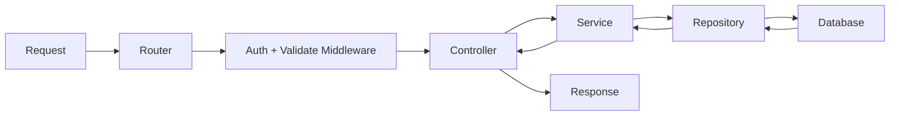

---

### Q47. How do you handle errors in an Express app?
**Answer:** Use an async wrapper or Express 5's native async support. Register a 4-argument error handler last.

```js
app.use((err, req, res, next) => {
  const status = err.statusCode ?? 500;
  res.status(status).json({ error: err.message });
});
```

---

### Q48. What is Fastify and when would you use it over Express?
**Answer:** Fastify is 2–3× faster than Express, has built-in schema validation and serialization (using JSON Schema + fast-json-stringify), TypeScript-first, and a plugin system. Use it for high-throughput microservices.

---

### Q49. How do you secure a Node.js API?
**Answer:**
- Helmet for HTTP headers
- Rate limiting (express-rate-limit)
- Input validation (Zod/Joi)
- Parameterised queries (never string-build SQL)
- Secrets in environment (never in code)
- Dependency auditing (`npm audit`, Snyk)

---

### Q50. What are Worker Threads in Node.js?
**Answer:** Worker threads run JavaScript in separate threads for CPU-intensive work (image processing, cryptography, ML inference) without blocking the event loop.

```js
import { Worker } from 'worker_threads';
const worker = new Worker('./heavy.js', { workerData: { data } });
worker.on('message', result => console.log(result));
```

---

### Q51. How do you manage database connections in Node.js?
**Answer:** Always use a connection pool. Set min/max pool size based on DB capacity. Close connections gracefully on `SIGTERM`. Use `pg` pool for PostgreSQL or the Prisma client which manages a pool internally.

---

### Q52. What is tRPC and when would you use it?
**Answer:** tRPC provides end-to-end type safety between a Node.js server and a TypeScript client without code generation or a schema file. The server defines procedures; the client calls them with full type inference.

---

### Q53. How do you deploy a Node.js service?
**Answer:** Containerise with Docker, run multiple instances behind a load balancer, use PM2 or Kubernetes for process management, enable structured logging (pino), expose `/health` and `/ready` endpoints, handle `SIGTERM` for graceful shutdown.

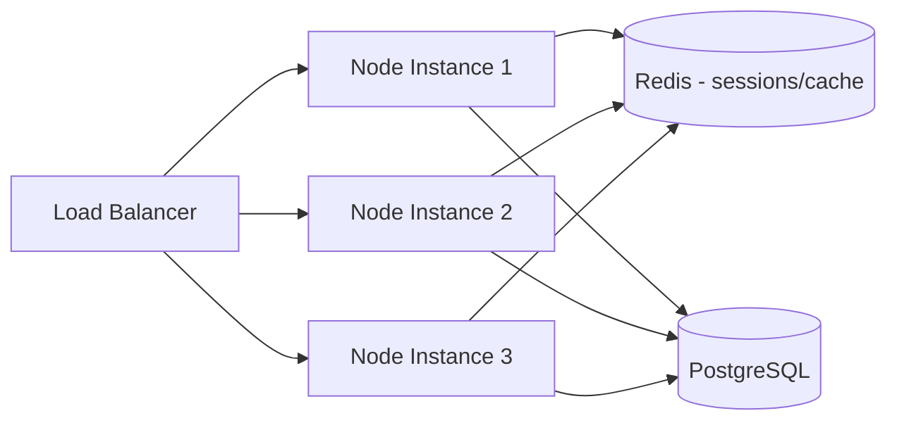

---

### Q54. How do you implement JWT authentication in Node.js?
**Answer:**

```js
// Issue token
const token = jwt.sign({ userId: user.id, role: user.role },
  process.env.JWT_SECRET, { expiresIn: '15m' });

// Verify middleware
export const auth = (req, res, next) => {
  const payload = jwt.verify(req.cookies.token, process.env.JWT_SECRET);
  req.user = payload;
  next();
};
```

Store access token in memory (or HTTP-only cookie) and refresh token in an HTTP-only cookie.

---

### Q55. What is GraphQL and how does it compare to REST?
**Answer:** GraphQL is a query language and runtime. The client specifies exactly what data it needs; the server returns only that. Avoids over-fetching and under-fetching. Best for complex, multi-entity data with varied client needs (mobile vs web).

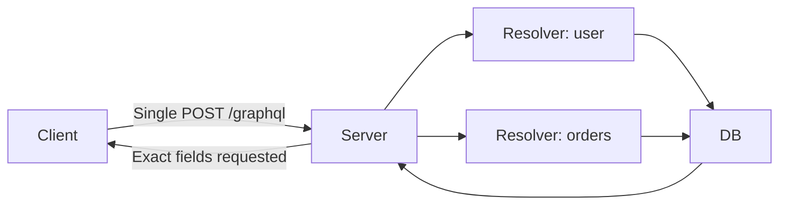

---

# 4. Python

### Q56. What makes Python suitable for backend APIs?
**Answer:** Python has mature frameworks (FastAPI, Django, Flask), excellent async support with asyncio, type hints for safety, and an enormous ecosystem. FastAPI is particularly notable for high-performance async APIs with automatic OpenAPI documentation.

---

### Q57. What is FastAPI and what makes it fast?
**Answer:** FastAPI is built on Starlette (ASGI) and Pydantic. It is fast because: (1) Starlette's async request handling, (2) Pydantic V2 compiled validators (Rust under the hood), (3) JSON serialization with orjson.

```python
from fastapi import FastAPI
from pydantic import BaseModel

app = FastAPI()

class Order(BaseModel):
    id: int
    total: float

@app.post("/orders", status_code=201)
async def create_order(order: Order) -> Order:
    return await db.save(order)
```

---

### Q58. How does Python's asyncio work?
**Answer:** asyncio runs an event loop on one thread. `async def` defines a coroutine. `await` suspends it, letting the loop run other coroutines. All awaitables must use async-compatible libraries (httpx, asyncpg, aiofiles — not requests, psycopg2).

```python
async def main():
    results = await asyncio.gather(
        fetch("https://api1.com"),
        fetch("https://api2.com"),
        fetch("https://api3.com"),
    )
```

---

### Q59. What is Pydantic and how does it help?
**Answer:** Pydantic validates and coerces data using Python type hints. At API boundaries it converts JSON to typed objects and raises descriptive errors on bad input. V2 is 5–50× faster than V1.

```python
class CreateUser(BaseModel):
    email: EmailStr
    age: int = Field(ge=18, le=120)
    role: Literal["admin", "user"] = "user"
```

---

### Q60. How do you structure a Python microservice?
**Answer:**

```
src/
  api/        (FastAPI routers)
  services/   (business logic)
  models/     (Pydantic schemas)
  db/         (SQLAlchemy models + repository)
  core/       (config, logging, auth)
tests/
Dockerfile
pyproject.toml
```

---

### Q61. What is SQLAlchemy and how do you use it?
**Answer:** SQLAlchemy is an ORM and SQL toolkit. Use the async engine with `AsyncSession` for FastAPI.

```python
async with AsyncSession(engine) as session:
    result = await session.execute(
        select(User).where(User.id == user_id)
    )
    user = result.scalar_one_or_none()
```

---

### Q62. How do you handle background tasks in Python?
**Answer:** Use **Celery** (Redis/RabbitMQ broker) for distributed tasks, or **FastAPI BackgroundTasks** for lightweight in-process tasks. For scheduled jobs, use Celery Beat or APScheduler.

```python
@app.post("/send-report")
async def send_report(background_tasks: BackgroundTasks, user_id: int):
    background_tasks.add_task(generate_and_email_report, user_id)
    return {"message": "Report queued"}
```

---

### Q63. How do you test a FastAPI app?
**Answer:** Use `httpx.AsyncClient` with `TestClient` or pytest-asyncio. Mock dependencies with FastAPI's `Depends` override system.

```python
app.dependency_overrides[get_db] = lambda: fake_db
response = client.post("/orders", json={"total": 100})
assert response.status_code == 201
```

---

### Q64. How do you implement caching in a Python API?
**Answer:** Use Redis with `redis-py` or `aiocache`. Cache at the function level with a decorator or at the response level.

```python
@cache(ttl=300, key="user:{user_id}")
async def get_user(user_id: int) -> User:
    return await db.fetch_user(user_id)
```

---

### Q65. What are common Python security concerns?
**Answer:**
- SQL injection → use ORM or parameterised queries
- Deserialization attacks → never unpickle untrusted data
- Secret management → use Vault or cloud secret manager, never hardcode
- Dependency vulnerabilities → `pip-audit`, Snyk
- SSRF → validate and allowlist outbound URLs

---

# 5. Spring Boot

### Q66. What is Spring Boot auto-configuration?
**Answer:** Spring Boot scans `spring.factories` / `AutoConfiguration.imports` for `@AutoConfiguration` classes. Each class has `@Conditional*` annotations — `@ConditionalOnClass`, `@ConditionalOnMissingBean`, `@ConditionalOnProperty`. It configures beans only when conditions are met and when you have not provided your own bean.

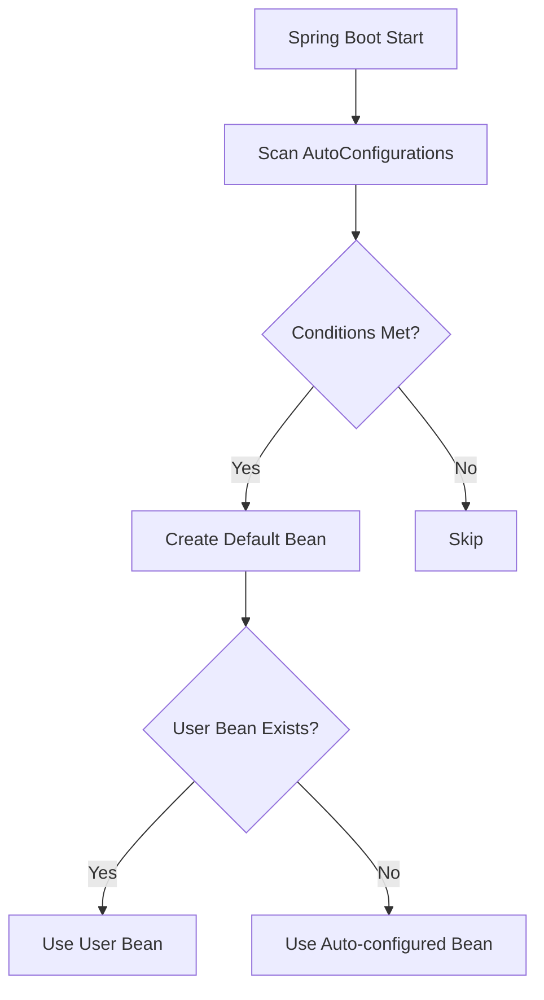

---

### Q67. What is the difference between `@Component`, `@Service`, `@Repository`, and `@Controller`?
**Answer:** All are specialisations of `@Component` and register beans. The semantic difference matters for tooling and AOP: `@Repository` enables Spring's exception translation (turning SQL exceptions into Spring's DataAccessException). `@Service` is the business layer marker. `@Controller` signals the web layer.

---

### Q68. How does Spring Security work?
**Answer:** Every request passes through a `SecurityFilterChain`. Filters extract credentials, authenticate against `UserDetailsService`, and store the result in `SecurityContextHolder`. Authorisation rules are checked before the controller runs.

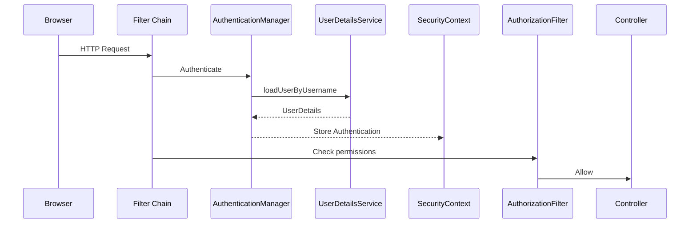

---

### Q69. What is Spring Data JPA and how do you avoid the N+1 problem?
**Answer:** Spring Data JPA generates repository implementations from interface method names or `@Query`. The N+1 problem: loading 100 orders and then lazily loading each order's customer fires 101 queries. Fix with `JOIN FETCH` or `@EntityGraph`.

```java
@Query("SELECT o FROM Order o JOIN FETCH o.customer")
List<Order> findAllWithCustomer();

// Or EntityGraph
@EntityGraph(attributePaths = {"customer", "items"})
List<Order> findByStatus(String status);
```

---

### Q70. What is Spring WebFlux?
**Answer:** WebFlux is Spring's reactive web framework built on Project Reactor. It uses a non-blocking, event-loop model (Netty) and returns `Mono<T>` / `Flux<T>` instead of plain objects. Best for high concurrency I/O-bound services.

```java
@GetMapping("/orders")
public Flux<Order> listOrders() {
    return orderRepository.findAll()
        .filter(o -> o.isActive())
        .limitRate(50);
}
```

---

### Q71. How do you implement resilience in Spring Boot (Circuit Breaker, Retry)?
**Answer:** Use **Resilience4j** with Spring Boot Starter.

```java
@CircuitBreaker(name = "payment", fallbackMethod = "payFallback")
@Retry(name = "payment", fallbackMethod = "payFallback")
@TimeLimiter(name = "payment")
public CompletableFuture<Receipt> processPayment(Order order) { ... }

public CompletableFuture<Receipt> payFallback(Order order, Throwable t) {
    return CompletableFuture.completedFuture(Receipt.pending());
}
```

---

### Q72. How do you manage transactions in Spring?
**Answer:** `@Transactional` creates a proxy. The proxy begins a transaction before the method and commits or rolls back after. Key pitfalls: (1) calling a `@Transactional` method from the same class bypasses the proxy; (2) checked exceptions don't trigger rollback by default.

```java
@Transactional(rollbackFor = Exception.class,
               isolation = Isolation.READ_COMMITTED,
               propagation = Propagation.REQUIRED)
public void transferFunds(Long from, Long to, BigDecimal amount) {
    debit(from, amount);
    credit(to, amount);  // if this throws, debit is rolled back
}
```

---

### Q73. What is Spring Cloud and what problems does it solve?
**Answer:** Spring Cloud provides patterns for distributed systems: service discovery (Eureka), API gateway (Gateway), config server, circuit breakers, distributed tracing (Sleuth/Zipkin), and load balancing. Many teams now use Kubernetes-native equivalents.

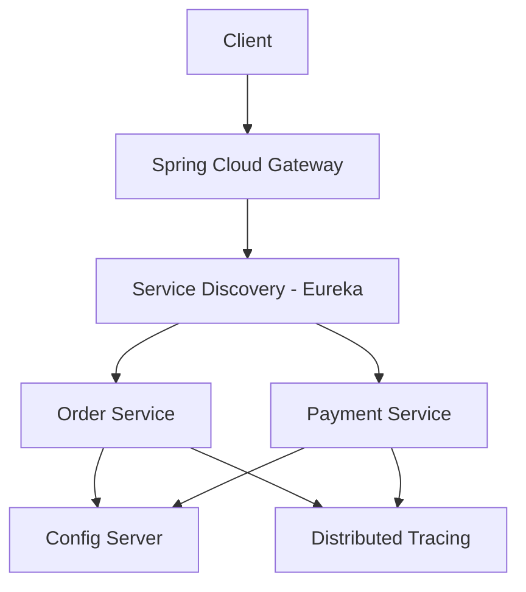

---

### Q74. How do you implement event-driven architecture with Spring Boot?
**Answer:** Use **Spring Events** for in-process events, or **Spring Kafka**/**Spring AMQP** for external message brokers. The **Outbox pattern** ensures events are published atomically with database changes.

```java
@TransactionalEventListener(phase = AFTER_COMMIT)
public void handleOrderCreated(OrderCreatedEvent event) {
    kafkaTemplate.send("orders", event.getOrderId(), event);
}
```

---

### Q75. How do you test a Spring Boot application?
**Answer:**

| Test Type | Annotation | What it tests |
|-----------|-----------|---------------|
| Unit | None (JUnit 5) | Service/util logic |
| Slice | `@WebMvcTest` | Controller + MVC |
| Slice | `@DataJpaTest` | Repository + DB |
| Integration | `@SpringBootTest` | Full app |
| Integration | Testcontainers | Real DB in Docker |

---

# 6. Camunda & BPM

### Q76. What is Camunda and what problem does it solve?
**Answer:** Camunda is a process automation platform that externalises business workflows from application code into BPMN diagrams. This makes long-running processes visible, auditable, and changeable without code changes.

**Real-world example:** A mortgage approval process with 15 steps, human reviewers, and 3-week SLAs — Camunda tracks every instance, shows where it is, and escalates overdue tasks.

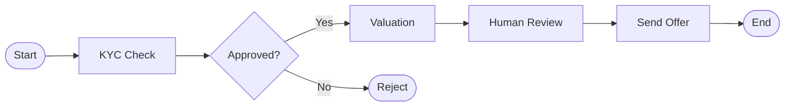

---

### Q77. What is the difference between Camunda 7 and Camunda 8?
**Answer:**

| Feature | Camunda 7 | Camunda 8 |
|---------|----------|----------|
| Engine | Embedded in Java app | Zeebe (separate cluster) |
| Communication | Direct Java API | gRPC + job workers |
| Storage | RDBMS | Partitioned log (Kafka-like) |
| Scale | Vertical | Horizontal (cloud-native) |
| Deployment | Spring Boot embedded | SaaS or self-hosted |

---

### Q78. What is a Zeebe job worker?
**Answer:** A job worker polls for jobs of a specific type, executes the task, and completes or fails the job. Workers are stateless and scalable independently.

```java
@JobWorker(type = "charge-payment")
public void chargePayment(final JobClient client, final ActivatedJob job) {
    var vars = job.getVariablesAsMap();
    var result = paymentService.charge(
        (String) vars.get("customerId"),
        (Double) vars.get("amount")
    );
    client.newCompleteCommand(job.getKey())
          .variable("receiptId", result.getId())
          .send();
}
```

---

### Q79. What is the Outbox pattern and how does it work with Camunda?
**Answer:** When a service task must publish an event reliably, write the event to an outbox table in the same DB transaction as the business data. A separate relay reads the outbox and sends to the broker. This avoids dual-write failure.

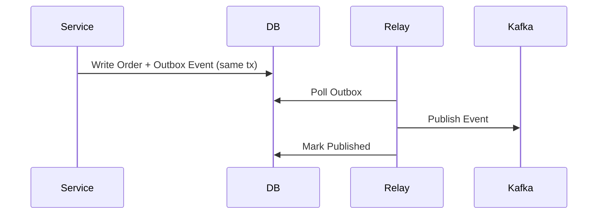

---

### Q80. What is a DMN decision table in Camunda?
**Answer:** Decision Model and Notation tables express business rules as rows of conditions and outputs. The BPMN business rule task calls the DMN engine and injects the result into process variables.

| Credit Score | Income | Decision |
|-------------|--------|---------|
| > 700 | > 50000 | Approve |
| 500-700 | > 80000 | Manual |
| < 500 | ANY | Reject |

---

### Q81. How do you handle process versioning in Camunda?
**Answer:** Every deployed BPMN creates a new version. Running instances use the version they started with. Use `migrationPlan` to move running instances to a new version deliberately.

---

### Q82. What is BPMN message correlation?
**Answer:** Message events pause a process until a matching message arrives. Correlation uses process variables to find the right instance.

```java
zeebeClient.newPublishMessageCommand()
  .messageName("payment-received")
  .correlationKey(orderId)
  .variable("paymentRef", ref)
  .send();
```

---

# 7. System Design & Architecture Patterns

### Q83. What is the difference between monolith, SOA, and microservices?
**Answer:**

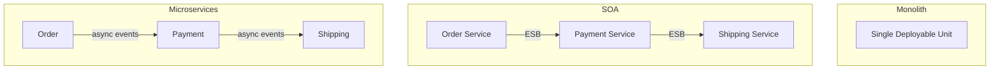

---

### Q84. What is CQRS?
**Answer:** Command Query Responsibility Segregation separates the write model (commands) from the read model (queries). Writes update the domain model; reads use a denormalised projection optimised for queries. Enables independent scaling.

```mermaid
flowchart LR
    UI --> Cmd[Command Handler]
    Cmd --> Domain[Domain Model]
    Domain --> Event[Event Store]
    Event --> Projection[Read Projection]
    UI --> Query[Query Handler]
    Query --> Projection
```

---

### Q85. What is Event Sourcing?
**Answer:** Instead of storing current state, store every event that caused a state change. The current state is rebuilt by replaying events. Provides full audit trail, temporal queries, and event replay for new projections.

---

### Q86. What is the Saga pattern?
**Answer:** A saga manages a distributed business transaction across multiple services without a two-phase commit. Each step has a compensating action that undoes it if a later step fails.

```mermaid
sequenceDiagram
    Orchestrator->>OrderService: Create Order
    Orchestrator->>InventoryService: Reserve Stock
    Orchestrator->>PaymentService: Charge Card
    PaymentService-->>Orchestrator: FAIL
    Orchestrator->>InventoryService: Release Stock (compensate)
    Orchestrator->>OrderService: Cancel Order (compensate)
```

---

### Q87. What is the Strangler Fig pattern?
**Answer:** Gradually replace a legacy system by routing new traffic to new services while the legacy system handles the rest. The new system "strangles" the old one over time without a big-bang rewrite.

---

### Q88. What is Domain-Driven Design (DDD)?
**Answer:** DDD aligns software structure with business domains. Key concepts: **Bounded Context** (clear boundary of a domain), **Aggregate** (consistency boundary), **Entity** (has identity), **Value Object** (defined by value, not identity), **Domain Event**, **Repository**, **Anti-Corruption Layer**.

```mermaid
flowchart TD
    subgraph Order Bounded Context
        OA[Order Aggregate]
        OI[OrderItem VO]
        OE[OrderPlaced Event]
    end
    subgraph Inventory Bounded Context
        IA[Product Aggregate]
    end
    OE -->|ACL| IA
```

---

### Q89. What is the difference between REST, GraphQL, gRPC, and WebSockets?
**Answer:**

| Protocol | Best for |
|----------|---------|
| REST | Standard CRUD APIs, public APIs |
| GraphQL | Flexible data queries, BFF layer |
| gRPC | Internal service-to-service, streaming |
| WebSockets | Real-time bidirectional (chat, live feeds) |

---

### Q90. What is hexagonal architecture (Ports and Adapters)?
**Answer:** The domain core is in the centre. Ports are interfaces the domain exposes or requires. Adapters implement ports — a REST adapter, a Kafka adapter, a JPA adapter. The domain has zero framework dependencies.

```mermaid
flowchart LR
    REST[REST Adapter] -->|Driving| Port1[Input Port]
    Port1 --> Domain[Domain Core]
    Domain --> Port2[Output Port]
    Port2 -->|Driven| DB[JPA Adapter]
    Port2 --> MQ[Kafka Adapter]
```

---

### Q91. How do you design for high availability?
**Answer:** Eliminate single points of failure. Use redundant instances, health checks, auto-restart, database replicas, multi-AZ deployment, circuit breakers, and chaos engineering to validate assumptions.

---

### Q92. What is eventual consistency and when is it acceptable?
**Answer:** In a distributed system, replicas may be temporarily out of sync but converge to the same state. Acceptable for: social feeds, analytics, recommendations. Not acceptable for: payments, inventory reservation, banking.

---

### Q93. What is the CAP theorem?
**Answer:** A distributed system can guarantee only two of three: Consistency (all nodes see the same data), Availability (every request gets a response), Partition Tolerance (system works despite network splits). Since partitions always happen, you choose CA or CP under a partition.

---

### Q94. How do you design an API rate limiter?
**Answer:** Common algorithms: **Token Bucket** (smooth burst), **Fixed Window** (simple, boundary burst), **Sliding Window** (precise). Store counters in Redis with TTL.

```mermaid
flowchart LR
    Request --> RateLimiter
    RateLimiter --> Redis[(Redis Counters)]
    Redis --> Check{Limit OK?}
    Check -->|Yes| Proceed[Forward to Service]
    Check -->|No| Reject[429 Too Many Requests]
```

---

### Q95. How do you design a URL shortener?
**Answer:** Generate a 6–8 character base62 key. Store `{key → long_url}` in a database with a cache (Redis). Use a distributed ID generator (Snowflake) for key generation. CDN for read scaling. Provide analytics with async click events to Kafka.

---

### Q96. How do you design a notification system?
**Answer:**

```mermaid
flowchart LR
    Service -->|Publish| Kafka[Kafka]
    Kafka --> Worker[Notification Worker]
    Worker --> Pref[User Preferences DB]
    Worker --> Email[Email Provider]
    Worker --> Push[Push Notification]
    Worker --> SMS[SMS Gateway]
```

---

# 8. Microservices & Cloud

### Q97. What are the key principles of microservices architecture?
**Answer:** Single responsibility, independent deployment, decentralised data (each service owns its DB), failure isolation, design for failure, communication via APIs or events, and automation.

---

### Q98. How do services discover each other?
**Answer:** Options: (1) **Client-side discovery** — service queries registry (Eureka), loads balance itself. (2) **Server-side discovery** — load balancer queries registry (AWS ALB + ECS). (3) **Kubernetes DNS** — services resolve via DNS names, kube-proxy handles routing.

---

### Q99. What is an API Gateway and what does it do?
**Answer:** A single entry point for all client traffic. Responsibilities: routing, auth, rate limiting, SSL termination, request/response transformation, caching, circuit breaking.

```mermaid
flowchart LR
    Mobile & Web & External --> GW[API Gateway]
    GW --> Auth[Auth Service]
    GW --> Orders[Order Service]
    GW --> Products[Product Service]
    GW --> Users[User Service]
```

---

### Q100. What is the sidecar pattern?
**Answer:** Deploy a helper container alongside the main container. The sidecar handles cross-cutting concerns: logging, metrics, service mesh (Envoy), config reload. The main app stays simple.

---

### Q101. What is a service mesh?
**Answer:** A service mesh (Istio, Linkerd) adds an infrastructure layer of sidecar proxies. Provides: mTLS between services, traffic management, circuit breaking, observability — without changing application code.

---

### Q102. What is Kubernetes and what problems does it solve?
**Answer:** Kubernetes orchestrates containers: scheduling, scaling, self-healing, service discovery, rolling updates, config management, and resource limits.

```mermaid
flowchart TD
    subgraph Kubernetes Cluster
        A[Ingress] --> S1[Service]
        S1 --> P1[Pod 1]
        S1 --> P2[Pod 2]
        S1 --> P3[Pod 3]
        P1 & P2 & P3 --> CM[ConfigMap]
        P1 & P2 & P3 --> SEC[Secret]
    end
```

---

### Q103. What is the difference between a Deployment, StatefulSet, and DaemonSet in Kubernetes?
**Answer:**
- **Deployment:** Stateless pods, rolling updates, horizontal scaling.
- **StatefulSet:** Ordered, stable pod names and persistent volumes (databases, Kafka).
- **DaemonSet:** One pod per node (log agents, monitoring).

---

### Q104. What is Helm and why use it?
**Answer:** Helm is a package manager for Kubernetes. Charts template YAML manifests with values files. Manage installs, upgrades, rollbacks, and environments from one chart.

---

### Q105. How do you handle secrets in Kubernetes?
**Answer:** Kubernetes Secrets (base64 — not encrypted at rest by default). Better: encrypt etcd, use Sealed Secrets (Bitnami), or pull from Vault/AWS Secrets Manager via a sidecar or CSI driver.

---

### Q106. What is an Event-Driven Architecture?
**Answer:** Services communicate via events on a message broker (Kafka, RabbitMQ, SQS). Publishers don't know about subscribers. Enables loose coupling, replay, and scalable processing.

```mermaid
flowchart LR
    OrderSvc -->|OrderPlaced| Kafka
    Kafka --> InventorySvc
    Kafka --> NotificationSvc
    Kafka --> AnalyticsSvc
```

---

### Q107. What is Kafka and when would you choose it over RabbitMQ?
**Answer:** Kafka is a distributed log — messages are retained and replayable. Best for event sourcing, audit logs, high-throughput streams, and multiple independent consumers. RabbitMQ is a message broker — messages are consumed and deleted. Best for task queues and RPC patterns.

---

### Q108. What is the BFF (Backend for Frontend) pattern?
**Answer:** Instead of one API for all clients, each client type (mobile, web, third-party) has its own backend that aggregates and shapes data. Avoids over-fetching and under-fetching per client type.

---

# 9. DevOps, CI/CD & Testing

### Q109. What is a CI/CD pipeline?
**Answer:** Continuous Integration: every push triggers build + test. Continuous Delivery: builds are always deployable. Continuous Deployment: every passing build deploys to production automatically.

```mermaid
flowchart LR
    Push --> Build
    Build --> UnitTest[Unit Tests]
    UnitTest --> IntTest[Integration Tests]
    IntTest --> SAST[Security Scan]
    SAST --> Publish[Publish Image]
    Publish --> StageDeploy[Deploy to Staging]
    StageDeploy --> E2E[E2E Tests]
    E2E --> ProdDeploy[Deploy to Production]
```

---

### Q110. What is blue-green deployment?
**Answer:** Two identical production environments (blue = live, green = new version). Switch the load balancer to green after testing. Blue stays running for instant rollback.

---

### Q111. What is a canary deployment?
**Answer:** Route a small percentage (1–5%) of traffic to the new version. Monitor error rates and latency. Gradually increase to 100% or roll back.

---

### Q112. What is Infrastructure as Code (IaC)?
**Answer:** Define infrastructure in version-controlled code (Terraform, Pulumi, CloudFormation). Enables repeatable, reviewable, and auditable infrastructure changes.

---

### Q113. What is the testing pyramid?
**Answer:**

```mermaid
%%{init: {"theme": "default"}}%%
flowchart TD
    E2E["E2E Tests (few, slow, expensive)"]
    INT["Integration Tests (some)"]
    UNIT["Unit Tests (many, fast, cheap)"]
    UNIT --> INT --> E2E
```

Write many fast unit tests, some integration tests that verify component interaction, and few end-to-end tests for critical flows.

---

### Q114. What is contract testing?
**Answer:** Consumers define the contract (expected API shape) and publish it. Providers verify they satisfy the contract in CI. Tool: **Pact**. Avoids integration environments for catching API breaking changes.

---

### Q115. What is observability and what are the three pillars?
**Answer:**
- **Logs:** Discrete events (structured JSON, correlation IDs)
- **Metrics:** Aggregated numbers over time (latency p99, error rate, throughput)
- **Traces:** End-to-end request flow across services (Jaeger, Zipkin, OpenTelemetry)

---

# 10. Databases & API Design

### Q116. How do you choose between SQL and NoSQL?
**Answer:**

| Criteria | SQL | NoSQL |
|----------|-----|-------|
| Data relationships | Strong | Flexible |
| Schema | Fixed | Dynamic |
| Transactions | ACID | Eventual (varies) |
| Scale | Vertical + sharding | Horizontal |
| Best for | Financials, ERP | Catalogs, sessions, IoT |

---

### Q117. What is database sharding?
**Answer:** Splitting data across multiple database instances (shards) based on a shard key. Enables horizontal scaling. Challenges: cross-shard queries, rebalancing, hotspots if shard key is poorly chosen.

---

### Q118. What is the difference between optimistic and pessimistic locking?
**Answer:**
- **Pessimistic:** Lock the row (`SELECT FOR UPDATE`) before reading. Safe but reduces throughput.
- **Optimistic:** Read with a version number. Update only if version matches. Retry on conflict. Better throughput, requires retry logic.

---

### Q119. What is database indexing strategy?
**Answer:** Index columns used in `WHERE`, `JOIN`, `ORDER BY`. Composite index order matters (most selective first). Covering indexes include all columns a query needs. Too many indexes slow writes.

---

### Q120. What is REST API versioning?
**Answer:**
| Strategy | Example | Notes |
|---------|---------|-------|
| URI | `/api/v1/orders` | Most common, easy to route |
| Header | `Accept: application/vnd.api.v1+json` | Clean URLs |
| Query | `/api/orders?version=1` | Easy to test |
| Subdomain | `v1.api.example.com` | Separate routing |

---

# 11. Security

### Q121. What is OWASP Top 10 and which are most common in full-stack apps?
**Answer:** Top issues: (1) Broken Access Control, (2) Cryptographic Failures, (3) Injection (SQL, XSS), (4) Insecure Design, (5) Security Misconfiguration. In full-stack: injection and broken access control are most common.

---

### Q122. What is CSRF and how do you prevent it?
**Answer:** Cross-Site Request Forgery tricks a browser into making authenticated requests to another site. Prevention: same-site cookies (`Lax` or `Strict`), CSRF tokens (synchroniser pattern), and checking `Origin`/`Referer` headers.

---

### Q123. What is XSS and how do you prevent it?
**Answer:** Cross-Site Scripting injects malicious scripts into pages. Prevention: escape output (React does this automatically in JSX), use Content Security Policy headers, avoid `dangerouslySetInnerHTML`/`v-html` with untrusted content.

---

### Q124. What is OAuth2 and OpenID Connect?
**Answer:** OAuth2 is an authorisation framework — a resource owner grants a client limited access to their resources via an access token. OIDC extends OAuth2 with an identity layer — the ID token (JWT) contains claims about who the user is.

```mermaid
sequenceDiagram
    User->>App: Login
    App->>AuthServer: Redirect with client_id + scope
    AuthServer->>User: Login + Consent
    User->>AuthServer: Approve
    AuthServer->>App: Code
    App->>AuthServer: Code + secret → Token
    AuthServer-->>App: access_token + id_token
    App->>API: access_token
```

---

### Q125. How do you implement role-based access control (RBAC)?
**Answer:** Assign roles to users (admin, editor, viewer). Attach permissions to roles. Check permissions in middleware or service layer — never only in the UI.

```java
@PreAuthorize("hasRole('ADMIN') or @security.isOwner(#id)")
public Order getOrder(Long id) { ... }
```


---

### Q126. How do you secure inter-service communication in microservices?
**Answer:** Use mTLS (mutual TLS) so each service verifies the other's certificate. A service mesh (Istio) handles this transparently. Add service-to-service JWTs for authorisation at the application layer.

```mermaid
sequenceDiagram
    ServiceA->>ServiceB: Request + mTLS + JWT
    ServiceB->>ServiceB: Verify TLS cert + JWT signature
    ServiceB-->>ServiceA: Response
```

---

### Q127. What is secret management and how do you implement it?
**Answer:** Never hardcode secrets. Use a secret manager: **HashiCorp Vault**, **AWS Secrets Manager**, or **Azure Key Vault**. Inject secrets at runtime via environment variables or a sidecar. Rotate secrets automatically and audit access.

---

### Q128. What is a JWT and what are its security risks?
**Answer:** A JWT is a signed (and optionally encrypted) token with header, payload, and signature. Risks: (1) using `alg: none`, (2) weak signing secret, (3) not validating `aud`/`iss`/`exp`, (4) storing in localStorage (XSS risk). Always use `RS256` for public APIs and short expiry.

---

### Q129. What is SSRF and how do you prevent it?
**Answer:** Server-Side Request Forgery tricks the server into making requests to internal services. Prevent by: allowlisting outbound URLs, blocking metadata endpoints (169.254.169.254), using a dedicated egress proxy, and validating user-supplied URLs.

---

### Q130. How do you perform a threat model for a full-stack application?
**Answer:** Use **STRIDE**: Spoofing (identity), Tampering (data), Repudiation (audit), Information Disclosure, Denial of Service, Elevation of Privilege. Draw a data-flow diagram, mark trust boundaries, and mitigate each threat.

```mermaid
flowchart LR
    User -->|HTTPS| LB[Load Balancer]
    LB -->|TLS| API[API Layer]
    API -->|VPC only| DB[(Database)]
    API -->|VPC only| Cache[(Redis)]
    API -->|IAM role| S3[(Object Store)]
```

---

# Advanced Architecture Deep-Dives

### Q131. How do you design a distributed caching strategy?
**Answer:** Use **Redis** as the shared cache. Strategies:
- **Cache-aside (Lazy):** App checks cache; on miss, reads DB and populates cache.
- **Write-through:** Write to cache and DB together.
- **Write-behind:** Write to cache; async flush to DB.
- **Read-through:** Cache itself fetches from DB on miss.

Set appropriate TTLs, handle cache stampede with locking or probabilistic early expiry.

```mermaid
flowchart LR
    App -->|GET| Redis
    Redis -->|Cache Hit| App
    Redis -->|Cache Miss| DB[(Database)]
    DB -->|Data| Redis
    Redis -->|Data| App
```

---

### Q132. How do you design for zero-downtime database migrations?
**Answer:** Use the **expand-contract pattern**:
1. **Expand:** Add new column/table (backward compatible).
2. **Migrate:** Backfill old data, deploy code that writes both old and new.
3. **Contract:** Remove old column after all instances use new column.

Tools: Flyway, Liquibase with repeatable scripts. Never drop columns in the same deploy that removes the code using them.

---

### Q133. What is the difference between eventual consistency and strong consistency?
**Answer:** Strong consistency: every read sees the latest write. Eventual consistency: reads may see stale data but will converge. Use strong for payments, inventory deductions. Use eventual for user feeds, recommendations, analytics.

```mermaid
flowchart LR
    Write -->|Sync| Primary
    Primary -->|Async replication| Replica1
    Primary -->|Async replication| Replica2
    Read -->|May get stale data| Replica1
```

---

### Q134. How do you implement idempotency in APIs?
**Answer:** Accept an `Idempotency-Key` header. Store the key with the response in Redis (TTL 24h). On duplicate request with same key, return stored response without re-processing.

```js
app.post('/payments', async (req, res) => {
  const key = req.headers['idempotency-key'];
  const cached = await redis.get(`idem:${key}`);
  if (cached) return res.json(JSON.parse(cached));

  const result = await processPayment(req.body);
  await redis.setex(`idem:${key}`, 86400, JSON.stringify(result));
  res.json(result);
});
```

---

### Q135. How do you design a search system?
**Answer:** Use **Elasticsearch** or **OpenSearch** for full-text search. Index data asynchronously via events (Kafka). Design mappings carefully — wrong mapping types cause poor relevance. Use BM25 scoring, filters, aggregations, and autocomplete with edge n-grams.

```mermaid
flowchart LR
    DB[(Database)] -->|Change Events| Kafka
    Kafka --> Indexer[Search Indexer]
    Indexer --> ES[(Elasticsearch)]
    UI -->|Search Query| SearchAPI
    SearchAPI --> ES
    ES --> SearchAPI
    SearchAPI --> UI
```

---

### Q136. What is a data pipeline and how do you design one?
**Answer:** A data pipeline moves, transforms, and loads data from sources to destinations.

```mermaid
flowchart LR
    Sources["Sources\n(APIs, DBs, Events)"] --> Ingestion["Ingestion\n(Kafka, Firehose)"]
    Ingestion --> Transform["Transform\n(Spark, Flink, dbt)"]
    Transform --> Storage["Storage\n(S3, Data Warehouse)"]
    Storage --> Serve["Serve\n(BI, APIs, ML Models)"]
```

---

### Q137. What are the SOLID principles and give a code example for each?
**Answer:**
- **S — Single Responsibility:** `OrderService` only handles order logic, not email sending.
- **O — Open/Closed:** Add new payment methods by implementing `PaymentGateway` interface, not modifying existing code.
- **L — Liskov Substitution:** Any `Notifier` subtype can replace the base without breaking the program.
- **I — Interface Segregation:** Split `IWorker` into `IWorker` + `IEatable` so robots don't implement `eat()`.
- **D — Dependency Inversion:** `OrderService` depends on `IEmailService` interface, not `SmtpEmailService`.

---

### Q138. What is the difference between synchronous and asynchronous communication in microservices?
**Answer:**

| Aspect | Synchronous (REST/gRPC) | Asynchronous (Kafka/RabbitMQ) |
|--------|------------------------|-------------------------------|
| Coupling | Temporal coupling | Decoupled |
| Latency | Immediate response | Near-real-time |
| Failure handling | Caller must retry | Broker retries |
| Use case | Query data, real-time UX | Events, workflows |
| Complexity | Lower | Higher (idempotency, ordering) |

---

### Q139. How do you approach capacity planning?
**Answer:** Identify key metrics (RPS, concurrent users, data volume). Load test at 2–3× expected peak. Set resource limits and auto-scaling policies. Plan for 10× growth with sharding/partitioning strategy. Monitor trends and trigger planning at 70% utilisation.

---

### Q140. What is a bulkhead pattern?
**Answer:** Isolate resources (thread pools, connections) per downstream service. If Service B becomes slow, it only exhausts its dedicated pool, not the shared pool, preventing cascade failures.

```mermaid
flowchart LR
    App --> Pool_A[Pool: Service A\n10 threads]
    App --> Pool_B[Pool: Service B\n10 threads]
    App --> Pool_C[Pool: Service C\n10 threads]
    Pool_B -->|B is slow| Isolate[Degraded - isolated]
    Pool_A & Pool_C -->|Still healthy| Services
```

---

# React Advanced

### Q141. How do you implement optimistic updates in React?
**Answer:** Immediately update the UI assuming success, then sync with the server. On failure, roll back. TanStack Query handles this with `onMutate`, `onError`, and `onSettled`.

```js
useMutation({
  mutationFn: updateTodo,
  onMutate: async (newTodo) => {
    await queryClient.cancelQueries({ queryKey: ['todos'] });
    const previous = queryClient.getQueryData(['todos']);
    queryClient.setQueryData(['todos'], (old) =>
      old.map(t => t.id === newTodo.id ? newTodo : t));
    return { previous };
  },
  onError: (err, _, context) => {
    queryClient.setQueryData(['todos'], context.previous);
  },
});
```

---

### Q142. What is React's concurrent mode and how does it affect rendering?
**Answer:** Concurrent mode allows React to pause, discard, and restart renders. It enables `useTransition` for non-urgent updates, `useDeferredValue` for deferred values, automatic batching, and Suspense with streaming SSR.

---

### Q143. How do you implement real-time features in a React app?
**Answer:** Options: (1) **WebSockets** for bidirectional (chat, collaborative editing), (2) **Server-Sent Events** for server-to-client streams (live dashboards), (3) **long-polling** as fallback.

```js
useEffect(() => {
  const ws = new WebSocket('wss://api.example.com/ws');
  ws.onmessage = (e) => setMessages(prev => [...prev, JSON.parse(e.data)]);
  return () => ws.close();
}, []);
```

---

### Q144. How do you implement a component library?
**Answer:** Build on accessible primitives (Radix UI, Headless UI). Design tokens for consistent theme. Publish as npm package with TypeScript types and Storybook docs. Use changesets for versioning.

---

### Q145. What is Storybook and how do you use it?
**Answer:** Storybook is a development environment for UI components in isolation. Write stories for each state, use for visual regression testing (Chromatic), and as living documentation for designers and developers.

---

# Angular Advanced

### Q146. How do you implement server-side rendering with Angular Universal?
**Answer:** `ng add @angular/ssr` adds server rendering. Use `isPlatformBrowser` and `isPlatformServer` to guard browser-only code. Use `TransferState` to pass server-fetched data to the client, avoiding double fetching.

---

### Q147. What is Angular's zone.js and what are zone-less applications?
**Answer:** Zone.js monkey-patches async APIs to trigger change detection. Zone-less apps (`bootstrapApplication` with `provideExperimentalZonelessChangeDetection`) rely entirely on signals and manual `markForCheck` calls, reducing overhead and improving predictability.

---

### Q148. How do you implement custom Angular form controls?
**Answer:** Implement `ControlValueAccessor` to integrate custom inputs with reactive forms.

```ts
@Component({ ... })
export class PhoneInputComponent implements ControlValueAccessor {
  onChange = (_: any) => {};
  writeValue(val: string) { this.phone = val; }
  registerOnChange(fn: any) { this.onChange = fn; }
  registerOnTouched(fn: any) {}
}
```

---

### Q149. What is Angular Ivy and how did it improve the framework?
**Answer:** Ivy is Angular's compilation and rendering engine (default since v9). Benefits: smaller bundles (tree-shakeable), faster compilation, better debugging with component tags, support for higher-order components and lazy-loaded providers.

---

### Q150. How does Angular handle accessibility?
**Answer:** Angular CDK provides `A11yModule` with focus management, live announcer, and ARIA utilities. Use semantic HTML, `tabindex`, `aria-*` attributes, and test with `axe-core` integration.

---

# Node.js Advanced

### Q151. How do you implement a job queue in Node.js?
**Answer:** Use **BullMQ** (Redis-backed) for distributed job queues with priorities, retries, delays, and concurrency control.

```js
const queue = new Queue('emails', { connection: redis });
const worker = new Worker('emails', async (job) => {
  await sendEmail(job.data);
}, { connection: redis, concurrency: 10 });

await queue.add('welcome', { to: 'user@example.com' }, {
  attempts: 3, backoff: { type: 'exponential', delay: 1000 }
});
```

---

### Q152. How do you implement database migrations in Node.js?
**Answer:** Use **Prisma Migrate**, **Knex migrations**, or **db-migrate**. Never auto-migrate in production — run migrations as part of CI/CD before deploying new code. Use transactions for multi-step migrations.

---

### Q153. What is OpenTelemetry and how do you add it to Node.js?
**Answer:** OpenTelemetry provides vendor-neutral instrumentation for traces, metrics, and logs.

```js
import { NodeSDK } from '@opentelemetry/sdk-node';
import { OTLPTraceExporter } from '@opentelemetry/exporter-trace-otlp-http';

const sdk = new NodeSDK({
  traceExporter: new OTLPTraceExporter({ url: process.env.OTEL_ENDPOINT }),
});
sdk.start();
```

---

### Q154. How do you implement graceful shutdown in Node.js?
**Answer:**

```js
process.on('SIGTERM', async () => {
  console.log('Received SIGTERM, shutting down...');
  server.close(async () => {
    await db.end();
    await redis.quit();
    process.exit(0);
  });
  setTimeout(() => process.exit(1), 30_000);
});
```

---

### Q155. How do you debug memory leaks in Node.js?
**Answer:** Use `--inspect` flag + Chrome DevTools heap snapshot. `clinic.js heap` for profiling. Common causes: global caches without limits, forgotten event listeners, circular references in closures.

---

# Spring Boot Advanced

### Q156. What is Spring Boot Actuator and what endpoints does it provide?
**Answer:** Actuator exposes production-ready endpoints: `/actuator/health`, `/actuator/metrics`, `/actuator/info`, `/actuator/env`, `/actuator/prometheus`. Secure them — never expose `/actuator/env` or `/actuator/heapdump` publicly.

---

### Q157. How do you implement distributed tracing in Spring Boot?
**Answer:** Add Micrometer Tracing with OpenTelemetry exporter. Every request gets a `traceId` propagated through HTTP headers and log MDC.

```yaml
management.tracing.sampling.probability: 1.0
spring.application.name: order-service
```

---

### Q158. How do you implement event-driven messaging with Spring Kafka?
**Answer:**

```java
@KafkaListener(topics = "orders", groupId = "inventory")
public void handleOrder(OrderEvent event) {
    inventoryService.reserve(event.getProductId(), event.getQty());
}

@Service
public class OrderService {
  @Autowired KafkaTemplate<String, OrderEvent> kafka;

  public void createOrder(Order order) {
    orderRepo.save(order);
    kafka.send("orders", order.getId().toString(), new OrderEvent(order));
  }
}
```

---

### Q159. What is Spring Batch and when do you use it?
**Answer:** Spring Batch processes large volumes of records in chunks. Use for: nightly reports, data migrations, invoice generation. Provides restart/retry, skip logic, partitioning for parallel processing.

---

### Q160. How do you implement caching in Spring Boot?
**Answer:** Use `@EnableCaching` with `@Cacheable`, `@CachePut`, `@CacheEvict`. Back with Redis for distributed caching.

```java
@Cacheable(value = "products", key = "#id", unless = "#result == null")
public Product getProduct(Long id) { return repo.findById(id).orElse(null); }

@CacheEvict(value = "products", key = "#product.id")
public Product updateProduct(Product product) { return repo.save(product); }
```

---

# Camunda Advanced

### Q161. How do you implement the Saga pattern with Camunda?
**Answer:** Model the saga as a BPMN process. Each step is a service task. Compensation steps are attached as boundary compensation events. If a step fails, the compensation flows trigger in reverse order.

```mermaid
flowchart LR
    Start --> Reserve[Reserve Inventory]
    Reserve --> Charge[Charge Payment]
    Charge --> Ship[Create Shipment]
    Ship --> End

    Reserve -.-|compensate| CancelReserve[Release Inventory]
    Charge -.-|compensate| Refund[Refund Payment]
```

---

### Q162. How do you monitor Camunda processes?
**Answer:** Use Camunda Operate (Camunda 8) to view running and completed instances. Set up alerts for SLA breaches using timer boundary events. Export metrics via Prometheus exporter and visualise in Grafana.

---

### Q163. How do you handle SLA escalation in Camunda?
**Answer:** Attach a timer boundary event (non-interrupting) to a user task. When the timer fires, trigger an escalation sub-process (notify manager, reassign task) while the original task continues.

```mermaid
flowchart LR
    Task[Review Application] -->|Completed| Next[Next Step]
    Task -.->|24h Timer| Escalate[Escalate to Manager]
    Escalate -->|Notify + Reassign| Task
```

---

### Q164. What is a Camunda Connector?
**Answer:** Connectors (Camunda 8) are pre-built integrations: REST, Kafka, AWS SNS/SQS, Slack, SendGrid. They are configured in the BPMN modeler without custom code, reducing boilerplate.

---

### Q165. How do you unit test Camunda process definitions?
**Answer:** Use `camunda-process-test` (Camunda 8) or `camunda-bpm-assert` (Camunda 7). Verify that the process reaches expected states, variables are set correctly, and gateways route correctly.

---

# Full-Stack Architecture Scenarios

### Q166. Design an e-commerce checkout flow as a Camunda process.
**Answer:**

```mermaid
flowchart LR
    Start([Cart Checkout]) --> Val[Validate Cart]
    Val --> Reserve[Reserve Inventory]
    Reserve --> Pay[Process Payment]
    Pay --> Dec{Payment OK?}
    Dec -->|Yes| Ship[Create Shipment]
    Dec -->|No| RefundInv[Release Inventory]
    Ship --> Email[Send Confirmation]
    Email --> End([Done])
    RefundInv --> Fail([Failed])
```

Each step is a Zeebe job worker. The process is durable — if the payment worker crashes, Zeebe retries automatically.

---

### Q167. How do you architect a multi-tenant SaaS application?
**Answer:** Three models:
- **Silo:** Separate DB per tenant. Best isolation, highest cost.
- **Pool:** Shared DB, `tenant_id` column in every table. Cheapest, risk of data leakage on bad query.
- **Bridge:** Shared app, separate schema per tenant. Balance of isolation and cost.

Add tenant context middleware that injects `tenant_id` into every query automatically.

---

### Q168. How do you handle feature flags across a full-stack app?
**Answer:** Use a feature flag service (LaunchDarkly, Unleash, GrowthBook). Flags evaluated on the backend control both API behaviour and what the frontend renders. Never deploy flags only in the frontend — the backend must enforce them too.

---

### Q169. How do you implement audit logging?
**Answer:** Intercept at service layer, record `{who, what, when, before, after}` to an append-only audit table or Kafka topic. Never allow audit records to be deleted or modified.

```java
@Around("@annotation(Auditable)")
public Object audit(ProceedingJoinPoint pjp) throws Throwable {
  var before = captureState();
  var result = pjp.proceed();
  auditRepo.save(new AuditLog(currentUser(), pjp.getSignature(), before, result));
  return result;
}
```

---

### Q170. How do you design for GDPR compliance in a full-stack app?
**Answer:** Right to erasure: implement soft-delete with `deleted_at`, purge PII after retention period. Right to access: expose data export API. Data minimisation: only collect what you need. Consent management: store and honour marketing preferences. Encrypt PII at rest and in transit.

---

### Q171. How do you handle cross-cutting concerns in a microservices system?
**Answer:** Use a service mesh or API gateway for: authentication, rate limiting, tracing, logging. Use a shared library (carefully versioned) for: common error codes, pagination contracts, audit utilities.

---

### Q172. What is the strangler fig pattern applied to a React monolith?
**Answer:** Add a routing layer (nginx or a shell app) that serves the old monolith by default. Migrate one route at a time to new React micro-frontends. Each route served by the new app is "strangled" from the monolith.

---

### Q173. How do you implement search-as-you-type autocomplete?
**Answer:** Debounce input events (300ms). Send to a dedicated autocomplete endpoint backed by Elasticsearch `completion` suggester or `edge_ngram` tokenizer. Cache popular queries in Redis.

---

### Q174. How do you design a notification system with delivery guarantees?
**Answer:**

```mermaid
flowchart LR
    Service -->|Event| Kafka
    Kafka --> Worker[Notification Worker]
    Worker --> OutboxDB[(Outbox DB)]
    OutboxDB --> EmailSender
    OutboxDB --> PushSender
    OutboxDB --> SMSSender
    EmailSender -->|Webhook| DeliveryTracker
```

Use at-least-once delivery with idempotency keys. Retry with exponential backoff. Track delivery status via provider webhooks.

---

### Q175. How do you manage API breaking changes?
**Answer:** Semantic versioning for major changes. Provide a migration guide and deprecation timeline (minimum 6 months). Support `Sunset` header. Use API gateway to route old clients to a compatibility adapter. Never remove enum values or required fields in a minor version.

---

### Q176. What are the tradeoffs of a GraphQL Federation architecture?
**Answer:** Federation composes multiple GraphQL services into one graph. Tradeoffs: (1) distributed tracing across subgraphs is complex, (2) schema governance needs strict process, (3) resolving entities across services adds latency, (4) great for large teams — each team owns their subgraph.

---

### Q177. How do you design a file upload system?
**Answer:**

```mermaid
sequenceDiagram
    Browser->>API: Request presigned URL
    API->>S3: Generate presigned PUT URL
    S3-->>API: Presigned URL
    API-->>Browser: Presigned URL
    Browser->>S3: PUT file directly (bypasses server)
    S3->>Lambda: Trigger on upload
    Lambda->>API: Notify completion
    API->>Browser: Upload confirmed
```

Direct-to-S3 upload avoids routing large files through your servers.

---

### Q178. How do you implement full-text search in a PostgreSQL-backed Node.js app?
**Answer:** Use PostgreSQL's `tsvector` + `tsquery` for simple search. Add `GIN` index on the `tsvector` column. For complex needs (faceting, autocomplete, relevance tuning), migrate to Elasticsearch.

```sql
ALTER TABLE products ADD COLUMN search_vector tsvector;
CREATE INDEX idx_products_search ON products USING GIN(search_vector);
UPDATE products SET search_vector = to_tsvector('english', name || ' ' || description);
```

---

### Q179. What is the difference between REST pagination strategies?
**Answer:**
| Strategy | Pros | Cons |
|---------|------|------|
| Offset (`?page=2&limit=20`) | Simple, any page jump | Slow on deep pages, misses if rows deleted |
| Cursor (keyset) | O(1) regardless of depth | No random page access |
| Seek | Efficient for sorted data | Complex with multi-column sort |

Prefer cursor pagination for large datasets.

---

### Q180. How do you implement WebSocket authentication?
**Answer:** WebSocket upgrade requests carry cookies (HTTP-only). Validate the JWT or session in the HTTP upgrade handler before accepting the WebSocket. For token-only flows, send credentials in the first message, not in the URL (URLs are logged).

---

### Q181. How do you design a workflow engine from scratch?
**Answer:**

```mermaid
flowchart TD
    WFDef[Workflow Definition Store] --> Engine[Workflow Engine]
    Engine --> State[Instance State Store]
    Engine --> Queue[Job Queue]
    Queue --> Worker1[Worker Pool]
    Worker1 --> Engine
    Engine --> Events[Event Bus]
```

Key components: definition parser (BPMN/YAML), instance state machine (pending/active/completed/failed), persistent job queue, worker executor, and retry/timer scheduler.

---

### Q182. What is OpenAPI and how do you use it?
**Answer:** OpenAPI (Swagger) is a specification for REST APIs. Define endpoints, request/response schemas, authentication, and errors. Use `openapi-typescript` to generate TypeScript types from the spec. Use `FastAPI` or `springdoc-openapi` to auto-generate the spec from code.

---

### Q183. How do you manage dependencies across a microservices ecosystem?
**Answer:** Use a package registry (Artifactory, GitHub Packages) for shared libraries. Semantic versioning with changelogs. Automated dependency update PRs (Dependabot, Renovate). Central `CODEOWNERS` for shared packages. Deprecation policy for old major versions.

---

### Q184. What are common pitfalls when moving from monolith to microservices?
**Answer:**
1. **Distributed monolith:** Services tightly coupled via synchronous calls.
2. **Data coupling:** Services sharing a database.
3. **No observability:** Cannot trace a request across services.
4. **Too many services too early:** Operational overhead before business need.
5. **Ignoring the network:** No timeouts, retries, or circuit breakers.

---

### Q185. How do you implement a soft delete pattern?
**Answer:** Add `deleted_at TIMESTAMP` column. Queries filter `WHERE deleted_at IS NULL`. Use DB views or ORM global scopes to enforce automatically. Schedule hard deletes for GDPR compliance after retention period.

---

### Q186. How do you handle timezone issues in a full-stack app?
**Answer:** Store all timestamps as UTC in the database. Convert to user's timezone only in the UI. Use `date-fns-tz` or `Luxon` on the frontend. Never store timezone-dependent data without the UTC equivalent.

---

### Q187. What is the difference between a process and a goroutine and a thread?
**Answer:** An OS thread is a heavyweight execution unit with its own stack (~1MB). A goroutine is a lightweight coroutine (~2KB initial stack) managed by the Go scheduler, multiplexed onto OS threads. A process has its own memory space. Goroutines are cheap — you can run millions.

---

### Q188. How do you implement server-sent events (SSE)?
**Answer:**

```js
// Server
app.get('/events', (req, res) => {
  res.setHeader('Content-Type', 'text/event-stream');
  res.setHeader('Cache-Control', 'no-cache');
  const id = setInterval(() => {
    res.write(`data: ${JSON.stringify({ time: Date.now() })}\n\n`);
  }, 1000);
  req.on('close', () => clearInterval(id));
});

// Client
const es = new EventSource('/events');
es.onmessage = (e) => setData(JSON.parse(e.data));
```

---

### Q189. How do you implement content negotiation in a REST API?
**Answer:** Inspect the `Accept` header and respond with the requested media type (`application/json`, `application/xml`, `text/csv`). Return `406 Not Acceptable` if unsupported. Version-specific content types: `Accept: application/vnd.company.v2+json`.

---

### Q190. What is the ELK stack and how do you use it for logging?
**Answer:** Elasticsearch (storage + search), Logstash (ingest + transform), Kibana (visualise). Modern setup: replace Logstash with Fluent Bit for lightweight collection. Structured JSON logs from apps → Fluent Bit → Elasticsearch → Kibana dashboards and alerts.

---

### Q191. How do you design a multi-region deployment?
**Answer:**

```mermaid
flowchart LR
    DNS[Route 53 / Traffic Manager] --> EU[EU Region]
    DNS --> US[US Region]
    DNS --> APAC[APAC Region]
    EU & US & APAC --> GlobalDB[(Global Database\nAurora Global / CockroachDB)]
    EU & US & APAC --> CDN[CDN - Static Assets]
```

Use active-active for reads with async replication. Active-passive for writes (promote on failure). Database: Aurora Global, CockroachDB, or Spanner for multi-region writes.

---

### Q192. What are the patterns for handling partial failures in a distributed system?
**Answer:** Timeouts (every outbound call), retries with exponential backoff and jitter (idempotent calls only), circuit breaker (fail fast when downstream is unhealthy), fallback (cached response, default value), bulkhead (isolate failures), and dead letter queues for unprocessable messages.

---

### Q193. How do you implement a webhook system?
**Answer:** Customer registers webhook URL. Your system publishes events to a Kafka topic. A webhook delivery service reads the topic, POSTs to the customer URL, records delivery status. Retry with exponential backoff for 4xx/5xx. Provide a replay API and event log in the customer dashboard.

---

### Q194. What is a distributed lock and when do you need one?
**Answer:** Prevents concurrent execution of the same critical section across multiple service instances. Use Redis `SET NX PX` with a unique token and TTL. Release only if the token matches (atomic Lua script). Use cases: processing a payment exactly once, scheduled job deduplication.

```js
const acquired = await redis.set('lock:order:123', token, 'NX', 'PX', 30000);
```

---

### Q195. How do you design a data archival strategy?
**Answer:** Move records older than N months to a cold storage table or separate DB (less expensive). Provide a query API that transparently unions live + archive. Use partitioned tables in PostgreSQL — dropping old partitions is instant.

---

### Q196. What is change data capture (CDC) and when do you use it?
**Answer:** CDC streams database changes (inserts, updates, deletes) as events. Debezium reads PostgreSQL WAL and publishes to Kafka. Use cases: keeping read models in sync, populating search indexes, replicating to data warehouses, audit trails.

---

### Q197. How do you implement pagination in GraphQL?
**Answer:** Use the **Relay cursor connection** spec: `edges[{cursor, node}]` + `pageInfo{hasNextPage, endCursor}`. Clients use `first`/`after` for forward pagination and `last`/`before` for backward.

---

### Q198. What is the CQRS + Event Sourcing combination?
**Answer:** Commands produce events stored in an event store (append-only). Read models (projections) are built by replaying events. Benefits: full audit trail, rebuild any read model from scratch, temporal queries. Complexity: event schema evolution, eventual consistency.

---

### Q199. How do you handle schema evolution in event-driven systems?
**Answer:** Use Apache Avro or Protobuf with a Schema Registry. Consumers must handle unknown fields gracefully. Strategies: (1) **Backward compatible:** add optional fields. (2) **Forward compatible:** remove optional fields. (3) **Full compatible:** both. Avoid removing required fields or changing types.

---

### Q200. How do you approach a system design interview?
**Answer:** Follow this structure:
1. **Clarify requirements** (functional + non-functional).
2. **Estimate scale** (QPS, data volume, latency targets).
3. **High-level design** (components, data flow).
4. **Deep dive** on bottlenecks (storage, caching, scaling).
5. **Trade-offs** (consistency vs availability, complexity vs simplicity).

```mermaid
flowchart LR
    Req[Requirements] --> Scale[Scale Estimates]
    Scale --> HLD[High-Level Design]
    HLD --> Deep[Deep Dive]
    Deep --> Tradeoff[Trade-offs]
```


---

# React — Patterns & Performance (continued)

### Q201. What is the render-as-you-fetch pattern?
**Answer:** Start fetching data before the component renders (not inside `useEffect`). Pair with Suspense so the component suspends while data loads and resumes when it arrives. TanStack Query's `prefetchQuery` and Next.js route loaders implement this.

---

### Q202. What is the difference between `useLayoutEffect` and `useEffect`?
**Answer:** Both run after render, but `useLayoutEffect` runs synchronously before the browser paints (same as `componentDidMount`/`componentDidUpdate`). Use it only for DOM measurements or mutations that must happen before paint to prevent flicker. `useEffect` is correct for the vast majority of side effects.

---

### Q203. How do you handle complex animations in React?
**Answer:** Use **Framer Motion** for declarative, physics-based animations and shared layout transitions. Use **React Spring** for spring-based animations. Keep animation state in Framer Motion, not in React state, to avoid unnecessary re-renders.

---

### Q204. What is the React Compiler (React Forget) and what does it do?
**Answer:** The React Compiler automatically adds memoisation (`memo`, `useMemo`, `useCallback`) at build time. Developers write plain React; the compiler analyses data-flow and inserts optimisations. This eliminates most manual memoisation.

---

### Q205. How do you implement drag-and-drop in React?
**Answer:** Use **dnd-kit** (accessible, touch support, composable) or **React Beautiful DnD** (Kanban boards). Avoid re-creating arrays on every drag event — use virtualization for long lists.

---

### Q206. How do you handle deep form state (dynamic fields, nested arrays)?
**Answer:** React Hook Form's `useFieldArray` manages arrays of fields efficiently. Field registration is per-element, so only changed inputs re-render.

```jsx
const { fields, append, remove } = useFieldArray({ control, name: "items" });
```

---

### Q207. What is the Island Architecture in the context of React?
**Answer:** Only interactive parts (islands) are hydrated with JavaScript; the rest is static HTML. Used by Astro. Reduces Total Blocking Time significantly for content-heavy sites.

---

### Q208. How do you implement dark mode in a React app?
**Answer:** Use CSS custom properties driven by a `data-theme` attribute on `<html>`. Persist preference in `localStorage`. Respect `prefers-color-scheme` media query as default. Use a React context to synchronise the toggle.

---

### Q209. What are design tokens and how do you implement them?
**Answer:** Design tokens are named variables for colours, spacing, typography, and radius (`--color-primary`, `--space-4`). Tools: **Style Dictionary** generates tokens for CSS, JS, iOS, and Android from one source JSON file.

---

### Q210. How do you implement keyboard navigation in a React component?
**Answer:** Handle `keydown` events for `ArrowUp`, `ArrowDown`, `Enter`, `Escape`. Use `tabIndex` and `ref.current.focus()` to manage focus programmatically. Use ARIA roles (`menu`, `menuitem`, `listbox`, `option`) to communicate structure to screen readers.

---

# Angular — Patterns (continued)

### Q211. What is Angular's `InjectionToken` and when do you use it?
**Answer:** `InjectionToken` provides type-safe injection for non-class dependencies (config objects, functions, primitives).

```ts
const API_URL = new InjectionToken<string>('API_URL');
// provide:
{ provide: API_URL, useValue: 'https://api.example.com' }
// inject:
const url = inject(API_URL);
```

---

### Q212. How do you implement a global error handler in Angular?
**Answer:** Implement `ErrorHandler`, override `handleError`, and provide it in the root config. Send uncaught errors to a monitoring service (Sentry, Datadog RUM).

```ts
@Injectable()
export class GlobalErrorHandler implements ErrorHandler {
  handleError(error: unknown) {
    sentryClient.captureException(error);
    console.error(error);
  }
}
```

---

### Q213. What is Angular's `HttpContext` and when do you use it?
**Answer:** `HttpContext` passes metadata with an HTTP request, readable inside interceptors. Use it to flag requests that should skip auth, bypass caching, or use a specific timeout.

```ts
const SKIP_AUTH = new HttpContextToken(() => false);
this.http.get('/public', { context: new HttpContext().set(SKIP_AUTH, true) });
```

---

### Q214. How do you implement real-time updates in Angular?
**Answer:** Use an RxJS WebSocket subject (`webSocket()` from `rxjs/webSocket`) and subscribe in a service. Expose an Observable to components. Reconnect on error with `retryWhen`.

---

### Q215. What is Angular's `Title` and `Meta` service?
**Answer:** Inject `Title` to set `document.title` and `Meta` to set/update `<meta>` tags. Essential for SSR SEO — set unique titles and Open Graph tags per route.

---

# Node.js — Patterns (continued)

### Q216. How do you implement request tracing in Node.js without a framework?
**Answer:** Use `AsyncLocalStorage` to propagate a trace ID through async operations without passing it through every function argument.

```js
const store = new AsyncLocalStorage();

app.use((req, res, next) => {
  store.run({ traceId: req.headers['x-trace-id'] ?? uuid() }, next);
});

export const getTraceId = () => store.getStore()?.traceId;
```

---

### Q217. How do you implement pagination with Prisma and cursor?
**Answer:**

```js
const items = await prisma.order.findMany({
  take: 20,
  skip: cursor ? 1 : 0,
  cursor: cursor ? { id: cursor } : undefined,
  orderBy: { createdAt: 'desc' },
});
const nextCursor = items[19]?.id ?? null;
```

---

### Q218. How do you structure a monorepo for a Node.js + React app?
**Answer:** Use **Turborepo** or **Nx**. Shared packages (`packages/`) for types, utils, and UI components. Apps (`apps/`) for frontend and backend. Turborepo caches build outputs and runs only affected packages.

```
apps/
  web/     (Next.js)
  api/     (Fastify)
packages/
  types/   (shared TypeScript types)
  ui/      (shared components)
  config/  (eslint, tsconfig)
```

---

### Q219. How do you implement server-side caching with Node.js and Redis?
**Answer:** Cache at multiple levels: (1) HTTP response cache (`Cache-Control` headers + CDN), (2) application-level cache (Redis), (3) query-result cache (Prisma accelerate or manual).

```js
export async function getCachedUser(id) {
  const key = `user:${id}`;
  const hit = await redis.get(key);
  if (hit) return JSON.parse(hit);
  const user = await db.users.findUnique({ where: { id } });
  await redis.setex(key, 300, JSON.stringify(user));
  return user;
}
```

---

### Q220. How do you implement a health check endpoint?
**Answer:**

```js
app.get('/health', async (req, res) => {
  const checks = await Promise.allSettled([
    db.raw('SELECT 1'),
    redis.ping(),
  ]);
  const healthy = checks.every(c => c.status === 'fulfilled');
  res.status(healthy ? 200 : 503).json({
    status: healthy ? 'ok' : 'degraded',
    checks: { db: checks[0].status, redis: checks[1].status }
  });
});
```

---

# Python — Patterns (continued)

### Q221. How do you implement dependency injection in FastAPI?
**Answer:** FastAPI's `Depends()` function provides DI. Dependencies are resolved per-request, cached within a request scope, and can have cleanup via generator syntax.

```python
async def get_db():
    async with AsyncSession(engine) as session:
        try:
            yield session
        finally:
            await session.close()

@router.post("/orders")
async def create_order(data: OrderIn, db: AsyncSession = Depends(get_db)):
    ...
```

---

### Q222. How do you implement pagination in FastAPI?
**Answer:**

```python
class Pagination(BaseModel):
    page: int = Field(1, ge=1)
    size: int = Field(20, ge=1, le=100)

@app.get("/items")
async def list_items(p: Pagination = Depends()):
    offset = (p.page - 1) * p.size
    items = await db.fetch(select(Item).offset(offset).limit(p.size))
    total = await db.scalar(select(func.count(Item.id)))
    return { "items": items, "total": total, "page": p.page, "size": p.size }
```

---

### Q223. How do you use Alembic for database migrations in Python?
**Answer:** Alembic generates versioned migration scripts from SQLAlchemy model changes. Run `alembic revision --autogenerate -m "add orders"` to create a migration, `alembic upgrade head` to apply.

---

### Q224. How do you implement rate limiting in FastAPI?
**Answer:** Use `slowapi` (Limits per IP, user, or endpoint) backed by Redis.

```python
limiter = Limiter(key_func=get_remote_address)
app.state.limiter = limiter

@app.get("/search")
@limiter.limit("30/minute")
async def search(request: Request, q: str):
    ...
```

---

### Q225. How do you implement event-driven messaging in Python?
**Answer:** Use **aiokafka** for Kafka or **aio-pika** for RabbitMQ. Use **Celery** for task queues. Use **Dramatiq** for simple distributed jobs.

```python
consumer = AIOKafkaConsumer("orders", bootstrap_servers="kafka:9092")
async for msg in consumer:
    event = OrderEvent.parse_raw(msg.value)
    await process(event)
```

---

# Spring Boot — Patterns (continued)

### Q226. How do you implement the outbox pattern in Spring Boot?
**Answer:**

```java
@Transactional
public Order createOrder(OrderRequest req) {
    var order = orderRepo.save(new Order(req));
    // Write to outbox in SAME transaction
    outboxRepo.save(new OutboxEvent("OrderCreated", toJson(order)));
    return order;
}

@Scheduled(fixedDelay = 1000)
public void publishOutboxEvents() {
    outboxRepo.findUnpublished().forEach(event -> {
        kafkaTemplate.send("orders", event.getPayload());
        event.setPublished(true);
        outboxRepo.save(event);
    });
}
```

---

### Q227. How do you implement a custom Spring Boot starter?
**Answer:** Create a module with auto-configuration class annotated `@AutoConfiguration`. Add it to `META-INF/spring/org.springframework.boot.autoconfigure.AutoConfiguration.imports`. Provide `@ConditionalOn*` annotations. Package as a jar.

---

### Q228. How do you implement pagination with Spring Data?
**Answer:**

```java
Page<Order> page = orderRepo.findByCustomerId(
    customerId,
    PageRequest.of(pageNum, 20, Sort.by("createdAt").descending())
);
```

Return `Page<OrderDto>` mapped from the entity slice.

---

### Q229. How do you use Spring Boot with GraphQL?
**Answer:** Add `spring-boot-starter-graphql`. Define schema in `.graphqls` files. Annotate controllers with `@QueryMapping`, `@MutationMapping`, `@SubscriptionMapping`. Use `@BatchMapping` for the N+1 problem.

```java
@QueryMapping
public List<Order> orders(@Argument String customerId) {
    return orderService.findByCustomer(customerId);
}
```

---

### Q230. How do you implement async processing in Spring Boot?
**Answer:** Enable `@EnableAsync`. Annotate service methods with `@Async` and return `CompletableFuture<T>`. Configure a thread pool via `TaskExecutor` bean.

```java
@Async("reportExecutor")
public CompletableFuture<Report> generateReport(Long userId) {
    return CompletableFuture.completedFuture(reportService.build(userId));
}
```

---

# Architecture Patterns (continued)

### Q231. What is the sidecar container pattern in Kubernetes?
**Answer:** A sidecar container runs alongside the main container in the same pod. Use cases: log shipper (Fluent Bit), metrics exporter, Envoy proxy for service mesh, certificate rotator, config reloader.

---

### Q232. What is a service locator pattern and why is it considered an anti-pattern?
**Answer:** A service locator is a global registry from which code retrieves dependencies. It is an anti-pattern because: dependencies are hidden (not visible in constructor), testing requires overriding the registry, and circular dependencies are not detected at compile time. Prefer explicit DI.

---

### Q233. What is the observer pattern and how is it implemented in modern frameworks?
**Answer:** The subject maintains a list of observers and notifies them on state change. In React: `useState` + re-render. In Angular: `EventEmitter`, RxJS `Subject`. In Node.js: `EventEmitter`. In Spring: `ApplicationEvent`.

---

### Q234. What is the proxy pattern and where is it used in Java Spring?
**Answer:** Spring AOP creates proxies around beans annotated with `@Transactional`, `@Cacheable`, `@Async`. The proxy intercepts method calls to add cross-cutting behaviour. This is why self-invocation bypasses the proxy.

---

### Q235. What is the decorator pattern vs inheritance?
**Answer:** Inheritance adds behaviour statically at compile time. Decorator wraps an object at runtime, adding behaviour without modifying the class. Decorators compose better — you can stack multiple decorators. Example: `BufferedInputStream` wraps `FileInputStream`.

---

### Q236. How do you implement the circuit breaker pattern?
**Answer:**

```mermaid
stateDiagram-v2
    [*] --> Closed
    Closed --> Open: Failure threshold exceeded
    Open --> HalfOpen: Timeout elapsed
    HalfOpen --> Closed: Probe request succeeds
    HalfOpen --> Open: Probe request fails
```

Closed: requests pass through. Open: requests fail fast. Half-Open: test with one request.

---

### Q237. What is the chain of responsibility pattern?
**Answer:** A request passes through a chain of handlers. Each handler either handles it or passes it on. Examples: Express middleware, Java Servlet filters, Spring Security filter chain.

---

### Q238. What is the template method pattern?
**Answer:** A base class defines the skeleton of an algorithm, deferring some steps to subclasses. Used in Spring's `JdbcTemplate`, `RestTemplate`, Spring Batch step processing.

---

### Q239. What is the flyweight pattern and when is it useful?
**Answer:** Share common state among many objects, keeping only unique state per object. Example: a text editor stores one glyph object per character type (letter shape), not one per character occurrence.

---

### Q240. What is the command pattern?
**Answer:** Encapsulate a request as an object. Enables queuing, logging, undoing, and scheduling commands. Used in job queues, undo/redo systems, and macro recording.

---

# Cloud & DevOps (continued)

### Q241. What is the difference between horizontal and vertical scaling?
**Answer:** Vertical scaling (scale-up): add CPU/RAM to existing instance. Simple but has hardware limits and single point of failure. Horizontal scaling (scale-out): add more instances behind a load balancer. More complex but elastic and resilient.

---

### Q242. What is auto-scaling and how do you configure it?
**Answer:** Auto-scaling adds/removes instances based on metrics (CPU, request rate, queue depth). Configure: min/max instances, target metric (70% CPU), cooldown period. Use KEDA (Kubernetes) for event-driven scaling (scale to zero from a Kafka queue).

---

### Q243. What are Kubernetes resource requests and limits?
**Answer:** `requests` is what the scheduler uses to find a node with enough capacity. `limits` is the maximum — exceeding CPU limit causes throttling; exceeding memory limit causes OOM kill.

```yaml
resources:
  requests: { cpu: "100m", memory: "128Mi" }
  limits:   { cpu: "500m", memory: "512Mi" }
```

---

### Q244. What is a Kubernetes readiness vs liveness probe?
**Answer:**
- **Liveness:** Is the container alive? Fail → restart it.
- **Readiness:** Is the container ready to serve? Fail → remove from Service endpoints (no traffic during startup or after DB disconnect).
- **Startup:** Is the container started? Prevents liveness check from killing slow-starting containers.

---

### Q245. What is GitOps?
**Answer:** GitOps is a deployment model where the desired infrastructure state is in a Git repository. A reconciliation agent (ArgoCD, Flux) continuously compares Git state with cluster state and applies diffs. Changes are made via PRs, not `kubectl apply`.

---

### Q246. How do you implement a multi-environment deployment pipeline?
**Answer:**

```mermaid
flowchart LR
    Dev[dev] -->|Auto deploy on merge| Staging[staging]
    Staging -->|Manual gate + E2E tests| Prod[production]
    Prod -->|Canary 5% → 100%| Live[Live Traffic]
```

Use environment-specific values files (Helm) or Kustomize overlays.

---

### Q247. What is the difference between a container and a VM?
**Answer:** A VM virtualises the hardware and runs a full OS kernel. A container shares the host OS kernel and isolates at the process level using namespaces and cgroups. Containers are lighter (MB vs GB), start in milliseconds, and are more portable.

---

### Q248. What is Docker multi-stage build?
**Answer:** Use multiple `FROM` statements. Build in a full image (with build tools), then copy only the artifact to a slim runtime image. Keeps production images small and secure.

```dockerfile
FROM node:20 AS builder
WORKDIR /app
COPY . .
RUN npm ci && npm run build

FROM node:20-slim AS runtime
COPY --from=builder /app/dist ./dist
COPY --from=builder /app/node_modules ./node_modules
CMD ["node", "dist/index.js"]
```

---

### Q249. What is DORA metrics and why do they matter?
**Answer:** Four key metrics measuring DevOps performance:
- **Deployment Frequency:** How often you deploy to production.
- **Lead Time for Changes:** From code commit to production.
- **Change Failure Rate:** % of deployments causing incidents.
- **Mean Time to Restore (MTTR):** Time to recover from failure.

Elite teams: deploy multiple times/day with <1h lead time, <5% failure rate, <1h MTTR.

---

### Q250. How do you implement cost management in cloud infrastructure?
**Answer:** Tag all resources (team, service, environment). Set budgets and alerts. Right-size instances using utilisation data. Use spot/preemptible instances for batch workloads. Reserve capacity for predictable baseline. Use auto-scaling to avoid over-provisioning.

---

# Database Deep Dives

### Q251. What is a covering index?
**Answer:** A covering index contains all columns a query needs, so the DB engine reads only the index without touching the table (index-only scan). Faster but uses more storage.

```sql
CREATE INDEX idx_orders_cov ON orders (customer_id, status, created_at);
-- Query uses only the index:
SELECT status, created_at FROM orders WHERE customer_id = 42;
```

---

### Q252. What is the difference between OLTP and OLAP?
**Answer:** OLTP (transactional): many small reads/writes, normalised schema, row-oriented storage. OLAP (analytical): few large reads aggregating millions of rows, denormalised star/snowflake schema, column-oriented storage (Redshift, BigQuery, ClickHouse).

---

### Q253. What is a materialized view?
**Answer:** A pre-computed, stored result of a query. Refreshed manually or on schedule. Useful for expensive aggregations accessed frequently. PostgreSQL: `CREATE MATERIALIZED VIEW` + `REFRESH MATERIALIZED VIEW CONCURRENTLY`.

---

### Q254. What is MVCC (Multi-Version Concurrency Control)?
**Answer:** Instead of locking rows, the DB keeps multiple versions. Readers see a consistent snapshot; writers create a new version. PostgreSQL uses MVCC. Benefit: readers never block writers, writers never block readers. Cost: dead tuple accumulation (needs `VACUUM`).

---

### Q255. How do you scale PostgreSQL reads?
**Answer:** Read replicas for read-heavy workloads. PgBouncer for connection pooling. Partitioned tables for large datasets. CITUS for distributed PostgreSQL (sharding). Caching hot queries in Redis.

---

### Q256. What is a time-series database and when do you use one?
**Answer:** Optimised for sequential writes and time-range queries of numeric metrics. Examples: InfluxDB, TimescaleDB (PostgreSQL extension), Prometheus. Use for: application metrics, IoT sensor data, financial tick data.

---

### Q257. What is a graph database and when do you use one?
**Answer:** Stores entities as nodes and relationships as edges. Efficient for graph traversal (friends-of-friends, shortest path, recommendations). Examples: Neo4j, Amazon Neptune. Use for: social networks, fraud detection, knowledge graphs.

---

### Q258. What is Redis and what are its data structures?
**Answer:** Redis is an in-memory data store. Data structures: String (cache, counter), List (queue, stack), Set (unique items), Sorted Set (leaderboard, rate limiter), Hash (object), Pub/Sub (messaging), Stream (event log), Bitmap, HyperLogLog.

---

### Q259. How do you handle hot partitions in DynamoDB?
**Answer:** Hot partitions occur when too many requests target the same partition key. Solutions: add a random suffix to the partition key (write sharding), use DAX (caching), distribute reads with eventually consistent reads, or redesign the access pattern.

---

### Q260. What is a database transaction isolation level and what anomalies does each prevent?
**Answer:**

| Level | Dirty Read | Non-Repeatable | Phantom |
|-------|-----------|----------------|---------|
| Read Uncommitted | ✗ | ✗ | ✗ |
| Read Committed | ✓ | ✗ | ✗ |
| Repeatable Read | ✓ | ✓ | ✗ |
| Serializable | ✓ | ✓ | ✓ |

PostgreSQL default: Read Committed. Use Serializable for financial transactions.

---

# API Design (continued)

### Q261. What is HATEOAS?
**Answer:** Hypermedia as the Engine of Application State. API responses include links to related actions, so clients don't need to hardcode URLs. Rarely implemented fully in practice but useful for self-discoverable APIs.

```json
{
  "orderId": 123,
  "status": "pending",
  "_links": {
    "pay": { "href": "/orders/123/pay", "method": "POST" },
    "cancel": { "href": "/orders/123/cancel", "method": "DELETE" }
  }
}
```

---

### Q262. What is API-first design?
**Answer:** Design the API contract (OpenAPI spec) before writing any code. Agree with consumers. Generate server stubs and client SDKs from the spec. Catch breaking changes in CI by comparing spec versions.

---

### Q263. How do you handle backwards compatibility in a JSON API?
**Answer:** Add fields (consumers ignore unknown fields). Never remove or rename required fields. Never change field types. Provide `deprecated: true` in OpenAPI with sunset date. Add new optional fields; never make existing optional fields required.

---

### Q264. What is JSON:API specification?
**Answer:** JSON:API is a standard for structuring JSON APIs: resource objects with `type`, `id`, `attributes`, `relationships`, and `links`. Pagination, filtering, sorting, and sparse fieldsets are built into the spec. Reduces bikeshedding on structure.

---

### Q265. How do you design an API for file uploads?
**Answer:** Small files (<10MB): multipart/form-data. Large files: presigned URL direct-to-S3. Chunked uploads for resumable large files (TUS protocol). Return a `Location` header pointing to the uploaded resource.

---

# Testing Deep Dives

### Q266. What is mutation testing?
**Answer:** Mutation testing introduces deliberate bugs (mutations) into the code and verifies that tests fail. If a test suite passes despite a mutation, the tests are not covering that code path. Tools: Stryker (JS/TS), PIT (Java).

---

### Q267. What is property-based testing?
**Answer:** Instead of specific example inputs, generate hundreds of random inputs that satisfy a property. The framework finds the smallest input that breaks the property. Tools: fast-check (JS), Hypothesis (Python), jqwik (Java).

```js
fc.assert(fc.property(fc.integer(), fc.integer(), (a, b) => add(a, b) === add(b, a)));
```

---

### Q268. What is test-driven development (TDD)?
**Answer:** Red → Green → Refactor. Write a failing test, write minimum code to pass it, refactor. Benefits: forced modular design, high coverage, documentation through tests. Challenges: upfront investment, difficulty with UI and integration tests.

---

### Q269. How do you test asynchronous code?
**Answer:** In Jest: `async/await` with `expect().resolves/rejects`. Use fake timers (`jest.useFakeTimers()`) to control `setTimeout`. Mock `Date.now()` for time-dependent logic. Use `waitFor` from Testing Library for UI async states.

---

### Q270. What is Testcontainers and how does it improve integration tests?
**Answer:** Testcontainers spins up real Docker containers (PostgreSQL, Redis, Kafka) for tests and disposes them after. No shared state, no mocking — tests run against the real dependency.

```java
@Container
static PostgreSQLContainer<?> pg = new PostgreSQLContainer<>("postgres:16");
```

---

# Full-Stack Scenario Deep-Dives

### Q271. Design a real-time collaborative editing system (like Google Docs).
**Answer:**

```mermaid
flowchart LR
    User1 & User2 & User3 -->|WebSocket| Gateway[WebSocket Gateway]
    Gateway --> CRDT[CRDT Engine]
    CRDT --> Redis[(Redis Pub/Sub\nbroadcast)]
    CRDT --> Persist[Persistence Service]
    Persist --> DB[(Document Store)]
    Redis --> Gateway
    Gateway --> User1 & User2 & User3
```

Use CRDTs (Yjs, Automerge) for conflict-free merging of concurrent edits. Broadcast changes via Redis Pub/Sub across gateway instances.

---

### Q272. Design a ride-matching system.
**Answer:**

```mermaid
flowchart LR
    Driver -->|Location update 1/s| LocationSvc
    LocationSvc --> Redis[(Geospatial Index)]
    Rider -->|Request ride| MatchSvc
    MatchSvc --> Redis
    Redis -->|Nearest drivers| MatchSvc
    MatchSvc --> Kafka[Kafka: match-offer]
    Kafka --> DriverApp
    DriverApp -->|Accept| MatchSvc
    MatchSvc --> TripSvc
```

Use Redis `GEOSEARCH` for nearest-driver queries. Distribute driver locations via Kafka.

---

### Q273. Design a hotel booking system with no double-booking.
**Answer:** Use optimistic locking or database constraints.

```sql
CREATE TABLE bookings (
  room_id INT,
  check_in DATE,
  check_out DATE,
  EXCLUDE USING gist (
    room_id WITH =,
    daterange(check_in, check_out) WITH &&
  )
);
```

PostgreSQL exclusion constraints prevent overlapping date ranges for the same room.

---

### Q274. How would you architect a CI/CD pipeline for a full-stack app with Camunda processes?
**Answer:**

```mermaid
flowchart LR
    Push -->|GitHub Actions| Build[Build + Test]
    Build --> BPMN[Validate BPMN models]
    BPMN --> Docker[Build Docker images]
    Docker --> StageDeploy[Deploy to staging]
    StageDeploy --> ProcessTest[Camunda Process Tests]
    ProcessTest --> ProdDeploy[Deploy to production]
    ProdDeploy --> DeployBPMN[Deploy BPMN definitions to Camunda]
```

---

### Q275. How do you implement A/B testing in a full-stack app?
**Answer:** Assign users to experiments consistently (hash user ID). Feature flag service controls which variant is active. Collect events (Kafka/Segment). Analyse with statistical significance test (t-test, chi-squared). Implement server-side to avoid flicker.

---

### Q276. How would you refactor a monolithic Spring Boot application into microservices?
**Answer:**
1. Add service boundaries using Spring Modulith to enforce module isolation.
2. Identify seams with high cohesion and low coupling.
3. Extract one domain (e.g., billing) using the strangler fig.
4. Replace direct method calls with events or REST.
5. Separate the database — dual-write during transition, then cut over.
6. Add observability before splitting (harder to debug distributed).

---

### Q277. How do you handle configuration drift between environments?
**Answer:** Use IaC (Terraform) for infrastructure. Use Helm values per environment (not hardcoded config). Validate config at startup (fail fast). Use config drift detection tools (Driftctl, Checkov). Treat configuration as code — review and version it.

---

### Q278. What is progressive delivery?
**Answer:** Deploy incrementally with safety gates: feature flags → canary release → percentage rollout → full release. Roll back instantly by toggling a flag, not by redeploying. Tools: Argo Rollouts, Flagger, LaunchDarkly.

---

### Q279. How do you approach on-call incident management?
**Answer:** Automated alerts on SLO breach (not raw metrics). Runbook linked in alert. Clear escalation path. Post-incident review (blameless). Track MTTR trend. Reduce on-call burden by fixing top repeat incidents each sprint.

---

### Q280. What is the difference between SLA, SLO, and SLI?
**Answer:**
- **SLI** (Service Level Indicator): The measured metric (error rate = 0.1%).
- **SLO** (Service Level Objective): The target (error rate < 0.5%).
- **SLA** (Service Level Agreement): The contractual commitment with consequences (99.9% uptime or credits issued).

---

### Q281. What is an error budget?
**Answer:** The allowed downtime/error rate before an SLO is breached. If 99.9% uptime is the SLO, the error budget is 8.7h/year. When the budget is exhausted, new features are paused and reliability work is prioritised.

---

### Q282. How do you implement blue-green deployment with Kubernetes?
**Answer:** Maintain two Deployments (blue, green). Service points to blue via label selector. Deploy new version to green, run smoke tests. Switch service selector to green. Keep blue for instant rollback.

```yaml
selector:
  matchLabels:
    version: green  # Switch from blue to green
```

---

### Q283. What is GitOps and how is it different from traditional deployment?
**Answer:** Traditional: CI pipeline `kubectl apply`s directly. GitOps: Git is the source of truth. ArgoCD/Flux watches Git and syncs cluster to match. Benefits: audit log (Git history), self-healing (drift correction), PR-based change management.

---

### Q284. How do you manage multi-cluster Kubernetes environments?
**Answer:** Use ArgoCD ApplicationSets or Flux with cluster generators. Central image registry. Shared service mesh across clusters (Istio with multi-cluster mesh). Cross-cluster DNS with ExternalDNS. Federated monitoring with Thanos or Victoria Metrics.

---

### Q285. What is eBPF and why is it relevant to full-stack engineers?
**Answer:** eBPF runs sandboxed programs in the Linux kernel without modifying kernel source. Used by Cilium (networking/security), Parca (profiling), Pixie (observability) — with zero code changes to applications. Provides deep visibility and policy enforcement with minimal overhead.

---

### Q286. How do you implement compliance (SOC2, PCI) in a full-stack system?
**Answer:** SOC2 requires: access controls, audit logging, encryption at rest and in transit, vulnerability management, incident response procedures. PCI additionally requires: network segmentation (cardholder data environment), no storing CVV, tokenisation.

---

### Q287. What is SBOM (Software Bill of Materials) and why does it matter?
**Answer:** An SBOM is a formal list of all components, libraries, and dependencies in a software product. Required by US Executive Order on cybersecurity. Tools: Syft, SPDX, CycloneDX. Enables rapid response when a vulnerability (like Log4Shell) is announced.

---

### Q288. How do you implement supply chain security for your CI/CD pipeline?
**Answer:** Sign container images (Cosign + Sigstore). Verify signatures before deploying (Kyverno policy). Lock dependency versions. Use `npm ci` / `pip install --require-hashes`. Scan images (Trivy, Grype). SLSA framework levels define provenance guarantees.

---

### Q289. How do you handle data residency requirements?
**Answer:** Identify which data must stay in which region (GDPR: EU personal data). Partition data by region at the application layer. Use region-locked S3 buckets and regional database deployments. Prevent cross-region replication of regulated data.

---

### Q290. What is eventual consistency and how do you reason about it in a UI?
**Answer:** After a write, reads from replicas may return stale data for milliseconds to seconds. UI patterns: optimistic UI (show the new state immediately), read-your-writes (route user to primary after write), explicit "refresh" UX, or display "last updated" timestamps.

---

### Q291. How do you version a GraphQL API?
**Answer:** GraphQL discourages URL versioning. Instead: deprecate fields (`@deprecated`), add new fields alongside old ones, use schema evolution tooling (GraphQL Inspector). For major breaking changes, run two schemas in parallel with a migration period.

---

### Q292. What is the N+1 problem in GraphQL and how do you fix it?
**Answer:** Fetching a list of orders and then resolving each order's customer individually makes N+1 queries. Fix with **DataLoader**: batch all customer IDs, make one query, return results keyed by ID.

```js
const customerLoader = new DataLoader(async (ids) => {
  const customers = await db.findCustomersByIds(ids);
  return ids.map(id => customers.find(c => c.id === id));
});
```

---

### Q293. How do you secure a GraphQL API?
**Answer:** Disable introspection in production. Set query depth limits (prevent deeply nested attacks). Set query complexity limits. Use field-level authorisation (not just route-level). Rate limit by number of queries and complexity. Never expose internal identifiers.

---

### Q294. What is OpenAPI Specification 3.1 and what improved over 3.0?
**Answer:** OAS 3.1 fully aligns with JSON Schema 2020-12, adding: `const`, `unevaluatedProperties`, `unevaluatedItems`, `if/then/else`. Webhooks are now first-class. `exclusiveMaximum`/`exclusiveMinimum` changed from boolean to numeric.

---

### Q295. How do you implement API monitoring and alerting?
**Answer:** Track: p50/p95/p99 latency, error rate by endpoint, saturation (CPU, connections), traffic (RPS). Alert on SLO breach (error rate > threshold for 5 minutes). Use synthetic monitoring (Pingdom, DataDog Synthetics) to detect issues before users do.

---

### Q296. What is chaos engineering and how do you practice it?
**Answer:** Deliberately inject failures (kill pods, add latency, partition network) in production or staging to verify resilience assumptions. Tools: Chaos Monkey (Netflix), Chaos Mesh (Kubernetes), Gremlin. Run experiments during business hours with safety guards and rollback plans.

---

### Q297. How do you implement multi-language (i18n) support in a full-stack app?
**Answer:** Backend: accept `Accept-Language` header, store translations in DB or files. Frontend: use i18next (React) or @angular/localize. Format dates/numbers with Intl API. Right-to-left support: use `dir="rtl"` and CSS logical properties.

---

### Q298. What is the difference between authentication and authorisation?
**Answer:** Authentication: verifying identity ("Who are you?"). Authorisation: verifying permission ("Are you allowed to do this?"). Authentication always precedes authorisation. Implement at every layer — UI, API gateway, and service.

---

### Q299. How do you implement fine-grained authorisation (ABAC)?
**Answer:** Attribute-based access control evaluates policies based on attributes of the user, resource, action, and environment. Tools: OPA (Open Policy Agent), Cedar (AWS), Casbin. Centralise policy evaluation to avoid scattered permission checks.

```rego
allow {
  input.user.role == "admin"
}
allow {
  input.user.id == input.resource.ownerId
  input.action == "read"
}
```

---

### Q300. How do you approach technical debt in a large team?
**Answer:** Quantify it (number of deprecation warnings, test coverage, build time). Reserve 20% of sprint capacity for tech debt. Use Architecture Decision Records (ADRs) to document why decisions were made. Prioritise debt that blocks feature delivery or creates security risk. Never "big bang" refactor — do it incrementally alongside features.


---

# React — Accessibility & Testing (continued)

### Q301. How do you test accessibility in a React application?
**Answer:** Combine automated and manual testing. Use `jest-axe` for unit-level a11y assertions, `@axe-core/playwright` for E2E, and eslint-plugin-jsx-a11y for lint-time checks. Manual: test keyboard navigation (Tab, Enter, Escape, Arrows), test with NVDA/VoiceOver, and check colour contrast ratios (WCAG AA requires 4.5:1).

---

### Q302. What is a focus trap and when do you need one?
**Answer:** A focus trap confines keyboard focus within a modal/dialog while it is open, preventing users from accidentally reaching content behind it. Use the `focus-trap-react` library or the native `<dialog>` element (which has built-in focus trapping).

---

### Q303. What is the React Profiler and how do you use it?
**Answer:** The React DevTools Profiler records renders per component, their durations, and what triggered them. Record a user interaction, identify the slowest renders, then use `React.memo` / `useMemo` / component splitting to reduce work.

---

### Q304. What is hydration mismatch in Next.js and how do you debug it?
**Answer:** A hydration mismatch occurs when server-rendered HTML differs from the first client render. Common causes: `Date.now()`, `Math.random()`, or browser-only APIs called at render time. Fix: wrap in a `useEffect` and render null until mounted, or use `suppressHydrationWarning` for intentional differences.

---

### Q305. How do you implement a virtualized table in React?
**Answer:** Use TanStack Virtual (headless) or AG Grid. Only DOM nodes for visible rows are rendered. Required for tables with thousands of rows.

```jsx
const { getVirtualItems } = useVirtualizer({
  count: rows.length,
  getScrollElement: () => parentRef.current,
  estimateSize: () => 48,
});
```

---

# Angular — Advanced Patterns (continued)

### Q306. What is Angular's `ElementRef`, `ViewChild`, and `ContentChild`?
**Answer:** `ElementRef` gives direct access to the native DOM element (use sparingly). `@ViewChild` queries an element or component in the component's own template. `@ContentChild` queries projected content passed via slots/ng-content.

---

### Q307. How does Angular handle AOT vs JIT compilation?
**Answer:** AOT (Ahead-of-Time, default) compiles templates to JavaScript at build time — faster runtime, smaller bundles, earlier template errors. JIT (Just-in-Time) compiles in the browser at startup — useful for dynamic templates, slower first load.

---

### Q308. What is Angular's `Renderer2` and why use it instead of direct DOM manipulation?
**Answer:** `Renderer2` abstracts DOM operations so code runs in environments without a real DOM (SSR, Web Workers). Using `nativeElement.style` directly breaks SSR.

```ts
this.renderer.setStyle(el.nativeElement, 'color', 'red');
```

---

### Q309. What is `NgZone.runOutsideAngular` and when do you use it?
**Answer:** Code run via `runOutsideAngular` does not trigger change detection. Use for high-frequency events (mousemove, scroll, `requestAnimationFrame`) that do not change component state, to avoid thousands of unnecessary checks.

---

### Q310. How does Angular's `trackBy` (or `track`) optimise `ngFor`/`@for`?
**Answer:** Without tracking, Angular tears down and recreates every DOM element on any array change. With `track item.id`, Angular identifies stable items and only updates changed nodes — critical for large lists with dynamic data.

---

# Node.js — Production Patterns (continued)

### Q311. How do you implement request validation middleware in Express/Fastify?
**Answer:**

```js
// Fastify — schema-based validation (fastest)
fastify.post('/orders', {
  schema: {
    body: {
      type: 'object',
      required: ['customerId', 'total'],
      properties: {
        customerId: { type: 'string', format: 'uuid' },
        total: { type: 'number', minimum: 0 }
      }
    }
  }
}, handler);
```

Fastify compiles the JSON Schema to a validator at startup, making it 2× faster than runtime parsing.

---

### Q312. How do you implement structured logging with Pino?
**Answer:**

```js
import pino from 'pino';
const logger = pino({ level: 'info' });

app.use((req, res, next) => {
  req.log = logger.child({ traceId: req.id, path: req.path });
  next();
});

req.log.info({ userId: req.user.id }, 'Order created');
```

Pino serialises to JSON in a worker thread, adding ~1µs overhead per log line.

---

### Q313. How do you handle uncaught exceptions in a Node.js service?
**Answer:**

```js
process.on('uncaughtException', (err) => {
  logger.fatal({ err }, 'Uncaught exception');
  // Flush logs, close connections
  process.exit(1); // Required — process may be in inconsistent state
});

process.on('unhandledRejection', (reason) => {
  logger.error({ reason }, 'Unhandled rejection');
  process.exit(1);
});
```

Always exit after uncaughtException — the process state is undefined.

---

### Q314. How do you implement connection pooling with pg (PostgreSQL)?
**Answer:**

```js
import { Pool } from 'pg';
const pool = new Pool({
  connectionString: process.env.DATABASE_URL,
  max: 20,              // max connections
  idleTimeoutMillis: 30_000,
  connectionTimeoutMillis: 2_000,
});

// Always release via try/finally or use pool.query()
const { rows } = await pool.query('SELECT * FROM users WHERE id = $1', [id]);
```

---

### Q315. What is the Node.js `cluster` module and when do you use it?
**Answer:** Cluster forks child processes that share a server port, using all CPU cores. The master distributes incoming connections across workers. For modern deployment, prefer running multiple container replicas behind a load balancer — cleaner separation.

---

# Python — Advanced Patterns (continued)

### Q316. How do you implement a custom FastAPI middleware?
**Answer:**

```python
from starlette.middleware.base import BaseHTTPMiddleware

class TimingMiddleware(BaseHTTPMiddleware):
    async def dispatch(self, request, call_next):
        start = time.time()
        response = await call_next(request)
        duration = time.time() - start
        response.headers["X-Response-Time"] = f"{duration:.3f}s"
        return response

app.add_middleware(TimingMiddleware)
```

---

### Q317. How do you implement structured error responses in FastAPI?
**Answer:**

```python
class AppError(Exception):
    def __init__(self, code: str, message: str, status: int = 400):
        self.code = code
        self.message = message
        self.status = status

@app.exception_handler(AppError)
async def app_error_handler(request, exc: AppError):
    return JSONResponse(
        status_code=exc.status,
        content={"error": {"code": exc.code, "message": exc.message}}
    )
```

---

### Q318. How do you use dependency injection for settings in FastAPI?
**Answer:**

```python
from functools import lru_cache
from pydantic_settings import BaseSettings

class Settings(BaseSettings):
    database_url: str
    redis_url: str
    jwt_secret: str
    class Config: env_file = ".env"

@lru_cache
def get_settings() -> Settings:
    return Settings()

@router.get("/config-info")
async def info(settings: Settings = Depends(get_settings)):
    return {"db": settings.database_url[:20]}
```

---

### Q319. How do you implement soft delete with SQLAlchemy?
**Answer:**

```python
class SoftDeleteMixin:
    deleted_at: Mapped[Optional[datetime]] = mapped_column(nullable=True)

    @classmethod
    def active(cls):
        return select(cls).where(cls.deleted_at.is_(None))

class Order(Base, SoftDeleteMixin):
    __tablename__ = "orders"
    id: Mapped[int] = mapped_column(primary_key=True)
```

---

### Q320. How do you write parameterised tests with pytest?
**Answer:**

```python
@pytest.mark.parametrize("a,b,expected", [
    (1, 2, 3),
    (0, 0, 0),
    (-1, 1, 0),
    (100, -50, 50),
])
def test_add(a, b, expected):
    assert add(a, b) == expected
```

Parametrised tests run separately, so one failure doesn't skip others.

---

# Spring Boot — Advanced (continued)

### Q321. How do you implement optimistic locking in Spring Data JPA?
**Answer:**

```java
@Entity
public class Product {
    @Id Long id;
    String name;
    int stock;

    @Version
    int version;  // Auto-incremented on each update
}

// If version mismatches: OptimisticLockingFailureException
// Caller should catch and retry
```

---

### Q322. How do you implement a custom Spring Security filter?
**Answer:**

```java
public class ApiKeyFilter extends OncePerRequestFilter {
    @Override
    protected void doFilterInternal(HttpServletRequest req,
                                    HttpServletResponse res,
                                    FilterChain chain) throws IOException, ServletException {
        var key = req.getHeader("X-API-Key");
        if (!apiKeyService.isValid(key)) {
            res.setStatus(401);
            return;
        }
        chain.doFilter(req, res);
    }
}

http.addFilterBefore(new ApiKeyFilter(), UsernamePasswordAuthenticationFilter.class);
```

---

### Q323. How do you implement database connection pooling with HikariCP in Spring Boot?
**Answer:**

```yaml
spring:
  datasource:
    hikari:
      maximum-pool-size: 20
      minimum-idle: 5
      connection-timeout: 2000
      idle-timeout: 600000
      max-lifetime: 1800000
```

Size the pool: `connections = (core_count * 2) + effective_spindle_count`. More is not always better.

---

### Q324. How do you implement idempotent REST endpoints in Spring Boot?
**Answer:**

```java
@PostMapping("/payments")
public ResponseEntity<Receipt> pay(
        @RequestHeader("Idempotency-Key") String key,
        @RequestBody PaymentRequest req) {

    return idempotencyService.getOrCompute(key, () -> {
        var receipt = paymentService.charge(req);
        return ResponseEntity.status(201).body(receipt);
    });
}
```

---

### Q325. How do you implement scheduled tasks with Spring Boot?
**Answer:**

```java
@EnableScheduling
@Service
public class ReportScheduler {
    @Scheduled(cron = "0 0 2 * * ?", zone = "UTC")  // 2 AM UTC
    public void generateDailyReport() {
        reportService.generate(LocalDate.now());
    }
}
```

For distributed environments, ensure only one instance runs the job (use ShedLock or Quartz cluster).

---

# Camunda — Advanced (continued)

### Q326. How do you implement a compensation (rollback) saga in Camunda 8?
**Answer:**

```mermaid
flowchart LR
    Reserve[Reserve Stock] -->|ok| Charge[Charge Card]
    Charge -->|fail| RefundStock[Release Stock]
    Charge -->|ok| Ship[Create Shipment]
    Ship -->|fail| RefundCharge[Refund Card]
    Ship -->|fail| RefundStock2[Release Stock]
```

Each service task has a compensation boundary event. If a later step fails, Camunda triggers compensation activities in reverse order.

---

### Q327. How do you implement parallel processing in BPMN?
**Answer:** Use a **parallel gateway** (AND split) to start multiple service tasks simultaneously. Use a joining parallel gateway (AND join) to wait for all branches before proceeding.

```mermaid
flowchart LR
    Start --> AndSplit{+}
    AndSplit --> KYC[KYC Check]
    AndSplit --> Credit[Credit Check]
    AndSplit --> Fraud[Fraud Check]
    KYC & Credit & Fraud --> AndJoin{+}
    AndJoin --> Decision[Make Decision]
```

---

### Q328. What is a Camunda external task pattern?
**Answer:** Service tasks can be configured as external tasks that worker processes poll for. Workers execute the task and complete it via REST or Java/Node.js client. Workers are independent services — easily scaled and redeployable without touching the BPMN.

---

### Q329. How do you handle process variables securely in Camunda?
**Answer:** Avoid storing sensitive data (card numbers, passwords) as process variables — they are visible in Cockpit/Operate. Store sensitive data in an encrypted external store (Vault, AWS Secrets Manager) and pass a reference (not the value) as a process variable.

---

### Q330. How do you implement SLA monitoring in Camunda?
**Answer:**

```mermaid
flowchart LR
    Task[Review Task] -.->|24h boundary timer\nnon-interrupting| Escalate[Escalate]
    Escalate --> Notify[Notify Manager]
    Notify --> Task
    Task -->|completed| Next[Next Step]
```

Non-interrupting timer lets the original task continue while the escalation runs in parallel.

---

# Architecture Patterns — Advanced (continued)

### Q331. What is the aggregator pattern in microservices?
**Answer:** An aggregator service calls multiple downstream services and merges the results into a single response. The API gateway or a BFF (Backend for Frontend) often plays this role.

```mermaid
flowchart LR
    Client --> Aggregator
    Aggregator -->|parallel| Products[Product Service]
    Aggregator -->|parallel| Inventory[Inventory Service]
    Aggregator -->|parallel| Pricing[Pricing Service]
    Products & Inventory & Pricing --> Aggregator
    Aggregator --> Client
```

---

### Q332. What is the scatter-gather pattern?
**Answer:** Scatter: broadcast a request to multiple services simultaneously. Gather: collect all responses (or the fastest N responses). Used for price comparison, search federation, and parallel computation.

---

### Q333. What is event-carried state transfer?
**Answer:** Events include the full payload of changed data, not just an ID. Consumers do not need to call back to the source to get details. This reduces coupling but increases event size and means consumers may store denormalised copies.

---

### Q334. What is the REPR design pattern?
**Answer:** Request-Endpoint-Response pattern organises API code by endpoint, not by HTTP method or layer. Each endpoint has its own class with its own request/response type. Reduces coupling between endpoints and makes navigation in large APIs simple.

---

### Q335. What is the gateway aggregation pattern?
**Answer:** An API gateway aggregates multiple downstream requests into one client response. Reduces client-to-server round trips, hides service topology from clients, and enables response shaping per client type.

---

### Q336. How do you design for observability from day one?
**Answer:** Add distributed tracing before splitting services. Agree on a correlation ID format. Use structured logs (JSON) with trace IDs. Instrument with OpenTelemetry SDK — vendor-neutral, so you can switch backends. Define SLIs before you need them.

---

### Q337. What is the difference between a message queue and a message topic?
**Answer:** A queue delivers each message to one consumer (competing consumers pattern). A topic delivers each message to all subscribed consumers (pub/sub pattern). Kafka uses partitioned topics — multiple consumer groups each receive all messages; within a group, partitions are distributed.

---

### Q338. How do you implement the competing consumers pattern?
**Answer:** Multiple worker instances subscribe to the same queue. The broker delivers each job to exactly one worker. Add more workers to scale throughput. Use visibility timeout / acknowledgement to prevent duplicate processing. Example: RabbitMQ queue with 10 Node.js workers.

---

### Q339. What is the pipes and filters architectural pattern?
**Answer:** Data flows through a pipeline of independent processing steps (filters). Each filter reads from an input pipe and writes to an output pipe. Filters are reusable, replaceable, and composable. Used in ETL pipelines, build systems, and Unix shell pipelines.

---

### Q340. What is the two-phase commit (2PC) and why is it avoided in microservices?
**Answer:** 2PC coordinates a distributed transaction with a prepare phase and a commit phase across multiple systems. It is reliable but: (1) requires all participants to be available, (2) the coordinator is a single point of failure, (3) locks held during the transaction reduce throughput. Use Sagas instead.

---

# DevOps — Advanced (continued)

### Q341. What is the difference between declarative and imperative infrastructure management?
**Answer:** Imperative: scripts that describe how to reach a state (run these commands). Declarative: code describes the desired state; the tool figures out how (Terraform, Kubernetes manifests). Declarative is safer for drift detection and idempotent reapplication.

---

### Q342. How do you implement secret rotation without downtime?
**Answer:** Store the new and old credentials simultaneously. Update the secret in the secret manager. Applications pick up the new value via scheduled polling or a sidecar injector. Keep the old credential valid for a grace period. Revoke after all instances have rotated.

---

### Q343. What is a Helm chart and how do you template it?
**Answer:** A Helm chart is a collection of Kubernetes YAML templates with Go templating. `values.yaml` provides defaults; environment-specific files override them.

```yaml
# deployment.yaml
image: {{ .Values.image.repository }}:{{ .Values.image.tag }}
replicas: {{ .Values.replicaCount }}
```

---

### Q344. What is kustomize and how does it differ from Helm?
**Answer:** Kustomize uses overlays to patch plain Kubernetes YAML — no templating engine. `base/` holds the common config; `overlays/prod/` and `overlays/dev/` patch it. Helm uses Go templates for full customisation. Kustomize is simpler; Helm is more powerful.

---

### Q345. How do you implement pod disruption budgets?
**Answer:** A PodDisruptionBudget limits voluntary disruptions during node drains and cluster upgrades.

```yaml
apiVersion: policy/v1
kind: PodDisruptionBudget
spec:
  minAvailable: 2       # At least 2 pods must remain
  selector:
    matchLabels: { app: order-service }
```

---

### Q346. What is Istio and what does it add to Kubernetes?
**Answer:** Istio injects an Envoy sidecar into every pod. It adds: mTLS between services, traffic management (canary, circuit breaking), retries, timeouts, rate limiting, and distributed tracing — all without changing application code.

---

### Q347. How do you implement rollback in Kubernetes?
**Answer:** Kubernetes keeps a revision history of Deployments. `kubectl rollout undo deployment/order-service` rolls back to the previous ReplicaSet. Use `--to-revision=N` for a specific version. Automate rollback via ArgoCD health checks or Argo Rollouts analysis.

---

### Q348. What is KEDA (Kubernetes Event-Driven Autoscaling)?
**Answer:** KEDA scales Kubernetes workloads based on external event sources: Kafka lag, RabbitMQ queue depth, AWS SQS queue length, Prometheus metrics — including scaling to zero. Standard HPA only scales on CPU/memory.

---

### Q349. How do you implement network policies in Kubernetes?
**Answer:**

```yaml
apiVersion: networking.k8s.io/v1
kind: NetworkPolicy
metadata: { name: allow-frontend }
spec:
  podSelector:
    matchLabels: { app: api }
  ingress:
    - from:
      - podSelector:
          matchLabels: { app: frontend }
      ports:
        - port: 8080
```

Default: allow all. Add network policies for zero-trust: deny all, then explicitly allow required communication.

---

### Q350. What is the difference between metrics-based and event-based alerting?
**Answer:** Metrics-based alerting fires when an aggregate crosses a threshold (error rate > 1% for 5 min). Event-based alerting fires on a specific log pattern or anomaly. Use metrics for SLO-based alerts and events for rapid detection of specific error conditions.

---

# Full-Stack Scenario Q&A (continued)

### Q351. How do you design an audit trail system for a healthcare application?
**Answer:** Every read, write, and delete of patient data must be logged. Use an append-only audit event store (Kafka → immutable S3 Parquet). Include: actor, action, resource ID, timestamp, before/after state. Encrypt PII in audit logs. Provide a query API with filtering by patient, actor, and time range. Retention: 7 years minimum.

---

### Q352. How do you implement consent management under GDPR?
**Answer:**

```mermaid
flowchart LR
    User -->|Give/withdraw consent| ConsentAPI
    ConsentAPI --> ConsentDB[(Consent Store)]
    ConsentDB --> Kafka[Consent Changed Event]
    Kafka --> EmailSvc[Email Service]
    Kafka --> AnalyticsSvc[Analytics Service]
    Kafka --> PersonalisationSvc[Personalisation Service]
```

Each downstream service honours consent decisions independently. Never process data without a valid, recorded consent basis.

---

### Q353. How do you implement a recommendation engine in a full-stack app?
**Answer:** Collect interaction events (views, clicks, purchases) to Kafka. Batch process with Spark to generate user-item matrices (ALS collaborative filtering). Serve recommendations from a pre-computed Redis lookup or a real-time model (TensorFlow Serving). A/B test recommendation algorithms.

---

### Q354. How do you handle time zones in a calendar/booking application?
**Answer:** Store all times in UTC. Store the user's declared time zone separately. Display in the user's time zone. For recurring events, store the RRULE and time-zone, then materialise instances on read. Handle DST transitions when materialising.

---

### Q355. How do you design an API key management system?
**Answer:** Generate a random key (32 bytes, base64url). Store only the hash (SHA-256) in the database. Return the plaintext key once at creation. Associate the key with scopes, rate limits, and an owner. Rotate by issuing a new key with a grace period. Log all API key usage for audit.

---

### Q356. How do you implement data masking in a multi-tier application?
**Answer:** Mask PII at the data layer for non-production environments (Faker, Anonymizer). Redact in API responses based on the caller's role (never send SSN to a support agent). Mask in logs (regex replacement before Pino serialises). Use separate encryption keys per data classification.

---

### Q357. How do you implement cross-service distributed transactions without 2PC?
**Answer:** Use the Saga pattern (orchestrated or choreographed). Each step is a local transaction. Compensation steps undo completed steps on failure. Use idempotency to handle retries. Accept that partial intermediate states will exist and design the UI to handle them.

---

### Q358. How do you manage long-running jobs (10+ minutes) in a web application?
**Answer:**

```mermaid
flowchart LR
    UI -->|Start Job| API
    API --> Queue[Job Queue - BullMQ]
    Queue --> Worker
    Worker -->|Progress updates| Redis
    UI -->|Poll /jobs/:id| API
    API --> Redis
    Redis --> UI
```

Return `202 Accepted` with a job ID. Client polls for status or subscribes via SSE/WebSocket. Store progress and result in Redis with TTL.

---

### Q359. How do you implement a document generation service?
**Answer:** Use a template engine (Handlebars, Pebble) with a document renderer (wkhtmltopdf, Puppeteer for PDFs, Apache POI for Excel). Queue generation jobs in BullMQ. Upload generated documents to S3. Return a presigned download URL.

---

### Q360. How do you design an API for a multi-step checkout process?
**Answer:** Model checkout as a session (resource) with state transitions.

```
POST   /checkouts                    → Create checkout session
PUT    /checkouts/:id/address        → Set delivery address
PUT    /checkouts/:id/payment        → Set payment method
POST   /checkouts/:id/confirm        → Confirm & place order
GET    /checkouts/:id                → Get current state
```

The backend validates each step and returns the current state with allowed next actions (HATEOAS-inspired). The frontend drives the UI from state, not hardcoded logic.

---

# Full-Stack Performance Q&A

### Q361. How do you measure and improve Web Vitals?
**Answer:**

| Metric | Measures | Target |
|--------|----------|--------|
| LCP | Largest Contentful Paint — loading | < 2.5s |
| INP | Interaction to Next Paint — interactivity | < 200ms |
| CLS | Cumulative Layout Shift — visual stability | < 0.1 |

Improve LCP: SSR/SSG, preload critical resources, optimise images. Improve INP: reduce long tasks, defer non-critical JS. Improve CLS: set image dimensions, avoid late-injected content.

---

### Q362. How do you implement HTTP/2 and HTTP/3 in a Node.js service?
**Answer:** Nginx or Caddy handles HTTP/2 and HTTP/3 (QUIC) termination and proxies HTTP/1.1 to Node.js. HTTP/2 enables multiplexing (multiple requests on one connection) and server push. HTTP/3 uses UDP, reducing head-of-line blocking.

---

### Q363. How do you optimise bundle size in a React application?
**Answer:** Analyse with `webpack-bundle-analyzer` or Vite's `rollup-plugin-visualizer`. Actions: tree-shake unused imports, lazy-load routes, replace heavy libraries (moment → date-fns, lodash → native or lodash-es), defer third-party scripts, use dynamic imports for rarely-used features.

---

### Q364. What is prefetching and preloading and how do you use them?
**Answer:**
- `<link rel="preload">` fetches a critical resource immediately (font, hero image, critical script).
- `<link rel="prefetch">` fetches a likely-next-page resource at low priority during idle time.
- Next.js `<Link>` prefetches linked pages on hover.

---

### Q365. How do you implement image optimisation in a full-stack app?
**Answer:** Serve modern formats (WebP, AVIF). Use responsive images (`srcset`). Lazy-load below-fold images (`loading="lazy"`). Serve from a CDN. Use Next.js `<Image>` or similar that handles all of the above automatically.

---

### Q366. How do you reduce API response time under heavy load?
**Answer:** Profile first. Common fixes: add missing database indexes, reduce query count (batch, join), add Redis cache for hot data, use a read replica for heavy reads, paginate large result sets, enable gzip compression, use HTTP/2, avoid synchronous blocking code.

---

### Q367. What is TTFB (Time to First Byte) and how do you improve it?
**Answer:** TTFB is the time from request to first byte of response. Causes of high TTFB: slow server processing (DB queries, computation), network latency (move closer to users with CDN and edge), TCP handshake (use HTTP/2 keep-alive).

---

### Q368. How do you implement edge computing for a React app?
**Answer:** Deploy Next.js middleware or a Cloudflare Worker at the edge. Serve personalised content, A/B tests, auth redirects, and geolocation features with <10ms latency anywhere in the world, without a round trip to your origin server.

---

### Q369. What is Brotli compression and how does it compare to gzip?
**Answer:** Brotli (Google) achieves 20–26% better compression than gzip at similar CPU cost. Configure your CDN or Nginx to serve `Content-Encoding: br` for supported clients. Node.js with the `compression` package or Fastify's `@fastify/compress` supports both.

---

### Q370. How do you cache API responses at the HTTP layer?
**Answer:** Use `Cache-Control` headers:
- `public, max-age=3600` — CDN-cacheable for 1 hour.
- `private, max-age=0, must-revalidate` — user-specific, always revalidate.
- `ETag` + `If-None-Match` — conditional requests.
- `Vary: Accept-Encoding, Accept-Language` — cache separate responses per encoding/language.

---

# Miscellaneous Architecture Questions

### Q371. What is a monorepo and what are its advantages?
**Answer:** A monorepo stores multiple projects in one repository. Advantages: atomic cross-project changes, shared tooling (eslint, tsconfig), easy code sharing, unified CI. Tools: Turborepo (JS), Nx (polyglot), Bazel (large scale).

---

### Q372. What is the twelve-factor app methodology?
**Answer:** 12 principles for cloud-native apps: (1) one codebase, (2) explicit dependencies, (3) config in environment, (4) backing services as attached resources, (5) separate build/release/run, (6) stateless processes, (7) port binding, (8) concurrency via process model, (9) disposability, (10) dev/prod parity, (11) logs as streams, (12) admin processes as one-off.

---

### Q373. What is the difference between a process (fork), a thread, and a coroutine?
**Answer:** A **process** has its own memory space. A **thread** shares memory with its parent process and is OS-scheduled (~1MB stack). A **coroutine** (Python asyncio, Go goroutine) is cooperatively scheduled by a runtime with a tiny stack (~2KB). Coroutines are cheaper and avoid OS context-switch overhead.

---

### Q374. What is backpressure and how do you implement it?
**Answer:** Backpressure is the mechanism by which a slow consumer signals a fast producer to slow down. In Node.js streams: `write()` returns `false` when the buffer is full; listen for `drain` before writing more. In Kafka: consumer lag metrics trigger auto-scaling. Prevents memory exhaustion and OOM crashes.

---

### Q375. What are soft real-time vs hard real-time systems?
**Answer:** Hard real-time: missing a deadline causes system failure (aircraft control, pacemakers). Soft real-time: missing a deadline degrades quality but doesn't fail the system (video streaming, gaming). Most web applications are soft real-time — SLA targets are business SLOs, not safety-critical deadlines.

---

### Q376. What is tail latency and why does it matter?
**Answer:** Tail latency is p99/p999 response time — the worst 1-0.1% of requests. Even if median is 50ms, p99 may be 2 seconds. It matters because: (1) every fan-out call amplifies tail latency, (2) users perceive the worst experience, (3) SLAs are often defined at p99.

---

### Q377. What is the law of large numbers applied to microservices latency?
**Answer:** When a request fan-outs to N services, the total latency is the **maximum** of all responses, not the average. At N=10, if each service has 1% chance of a slow response, the probability of a slow overall request is 10%. Reduce fan-out, use parallel calls, and set aggressive timeouts.

---

### Q378. How do you implement a data lake architecture?
**Answer:**

```mermaid
flowchart LR
    Sources --> Ingest["Ingest (Kafka, Firehose)"]
    Ingest --> Raw["Raw Zone (S3)"]
    Raw --> Process["Process (Spark, dbt)"]
    Process --> Curated["Curated Zone (Parquet, Delta Lake)"]
    Curated --> Serve["Serve (Redshift, Athena, Databricks)"]
    Serve --> BI & ML & APIs
```

---

### Q379. What is a data mesh and how does it differ from a data lake?
**Answer:** A data mesh is a decentralised approach where each domain team owns and serves their own data as a product. A data lake is centralised. Data mesh principles: domain ownership, data as product, self-serve platform, federated governance.

---

### Q380. How do you approach API documentation?
**Answer:** Auto-generate from code (FastAPI's OpenAPI, springdoc). Write a Getting Started guide. Provide real examples and sandbox. Document error codes. Use Redoc or Stoplight for rendering. Versioned docs alongside versioned APIs. Keep changelog. Test documentation examples in CI.

---

### Q381. How do you implement a feature flag system?
**Answer:**

```mermaid
flowchart LR
    App -->|Feature key + context| FlagService
    FlagService --> Rules[Targeting Rules]
    Rules -->|Evaluate| Boolean[true/false]
    Boolean --> App
    FlagService --> Analytics[Track impressions]
```

Store flags in a low-latency store (Redis). Evaluate client-side only for UI tweaks; server-side for business logic (security, pricing).

---

### Q382. What is OpenFeature and why does it matter?
**Answer:** OpenFeature is an open standard SDK for feature flags. It decouples your application from any specific feature flag vendor (LaunchDarkly, Unleash, Flagsmith). Switch providers by changing the provider implementation, not your application code.

---

### Q383. How do you implement semantic versioning for a library?
**Answer:** MAJOR.MINOR.PATCH. PATCH: bug fix. MINOR: backward-compatible feature. MAJOR: breaking change. `~1.2.0` accepts patch updates. `^1.2.0` accepts minor+patch. Use automated changelogs (conventional commits + release-please).

---

### Q384. What is the Repository pattern and how does it improve testability?
**Answer:** The repository abstracts data access behind an interface. Tests inject an in-memory repository. The service layer has no SQL. This means you can test business logic without a database.

```ts
interface OrderRepo {
  findById(id: string): Promise<Order | null>;
  save(order: Order): Promise<void>;
}

class InMemoryOrderRepo implements OrderRepo {
  private store = new Map<string, Order>();
  async findById(id: string) { return this.store.get(id) ?? null; }
  async save(order: Order) { this.store.set(order.id, order); }
}
```

---

### Q385. What is Domain-Driven Design's bounded context and why is it important for microservices?
**Answer:** A bounded context is an explicit boundary within which a domain model applies. The term "Order" may mean different things in Sales (quote), Fulfilment (shipment), and Finance (invoice). Bounded contexts map to microservices — each service has its own model and schema for the same real-world entity.

---

### Q386. How do you implement the saga orchestrator pattern?
**Answer:** A central orchestrator process (often a Camunda BPMN process) sends commands to participant services and receives replies.

```mermaid
sequenceDiagram
    Orchestrator->>OrderService: Create Order
    OrderService-->>Orchestrator: OrderCreated
    Orchestrator->>InventoryService: Reserve Stock
    InventoryService-->>Orchestrator: StockReserved
    Orchestrator->>PaymentService: Charge
    PaymentService-->>Orchestrator: Charged
    Orchestrator->>ShipmentService: Ship
```

---

### Q387. What is Specification pattern?
**Answer:** Encapsulates a business rule as an object with an `isSatisfiedBy(candidate)` method. Specifications can be combined with `and`, `or`, `not`. Used to build complex, reusable query criteria without polluting domain objects.

---

### Q388. What is the event-carried state transfer vs event notification pattern?
**Answer:** Event notification: minimal event ("OrderCreated", order-id only). Receiver queries the source for details. Pros: smaller events, always current. Cons: coupling, extra round trip. Event-carried state transfer: full payload included. Pros: receiver is autonomous. Cons: stale data risk, larger events.

---

### Q389. How do you debug a performance regression in production without taking the service down?
**Answer:** Enable continuous profiling (Parca, py-spy, async-profiler). Take a heap snapshot. Use feature flags to selectively enable detailed logging for 1% of traffic. Use distributed tracing to find slow spans. Compare p99 latency before and after the offending deployment. Roll back if critical.

---

### Q390. What is a function signature and why does it matter for API design?
**Answer:** A function signature defines its name, parameters (types, names, order), and return type. For REST APIs, the equivalent is the endpoint path, HTTP method, request schema, and response schema. A good signature is self-documenting, minimal, and stable.

---

### Q391. What are WebAssembly (WASM) use cases in full-stack development?
**Answer:** WASM runs compiled code (Rust, C, C++) in the browser or on the server (edge) at near-native speed. Use cases: image/video processing in the browser, PDF rendering, game engines, cryptography, porting legacy desktop apps to the web, Cloudflare Workers with Rust.

---

### Q392. What is the principle of least privilege and how do you apply it?
**Answer:** Grant the minimum permissions needed to perform a function. Application examples: DB user with read-only on reporting queries; Lambda with specific S3 bucket access only; Kubernetes service account with no cluster-admin; API key scoped to specific endpoints.

---

### Q393. How do you implement multi-factor authentication?
**Answer:** After password authentication, require a second factor: TOTP (Google Authenticator, Authy), SMS OTP (less secure due to SIM swap), hardware key (WebAuthn/FIDO2). Store TOTP secrets encrypted. Provide recovery codes. Enforce MFA for admin roles.

---

### Q394. What is WebAuthn/FIDO2 passkeys?
**Answer:** Passkeys are phishing-resistant credentials stored on the user's device (platform authenticator) or hardware key. The browser/OS handles the cryptographic challenge. No password, no server-stored secret, no phishing possible. Supported by all major browsers and platforms.

---

### Q395. How do you implement a zero-downtime database schema migration for a large table?
**Answer:**
1. Add nullable column (`NOT NULL` check skipped for now).
2. Deploy code that writes to both old and new columns.
3. Backfill old rows in batches of 1000 during off-peak hours.
4. Add `NOT NULL` constraint (fast once all rows filled).
5. Deploy code that reads only from new column.
6. Drop old column.

---

### Q396. What is eventual consistency in a distributed cache?
**Answer:** A write to Redis replicates asynchronously to replicas. Reads from a replica before replication completes may see stale data. For user-facing reads-after-writes, read from the primary. For non-critical reads, tolerate replica lag.

---

### Q397. What is the difference between at-most-once, at-least-once, and exactly-once delivery?
**Answer:**
- **At-most-once:** Message may be lost, never duplicated. Acceptable for metrics.
- **At-least-once:** Message may be duplicated, never lost. Consumer must be idempotent.
- **Exactly-once:** No loss, no duplicates. Very hard; Kafka Transactions + idempotent producers provide it within Kafka.

---

### Q398. What is a write-ahead log (WAL) and how is it used for replication?
**Answer:** A WAL records every database change before applying it. PostgreSQL replication streams the WAL to replicas — they replay it to stay in sync. CDC tools (Debezium) read the WAL to stream changes as events.

---

### Q399. What is the semantic meaning of HTTP status codes 200, 201, 202, 204, 400, 401, 403, 404, 409, 422, 429, 500, 502, 503?
**Answer:**

| Code | Meaning |
|------|---------|
| 200 | OK |
| 201 | Created |
| 202 | Accepted (async) |
| 204 | No Content |
| 400 | Bad Request (client error) |
| 401 | Unauthenticated |
| 403 | Forbidden (authenticated but no permission) |
| 404 | Not Found |
| 409 | Conflict (e.g. duplicate) |
| 422 | Unprocessable Entity (validation error) |
| 429 | Too Many Requests |
| 500 | Server Error |
| 502 | Bad Gateway |
| 503 | Service Unavailable |

---

### Q400. As a full-stack architect, how do you evaluate a new technology before adopting it?
**Answer:** Use the ADOPT/TRIAL/ASSESS/HOLD framework (ThoughtWorks Radar). Criteria: community maturity, security track record, operational complexity, vendor lock-in risk, team learning curve, production readiness (SLAs, support), licence. Run a time-boxed spike (1–2 weeks) with a real use case. Agree on success criteria before the spike.

---

# Final 100 Rapid-Fire Architecture Q&A

### Q401. What is eventual consistency and when is it acceptable?
**Answer:** See Q92 (expanded). Acceptable for social feeds, analytics, search indexes. Not acceptable for inventory reservation, payment deductions, identity records.

### Q402. What is the fan-out problem in social networks?
**Answer:** A user with 10M followers posts a message. Writing to 10M inboxes synchronously is infeasible. Solution: hybrid push-pull — push to online active users (small fan-out), pull for inactive users when they next log in. Twitter uses this model.

### Q403. What is the read-your-writes consistency model?
**Answer:** After a user writes data, their subsequent reads always see that write. Achieved by: routing the same user to the same replica (sticky session), reading from the primary after a write, or waiting for replication acknowledgement.

### Q404. What is a composite primary key?
**Answer:** A primary key made of multiple columns. Used in relational mapping tables (`user_id, role_id`) and time-series tables (`device_id, timestamp`). Avoid unless necessary — surrogate keys (UUID/SERIAL) are simpler.

### Q405. What is the difference between a hot path and a cold path in system design?
**Answer:** The hot path is the latency-critical synchronous path (user is waiting). The cold path processes events asynchronously (analytics, notifications, audit). Offload work from hot to cold via queues.

### Q406. What is tail-based sampling in distributed tracing?
**Answer:** Instead of sampling at the head of a request (before outcome is known), collect all spans and decide at the end whether to retain the trace — keep 100% of error traces and slow traces, sample successful fast ones. Jaeger and OpenTelemetry Collector support this.

### Q407. What is a blue whale anti-pattern?
**Answer:** A microservice so large and complex that it is in practice a monolith — with all the operational costs of microservices but none of the independence benefits. Solve by enforcing strict API surface and team ownership.

### Q408. What is the strangler vine versus strangler fig?
**Answer:** Both describe incremental legacy replacement. The strangler fig grows around and eventually replaces the host tree. The pattern was popularised by Martin Fowler. The key idea: build new functionality in a new system, route new traffic there, migrate old functionality incrementally.

### Q409. What is content delivery network (CDN) and how does it work?
**Answer:** A CDN is a global network of edge servers that cache static assets (images, JS, CSS) close to users. Requests hit the nearest edge node instead of the origin. Cache-Control headers determine what is cached and for how long.

### Q410. What is a push vs pull based notification system?
**Answer:** Push: server initiates delivery (WebSocket, FCM, APNs). Pull: client polls for new data. Polling is simpler but wasteful. Long-polling is a compromise. Push is real-time but requires a persistent connection and more server state.

### Q411. What is the difference between synchronous and asynchronous APIs?
**Answer:** Synchronous: client waits for the response before continuing. Asynchronous: client receives a job ID, does other work, and polls or gets a callback when done. Use async for jobs that take more than a few hundred milliseconds.

### Q412. What are Common Vulnerabilities in full-stack apps?
**Answer:** SQL injection, XSS, CSRF, broken access control, insecure direct object reference (IDOR), sensitive data exposure, insecure deserialization, security misconfiguration, using components with known vulnerabilities.

### Q413. What is IDOR (Insecure Direct Object Reference)?
**Answer:** A user changes an ID in a URL to access another user's data. Fix: always authorise that the requesting user owns or has permission for the requested resource, not just that the resource exists.

### Q414. What is Content Security Policy (CSP)?
**Answer:** CSP is an HTTP header that controls what scripts, styles, and resources the browser is allowed to load. It is the most effective defence against XSS. Start with `report-only` mode to audit violations before enforcing.

### Q415. What is CORS and when do you configure it?
**Answer:** Cross-Origin Resource Sharing allows a browser to make requests to a different origin than the page it loaded from. Configure CORS on your API to explicitly allow specific origins. Never use `*` with credentials. CORS is only enforced by browsers, not by other API clients.

### Q416. What is a supply chain attack?
**Answer:** An attacker compromises a dependency (npm package, Docker base image, CI plugin) to inject malicious code into downstream applications. Mitigations: pin versions, verify checksums, use private registries with security scanning, audit new dependencies.

### Q417. What is a time-of-check/time-of-use (TOCTOU) vulnerability?
**Answer:** A race condition where a check passes, then the state changes before the action executes. Example: check if a file exists, then open it — another process may delete it in between. Fix with atomic operations and transactions.

### Q418. What is the Principle of Defense in Depth?
**Answer:** Layer multiple independent security controls so that compromising one layer does not compromise the whole system. Example: network firewall + WAF + application auth + DB authorisation + data encryption.

### Q419. What is the difference between encoding, encryption, and hashing?
**Answer:** Encoding (base64, URL): reversible transformation, no key, for safe transport. Encryption: reversible with a key, for confidentiality. Hashing (SHA-256, bcrypt): one-way, for integrity and password storage. Never "encrypt" passwords — hash them.

### Q420. What is PKCE (Proof Key for Code Exchange)?
**Answer:** PKCE prevents authorisation code interception attacks in public OAuth2 clients (SPAs, mobile). The client generates a random code verifier, hashes it (code challenge), and sends the hash in the authorisation request. Only the original client can exchange the code because it has the verifier.

### Q421. How do you implement idempotent mutations in GraphQL?
**Answer:** Accept a client-generated `idempotencyKey` argument. Store the result keyed by `{userId, idempotencyKey}` in Redis or the database. Return the stored result on replay instead of re-executing the mutation.

### Q422. What is ahead-of-time type checking for API contracts?
**Answer:** Use tools that compare request/response types between client and server at CI time: OpenAPI with client SDK generation (`openapi-typescript`), Zod schemas shared between front and back end, or tRPC for full end-to-end TypeScript inference.

### Q423. What is the difference between REST and RPC?
**Answer:** REST models resources and uses HTTP verbs (GET /orders, POST /orders). RPC models actions (placeOrder, cancelOrder). gRPC is an RPC framework; REST is an architectural style. GraphQL mutations are RPC-style. REST suits public APIs; RPC suits internal service-to-service.

### Q424. What is the difference between a load balancer and a reverse proxy?
**Answer:** A reverse proxy forwards client requests to backend servers and returns the response. A load balancer distributes requests across multiple backend instances. Modern tools (Nginx, HAProxy, AWS ALB) do both. A reverse proxy also handles SSL termination, caching, and compression.

### Q425. What is SNI (Server Name Indication)?
**Answer:** SNI is a TLS extension where the client sends the hostname during the TLS handshake before the connection is established. This allows one IP address to serve certificates for multiple domains (virtual hosting with HTTPS).

### Q426. What is a DNS round-robin and its limitations?
**Answer:** DNS returns multiple A records for one hostname in rotating order, distributing traffic at the DNS level. Limitations: no health checking (keeps returning an IP even if the server is down), caching (TTL-based, slow to respond to failures), no session affinity.

### Q427. What is QUIC and why is it important for HTTP/3?
**Answer:** QUIC is a transport protocol built on UDP. It eliminates TCP's head-of-line blocking (one lost packet doesn't stall all streams), reduces connection establishment time (0-RTT reconnects), and encrypts everything. HTTP/3 runs entirely over QUIC.

### Q428. What is TCP slow start?
**Answer:** TCP begins by sending a small number of segments and doubles the window per RTT until loss occurs. This "warms up" a connection. CDN and connection keep-alive mitigate it by reusing warm connections.

### Q429. What is a WebSocket handshake?
**Answer:** WebSocket begins as an HTTP GET with `Upgrade: websocket` header. The server responds with `101 Switching Protocols`. After that, the connection is a full-duplex TCP stream with its own framing protocol.

### Q430. What is the difference between TCP and UDP?
**Answer:** TCP: reliable, ordered, connection-oriented, flow control. UDP: unreliable, unordered, connectionless, minimal overhead. UDP is preferred for: video streaming (tolerate packet loss), DNS queries, QUIC (which builds reliability on top of UDP).

### Q431. What is a load test vs a stress test vs a soak test?
**Answer:** Load test: verify system meets performance goals under expected load. Stress test: find the breaking point by increasing load beyond normal. Soak test: run at sustained normal load for hours/days to find memory leaks and degradation.

### Q432. What is Apdex score?
**Answer:** Apdex (Application Performance Index) measures user satisfaction. Apdex = (Satisfied + Tolerating/2) / Total. Set a threshold T (e.g., 500ms). Satisfied: < T. Tolerating: T to 4T. Frustrated: > 4T. Apdex 1.0 = perfect; 0.7 = needs improvement.

### Q433. What is SRE (Site Reliability Engineering)?
**Answer:** SRE applies software engineering to reliability problems. SREs manage SLIs/SLOs, error budgets, on-call, incident management, and automation of toil. Toil is repetitive manual work that scales with traffic — SRE's goal is to eliminate it.

### Q434. What is the difference between MTBF and MTTR?
**Answer:** MTBF (Mean Time Between Failures): average time between incidents — measures reliability. MTTR (Mean Time to Restore): average time to recover from an incident — measures resilience. Improve MTBF by reducing bugs. Improve MTTR by better alerting, runbooks, and automation.

### Q435. What is a runbook?
**Answer:** A runbook is a documented procedure for handling a specific operational scenario (e.g., "database connection pool exhausted"). It includes symptoms, diagnosis steps, remediation actions, and escalation paths. Good runbooks reduce MTTR and cognitive load during incidents.

### Q436. What is GitLab CI/CD and how does it compare to GitHub Actions?
**Answer:** Both are YAML-defined CI/CD pipelines. GitLab provides built-in container registry, security scanning, and environments in one platform. GitHub Actions has a larger marketplace of community actions and tighter GitHub integration. Both support self-hosted runners.

### Q437. What is Terraform state and how do you manage it?
**Answer:** Terraform state maps your config to real resources. Store it in a shared backend (S3 + DynamoDB lock, Terraform Cloud) — never on a local developer machine. Use `terraform workspace` for environments, or separate state files per environment.

### Q438. What is Pulumi and how does it differ from Terraform?
**Answer:** Pulumi uses general-purpose programming languages (TypeScript, Python, Go) to define infrastructure, while Terraform uses HCL. Pulumi enables loops, conditionals, and functions natively. Both support multi-cloud and have state management.

### Q439. What are Kubernetes Operators?
**Answer:** Operators extend Kubernetes with custom controllers for complex stateful applications (databases, message queues). They encode operational knowledge: deploy, scale, backup, failover — all triggered by Custom Resource Definitions (CRDs). Examples: Postgres Operator, Strimzi (Kafka), Elasticsearch ECK.

### Q440. What is a Custom Resource Definition (CRD) in Kubernetes?
**Answer:** A CRD extends the Kubernetes API with custom resource types. Once installed, you can create, update, and delete your custom resources with `kubectl`, and controllers react to those changes.

### Q441. What is a service account in Kubernetes?
**Answer:** A service account provides an identity for processes running in a pod. Pods use a service account token to authenticate with the Kubernetes API or cloud provider IAM (IRSA on AWS). Follow least privilege: create a dedicated service account per workload.

### Q442. What is a Kubernetes admission controller?
**Answer:** Admission controllers intercept API server requests and can validate or mutate them before objects are persisted. Examples: MutatingAdmissionWebhook (inject sidecar), ValidatingAdmissionWebhook (enforce policy), OPA Gatekeeper (policy enforcement).

### Q443. What is Open Policy Agent (OPA)?
**Answer:** OPA is a general-purpose policy engine that evaluates policies written in Rego. Used for Kubernetes admission control (Gatekeeper), microservice authorisation (middleware), Terraform plan validation, and API gateway policies.

### Q444. What is Vault by HashiCorp?
**Answer:** Vault is a secrets management platform that stores, rotates, and audits access to secrets (API keys, database credentials, TLS certs). Dynamic secrets generate short-lived credentials on demand — a compromised credential expires automatically.

### Q445. What is the difference between in-process and out-of-process cache?
**Answer:** In-process (e.g., Java HashMap, Python dict): sub-microsecond access, not shared across instances, lost on restart. Out-of-process (Redis): ~1ms access, shared across instances, survives restarts. Use in-process for low-cardinality immutable data; Redis for shared mutable data.

### Q446. What is a fan-in aggregation pattern?
**Answer:** Multiple parallel streams converge to a single consumer. Used for aggregating results from parallel worker goroutines/promises, combining search results from multiple indexes, or merging event streams.

### Q447. What is the difference between a hot and cold observable in RxJS?
**Answer:** A cold observable creates a new data producer per subscriber (HTTP request, timer). A hot observable shares one producer among all subscribers (WebSocket, EventEmitter). Subscribing late to a hot observable misses past values.

### Q448. What is a snapshot test?
**Answer:** Snapshot tests serialise a component's output (DOM, JSON) to a file. Future runs compare against the snapshot. Useful for detecting unintended UI changes, but requires discipline — blindly updating snapshots defeats the purpose.

### Q449. What is mutation testing coverage vs code coverage?
**Answer:** Code coverage measures which lines were executed during tests. Mutation testing measures whether your tests actually catch defects. High code coverage with low mutation score means tests run code but don't assert meaningful outcomes.

### Q450. What is the difference between mocking, stubbing, and spying in tests?
**Answer:** Stub: replace a function with a fixed return value. Spy: wrap a function to record calls without replacing behaviour. Mock: a full fake object that verifies expected calls. Use stubs for simple replacements, spies when you need to assert call arguments.

### Q451. What is the hexagonal testing pattern?
**Answer:** Test the domain core with unit tests (no external dependencies). Test adapters (REST, DB) with integration tests. The domain is tested in isolation; adapters are tested against their real external systems (Testcontainers).

### Q452. What is a consumer-driven contract test?
**Answer:** The consumer defines the contract (expected request/response). The provider's CI runs the contract as a test. If the provider breaks the contract, CI fails — before deploying. Pact is the standard tool.

### Q453. How do you test Kafka consumers?
**Answer:** Use an embedded Kafka broker (Testcontainers Kafka) or the `Kafka Streams Test Utils`. Publish test events and assert that the consumer produces the expected output or database state.

### Q454. What is a time-travel test?
**Answer:** A test that sets the system clock to a specific point in time (using jest.useFakeTimers(), @test.time annotation, or Libfaketime). Useful for testing scheduled jobs, token expiry, SLA timers, and timezone edge cases.

### Q455. What is load shedding?
**Answer:** Intentionally rejecting requests when the system is overloaded to protect service stability. Return 503 for excess requests instead of accepting them and degrading for everyone. Implement via rate limiting, queue capacity limits, and circuit breakers.

### Q456. What is back-of-envelope estimation?
**Answer:** Quick calculations to validate system design feasibility. Key numbers to memorise: L1 cache read ~1ns, SSD read ~100μs, network round trip ~1ms, 1M requests/day ≈ 12 RPS. Useful in system design interviews to justify choices.

### Q457. How do you handle a "thundering herd" problem?
**Answer:** When a cache expires, many requests simultaneously hit the database. Solutions: (1) add jitter to TTLs, (2) use probabilistic early expiry, (3) lock and have one request regenerate while others wait, (4) stale-while-revalidate pattern.

### Q458. What is the difference between push and pull model in monitoring?
**Answer:** Push: application sends metrics to collector (StatsD, Datadog Agent). Pull: collector scrapes application endpoint (Prometheus). Pull is simpler for Kubernetes (auto-discovery), push suits ephemeral tasks.

### Q459. What is a canary analysis?
**Answer:** Automated comparison of metrics (error rate, latency, saturation) between the canary version and baseline during a rollout. If metrics degrade beyond threshold, automatic rollback triggers. Spinnaker, Argo Rollouts, and Flagger implement canary analysis.

### Q460. How do you implement progressive web apps (PWAs) with React?
**Answer:** Register a service worker (`workbox-webpack-plugin` or Vite PWA plugin), define a web manifest (`manifest.json`), implement offline caching strategies (cache-first for static assets, network-first for API), and add install prompts. PWAs can be installed on home screens and work offline.

### Q461. What is a streaming SSR and how does it improve React performance?
**Answer:** Streaming SSR sends HTML to the browser in chunks as they are ready, instead of waiting for the full page. The browser can start parsing and rendering immediately. Next.js 13+ uses React 18 `renderToPipeableStream` for this.

### Q462. What is React Suspense with data fetching?
**Answer:** A component `throw`s a Promise (or uses a framework integration). React catches it, shows a Suspense fallback, and re-renders the component when the Promise resolves. This integrates loading state into the component tree instead of storing it in state.

### Q463. How do you implement token refresh silently in a React SPA?
**Answer:** Store refresh token in an HTTP-only cookie. On 401 response, call `/auth/refresh`, which sets a new access token cookie and returns a new access token. Retry the original request. Use an Axios interceptor or React Query's `onError` to handle this transparently.

### Q464. What is the difference between a session cookie and a JWT?
**Answer:** Session cookie: an opaque ID that maps to server-stored session data. JWT: a self-contained token with claims verified by signature. Sessions require server storage (stateful). JWTs are stateless but cannot be revoked without a blocklist. Use short JWT lifetimes (15m) with refresh tokens.

### Q465. What is a database index scan vs a full table scan?
**Answer:** A full table scan reads every row. An index scan reads the index to find matching row pointers, then fetches rows. An index-only scan reads only the index (covering index). Use `EXPLAIN ANALYZE` to see which path the planner chooses and whether it is correct.

### Q466. What is connection multiplexing and why does it matter for PostgreSQL?
**Answer:** PostgreSQL spawns one process per connection (~5MB RAM). With 1000 connections, that's 5GB just for connection overhead. Use PgBouncer in transaction-pooling mode to let many app threads share a small pool of database connections, dramatically reducing memory usage.

### Q467. What is the difference between `JOIN` types in SQL?
**Answer:**

| JOIN | Returns |
|------|---------|
| INNER JOIN | Rows with match in both tables |
| LEFT JOIN | All left rows + matching right |
| RIGHT JOIN | All right rows + matching left |
| FULL OUTER JOIN | All rows from both |
| CROSS JOIN | Cartesian product |
| SELF JOIN | Table joined to itself |

### Q468. What is an upsert (INSERT OR UPDATE)?
**Answer:** An atomic operation that inserts a new row or updates an existing one if the unique key already exists. PostgreSQL: `INSERT INTO t ... ON CONFLICT (key) DO UPDATE SET ...`. MySQL: `INSERT ... ON DUPLICATE KEY UPDATE`. Avoids a check-then-act race condition.

### Q469. What is the difference between DELETE and TRUNCATE in PostgreSQL?
**Answer:** DELETE: row-by-row removal, fires triggers, generates WAL records, can be rolled back in a transaction. TRUNCATE: removes all rows at once, minimal WAL, much faster, can be rolled back in PostgreSQL, fires TRUNCATE triggers.

### Q470. What is a partial index?
**Answer:** An index with a WHERE clause that indexes only rows meeting a condition.

```sql
CREATE INDEX idx_orders_pending ON orders (created_at)
WHERE status = 'pending';
```

Smaller and faster than a full index when only a fraction of rows are queried.

### Q471. What is a foreign data wrapper?
**Answer:** A PostgreSQL extension that lets you query external data sources (MySQL, MongoDB, CSV, REST API, another PostgreSQL instance) as if they were local tables.

### Q472. What is a lateral join?
**Answer:** `LATERAL` allows a subquery to reference columns from the preceding `FROM` item, enabling correlated subqueries in FROM clauses. Useful for getting "top N per group" efficiently.

### Q473. What is a recursive CTE?
**Answer:** A CTE that references itself to process hierarchical data (org charts, file systems, bill of materials).

```sql
WITH RECURSIVE managers AS (
  SELECT id, name, manager_id FROM employees WHERE id = 42
  UNION ALL
  SELECT e.id, e.name, e.manager_id
  FROM employees e JOIN managers m ON e.id = m.manager_id
)
SELECT * FROM managers;
```

### Q474. What is pg_stat_statements?
**Answer:** A PostgreSQL extension that records statistics for every query executed: call count, total time, mean time, rows. Essential for identifying slow queries in production. Enable with `shared_preload_libraries = 'pg_stat_statements'`.

### Q475. What is autovacuum in PostgreSQL?
**Answer:** Autovacuum removes dead tuples (old versions from MVCC), reclaims storage, and updates statistics. If autovacuum falls behind (table bloat), queries slow down. Monitor `pg_stat_user_tables.n_dead_tup`. Tune `autovacuum_vacuum_scale_factor` for large tables.

### Q476. What is Write Amplification in SSDs and databases?
**Answer:** A write to a database may trigger multiple writes to the storage layer: journal, B-tree page update, WAL record. For SSDs, the internal flash translation layer adds further amplification. LSM-tree storage engines (RocksDB, Cassandra) have high write throughput by writing sequentially and compacting later.

### Q477. What is the difference between a message broker and an event streaming platform?
**Answer:** Message broker (RabbitMQ, SQS): routes messages to consumers, messages deleted after consumption, focus on message delivery. Event streaming platform (Kafka): retains events indefinitely, consumers maintain their own offset, focus on event log and replay.

### Q478. What is Kafka consumer group lag?
**Answer:** Consumer group lag is the difference between the latest offset in a partition and the consumer's committed offset. High lag means the consumer is falling behind. Alert on lag growth (not absolute lag, which can be normal during batch processing).

### Q479. What is a Kafka partition and why does it matter for ordering?
**Answer:** Messages within a partition are strictly ordered and consumed by one consumer per group. Messages across partitions are not ordered relative to each other. To guarantee ordering for a user's events, use the user ID as the partition key.

### Q480. What is exactly-once semantics in Kafka?
**Answer:** Kafka Transactions + idempotent producer + transactional consumer provides exactly-once end-to-end. The producer sends messages in a transaction; the consumer commits its offset in the same transaction. This prevents duplicates even on retry.

### Q481. What is the two generals problem?
**Answer:** Two armies (representing distributed services) cannot guarantee consensus over an unreliable communication channel. Applied to distributed systems: you cannot guarantee both sides acknowledge a message. This is why idempotency and saga compensations are needed.

### Q482. What is the Fisher-Yates shuffle algorithm?
**Answer:** An O(n) algorithm for uniformly random array shuffling. Used in recommendation systems, playlist randomisation, and AB test assignment. Incorrect alternatives (picking random position for each element) produce biased shuffles.

### Q483. What is consistent hashing and where is it used?
**Answer:** A hashing technique that minimises key remapping when nodes are added/removed. Used in distributed caches (Redis Cluster), CDNs, and load balancers to distribute keys while handling node churn gracefully.

### Q484. What is a Bloom filter?
**Answer:** A probabilistic data structure for set membership queries. No false negatives; small false positive rate. Uses minimal memory. Used in databases (avoid disk reads for missing keys), spam filters, and duplicate URL detection.

### Q485. What is a Merkle tree?
**Answer:** A binary tree where each node is the hash of its children. The root hash summarises the entire dataset. Changing one leaf changes the root. Used in blockchains, Git (content addressing), and Cassandra/DynamoDB for anti-entropy repair.

### Q486. What is a skip list?
**Answer:** A probabilistic data structure with O(log n) search, insert, and delete — an alternative to balanced trees. Redis Sorted Sets use skip lists. Simpler to implement and lock-free versions are easier to build than B-trees.

### Q487. What is tail call optimisation?
**Answer:** A compiler optimisation for recursive functions where the last action is a recursive call. Instead of adding a new stack frame, it reuses the current one — constant stack space. Important in functional languages; JavaScript supports it only in strict mode (and few engines implement it).

### Q488. What is the difference between eager and lazy evaluation?
**Answer:** Eager: expressions are evaluated immediately when defined. Lazy: evaluation is deferred until the value is needed. Benefits of lazy: avoid computing unused values, handle infinite sequences (Python generators, Haskell lists). React's lazy loading of components is an application of this principle.

### Q489. What are the KISS, DRY, and YAGNI principles?
**Answer:** KISS (Keep It Simple, Stupid): prefer simple solutions over clever ones. DRY (Don't Repeat Yourself): every piece of knowledge should have one authoritative representation. YAGNI (You Aren't Gonna Need It): don't implement features until needed — reduce speculative complexity.

### Q490. What is a golden path in a software platform?
**Answer:** A golden path is an opinionated, pre-configured, easy-to-use set of tools and patterns provided by a platform team for other teams. It encodes best practices (CI templates, Dockerfile starters, observability setup) so teams don't each solve the same problems.

### Q491. What is an internal developer platform (IDP)?
**Answer:** An IDP abstracts infrastructure complexity behind self-service capabilities: provision a service, deploy to staging, view logs, manage secrets — all through a UI or CLI without needing Kubernetes expertise. Built on tools like Backstage, Port, or Kratix.

### Q492. What is Backstage (by Spotify)?
**Answer:** Backstage is an open-source developer portal that provides a service catalog, TechDocs (documentation), scaffolding templates, and plugins for CI/CD, Kubernetes, and monitoring. Teams use it to discover, create, and manage services.

### Q493. How do you implement technical documentation as code?
**Answer:** Store documentation in Markdown alongside code. Use Architecture Decision Records (ADRs) for decisions. Auto-generate API docs from code (OpenAPI). Render with a static site generator (Docusaurus, MkDocs, Backstage TechDocs). Review docs in PRs. Test code samples in CI.

### Q494. What is an Architecture Decision Record (ADR)?
**Answer:** A short document capturing an important architectural decision: context, the options considered, the decision made, and the consequences. Stored in the repository under `docs/adr/`. Helps future team members understand *why* choices were made, not just what they are.

### Q495. What is Conway's Law?
**Answer:** "Organisations design systems which are copies of their communication structures." If teams are siloed, their APIs will reflect those silos. Inverse Conway Maneuver: design the team topology to match the desired architecture.

### Q496. What is Wardley Mapping?
**Answer:** A strategic planning tool that maps components of a business or system by value chain (visibility to user) and evolution (genesis → custom → product → commodity). Used to identify where to build vs buy, anticipate market changes, and align technology strategy with business.

### Q497. What is technical debt and how do you manage it?
**Answer:** See Q300 (expanded). Categorise as: intentional (made knowingly, documented, planned to fix), inadvertent (discovered later), or bit rot (outdated dependencies). Budget 20% of sprint for debt. Track in a debt backlog with estimated cost of carry.

### Q498. What are the most important skills for a full-stack architect?
**Answer:** Technical: deep knowledge in 2–3 layers, breadth across the stack, security, performance, cloud. Non-technical: communication (write clearly, draw diagrams), influence without authority, understanding business requirements, trade-off reasoning, mentoring, navigating ambiguity.

### Q499. How do you communicate an architectural decision to non-technical stakeholders?
**Answer:** Start with the business impact (cost, speed, risk), not the technology. Use analogies. Show the trade-offs as business trade-offs. Use a one-page summary with a diagram. Separate "what changes" (simple) from "how it works" (technical appendix). Use numbers: "30% faster, 20% cheaper."

### Q500. What is the most important principle in full-stack architecture?
**Answer:** **Simplicity.** Every pattern, abstraction, and tool adds complexity. Add complexity only when it removes a bigger problem. The best architecture is the one the whole team understands, can change, and can debug at 3 AM. Start simple, measure, then complicate.


---

# SUPPLEMENT — Production Issues, Environment Handling & Practical Deep-Dives

> This supplement adds missing practical examples, Mermaid diagrams, production incident scenarios, and multi-environment handling Q&A for every major technology section.

---

## Production & Environment: React

### Q501. How do you debug a React app that is crashing in production but working fine in development?
**Answer:** Production builds are minified — stack traces are unreadable without source maps. Enable source maps in your build (never expose them publicly — upload to Sentry or similar). Use `Error Boundaries` with `componentDidCatch` to capture and report unhandled errors.

**Practical example:**
```js
// Upload source maps to Sentry at build time
// vite.config.ts
import { sentryVitePlugin } from "@sentry/vite-plugin";
export default { plugins: [sentryVitePlugin({ authToken: process.env.SENTRY_AUTH_TOKEN })] };

// Error boundary
class ErrorBoundary extends React.Component {
  componentDidCatch(error, info) {
    Sentry.captureException(error, { extra: info });
  }
  render() { return this.state.hasError ? <Fallback /> : this.props.children; }
}
```

```mermaid
flowchart LR
    Crash[Production Crash] --> EB[Error Boundary catches]
    EB --> Sentry[Sentry receives\nerror + source map]
    Sentry --> Alert[Alert to on-call engineer]
    Alert --> SM[Source map resolves\nminified stack trace]
    SM --> Fix[Reproduce in local\nprod build]
```

**Checklist for production React debugging:**
1. Check Sentry/LogRocket for the actual error with stack trace
2. Reproduce with `npm run build && npm run preview` locally
3. Check browser console for hydration mismatch errors (SSR)
4. Check network tab for failed API calls
5. Check feature flags — a flag active in prod but not staging?

---

### Q502. How do you handle environment-specific configuration in React across dev, staging, and production?
**Answer:** Use `.env` files per environment. Never put secrets in frontend env vars.

```
.env.development    → VITE_API_URL=http://localhost:8000
.env.staging        → VITE_API_URL=https://api.staging.example.com
.env.production     → VITE_API_URL=https://api.example.com
```

```mermaid
flowchart LR
    Dev[.env.development] --> ViteDev[Vite Dev Server]
    Stg[.env.staging]     --> ViteStage[Staging Build]
    Prod[.env.production] --> ViteProd[Production Build]
    ViteProd --> CDN[CDN Deployment]
    ViteStage --> StageServer[Staging Server]
```

**Practical example — runtime config (better than build-time):**
```js
// public/config.js — injected by the deployment environment
window.__APP_CONFIG__ = {
  apiUrl: "https://api.prod.example.com",
  featureFlags: { newCheckout: true }
};

// Use in app
const apiUrl = window.__APP_CONFIG__?.apiUrl ?? import.meta.env.VITE_API_URL;
```
Runtime config allows the same Docker image to be promoted across environments.

---

### Q503. How do you handle a memory leak in a React application?
**Answer:** Common causes: subscriptions not cleaned up in `useEffect`, event listeners attached globally, `setInterval`/`setTimeout` not cleared, refs holding stale data.

**Practical example:**
```js
// BAD — listener never removed
useEffect(() => {
  window.addEventListener("resize", handleResize);
}, []);

// GOOD — cleanup function
useEffect(() => {
  window.addEventListener("resize", handleResize);
  return () => window.removeEventListener("resize", handleResize);
}, []);

// BAD — WebSocket never closed
useEffect(() => {
  const ws = new WebSocket(url);
  ws.onmessage = (e) => setData(JSON.parse(e.data));
}, []);

// GOOD
useEffect(() => {
  const ws = new WebSocket(url);
  ws.onmessage = (e) => setData(JSON.parse(e.data));
  return () => ws.close();
}, [url]);
```

**Detection:** Open Chrome DevTools → Memory tab → Take heap snapshot → Interact → Take another → Compare. Growing retained size = leak.

---

### Q504. How do you manage React app performance in production when users report slowness?
**Answer:**

```mermaid
flowchart TD
    Report[User reports slowness] --> Measure[Measure with Lighthouse\nCore Web Vitals]
    Measure --> LCP{LCP > 2.5s?}
    LCP -->|Yes| Images[Optimise images\nPreload hero image\nUse CDN]
    LCP -->|No| INP{INP > 200ms?}
    INP -->|Yes| JS[Profile JS\nSplit bundles\nDefer non-critical]
    INP -->|No| CLS{CLS > 0.1?}
    CLS -->|Yes| Layout[Set image dimensions\nAvoid late content injection]
```

**Practical steps:**
1. Run Lighthouse CI in your pipeline — fail on regressions
2. Use `React.Profiler` or DevTools Profiler to find slow components
3. Check bundle size with `vite-bundle-visualizer`
4. Use `React.lazy` for route-level splitting
5. Enable HTTP/2 and Brotli compression at the CDN

---

## Production & Environment: Angular

### Q505. How do you debug an Angular app that works in development but breaks in production?
**Answer:** AOT compilation (production) is stricter than JIT (development). Common causes: template binding errors hidden in JIT, `undefined` access on early lifecycle, missing null checks.

**Practical example:**
```bash
# Reproduce production build locally
ng build --configuration=production
npx http-server dist/my-app -p 4200

# Common fix: strict null checks in tsconfig
# tsconfig.json
"strict": true, "strictNullChecks": true

# Common fix: null-safe template access
{{ user?.profile?.name }}  <!-- not user.profile.name -->
```

```mermaid
flowchart LR
    DevBuild[JIT Build\nlax checking] --> Works[Works fine]
    ProdBuild[AOT Build\nstrict template check] --> Fails[Template Error]
    Fails --> Debug[ng build --configuration=production\nCheck browser console]
    Debug --> Fix[Add null guards\nFix template bindings]
```

---

### Q506. How do you manage environment-specific configuration in Angular?
**Answer:** Angular uses `environment.ts` files per build configuration.

```
src/environments/
  environment.ts          (default / development)
  environment.staging.ts
  environment.prod.ts
```

```ts
// environment.prod.ts
export const environment = {
  production: true,
  apiUrl: 'https://api.example.com',
  logLevel: 'error',
  featureFlags: { newDashboard: true }
};
```

```json
// angular.json
"configurations": {
  "staging": {
    "fileReplacements": [
      { "replace": "src/environments/environment.ts",
        "with": "src/environments/environment.staging.ts" }
    ]
  }
}
```

```bash
ng build --configuration=staging
ng build --configuration=production
```

**Runtime config pattern (same image, different envs):**
```ts
// app-config.service.ts
@Injectable({ providedIn: 'root' })
export class AppConfigService {
  private config: any;
  load() {
    return fetch('/assets/config.json')
      .then(r => r.json())
      .then(c => this.config = c);
  }
  get(key: string) { return this.config[key]; }
}
```

---

### Q507. How do you handle a production memory leak in an Angular application?
**Answer:** Common causes: RxJS subscriptions not unsubscribed, global event listeners, Angular animations not destroyed.

```ts
// BAD
ngOnInit() {
  this.userService.getUser().subscribe(u => this.user = u);
  // Subscription lives forever — memory leak
}

// GOOD — using takeUntilDestroyed (Angular 16+)
user$ = this.userService.getUser().pipe(takeUntilDestroyed());

// GOOD — classic pattern
private destroy$ = new Subject<void>();
ngOnInit() {
  this.userService.getUser()
    .pipe(takeUntil(this.destroy$))
    .subscribe(u => this.user = u);
}
ngOnDestroy() { this.destroy$.next(); this.destroy$.complete(); }
```

**Detection with Angular DevTools:**
1. Open Angular DevTools → Profiler
2. Record interactions
3. Check for components that remain in memory after navigation
4. Use Chrome Memory → Allocation instrumentation to find growing objects

---

### Q508. How do you handle CORS issues across Angular environments?
**Answer:** CORS is a server-side policy, not an Angular issue. But the Angular dev proxy (`proxy.conf.json`) helps during development.

```json
// proxy.conf.json
{
  "/api": {
    "target": "http://localhost:8080",
    "changeOrigin": true,
    "pathRewrite": { "^/api": "" }
  }
}
```

```mermaid
flowchart LR
    Dev[Angular Dev\nlocalhost:4200] --> Proxy[Angular Dev Proxy\nproxy.conf.json]
    Proxy --> Backend[Backend\nlocalhost:8080]
    Prod[Production\nsame-origin or CDN] --> Backend2[Backend\napi.example.com]
    Prod2[Production\ncross-origin] --> CORS[Server CORS headers\nAccess-Control-Allow-Origin]
```

**Environment-specific approach:**
- **Dev:** Use Angular proxy → no CORS needed
- **Staging/Prod:** Configure CORS on the actual server (Spring Boot, Node.js, etc.)
- **Never** use `Access-Control-Allow-Origin: *` with credentials

---

## Production & Environment: Node.js

### Q509. How do you diagnose and fix a Node.js service that is leaking memory in production?
**Answer:**

```mermaid
flowchart TD
    Alert[Memory alert fired\nPod restarting every 6h] --> Heap[Take heap snapshot\nnode --inspect + Chrome DevTools]
    Heap --> Analyze[Find growing retained objects]
    Analyze --> Common{Common cause?}
    Common -->|Event listeners| EL[removeEventListener\nin cleanup]
    Common -->|Cache no limit| Cache[Add TTL/LRU limit]
    Common -->|Closures| Closure[Fix closure scope]
    Common -->|DB connections| DB[Release connections\nuse connection pool]
```

**Practical investigation steps:**
```bash
# Start with inspector
node --inspect --max-old-space-size=512 dist/index.js

# In Chrome: chrome://inspect → Take heap snapshot before and after load
# Compare → retained objects growing = leak

# Using clinic.js (best tool for production profiling)
npx clinic heap -- node dist/index.js
npx clinic flame -- node dist/index.js
```

**Common leak fix examples:**
```js
// BAD: global cache without limit
const cache = {};
app.get('/data/:id', async (req, res) => {
  cache[req.params.id] = await db.fetch(req.params.id); // grows forever
  res.json(cache[req.params.id]);
});

// GOOD: LRU cache with size limit
import LRU from 'lru-cache';
const cache = new LRU({ max: 500, ttl: 1000 * 60 * 5 });
```

---

### Q510. How do you handle environment-specific configuration in a Node.js service?
**Answer:**

```
.env.development    → DB_URL=postgresql://localhost/myapp_dev
.env.staging        → DB_URL=postgresql://staging-db/myapp_stg
.env.production     → (injected by K8s Secret / AWS Secrets Manager)
```

```js
// config.js — validated at startup
import { z } from 'zod';

const schema = z.object({
  NODE_ENV: z.enum(['development', 'staging', 'production']),
  DATABASE_URL: z.string().url(),
  REDIS_URL: z.string().url(),
  JWT_SECRET: z.string().min(32),
  PORT: z.coerce.number().default(3000),
});

export const config = schema.parse(process.env);
// Throws at startup if any required env var is missing
```

```mermaid
flowchart LR
    Dev[.env file\nlocal dev] --> Dotenv[dotenv loads]
    Stg[K8s ConfigMap] --> EnvVars[Process.env]
    Prod[K8s Secret\nAWS Secrets Manager] --> EnvVars
    EnvVars --> Validate[Zod validates at startup]
    Validate --> App[App starts with\ntype-safe config]
```

---

### Q511. How do you handle a Node.js service that is timing out in production under load?
**Answer:**

**Practical debugging flow:**
```js
// Add timeout to every outbound call
const response = await fetch(url, { signal: AbortSignal.timeout(3000) });

// Add database query timeout
const pool = new Pool({ statement_timeout: 5000, connectionTimeoutMillis: 2000 });

// Add HTTP server timeout
server.setTimeout(30_000);       // overall request timeout
server.keepAliveTimeout = 65000; // must be > load balancer idle timeout
server.headersTimeout = 66000;
```

```mermaid
flowchart TD
    Timeout[Request Times Out\n504 Gateway Timeout] --> Check{Where is the timeout?}
    Check -->|LB → App| LBTimeout[LB idle timeout\nvs keepAliveTimeout mismatch]
    Check -->|App → DB| DBTimeout[DB query timeout\nCheck slow query log]
    Check -->|App → External API| APITimeout[Missing fetch timeout\nAdd AbortSignal.timeout]
    DBTimeout --> Explain[EXPLAIN ANALYZE the slow query]
    Explain --> Index[Add missing index]
```

---

### Q512. How do you roll out a Node.js service change without downtime?
**Answer:**

```mermaid
sequenceDiagram
    CI/CD->>Registry: Build & push new image
    CI/CD->>K8s: kubectl rollout (rolling update)
    K8s->>Pod2: Start new pod (health check)
    Pod2-->>K8s: /ready returns 200
    K8s->>LB: Add new pod to rotation
    K8s->>Pod1: Drain (SIGTERM)
    Pod1->>Pod1: Finish in-flight requests (30s)
    Pod1-->>K8s: Exit 0
    K8s->>LB: Remove old pod
```

**Practical graceful shutdown:**
```js
let isShuttingDown = false;

app.get('/ready', (req, res) => {
  res.status(isShuttingDown ? 503 : 200).json({ ready: !isShuttingDown });
});

process.on('SIGTERM', () => {
  isShuttingDown = true;           // Stop readiness — LB drains traffic
  setTimeout(async () => {
    await db.end();
    await redis.quit();
    server.close(() => process.exit(0));
  }, 5000);                        // Wait 5s for LB to drain
});
```

---

## Production & Environment: Python

### Q513. How do you debug a FastAPI service that crashes intermittently in production?
**Answer:**

**Practical setup:**
```python
# main.py — structured logging + Sentry
import logging, sentry_sdk
from sentry_sdk.integrations.fastapi import FastApiIntegration

sentry_sdk.init(dsn=settings.sentry_dsn, integrations=[FastApiIntegration()])

logging.basicConfig(
    level=logging.INFO,
    format='{"time":"%(asctime)s","level":"%(levelname)s","message":"%(message)s"}'
)

@app.middleware("http")
async def log_requests(request: Request, call_next):
    start = time.time()
    response = await call_next(request)
    logger.info(f"path={request.url.path} status={response.status_code} "
                f"duration={time.time()-start:.3f}s")
    return response
```

```mermaid
flowchart TD
    Crash[Intermittent 500 in prod] --> Sentry[Check Sentry\nfor traceback]
    Sentry --> Logs[Check structured logs\nfor pattern]
    Logs --> Pattern{Pattern found?}
    Pattern -->|After DB spike| DB[Check asyncpg pool\ntimeout config]
    Pattern -->|Under high load| Async[Blocking call\nin async handler?]
    Pattern -->|Random| Memory[OOM? Check\npod memory metrics]
    Async --> Fix[Move blocking call\nto thread pool executor]
```

---

### Q514. How do you manage environment configuration in a Python FastAPI service?
**Answer:**

```python
# config.py using pydantic-settings
from pydantic_settings import BaseSettings, SettingsConfigDict
from functools import lru_cache

class Settings(BaseSettings):
    database_url: str
    redis_url: str
    jwt_secret: str
    sentry_dsn: str = ""
    environment: str = "development"
    debug: bool = False

    model_config = SettingsConfigDict(env_file=".env", env_file_encoding="utf-8")

@lru_cache
def get_settings() -> Settings:
    return Settings()
```

```
.env              → local development defaults
.env.test         → test database (pytest)
Production        → K8s Secret / AWS Secrets Manager
Staging           → K8s ConfigMap + Secret
```

**Alembic for environment-specific migrations:**
```bash
# Run migrations per environment
DATABASE_URL=$DATABASE_URL alembic upgrade head

# CI pipeline
pytest --env=test          # uses .env.test
alembic upgrade head        # migrates test DB
```

---

### Q515. How do you handle a production Python service that is running out of DB connections?
**Answer:**

```python
# SQLAlchemy async engine with pool tuning
from sqlalchemy.ext.asyncio import create_async_engine

engine = create_async_engine(
    settings.database_url,
    pool_size=10,          # base connections
    max_overflow=20,       # extra connections under burst
    pool_timeout=30,       # wait time before giving up
    pool_pre_ping=True,    # verify connection alive before use
    pool_recycle=3600,     # recycle connections every hour
)
```

```mermaid
flowchart TD
    Alert[DB connection errors\nin production] --> Check[Check pg_stat_activity\nfor open connections]
    Check --> Count{> pool_size + max_overflow?}
    Count -->|Yes| Leak[Connection leak\nCheck for missing session.close]
    Count -->|No| Slow[Slow queries holding\nconnections open]
    Leak --> Fix1[Use async context manager\nasync with AsyncSession as session]
    Slow --> Fix2[Add query timeout\nand index]
```

---

### Q516. How do you handle a Python service deployment across dev, staging, and production with Docker?
**Answer:**

```dockerfile
# Multi-stage Dockerfile
FROM python:3.12-slim AS base
WORKDIR /app
COPY pyproject.toml .
RUN pip install --no-cache-dir .

FROM base AS dev
RUN pip install pytest pytest-asyncio httpx
CMD ["uvicorn", "app.main:app", "--reload", "--host", "0.0.0.0"]

FROM base AS production
COPY src/ ./src/
CMD ["gunicorn", "app.main:app", "-w", "4", "-k", "uvicorn.workers.UvicornWorker",
     "--bind", "0.0.0.0:8000", "--timeout", "30"]
```

```mermaid
flowchart LR
    Code[Source Code] --> Build[docker build --target=production]
    Build --> Registry[Push to ECR / GCR]
    Registry --> Dev[Deploy dev\nenv vars from .env]
    Registry --> Staging[Deploy staging\nenv vars from K8s ConfigMap]
    Registry --> Prod[Deploy prod\nenv vars from K8s Secret]
```

---

## Production & Environment: Spring Boot

### Q517. How do you debug a Spring Boot service that is throwing `OutOfMemoryError` in production?
**Answer:**

```mermaid
flowchart TD
    OOM[OutOfMemoryError\nin production pod] --> HeapDump[Enable heap dump on OOM\n-XX:+HeapDumpOnOutOfMemoryError\n-XX:HeapDumpPath=/tmp/heap.hprof]
    HeapDump --> Download[Copy dump from pod\nkubectl cp pod:/tmp/heap.hprof .]
    Download --> Eclipse[Analyse with Eclipse MAT\nor VisualVM]
    Eclipse --> Dominator[Find dominator tree\nlargest retained objects]
    Dominator --> Fix{Root cause?}
    Fix -->|Unbounded cache| LimitCache[Add Caffeine cache\nmaximumSize + expireAfterWrite]
    Fix -->|JPA session holding entities| Detach[Detach entities after use\nor use DTOs]
    Fix -->|Listener accumulation| Remove[removeEventListener\nin destroy method]
```

**Practical JVM flags for production:**
```yaml
# application.yml
spring:
  jvm:
    args: >
      -Xms512m -Xmx1g
      -XX:+HeapDumpOnOutOfMemoryError
      -XX:HeapDumpPath=/tmp
      -XX:+UseG1GC
      -Djava.awt.headless=true
```

---

### Q518. How do you manage application configuration across environments in Spring Boot?
**Answer:**

```
src/main/resources/
  application.yml              (shared defaults)
  application-dev.yml          (local dev overrides)
  application-staging.yml      (staging overrides)
  application-prod.yml         (production overrides)
```

```yaml
# application.yml
spring:
  profiles:
    active: ${SPRING_PROFILES_ACTIVE:dev}
  datasource:
    url: ${DATABASE_URL}
    hikari:
      maximum-pool-size: ${DB_POOL_SIZE:10}
  redis:
    url: ${REDIS_URL:redis://localhost:6379}

logging:
  level:
    root: ${LOG_LEVEL:INFO}
```

```mermaid
flowchart LR
    Dev["application-dev.yml<br/>Local H2 / local PG"] --> App
    Stg["application-staging.yml<br/>Staging DB + feature flags"] --> App
    Prod["application-prod.yml<br/>Production DB + Vault secrets"] --> App
    App["Spring Boot App"] --> Actuator["/actuator/env<br/>Shows effective config"]
```

**Vault integration for secrets:**
```yaml
# application-prod.yml
spring:
  cloud:
    vault:
      uri: ${VAULT_ADDR}
      token: ${VAULT_TOKEN}
      kv:
        enabled: true
        backend: secret
        default-context: order-service
```

---

### Q519. How do you handle a slow database query causing production incidents in Spring Boot?
**Answer:**

**Step 1 — Detect:**
```yaml
# application.yml — log slow queries
spring:
  jpa:
    properties:
      hibernate:
        session:
          events:
            log:
              LOG_QUERIES_SLOWER_THAN_MS: 100
```

**Step 2 — Analyse:**
```java
// Use EXPLAIN ANALYZE via native query
@Query(value = "EXPLAIN ANALYZE SELECT * FROM orders WHERE customer_id = :id",
       nativeQuery = true)
List<String> explainQuery(@Param("id") Long id);
```

**Step 3 — Fix:**
```java
// Add missing index
@Table(indexes = { @Index(name = "idx_orders_customer", columnList = "customer_id") })
public class Order { ... }

// Fix N+1 with EntityGraph
@EntityGraph(attributePaths = {"customer", "items"})
List<Order> findByStatus(String status);
```

```mermaid
flowchart LR
    SlowQuery[Slow query alert\np99 latency > 2s] --> Datadog[Datadog APM\nFind slow span]
    Datadog --> HibernateLog[Hibernate slow query log\nCapture SQL]
    HibernateLog --> PGExplain[EXPLAIN ANALYZE\nin staging DB]
    PGExplain --> SeqScan{Seq Scan on\nlarge table?}
    SeqScan -->|Yes| Index[Add index\nFlyway migration]
    SeqScan -->|No| NPlusOne{N+1 queries?}
    NPlusOne -->|Yes| EntityGraph[Add @EntityGraph\nor JOIN FETCH]
```

---

### Q520. How do you handle a Spring Boot service that fails health checks in Kubernetes?
**Answer:**

```java
// Custom health indicator
@Component
public class DatabaseHealthIndicator implements HealthIndicator {
    @Autowired DataSource dataSource;

    @Override
    public Health health() {
        try (var conn = dataSource.getConnection();
             var stmt = conn.createStatement()) {
            stmt.execute("SELECT 1");
            return Health.up().withDetail("db", "reachable").build();
        } catch (Exception e) {
            return Health.down().withDetail("error", e.getMessage()).build();
        }
    }
}
```

```yaml
# application.yml
management:
  endpoint:
    health:
      show-details: always
      probes:
        enabled: true          # /actuator/health/liveness, /readiness
  health:
    livenessState:
      enabled: true
    readinessState:
      enabled: true

# Kubernetes probe config
livenessProbe:
  httpGet: { path: /actuator/health/liveness, port: 8080 }
  initialDelaySeconds: 60
  failureThreshold: 3
readinessProbe:
  httpGet: { path: /actuator/health/readiness, port: 8080 }
  initialDelaySeconds: 30
  failureThreshold: 3
```

```mermaid
flowchart TD
    K8s[K8s checks /health/liveness] --> Fail[Returns 503]
    Fail --> K8s2[K8s restarts pod]
    K8s2 --> Logs[Check pod logs\nkubectl logs pod --previous]
    Logs --> DB{DB connection\nfailing?}
    DB -->|Yes| DSN[Check DATABASE_URL\nK8s Secret mounted?]
    DB -->|No| Startup[App took too long\nIncrease initialDelaySeconds]
```

---

## Production & Environment: Camunda

### Q521. How do you handle a stuck process instance in Camunda production?
**Answer:**

**Common causes:**
- Job worker threw an unhandled exception → incident created
- Job worker is down → jobs not being polled
- Timer not firing due to clock skew

```mermaid
flowchart TD
    Stuck[Process instance stuck\nno progress for hours] --> Operate[Check Camunda Operate\nfor active incidents]
    Operate --> Incident{Incident found?}
    Incident -->|Yes| Investigate[View incident details\nCheck error message]
    Investigate --> Fix[Fix root cause\nin worker code]
    Fix --> Retry[Retry incident\nvia Operate UI or API]
    Incident -->|No| Jobs[Check job type polling\nWorker still running?]
    Jobs --> Scale[Scale up worker pods\nor restart crashed worker]
```

**Practical incident resolution via API:**
```java
// Resolve incident programmatically
zeebeClient.newResolveIncidentCommand(incidentKey).send().join();

// Update process variable before retry
zeebeClient.newSetVariablesCommand(elementInstanceKey)
    .variables(Map.of("retryCount", 0, "fixedData", correctedValue))
    .local(false)
    .send().join();
```

---

### Q522. How do you manage Camunda environments (dev, staging, production)?
**Answer:**

```mermaid
flowchart LR
    Dev[Camunda 8 SaaS\nDev Cluster] --> Stg[Camunda 8 SaaS\nStaging Cluster]
    Stg --> Prod[Camunda 8 SaaS\nProd Cluster]
    BPMN[BPMN Definitions\nin Git] --> CI[CI/CD Pipeline]
    CI -->|Deploy on merge to dev| Dev
    CI -->|Deploy on staging tag| Stg
    CI -->|Deploy on prod tag + approval| Prod
```

```yaml
# .github/workflows/deploy-process.yml
- name: Deploy BPMN to Camunda
  run: |
    zbctl deploy resources/order-process.bpmn \
      --address ${{ secrets.CAMUNDA_CLUSTER_ADDRESS }} \
      --clientId ${{ secrets.CAMUNDA_CLIENT_ID }} \
      --clientSecret ${{ secrets.CAMUNDA_CLIENT_SECRET }}
  env:
    ENVIRONMENT: ${{ github.ref == 'refs/heads/main' && 'production' || 'staging' }}
```

**Environment-specific worker configuration:**
```yaml
# application-prod.yml
zeebe:
  client:
    cloud:
      cluster-id: ${CAMUNDA_CLUSTER_ID}
      client-id: ${CAMUNDA_CLIENT_ID}
      client-secret: ${CAMUNDA_CLIENT_SECRET}
      region: us-east-1
    worker:
      threads: 10
      default-job-timeout: 30s
```

---

### Q523. How do you debug a Camunda job worker that keeps failing silently?
**Answer:**

```java
@JobWorker(type = "process-payment", autoComplete = false)
public void processPayment(JobClient client, ActivatedJob job) {
    try {
        Map<String, Object> vars = job.getVariablesAsMap();
        log.info("Processing payment for order={}", vars.get("orderId"));

        Receipt receipt = paymentService.charge(
            (String) vars.get("customerId"),
            (Double) vars.get("amount")
        );

        client.newCompleteCommand(job.getKey())
              .variable("receiptId", receipt.getId())
              .send()
              .exceptionally(t -> {
                  log.error("Failed to complete job {}", job.getKey(), t);
                  return null;
              });

    } catch (PaymentDeclinedException e) {
        // Business error — throw BPMN error for process to handle
        client.newThrowErrorCommand(job.getKey())
              .errorCode("PAYMENT_DECLINED")
              .errorMessage(e.getMessage())
              .send();

    } catch (Exception e) {
        // Technical failure — fail job, Zeebe will retry
        log.error("Technical failure in payment worker", e);
        client.newFailCommand(job.getKey())
              .retries(job.getRetries() - 1)
              .errorMessage("Payment service error: " + e.getMessage())
              .send();
    }
}
```

---

## Production & Environment: System Design

### Q524. How do you handle cascading failures in a production microservices system?
**Answer:**

```mermaid
flowchart TD
    PaySvc[Payment Service\nslows down] --> CartSvc[Cart Service\nwaits for payment]
    CartSvc --> OrderSvc[Order Service\nwaits for cart]
    OrderSvc --> WebApp[Web App\nall threads blocked]
    WebApp --> Outage[Full outage]

    Fix1[Circuit Breaker\nFail fast after threshold] --> Isolate[Isolate failure]
    Fix2[Timeout on every call\nMax 2s] --> Isolate
    Fix3[Bulkhead\nSeparate thread pools] --> Isolate
    Isolate --> Degrade[Graceful degradation\nshow cached data]
```

**Practical Resilience4j configuration (Spring Boot):**
```yaml
resilience4j:
  circuitbreaker:
    instances:
      payment:
        slidingWindowSize: 10
        failureRateThreshold: 50       # Open after 50% failure
        waitDurationInOpenState: 30s
        permittedNumberOfCallsInHalfOpenState: 3
  timelimiter:
    instances:
      payment:
        timeoutDuration: 2s
  retry:
    instances:
      payment:
        maxAttempts: 3
        waitDuration: 1s
        retryExceptions:
          - java.io.IOException
          - java.net.SocketTimeoutException
```

---

### Q525. How do you debug a production database that is running out of connections?
**Answer:**

```sql
-- Find who is holding connections
SELECT pid, usename, application_name, state, wait_event_type, query
FROM pg_stat_activity
WHERE state != 'idle'
ORDER BY duration DESC;

-- Count connections per application
SELECT application_name, count(*)
FROM pg_stat_activity
GROUP BY application_name
ORDER BY count DESC;

-- Kill idle-in-transaction connections > 5 minutes
SELECT pg_terminate_backend(pid)
FROM pg_stat_activity
WHERE state = 'idle in transaction'
  AND now() - state_change > interval '5 minutes';
```

```mermaid
flowchart LR
    Alert[DB connections at max\nToo many clients] --> pgActivity[Query pg_stat_activity\nFind connection owners]
    pgActivity --> App{Which app?}
    App -->|Node.js| Pool[Check pg pool config\nMax connections]
    App -->|Spring Boot| HikariCP[Check HikariCP\nmaximum-pool-size]
    App -->|Python| SQLAlchemy[Check pool_size\nmax_overflow]
    Pool & HikariCP & SQLAlchemy --> PgBouncer[Add PgBouncer\ntransaction pooling]
```

---

### Q526. How do you handle a Redis cache stampede in production?
**Answer:** When a popular cached key expires, all requests simultaneously hit the database.

```mermaid
sequenceDiagram
    participant U1 as User 1
    participant U2 as User 2
    participant Redis
    participant DB
    U1->>Redis: GET hot_key → MISS
    U2->>Redis: GET hot_key → MISS
    U1->>DB: SELECT expensive query
    U2->>DB: SELECT expensive query (duplicate!)
    DB-->>U1: Result (overloaded)
    DB-->>U2: Result
    U1->>Redis: SET hot_key
    U2->>Redis: SET hot_key (duplicate write)
```

**Fix — Probabilistic early recomputation:**
```js
function getWithEarlyRecompute(key, ttlSeconds, fetchFn) {
  return async () => {
    const cached = await redis.get(key);
    if (cached) {
      const { value, expiresAt } = JSON.parse(cached);
      const remaining = expiresAt - Date.now() / 1000;
      // Probabilistically recompute in last 10% of TTL
      if (remaining > ttlSeconds * 0.1 || Math.random() > 0.1) {
        return value;
      }
    }
    const value = await fetchFn();
    const expiresAt = Date.now() / 1000 + ttlSeconds;
    await redis.setex(key, ttlSeconds, JSON.stringify({ value, expiresAt }));
    return value;
  };
}
```

---

### Q527. How do you manage Kubernetes deployments across dev, staging, and production safely?
**Answer:**

```
k8s/
  base/                  (shared Kubernetes resources)
    deployment.yaml
    service.yaml
    hpa.yaml
  overlays/
    dev/                 (dev-specific overrides)
      kustomization.yaml  (1 replica, debug env)
    staging/
      kustomization.yaml  (2 replicas, staging secrets)
    production/
      kustomization.yaml  (5 replicas, prod secrets, PDB)
```

```yaml
# overlays/production/kustomization.yaml
apiVersion: kustomize.config.k8s.io/v1beta1
kind: Kustomization
resources:
  - ../../base
patches:
  - path: replicas-patch.yaml
  - path: resources-patch.yaml
configMapGenerator:
  - name: app-config
    literals:
      - ENVIRONMENT=production
      - LOG_LEVEL=INFO
secretGenerator:
  - name: app-secrets
    envs:
      - production.env
```

```mermaid
gitGraph
    commit id: "feature"
    branch staging
    checkout staging
    commit id: "deploy-staging"
    checkout main
    merge staging id: "merge"
    commit id: "deploy-prod" tag: "v1.2.0"
```

---

### Q528. How do you debug a Kafka consumer that is falling behind (high consumer lag)?
**Answer:**

```mermaid
flowchart TD
    Alert[Consumer lag > 100k\nfor order-processor group] --> Metrics[Check lag per partition\nkafka-consumer-groups.sh]
    Metrics --> Hotspot{One partition\nor all?}
    Hotspot -->|One partition| Key[Hot partition key\nAll orders for one customer → same partition]
    Hotspot -->|All partitions| Throughput[Consumer throughput\ntoo low]
    Key --> Reshard[Re-key with composite key\nto distribute load]
    Throughput --> Scale[Scale consumer pods\nAdd more threads]
    Scale --> Backpressure{DB a bottleneck?}
    Backpressure -->|Yes| BatchInsert[Batch insert\ninstead of one-by-one]
    Backpressure -->|No| Optimize[Profile consumer code\nFind CPU bottleneck]
```

**Practical monitoring:**
```bash
# Check lag per consumer group
kafka-consumer-groups.sh --bootstrap-server kafka:9092 \
  --group order-processor --describe

# Monitor with KEDA (auto-scale based on lag)
# keda-scaledobject.yaml
triggers:
  - type: kafka
    metadata:
      bootstrapServers: kafka:9092
      consumerGroup: order-processor
      topic: orders
      lagThreshold: "1000"
```

---

## Production & Environment: Security

### Q529. How do you respond to a suspected security breach in production?
**Answer:**

```mermaid
flowchart TD
    Detect[Anomaly detected\nUnexpected API access] --> Contain[CONTAIN FIRST\nRevoke compromised credentials\nBlock suspicious IPs]
    Contain --> Assess[Assess blast radius\nWhat data was accessed?]
    Assess --> Notify{PII affected?}
    Notify -->|Yes| Legal[Notify legal\nand DPO within 72h]
    Notify -->|No| Investigate[Full investigation\nAudit logs, access patterns]
    Investigate --> RootCause[Identify entry point\nFix vulnerability]
    RootCause --> PostMortem[Post-incident review\nPreventive measures]
    Legal --> Notify2[Notify affected users\nif required by GDPR]
```

**Immediate response checklist:**
```bash
# 1. Rotate all credentials immediately
aws secretsmanager rotate-secret --secret-id prod/db-password

# 2. Check audit logs for the breach window
aws cloudtrail lookup-events --start-time 2024-01-01T00:00:00 \
  --lookup-attributes AttributeKey=Username,AttributeValue=compromised-user

# 3. Check for data exfiltration
grep "unusual-ip" /var/log/nginx/access.log | awk '{print $7}' | sort | uniq -c | sort -rn
```

---

### Q530. How do you audit and fix OWASP vulnerabilities discovered in a production app?
**Answer:**

**A01 — Broken Access Control:**
```js
// BAD — no ownership check
app.get('/orders/:id', async (req, res) => {
  const order = await db.findOrder(req.params.id);
  res.json(order); // Any user can see any order!
});

// GOOD — ownership check
app.get('/orders/:id', auth, async (req, res) => {
  const order = await db.findOrder(req.params.id);
  if (order.userId !== req.user.id) return res.status(403).json({ error: 'Forbidden' });
  res.json(order);
});
```

**A03 — Injection:**
```python
# BAD
query = f"SELECT * FROM users WHERE email = '{email}'"  # SQL injection

# GOOD
result = await db.fetch("SELECT * FROM users WHERE email = $1", email)
```

**A07 — Auth failures:**
```java
// Spring Security — rate limit login attempts
@Bean
SecurityFilterChain filterChain(HttpSecurity http) {
  return http
    .sessionManagement(s -> s.maximumSessions(1))
    .addFilterBefore(rateLimitFilter, UsernamePasswordAuthenticationFilter.class)
    .build();
}
```

---

## Production & Environment: DevOps

### Q531. How do you roll back a failed Kubernetes deployment?
**Answer:**

```bash
# Check rollout status
kubectl rollout status deployment/order-service

# Immediate rollback to previous version
kubectl rollout undo deployment/order-service

# Rollback to specific revision
kubectl rollout history deployment/order-service
kubectl rollout undo deployment/order-service --to-revision=3

# Verify rollback
kubectl get pods -l app=order-service -w
```

```mermaid
sequenceDiagram
    CI/CD->>K8s: Deploy v1.2.0 (rolling update)
    K8s->>Monitoring: New pods failing health checks
    Monitoring->>Alert: Error rate > 5% — PagerDuty
    OnCall->>K8s: kubectl rollout undo
    K8s->>K8s: Revert to v1.1.9 ReplicaSet
    K8s->>Monitoring: Health checks passing
    OnCall->>PostMortem: Blameless review in 48h
```

**Automated rollback with Argo Rollouts:**
```yaml
apiVersion: argoproj.io/v1alpha1
kind: Rollout
spec:
  strategy:
    canary:
      steps:
        - setWeight: 10
        - pause: { duration: 5m }
        - analysis:
            templates:
              - templateName: success-rate
            args:
              - name: service-name
                value: order-service
  analysis:
    successCondition: "result[0] > 0.95"  # 95% success rate required
```

---

### Q532. How do you debug a CI/CD pipeline failure that only happens in production but not staging?
**Answer:**

```mermaid
flowchart TD
    Fail[Works in staging\nFails in prod] --> Config[Config difference?\nEnv vars, secrets, feature flags]
    Config -->|Different| Fix1[Align config\nor add env-specific test]
    Config -->|Same| Data[Data difference?\nProd data edge case not in staging]
    Data -->|Yes| Seed[Add prod-like seed data\nto staging tests]
    Data -->|No| Scale[Scale difference?\nProd has more replicas, concurrent load]
    Scale -->|Yes| LoadTest[Add load test\nto staging pipeline]
    Scale -->|No| Network[Network policy\nor firewall difference?]
```

**Practical parity checklist:**
```yaml
# Ensure parity with environment flags
staging:
  replicas: 2
  resources: { requests: { cpu: 500m, memory: 512Mi } }
  env:
    - name: ENVIRONMENT
      value: staging

production:
  replicas: 5          # Same resource ratios
  resources: { requests: { cpu: 500m, memory: 512Mi } }  # Same!
  env:
    - name: ENVIRONMENT
      value: production
```

---

## Practical Scenario: Full Production Incident

### Q533. Walk through a full production incident — from alert to resolution to post-mortem.
**Answer:**

**Scenario:** E-commerce checkout is returning 503 errors. Revenue is impacted.

```mermaid
sequenceDiagram
    participant PD as PagerDuty
    participant OC as On-Call Engineer
    participant Team as War Room (Slack)
    participant LB as Load Balancer
    participant DB as Database

    PD->>OC: 02:14 Alert: checkout error rate > 5%
    OC->>Team: 02:16 Incident declared. I'm IC. #incident-123
    OC->>LB: 02:17 Check LB — all pods healthy
    OC->>DB: 02:19 Check DB — connection count at 500/500 (max!)
    OC->>Team: 02:20 Root cause: DB connections exhausted
    OC->>DB: 02:21 Kill idle-in-transaction connections
    DB-->>OC: 02:22 Connections drop to 120
    OC->>Team: 02:23 Error rate dropping — 1% now
    OC->>Team: 02:28 Incident resolved. Duration: 14 minutes
    OC->>PD: 02:30 Incident closed. PIR in 48h
```

**Post-mortem template:**
```markdown
## Incident PIR — 2024-01-15 Checkout Outage

### Summary
14-minute partial outage affecting checkout. 847 failed transactions. £12,000 estimated lost revenue.

### Timeline
- 02:14: Alert fired (p99 latency > 10s)
- 02:16: Incident declared. On-call engineer as IC.
- 02:19: Root cause identified: DB connection exhaustion
- 02:22: Mitigation applied: killed idle transactions
- 02:28: Error rate returned to baseline

### Root Cause
A new feature released at 01:45 had a missing `await` on a database transaction,
causing connections to remain open in `idle in transaction` state indefinitely.

### Contributing Factors
- No connection timeout configured on idle-in-transaction
- Staging DB pool was 10× smaller, so this manifested only in production

### Action Items
| Action | Owner | Due |
|--------|-------|-----|
| Add idle_in_transaction_session_timeout=30s to PG | @devops | Jan 16 |
| Add connection leak detection to code review checklist | @team-lead | Jan 18 |
| Add idle-in-transaction alert to monitoring | @sre | Jan 17 |
| Load test staging with prod-equivalent pool size | @qa | Jan 22 |
```

---

### Q534. How do you manage secrets rotation without service downtime?
**Answer:**

```mermaid
sequenceDiagram
    SecretMgr->>NewSecret: Generate new DB password
    SecretMgr->>DB: Create new DB user with same permissions
    SecretMgr->>K8s: Update K8s Secret (new value)
    K8s->>Pod: Trigger rolling restart
    Pod->>Pod: New pod reads new secret
    Pod-->>LB: Healthy — added to rotation
    SecretMgr->>OldPod: Old pod drains
    OldPod->>DB: Last queries using old password
    OldPod->>K8s: Exit 0
    SecretMgr->>DB: Revoke old DB user (after all pods restarted)
```

**Practical with AWS Secrets Manager + Kubernetes:**
```yaml
# Use External Secrets Operator
apiVersion: external-secrets.io/v1beta1
kind: ExternalSecret
spec:
  refreshInterval: 1h          # Resync every hour
  secretStoreRef: { name: aws-secret-store }
  target:
    name: app-secrets
    creationPolicy: Owner
  data:
    - secretKey: DB_PASSWORD
      remoteRef:
        key: prod/order-service
        property: db_password
```

