# Scrum Master & Engineering Manager Interview Questions & Answers

> **~500 questions** covering Scrum & Agile, Team Handling, Customer Handling & Communication, Escalation Management, Project Management, Stakeholder Management, Delivery & Risk, Leadership, Metrics, and Conflict Resolution.
> Each question includes a practical answer, a real-world example, and a Mermaid diagram where relevant for managerial and leadership interviews.
> This version is tuned for interview clarity: crisp, evidence-based, and easy to adapt to real scenarios.

---

## Table of Contents
1. [Scrum & Agile Fundamentals](#1-scrum--agile-fundamentals)
2. [Team Handling & Dynamics](#2-team-handling--dynamics)
3. [Customer Handling & Communication](#3-customer-handling--communication)
4. [Escalation Management](#4-escalation-management)
5. [Project & Delivery Management](#5-project--delivery-management)
6. [Stakeholder Management](#6-stakeholder-management)
7. [Risk Management](#7-risk-management)
8. [Leadership & Coaching](#8-leadership--coaching)
9. [Metrics, Reporting & Continuous Improvement](#9-metrics-reporting--continuous-improvement)
10. [Conflict Resolution](#10-conflict-resolution)
11. [Hiring, Onboarding & Retention](#11-hiring-onboarding--retention)
12. [Remote & Distributed Teams](#12-remote--distributed-teams)
13. [Rapid-Fire Scenario Q&A](#13-rapid-fire-scenario-qa)

---

# 1. Scrum & Agile Fundamentals

### Q1. What is the role of a Scrum Master?
**Answer:** The Scrum Master is a servant-leader who helps the team, the Product Owner, and the organisation understand and apply Scrum effectively. In practice, their job is not to manage tasks or assign work; it is to improve the team's ability to deliver, protect the process, and remove organisational friction. The most important responsibilities are helping the team create focus, helping the Product Owner maintain a clear product direction, and removing blockers that prevent sustainable delivery.

**Interview-ready framing:** "I see the Scrum Master as a coach and enabler. We improve team flow, strengthen Scrum practices, and remove organizational impediments so the team can deliver value reliably."

**Real-world example:** When a team was consistently blocked waiting for security approvals taking 2 weeks, the SM escalated to the CISO and arranged a standing 30-minute review slot per sprint — removing a recurring impediment.

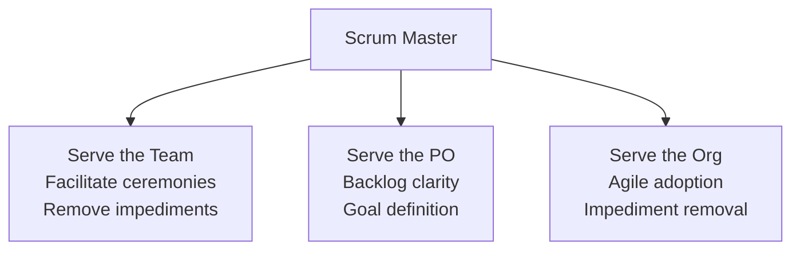

---

### Q2. What are the five Scrum events and their purposes?
**Answer:**

| Event | Purpose | Timebox |
|-------|---------|---------|
| Sprint | Container for all work | 1–4 weeks |
| Sprint Planning | Define sprint goal + select backlog items | 8h / 4-week sprint |
| Daily Scrum | Inspect progress, adapt plan | 15 minutes |
| Sprint Review | Inspect increment, gather feedback | 4h / 4-week sprint |
| Sprint Retrospective | Inspect team process, create improvement plan | 3h / 4-week sprint |

---

### Q3. What is the difference between a Scrum Master and a Project Manager?
**Answer:** A Project Manager is traditionally responsible for planning, scheduling, risk management, and reporting to leadership. A Scrum Master facilitates the Scrum process, removes impediments, and coaches — without authority over the team. In Scrum, the team self-organises. Many organisations blend these roles, but the core mindset differs: PM = control, SM = enable.

---

### Q4. What is a Sprint Goal?
**Answer:** A Sprint Goal is a single, concise objective that provides focus and coherence for the sprint. It answers "why are we doing this sprint?" All sprint backlog items should contribute to it. If a problem arises, the team and PO can renegotiate scope while keeping the goal intact.

**Example:** "Enable users to complete a purchase with a saved credit card" rather than "do 23 story points of backlog items."

---

### Q5. What is the Definition of Done (DoD)?
**Answer:** The DoD is a shared agreement of the quality criteria that every increment must meet before it is considered complete. It is not acceptance criteria for a user story — it applies to all stories. Typical DoD: code reviewed, unit tested, integration tested, deployed to staging, documentation updated, security scanned.

**Why it matters:** A DoD prevents "done in development but not really done" partial work from accumulating as hidden debt.

---

### Q6. What is a Product Backlog and who owns it?
**Answer:** The Product Backlog is an ordered list of everything that might be needed in the product. The Product Owner owns it — they add, remove, order, and refine items. The team and SM support the PO but do not set priorities.

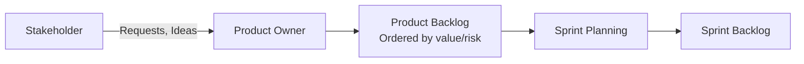

---

### Q7. How do you run an effective Sprint Planning?
**Answer:**
1. PO presents the sprint goal and top backlog items.
2. Team discusses and asks questions.
3. Team selects items they can complete (using velocity or judgment).
4. Team breaks items into tasks — the sprint backlog.
5. Everyone commits to the sprint goal.

**Anti-patterns:** PO assigning tasks to individuals, planning more capacity than available, skipping planning because "everyone knows what to do."

---

### Q8. How do you run an effective Daily Scrum?
**Answer:** The Daily Scrum is a 15-minute planning event for the team, not a status report to the manager. Teams inspect progress toward the sprint goal and adapt the plan. Modern Scrum removes the three questions (yesterday/today/blockers) in favour of focusing the conversation on: "What did we learn? What needs to change? Are we on track for the sprint goal?"

---

### Q9. How do you run an effective Sprint Retrospective?
**Answer:** Use a structured format: (1) Set the stage, (2) Gather data (what happened?), (3) Generate insights (why?), (4) Decide what to do (1–3 actionable improvements), (5) Close. Use different formats to maintain engagement (Mad/Sad/Glad, 4Ls, Starfish, Start/Stop/Continue).

**Key principle:** Every retrospective must produce at least one concrete improvement action with an owner and a deadline.

---

### Q10. What is velocity and how should it be used?
**Answer:** Velocity is the average story points (or items) a team completes per sprint over a 3–5 sprint period. Use it for: forecasting how much work can fit in a sprint, long-term release planning. Do not use it for: comparing teams, measuring performance, or as a target to maximise.

**Anti-pattern:** "We must increase velocity each sprint" — this incentivises story point inflation and rushed work.

---

### Q11. What is Kanban and how does it differ from Scrum?
**Answer:** Kanban is a flow-based system with no sprints, no defined roles, and continuous delivery. Work is pulled when capacity is available. Scrum has fixed-length sprints, defined roles, and iterative increments. Kanban uses WIP limits and lead time; Scrum uses velocity and sprint capacity.

**When to use Kanban:** Support/ops teams, maintenance work, teams where work arrives unpredictably.

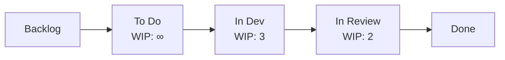

---

### Q12. What is SAFe (Scaled Agile Framework)?
**Answer:** SAFe scales Agile to enterprise level. Key constructs: Agile Release Trains (ART) — multiple Scrum teams working toward shared PI (Program Increment) objectives every 10 weeks. PIs end with a PI Planning event where all teams align. SAFe adds roles: Release Train Engineer (like a SM for the ART), Product Manager, System Architect.

---

### Q13. What is a Program Increment (PI) and PI Planning?
**Answer:** A PI is a timebox (typically 10 weeks = 5 × 2-week sprints) during which an Agile Release Train delivers value. PI Planning is a 2-day event where all teams plan their sprints together, identify dependencies, and commit to PI objectives.

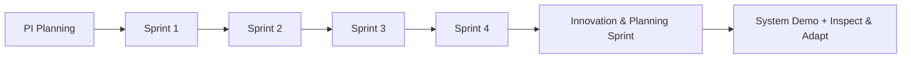

---

### Q14. What is LeSS (Large-Scale Scrum)?
**Answer:** LeSS applies basic Scrum rules to multiple teams working on one product. One PO, one Product Backlog, one sprint for all teams, one overall Sprint Retrospective. Minimal additional roles and processes. LeSS Huge adds an Area PO for very large products.

---

### Q15. What are common Scrum anti-patterns?
**Answer:**

| Anti-pattern | Problem | Fix |
|-------------|---------|-----|
| Sprint as a waterfall (design→dev→test) | No integration, late discovery | Work in thin vertical slices |
| PO absent until Review | Team builds wrong things | Daily PO availability |
| SM as project manager | Team depends, can't self-organise | Coach self-organisation |
| No retrospective action items | Nothing improves | 1 action per retro with owner |
| Velocity as a target | Inflated estimates | Use for forecasting only |
| "Fake agile" ceremonies without mindset | Bureaucracy with no adaptation | Focus on the why |

---

### Q16. What is the difference between Agile and waterfall?
**Answer:** Waterfall delivers in phases (requirements → design → build → test → deploy). Feedback comes at the end. Agile delivers in short iterations, gathering feedback continuously. Agile accommodates change; waterfall resists it. Use waterfall for projects with fixed, well-understood requirements (construction, regulated manufacturing). Use Agile for software and product development.

---

### Q17. What is the Agile Manifesto?
**Answer:** Four values:
1. **Individuals and interactions** over processes and tools
2. **Working software** over comprehensive documentation
3. **Customer collaboration** over contract negotiation
4. **Responding to change** over following a plan

Twelve principles include: satisfy the customer early, welcome changing requirements, deliver working software frequently, maintain sustainable pace.

---

### Q18. What is a release train engineer (RTE)?
**Answer:** An RTE is the chief Scrum Master for an Agile Release Train. They facilitate PI Planning, manage risk, escalate impediments, drive Agile practices across teams, and coach within the SAFe ART.

---

### Q19. What is the difference between a user story and an epic?
**Answer:** An epic is a large body of work too big for a single sprint. It is split into user stories. Stories are small enough to complete within a sprint and are written from the user's perspective: "As a [user], I want [feature], so that [benefit]." Stories have acceptance criteria; epics have an epic hypothesis.

---

### Q20. What is story point estimation and how do you do it?
**Answer:** Story points estimate relative effort and complexity, not hours. Use Planning Poker: each team member picks a Fibonacci card (1, 2, 3, 5, 8, 13, 21) independently, reveal simultaneously, discuss outliers, repeat. Calibrate against a reference story. The process reveals different assumptions.

---

# 2. Team Handling & Dynamics

### Q21. How do you handle a team member who consistently misses commitments?
**Answer:** Begin with a private, calm, and respectful 1:1 conversation to understand what is actually driving the pattern. The goal is not to assign blame, but to diagnose whether the issue is unclear requirements, overcommitment, personal circumstances, skill gaps, or low motivation. Then respond specifically: improve story clarity and acceptance criteria, provide training or pairing, reduce the load, or escalate professionally if support has already been offered. The key is to address the root cause and document the follow-up without creating shame or a public performance issue.

**Interview-ready framing:** "I handle missed commitments by understanding the cause first, then acting on the real issue with empathy and structure. I do not ignore the pattern; I address it early and supportively."

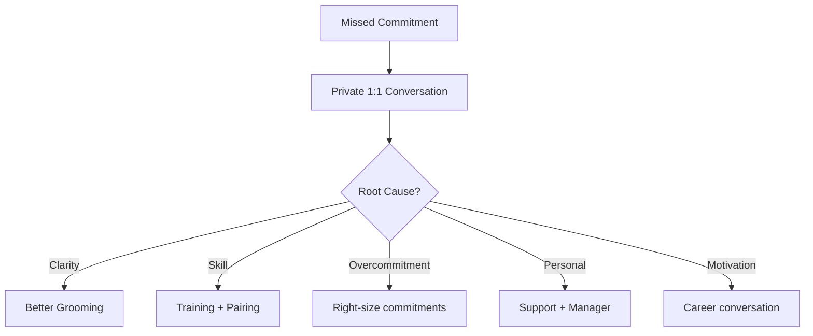

---

### Q22. How do you build psychological safety in a team?
**Answer:** Psychological safety (Amy Edmondson's research) is the belief that you can speak up, take risks, and make mistakes without punishment. Build it by: (1) modelling vulnerability as a leader ("I don't know, let's find out"), (2) rewarding questions and dissent, (3) reacting to failures with curiosity not blame, (4) explicitly inviting quieter voices, (5) never shooting the messenger of bad news.

---

### Q23. How do you handle a high-performing "rockstar" who undermines team collaboration?
**Answer:** Acknowledge their technical contribution privately. Have a candid conversation about impact on team effectiveness. Provide specific, behavioural examples ("When you dismiss others' ideas in planning, the team stops contributing"). Set clear expectations: individual excellence AND team success are both required. Adjust their goals to include team outcomes (code reviews, mentoring, pair programming).

---

### Q24. How do you handle a team that is constantly changing members?
**Answer:** Teams take time to form (Tuckman: Forming → Storming → Norming → Performing). Frequent change resets them. Advocate to leadership for stability. Document team norms, decision history, and architecture to reduce onboarding time. Create a "team compact" document. Use a lightweight but consistent onboarding checklist.

---

### Q25. How do you manage team conflict between a frontend and backend developer?
**Answer:** Bring them into a structured conversation with you as a neutral facilitator. Have each person explain their perspective without interruption. Identify the underlying interests (not positions). Find a shared goal ("we both want users to have a good experience"). Design a technical solution together (API contract, mock, shared spec). Follow up to ensure the resolution is implemented.

---

### Q26. How do you deal with a developer who refuses to write tests?
**Answer:** Understand their objection — often it is time pressure or not knowing how. Address time pressure by protecting test time in estimation. Provide training or pair them with someone who tests well. Make testing visible in the DoD so it is not optional. Share data on how testing reduces rework. If resistance persists, escalate to the manager — it is a team norm issue.

---

### Q27. What is Tuckman's model of team development?
**Answer:**

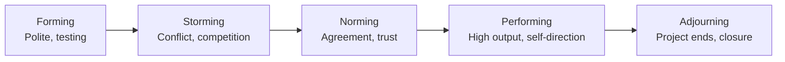

SM actions per stage: Forming (define norms, build relationships), Storming (facilitate conflict, clarify goals), Norming (reinforce agreements, reduce facilitation), Performing (step back, celebrate).

---

### Q28. How do you handle a team member who dominates every meeting?
**Answer:** Use facilitation techniques: round-robins (everyone speaks before anyone speaks twice), silent brainstorming (write ideas independently before sharing), timebox each speaker, use a talking object, ask others specifically ("Priya, what do you think?"). After the meeting, have a private conversation with the dominant person about their impact on others' participation.

---

### Q29. How do you motivate a team during a long, boring maintenance phase?
**Answer:** Link maintenance to meaningful outcomes ("These fixes will stop 3AM alerts for users in Japan"). Create small wins and celebrate them. Rotate maintenance responsibility so it doesn't always fall on the same people. Carve out innovation time (10–20%) for the team to work on something they care about. Acknowledge the unglamorous but essential nature of the work.

---

### Q30. What is a team's working agreement and how do you create one?
**Answer:** A working agreement is a set of norms the team explicitly commits to: meeting etiquette, communication channels, code review SLA, how decisions are made, what "urgent" means. Create it in a dedicated session by asking "What do we need from each other to be effective?" Revisit it in retrospectives.

---

### Q31. How do you handle a team that over-commits in sprint planning?
**Answer:** Show them the data — sprint velocity vs committed points. Run a capacity planning exercise (sum available hours minus meetings, leave, and overhead). Establish a buffer (plan to 70–80% capacity). Use the retrospective to reflect on the pattern and its cost (incomplete work carries forward, creates stress, erodes trust with the PO).

---

### Q32. How do you handle a situation where developers disagree on a technical approach?
**Answer:** Time-box the discussion (30 minutes). Ask both sides to present their approach with criteria (performance, maintainability, cost). If unresolved, use a decision framework (e.g., weighed criteria matrix). Set a "disagree and commit" expectation — once a decision is made, everyone implements it. For large architectural decisions, use an ADR (Architecture Decision Record).

---

### Q33. How do you handle a team that is in "storming" phase?
**Answer:** Name what is happening ("Teams often go through a conflict phase — this is normal and healthy"). Facilitate explicit conversations about expectations and norms. Create small, shared wins to build trust. Increase 1:1 frequency to understand individual perspectives. As SM, model the conflict resolution you want to see.

---

### Q34. What is the difference between coaching, mentoring, and managing?
**Answer:**
- **Coaching:** Ask powerful questions to help someone find their own answer. No advice given.
- **Mentoring:** Share your own experience and expertise to guide someone.
- **Managing:** Direct authority — set goals, evaluate performance, make resourcing decisions.

An effective SM uses all three depending on the situation, but leans toward coaching to build team autonomy.

---

### Q35. How do you create a culture of continuous improvement?
**Answer:** Make retrospectives safe and actionable. Track improvement items in the backlog. Celebrate when improvements land ("Last sprint we automated deployment — that's why we released twice this week"). Allocate time for improvement work in every sprint. Lead by example — improve your own facilitation and share what you learned.

---

# 3. Customer Handling & Communication

### Q36. How do you handle a customer who is unhappy with delivery speed?
**Answer:** Start by acknowledging the concern without defensiveness. Then explain the context clearly: what the team is delivering, what voluntary or external constraints are slowing progress, and what trade-offs exist. It is important to show transparency about the roadmap, current capacity, and known blockers. Then ask which outcome matters most to them and prioritize the next slice of value accordingly. This turns a complaint into a joint planning conversation and helps rebuild trust through predictability and visibility.

**Interview-ready framing:** "I focus on empathy, transparency, and alignment. Customers usually need to feel heard and informed, not just reassured."

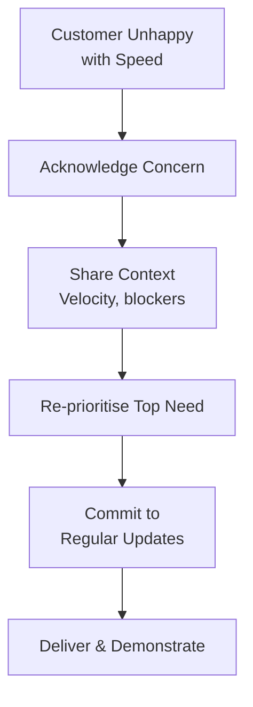

---

### Q37. How do you manage customer expectations?
**Answer:** Set expectations early and clearly — scope, timeline, quality, and what can change. Use a roadmap with confidence levels (high/medium/low), not fixed dates for uncertain work. Communicate proactively when something changes — never let the customer discover a problem through their own testing. Build trust through consistent, honest updates.

---

### Q38. How do you handle a customer who keeps changing requirements?
**Answer:** Welcome it — that is the point of Agile. But explain the trade-off: adding new requirements mid-sprint means something else must come out (or the sprint extends, which is not allowed in Scrum). Use the Product Backlog: new requirements go in, the PO orders them. Demonstrate frequently so customers can steer continuously rather than making a large change at the end.

---

### Q39. How do you communicate a delay to a customer?
**Answer:** Communicate early, before the deadline, not after. Be direct: "We will not deliver X by the agreed date." Explain the reason briefly (dependency blocked, complexity discovered). Offer a revised plan with a realistic date. Show what will be delivered on time. Bring solutions, not just problems.

**Example template:**
> "We've identified that the payment integration will not be ready by April 15 due to an API change from the payment provider. We expect delivery by April 22. The user profile and order history features will still be ready on April 15 as planned. I'd like to schedule 30 minutes to discuss priorities."

---

### Q40. How do you handle a customer who wants daily status updates?
**Answer:** Understand what need drives the request — usually anxiety about progress or a past experience of being surprised. Agree on a lightweight daily update: a one-paragraph email or Slack message with what was done, what is next, and any blockers. After 2–3 weeks of consistent updates, suggest moving to twice-weekly as trust builds.

---

### Q41. How do you present technical information to a non-technical customer?
**Answer:** Translate to business impact. Instead of "we need to refactor the database schema," say "we need to invest 2 sprints improving how data is stored, which will reduce page load time by 40% and prevent the outages you experienced in Q3." Use analogies, visuals, and avoid jargon. Check understanding by asking them to summarise what they heard.

---

### Q42. How do you handle a customer who attends the Daily Scrum?
**Answer:** The Daily Scrum is a team event — stakeholders (including customers) can observe but not participate. Invite them to a separate stakeholder sync or the Sprint Review. Politely explain: "The Daily Scrum is for the team to coordinate — your feedback is best captured in our weekly check-in or the Sprint Review, where you can interact with what we've built."

---

### Q43. How do you handle scope creep in a customer-facing project?
**Answer:** Scope creep is uncontrolled growth of requirements without corresponding adjustment to time, cost, or quality. Prevent with a clear change control process: (1) customer submits a change request, (2) team estimates the impact, (3) PO and customer agree on trade-off (defer something or extend timeline). Document all scope changes.

---

### Q44. How do you run a productive customer meeting?
**Answer:** Prepare: agenda shared 24h in advance, pre-read materials distributed. During: start on time, assign a facilitator and note-taker, timebox agenda items, park off-topic items in a list. Close: summarise decisions, assign action items with owners and dates. Send minutes within 24h.

---

### Q45. What is a customer journey map and how do you use it in project discussions?
**Answer:** A customer journey map visualises every touchpoint a user has with a product — before, during, and after use — including their emotions and pain points. Use it in customer meetings to build shared understanding, identify the highest-value improvements, and align on priorities.

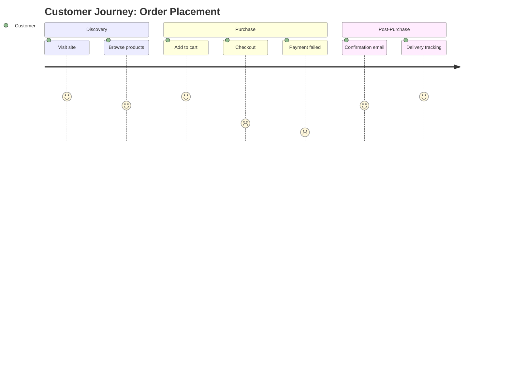

---

### Q46. How do you handle a customer who bypasses you and talks directly to developers?
**Answer:** First, understand why — they may feel the channel to you is slow, or they want technical detail. Have an open conversation with the customer about why a single point of contact protects them (consistent information, managed scope). Agree on a protocol: technical discussions with developers are welcome, but scope and priority changes go through you. Internally, ask developers to loop you in when scope discussions arise.

---

### Q47. What is a RACI matrix and how do you use it with customers?
**Answer:** RACI assigns roles for each decision or task: Responsible (does the work), Accountable (owns the outcome), Consulted (provides input), Informed (kept updated). Use it at project kickoff to clarify who makes which decisions and avoid the customer feeling bypassed or overwhelmed.

---

### Q48. How do you build a long-term partnership with a customer?
**Answer:** Deliver consistently and honestly. Celebrate their successes. Understand their business goals — not just their feature requests. Share insights proactively ("we noticed users abandon the checkout at step 3 — here's why and what we can do"). Conduct regular relationship health checks (quarterly business reviews).

---

### Q49. How do you handle a customer who micromanages the team?
**Answer:** This usually comes from distrust or previous bad experiences. Build trust through consistent delivery and transparency. Agree on what visibility they need (a burnup chart, weekly demo, Jira access) and provide it without them needing to ask. Gradually reduce their involvement in team-internal decisions by showing those decisions are being made well.

---

### Q50. What is a sprint review and how do you make it valuable for customers?
**Answer:** The Sprint Review is a working session — not a presentation — where the team demonstrates the increment and gathers feedback. Involve the customer actively: let them click through the feature, ask what they think, capture their reactions. Adjust the Product Backlog based on their feedback before the next sprint begins.

---

# 4. Escalation Management

### Q51. What is escalation and when should you escalate?
**Answer:** Escalation is raising an issue to a higher authority when it cannot be resolved at the current level within an acceptable time. Escalate when: (1) a blocker has persisted for more than 2 days despite your attempts, (2) a risk will impact the client delivery, (3) a decision is needed that is above your authority, (4) a team conflict cannot be resolved internally.

**Key principle:** Escalate early with a proposed solution, not just a problem.

---

### Q52. How do you escalate a client issue without damaging the relationship?
**Answer:** Frame the escalation as seeking support, not complaining. Bring facts, impact, and a proposed resolution. Involve the client's escalation point only if the issue requires their authority. After resolution, reconnect with the original contact to close the loop and restore the relationship.

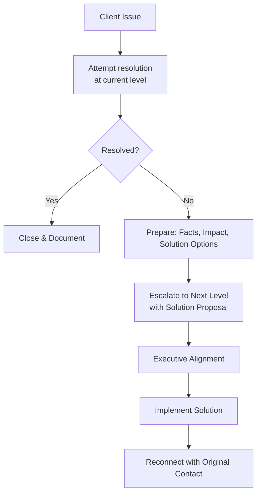

---

### Q53. How do you handle a situation where the client escalates over your head?
**Answer:** Stay calm and professional. Do not take it personally. Contact your manager immediately to brief them before the client reaches them. Prepare a factual summary of the situation, what you have done, and your proposed path forward. After the incident, have a reflective conversation with your manager about what could have been communicated earlier to prevent the bypass.

---

### Q54. What is an escalation matrix and how do you create one?
**Answer:** An escalation matrix defines who to contact for each type of issue, at what threshold, and within what timeframe.

| Issue Type | Level 1 (SM) | Level 2 (Manager) | Level 3 (Director) | Timeline |
|-----------|-------------|------------------|-------------------|---------|
| Technical blocker | Try to resolve | After 2 days | If client impacted | Same day |
| Missed milestone | Notify PO | If not resolved in 1 day | If client will be informed | Same day |
| Client complaint | Handle | If client not satisfied | If client escalates | Within 4h |
| Team conflict | Facilitate | If unresolved in 1 week | Rarely | 1 week |

---

### Q55. How do you handle a production outage affecting a client?
**Answer:**
1. **Acknowledge immediately** (within 15 minutes) — "We are aware of the issue and investigating."
2. **Establish a war room** — dedicated channel, incident commander, communicator role separated from fixers.
3. **Communicate regularly** — every 30 minutes even if there is no update.
4. **Fix, then analyse** — restore service first, root cause later.
5. **Post-incident review** — within 48h, blameless, share with client.
6. **Prevention plan** — specific action items to prevent recurrence.

---

### Q56. What is a blameless post-mortem?
**Answer:** A blameless post-mortem analyses an incident to understand what happened and why, without attributing fault to individuals. It assumes people acted in good faith with the information they had. The goal is to improve systems and processes, not punish people. It produces a timeline, contributing factors, and improvement actions.

---

### Q57. How do you handle a client who is threatening to exit the contract?
**Answer:** Get the right people in the room immediately (your manager, account lead, delivery lead). Do not negotiate by email. Listen to understand the core issues — not just the stated ones. Acknowledge the impact honestly. Present a concrete recovery plan with specific commitments and measures. Assign a senior relationship owner for a recovery period.

---

### Q58. How do you manage an escalation from a team member about a manager?
**Answer:** Listen fully without judgment. Assess whether this is a process issue, communication issue, or a conduct issue. For process/communication: coach the team member on how to raise it directly and offer to mediate. For conduct (harassment, discrimination): escalate to HR immediately regardless of level. Document everything.

---

### Q59. What is the difference between an issue and a risk?
**Answer:** An **issue** has already happened and is affecting the project now. A **risk** may happen in the future. Issues require immediate response. Risks are assessed for probability and impact, then mitigated, avoided, transferred, or accepted. The same thing can move from risk to issue — good risk management keeps it a risk (mitigated) rather than allowing it to become an issue.

---

### Q60. How do you de-escalate a heated situation with an angry client?
**Answer:** Let them speak without interrupting. Acknowledge their emotions explicitly ("I understand you're frustrated, and I would be too"). Do not get defensive or argue facts while they are emotionally activated. Shift to problem-solving only after their emotions have de-escalated. Ask: "What would make this right for you?" Focus on the future, not the past blame.

---

### Q61. How do you escalate a scope dispute?
**Answer:** Document the original agreement (SOW, user story, acceptance criteria). Document the new request and the gap. Present both to the PO/account manager and client contact. Agree on the gap, then negotiate: extend timeline, reduce scope elsewhere, or change the contract. Never let scope disputes fester silently — they erode the relationship faster than the conversation does.

---

### Q62. What is a formal complaint process and when do you trigger it?
**Answer:** Trigger a formal complaint process when: a client issue cannot be resolved at the account level, the relationship is at serious risk, or there are contractual/legal implications. It involves: written documentation of the complaint, senior leadership involvement, an agreed SLA for response (typically 24–48h acknowledgement, 5–10 days resolution plan), and ongoing tracking until closure.

---

# 5. Project & Delivery Management

### Q63. How do you create a project roadmap?
**Answer:** A roadmap shows what will be built and roughly when, at a high level. Good roadmaps: (1) are outcome-based (goals, not feature lists), (2) show confidence levels, (3) are updated regularly, (4) are tailored to the audience (strategy view for executives, detail for teams).

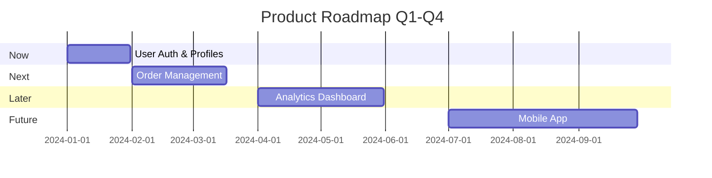

---

### Q64. How do you handle a project that is behind schedule?
**Answer:** The first step is not to react emotionally; it is to diagnose the cause. A schedule slip usually comes from one or more of four things: hidden scope, capacity loss, dependency delays, or flawed estimation. Once the cause is clear, present the client with options rather than a surprise: reduce scope, increase focus on the highest-value items, add temporary capacity if it is truly needed, or adjust the timeline with explicit trade-offs. The goal is to make the problem visible early and create a rational recovery plan with client alignment.

**Interview-ready framing:** "I treat schedule slippage as a planning and communication issue first, not just a delivery problem. The best recovery path is transparent options backed by evidence."

---

### Q65. What is Brooks' Law?
**Answer:** "Adding manpower to a late software project makes it later." New members need time to ramp up (reducing the team's output), and communication overhead increases as team size grows (n*(n-1)/2 channels). Adding people late in a project often hurts more than helps.

---

### Q66. What is a burndown chart vs a burnup chart?
**Answer:**

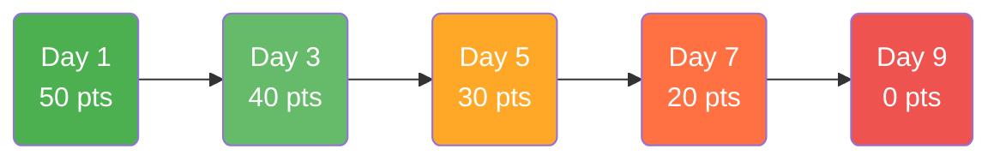
> 📉 **Sprint Burndown:** Ideal = 50→0 | Actual = 50→10 (10 pts carried over)

Burndown shows remaining work over time. Burnup shows completed work and total scope — it makes scope changes visible (the total line moves up). Burnup is more transparent with clients.

---

### Q67. How do you do release planning?
**Answer:** Divide the product backlog's estimated points by average velocity to calculate the number of sprints needed. Add buffer for unknowns (10–20%). Identify the MVP (minimum viable product) — the smallest valuable release. Plan milestone dates around MVP, then subsequent releases.

---

### Q68. What is a minimum viable product (MVP)?
**Answer:** An MVP is the smallest version of a product that delivers value to real users and allows the team to learn. It is not "a product with bugs" or "half the features" — it is a complete solution to a core problem. Use the MVP to validate assumptions before building more.

---

### Q69. How do you manage dependencies between teams?
**Answer:** Identify dependencies early in PI Planning or sprint planning. Create explicit contracts (API specs, shared schemas). Use a dependency board to track status. Raise blockers as early as possible. The receiving team should not wait silently — communicate the risk.

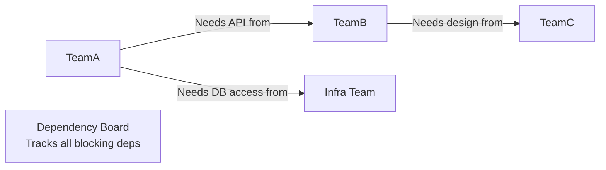

---

### Q70. What is a critical path?
**Answer:** The critical path is the longest sequence of dependent tasks in a project. Any delay on the critical path delays the entire project. Non-critical tasks have "float" — they can slip without affecting the end date. Focus mitigation efforts on critical path tasks.

---

### Q71. How do you manage a project with fixed scope, fixed budget, and fixed timeline?
**Answer:** This is the "triple constraint" or "iron triangle" — scope, time, and cost. When all three are fixed, quality is what suffers. Have an honest conversation: one of the three must flex. Usually scope is most flexible — prioritise ruthlessly and reduce scope to what can be delivered at quality within time and budget.

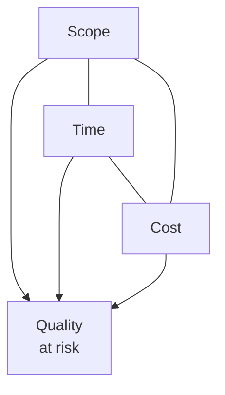

---

### Q72. How do you manage a project with an aggressive deadline?
**Answer:** Validate the deadline — is it truly fixed (contractual, regulatory) or assumed? If truly fixed: scope aggressively (cut to MVP), identify and eliminate blockers immediately, run parallel work streams, increase team communication frequency. Never commit to a deadline you don't believe in — negotiate or flag the risk in writing.

---

### Q73. What is an increment and why is it important?
**Answer:** An increment is a potentially shippable, working piece of software that meets the DoD. Each sprint should produce one. It is important because: (1) it proves real progress (not "90% done"), (2) it enables early feedback, (3) it gives the PO the option to release early.

---

### Q74. How do you handle a team where "done" means different things to different people?
**Answer:** This is a DoD problem. Run a workshop where the team lists all the activities needed to safely release a feature. Agree on the minimum set that must be true for every story. Write it down as the DoD. Put it on the team wall. Use retrospectives to refine it over time.

---

### Q75. What is a burndown for release planning?
**Answer:** A release burndown charts total remaining work (backlog points) across sprints. If the line reaches zero before the target release date, you're on track. If it won't, you need to cut scope, add sprints, or add resources. Update it after each sprint to show real progress.

---

# 6. Stakeholder Management

### Q76. How do you identify stakeholders for a project?
**Answer:** Use stakeholder identification techniques: (1) review the org chart, (2) ask "who will be affected by or can affect this project?", (3) identify decision-makers, (4) find information sources, (5) check for external regulators or partners. For each stakeholder, assess interest (how much they care) and influence (how much power they have).

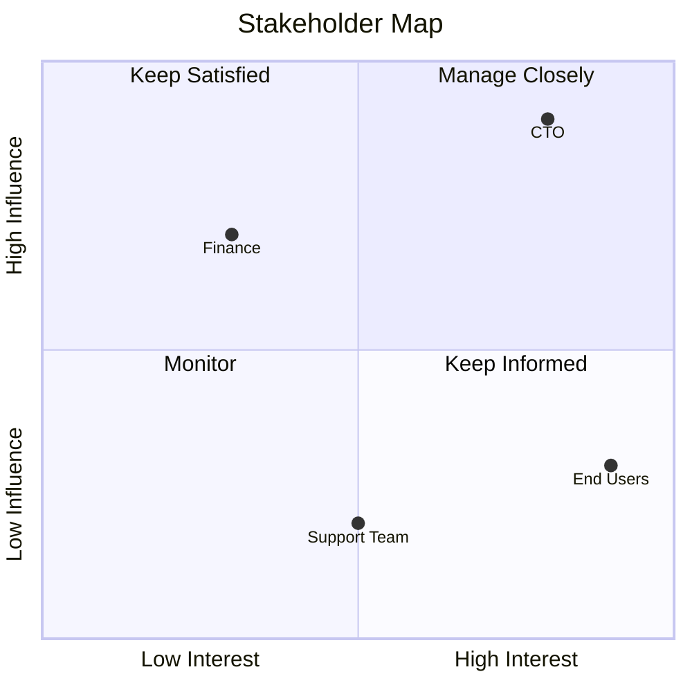

---

### Q77. How do you manage a stakeholder who keeps adding requirements?
**Answer:** Use the MOSCOW framework with the stakeholder: Must Have, Should Have, Could Have, Won't Have. When they add a new item, ask which Must Have it replaces. Use the backlog as the transparent container for all requirements — adding a new one means prioritising it against existing ones.

---

### Q78. How do you handle conflicting stakeholder priorities?
**Answer:** Get conflicting stakeholders in the same room. Facilitate a discussion using data (business value, risk, cost, user impact). Use a prioritisation framework (WSJF — Weighted Shortest Job First, or Business Value vs Effort matrix). The PO makes the final decision, but with shared context. Document the decision and rationale.

---

### Q79. What is weighted shortest job first (WSJF)?
**Answer:** WSJF = Cost of Delay / Job Duration. Cost of Delay = User Business Value + Time Criticality + Risk Reduction/Opportunity Enablement. Use it to prioritise backlog items in SAFe. The highest WSJF item delivers the most value per unit of time.

---

### Q80. How do you handle an executive who demands a specific feature immediately?
**Answer:** Acknowledge the importance. Ask for the business context — why this, why now? Understand the cost of delay. Take it to the PO who can make an informed trade-off decision. If the executive insists, escalate the trade-off: "We can add this sprint, but X and Y must move out. Is that acceptable?" Get the trade-off agreed in writing or at least in email.

---

### Q81. How do you present project status to executives?
**Answer:** Executives need: (1) overall status (RAG: Red/Amber/Green), (2) key achievements this period, (3) risks and issues, (4) decisions needed from them. Use a one-page format. Lead with what they care about (business impact, cost, risk). Go deeper only if asked. Avoid technical jargon.

---

### Q82. What is a steering committee and how do you run one?
**Answer:** A steering committee provides governance oversight for a project — reviewing status, making decisions, and resolving escalations. Run it monthly or quarterly. Agenda: (1) status update (5 min), (2) risks and issues (10 min), (3) decisions required (15 min), (4) next steps. Send the pack 48h in advance.

---

### Q83. How do you build alignment among multiple stakeholders?
**Answer:** Create a single source of truth (product vision, roadmap) that all stakeholders have contributed to and agreed on. Run joint workshops to surface disagreements early. Use a "one team" framing — stakeholders are part of the success, not outside of it. Regular touchpoints prevent drift.

---

### Q84. How do you handle a "sponsor" who disappears after kickoff?
**Answer:** Proactively schedule monthly brief check-ins. Send a one-page written update monthly whether they respond or not. Escalate when a decision requires their input. Document all unanswered requests. Make the risk visible: "Without a decision on X by Y, we will default to Z." If the sponsor is truly unavailable, raise it as a risk to their manager.

---

### Q85. What is stakeholder communication planning?
**Answer:** For each stakeholder: define what information they need, in what format, at what frequency, and through what channel. Document this in a stakeholder communications plan.

| Stakeholder | Information | Format | Frequency | Channel |
|------------|------------|--------|-----------|---------|
| CTO | Status, risks | 1-pager | Monthly | Email + Slack |
| PO | Backlog, velocity | Dashboard | Weekly | Jira + meeting |
| End users | Release notes | Email | Per release | Newsletter |

---

# 7. Risk Management

### Q86. What is a risk register?
**Answer:** A risk register documents identified risks with: description, probability (H/M/L), impact (H/M/L), risk score (P×I), owner, mitigation plan, and status. Review it at every sprint review and steering committee.

---

### Q87. What are the four risk response strategies?
**Answer:**
- **Avoid:** Change the plan to eliminate the risk entirely.
- **Mitigate:** Reduce the probability or impact.
- **Transfer:** Move the risk to a third party (insurance, subcontractor).
- **Accept:** Acknowledge the risk and have a contingency plan.

---

### Q88. How do you identify risks proactively?
**Answer:** Techniques: (1) brainstorming with the team, (2) lessons learned from past projects, (3) expert interviews, (4) SWOT analysis, (5) assumption log review (every assumption is a potential risk), (6) dependency analysis.

---

### Q89. What is a risk appetite vs risk tolerance?
**Answer:** Risk appetite is the amount of risk an organisation is willing to accept in pursuit of its objectives (strategic). Risk tolerance is the acceptable variation around a specific objective (tactical). Example: appetite — "we accept moderate technical risk for innovation." Tolerance — "we can accept up to 2 hours of unplanned downtime per month."

---

### Q90. How do you handle a risk that becomes an issue?
**Answer:** Activate the contingency plan prepared during risk identification. Communicate to stakeholders immediately. Track it as an issue (more urgent than a risk). Update the risk register. Conduct a lessons-learned review: how did we miss this, and what can we do to catch it earlier next time?

---

### Q91. What is technical risk and how do you manage it?
**Answer:** Technical risks include: unproven technology, complex integrations, performance unknowns, security vulnerabilities, or dependency on a single person's knowledge. Manage by: spikes (time-boxed experiments to reduce uncertainty), proof of concepts, cross-training, and architecture reviews.

---

### Q92. What is a dependency risk?
**Answer:** A dependency on another team, vendor, or system that could delay your work. Mitigate by: identifying early, establishing service agreements (SLAs), creating mock/stub interfaces, maintaining a buffer in your plan, and escalating late dependencies quickly.

---

### Q93. How do you manage vendor risk?
**Answer:** Assess vendor financial stability, support quality, security posture, and lock-in risk. Maintain contractual SLAs. Identify alternatives. Keep a contingency for a vendor going offline. Test recovery procedures annually.

---

### Q94. What is a quality risk?
**Answer:** The risk that the product does not meet quality standards. Mitigate with: strong DoD, automated testing, code reviews, security scanning, performance testing, and UAT with real users. Never "test quality in at the end."

---

### Q95. What is scope risk?
**Answer:** The risk that scope grows beyond what can be delivered in time and budget. Mitigate with: clear acceptance criteria, a formal change control process, regular backlog reviews with the PO, and by saying "no" (or "not now") clearly.

---

# 8. Leadership & Coaching

### Q96. What is servant leadership?
**Answer:** Servant leadership prioritises the needs of the team over the leader's own status. The leader's role is to remove obstacles, provide resources, enable autonomy, and create the conditions for the team to succeed. Robert Greenleaf coined the term. It is the foundation of the Scrum Master role.

---

### Q97. How do you give effective feedback?
**Answer:** Use the SBI model: Situation (describe the specific context), Behavior (describe the observable action — not intentions or character), Impact (describe the effect on you, the team, or the customer). Follow with a question ("What was your intent there?" or "What would you do differently?").

**Example:** "In yesterday's sprint review (S), when you told the client we'd deliver all features by next sprint (B), it created an expectation we can't meet and I need to manage now (I). What were you thinking in that moment?"

---

### Q98. How do you give feedback to someone senior to you?
**Answer:** Use the same SBI model. Focus on observable behaviors and their business impact — not on the person. Ask permission first ("I have an observation I'd like to share — is now a good time?"). Frame it as your perception ("It seemed to me that..."). Deliver it privately.

---

### Q99. What is the difference between intrinsic and extrinsic motivation?
**Answer:** Extrinsic: bonuses, promotions, fear of consequences. Intrinsic: purpose (why the work matters), autonomy (control over how to do it), and mastery (growing in skill). Dan Pink's research shows intrinsic motivation drives better performance for complex, creative work. Build an environment with purpose, autonomy, and mastery.

---

### Q100. How do you coach a team member who lacks confidence?
**Answer:** Identify the source — is it skill (they need training), experience (they need exposure), or mindset (they catastrophise)? For skill: provide training, pair them with someone better. For experience: give them progressively larger challenges with safety nets. For mindset: use coaching questions to challenge catastrophising ("What's the worst that could actually happen? What's most likely to happen?").

---

### Q101. What is a 1:1 meeting and how do you make it valuable?
**Answer:** A 1:1 is a regular (weekly or fortnightly) meeting between a manager and a direct report. It belongs to the team member — their agenda, their concerns. Manager's role: listen, remove blocks, give feedback, discuss career growth. Avoid making it a status report (that wastes both parties' time).

---

### Q102. How do you create an individual development plan (IDP)?
**Answer:** With the team member: identify their career goal (12–18 months), assess current skills vs target, identify 2–3 development areas, agree on specific actions (project, training, mentoring, book), set a review frequency. The IDP is a tool for the team member — not a performance improvement plan.

---

### Q103. How do you handle imposter syndrome in a team member?
**Answer:** Normalise it — imposter syndrome is extremely common, even among top performers. Share your own experience of doubt. Help them build an "evidence file" — a list of their actual contributions and achievements. Attribute credit publicly for their contributions. Give them stretch assignments they can succeed at.

---

### Q104. How do you develop a junior team member into a senior?
**Answer:** Progressively increase their scope: start with well-defined tasks, then complex tasks, then features, then design ownership, then mentoring others. Pair with senior members. Provide feedback on code and decisions. Give them opportunities to present to stakeholders. Advocate for their promotion when they demonstrate senior-level impact.

---

### Q105. What is a growth mindset and how do you cultivate it in a team?
**Answer:** A growth mindset (Carol Dweck) is the belief that abilities can be developed through dedication and hard work. The opposite is a fixed mindset ("I'm not a database person"). Cultivate by: praising effort and process over outcome, treating mistakes as learning opportunities, sharing your own learning journey, encouraging experiments, and protecting people who tried something new and failed.

---

### Q106. How do you handle a situation where you disagree with your manager's decision?
**Answer:** Seek to understand fully first ("Can you help me understand the reasoning?"). Share your perspective clearly and once — not repeatedly. Provide data or examples. If the decision stands: commit and implement it fully. If you believe it causes harm, escalate to your manager's manager or HR. Never undermine the decision passively.

---

### Q107. How do you manage upward?
**Answer:** Keep your manager informed (they should never be surprised by your problems). Understand their priorities and pressures. Bring solutions not just problems. Deliver on commitments consistently. Communicate your achievements — don't assume they're visible. Build a relationship of trust through honest, regular dialogue.

---

### Q108. What is emotional intelligence (EQ) and why does it matter for leaders?
**Answer:** EQ (Goleman) has four domains: self-awareness (knowing your emotions), self-management (controlling them), social awareness (reading others' emotions), relationship management (influencing, inspiring, managing conflict). Leaders with high EQ create better team environments, navigate conflict more effectively, and retain talent longer.

---

### Q109. How do you handle your own stress during a project crisis?
**Answer:** Acknowledge it (pretending to be unaffected is not credible). Separate the emergency response (what must happen right now) from anxiety about the future (what might happen). Use structured problem-solving to channel stress into action. Build recovery time into your schedule after a crisis. Build a support network of peers you can debrief with.

---

### Q110. What is the difference between a leader and a manager?
**Answer:** Managers plan, organise, and control — they maintain the current system. Leaders set direction, inspire, and change — they create a new system. Good engineering managers do both. A common pitfall: promoting a great engineer into a management role without training them in people management.

---

# 9. Metrics, Reporting & Continuous Improvement

### Q111. What are the key metrics for a Scrum team?
**Answer:**

| Metric | What it measures | How to use |
|--------|-----------------|-----------|
| Velocity | Throughput | Forecast, not target |
| Sprint Goal achievement | Reliability | Track % over time |
| Cycle time | Speed of individual items | Find process bottlenecks |
| Defect rate | Quality | Trend down over time |
| Team satisfaction (NPS) | Health | Act on low scores |
| Customer satisfaction | Value delivered | Align with business goals |

---

### Q112. What is DORA metrics?
**Answer:** Google's DevOps Research and Assessment identified four key metrics:
- **Deployment Frequency:** How often you release to production.
- **Lead Time for Changes:** From code commit to production.
- **Change Failure Rate:** % of releases causing an incident.
- **MTTR:** How fast you recover from incidents.

Elite teams deploy multiple times/day with <1h lead time, <5% failure rate, and <1h MTTR.

---

### Q113. How do you measure team health?
**Answer:** Use team health checks (Spotify Health Check model): surveys on dimensions like "easy to release," "fun to work here," "stakeholder value," "learning," "speed." Score Red/Yellow/Green per dimension. Run quarterly. Use results in retrospectives.

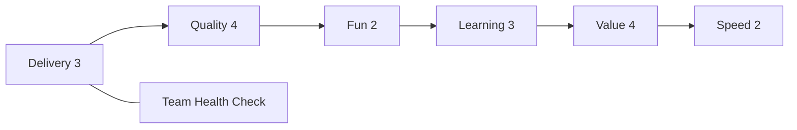

---

### Q114. What is cycle time and how do you reduce it?
**Answer:** Cycle time is the time from when a team starts work on an item to when it is done. Reduce by: limiting WIP (Work in Progress), eliminating handoffs (full-stack team), automating tests and deployments, reducing batch size (smaller stories), and removing approval bottlenecks.

---

### Q115. What is WIP (Work in Progress) limit and why does it help?
**Answer:** A WIP limit caps how many items can be "in progress" simultaneously. Benefits: forces finishing before starting, reduces context switching, makes bottlenecks visible (a column at the limit shows where work is piling up), and reduces cycle time. Little's Law: Cycle Time = WIP / Throughput.

---

### Q116. What is a cumulative flow diagram?
**Answer:** A chart showing how many items are in each workflow stage over time. Bands widening indicate WIP growing (a problem). Gaps between bands indicate bottlenecks. Use it to spot process health issues.

---

### Q117. What is an OKR (Objectives and Key Results)?
**Answer:** A goal-setting framework: an Objective (inspirational, qualitative goal) is paired with 2–4 Key Results (measurable outcomes that indicate progress). OKRs should be ambitious (70% completion = success). They are not task lists — Key Results are outcomes, not outputs.

**Example:**
- **Objective:** Delight users with a fast, reliable checkout experience.
- **KR1:** Checkout completion rate increases from 65% to 80%.
- **KR2:** Page load time <1.5s for 95% of users.
- **KR3:** Payment error rate <0.5%.

---

### Q118. How do you run a Kaizen event?
**Answer:** Kaizen is Japanese for "change for better." A Kaizen event is a focused, time-boxed (1–5 day) workshop to improve a specific process. Steps: define the problem, map the current process, identify waste, design the improved process, pilot the improvement, standardise and train.

---

### Q119. What is the PDCA cycle?
**Answer:** Plan → Do → Check → Act. Plan: identify a problem and hypothesise a solution. Do: implement on a small scale. Check: measure the results. Act: standardise if it worked, or restart with a new hypothesis if not. The retrospective is a sprint-level PDCA cycle.

---

### Q120. How do you present metrics in a way that drives action?
**Answer:** Show trend (3–6 periods), not point-in-time. Highlight anomalies. Tie metrics to business impact ("Cycle time increased by 3 days this month — this delayed 2 client stories"). Bring the retrospective action alongside the metric. Never present a metric without an interpretation.

---

# 10. Conflict Resolution

### Q121. What are the five conflict management styles?
**Answer:** Thomas-Kilmann model:

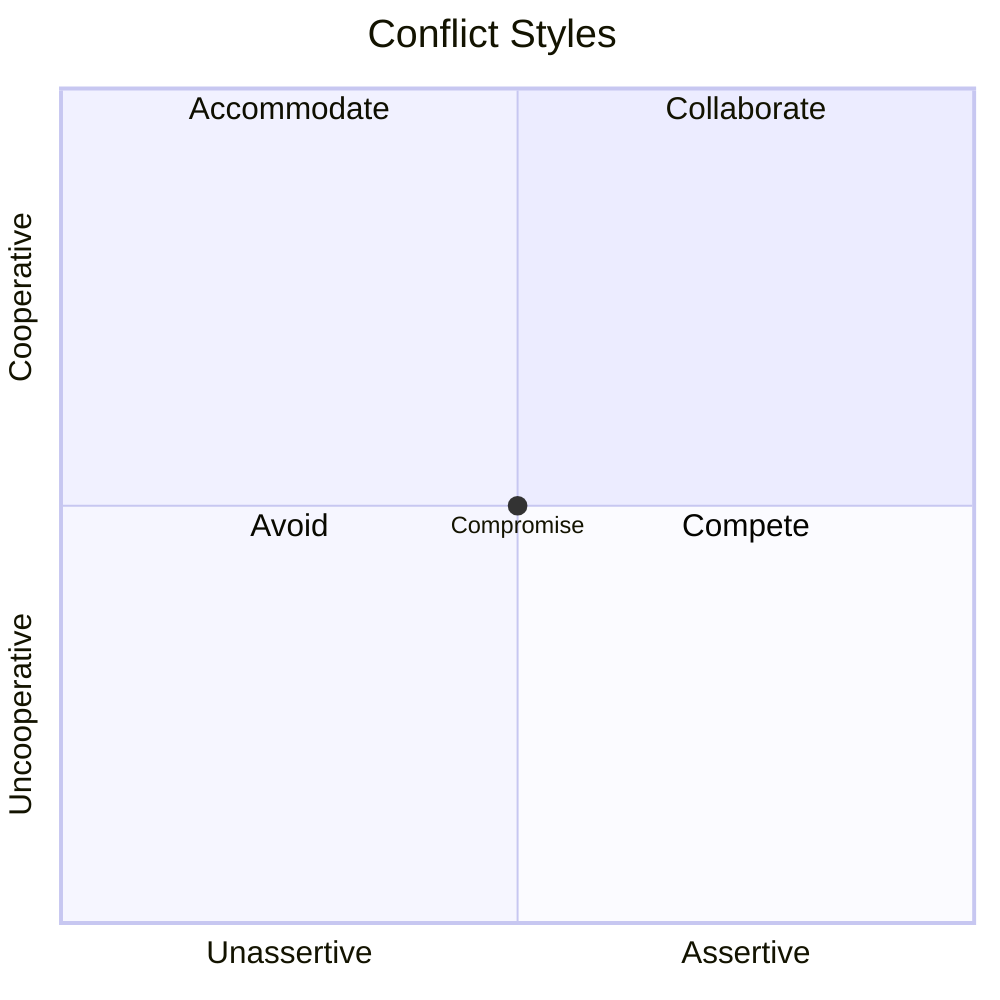

- **Avoid:** Withdraw. Use when the issue is trivial or emotions are too high.
- **Accommodate:** Give in. Use when you're wrong or the relationship matters more.
- **Compete:** Assert your position. Use when a quick decision is vital.
- **Compromise:** Split the difference. Use when time is short.
- **Collaborate:** Solve together. Best for complex, important conflicts. Most time-consuming.

---

### Q122. How do you mediate a conflict between two team members?
**Answer:** Meet them separately first to understand each perspective without the other influencing them. Find common ground (shared goal, shared values). Bring them together, establish ground rules (no interrupting, focus on behavior not character). Facilitate them to articulate their interests (not positions). Co-create a solution. Follow up.

---

### Q123. What is the difference between a position and an interest in a conflict?
**Answer:** A position is what someone says they want ("I need to own the database schema"). An interest is why they want it ("I need to ensure consistency and performance"). Two people may have opposing positions but compatible interests. Focus on interests to find creative solutions.

---

### Q124. How do you handle a conflict between the Product Owner and the development team?
**Answer:** This is common and healthy — it reflects different pressures. Mediate by: getting both parties to articulate their constraints, finding the shared goal (delivering value to users), using data (velocity, technical debt cost), and arriving at a sustainable agreement. The PO sets priority; the team estimates effort — neither can override the other.

---

### Q125. How do you handle a team member who gossips or creates division?
**Answer:** Address it directly and privately. Name the specific behavior ("I've noticed you sharing concerns about James's performance with other team members instead of with James or me"). Explain the impact on team trust. Set a clear expectation: direct communication is the norm. Monitor. If repeated, involve the manager.

---

### Q126. What is "disagree and commit"?
**Answer:** A principle where team members can advocate for their position but, once a decision is made by the right person or through the right process, everyone commits to executing it fully — even if they disagreed. It prevents passive resistance and re-litigating decisions in every meeting.

---

### Q127. How do you handle a conflict that has lasted so long it has become "the way things are"?
**Answer:** Name it explicitly ("I notice we've been working around this tension for 6 months"). Create safety to surface it in a retrospective or dedicated session. Use a facilitator if the SM is personally involved. Ask what the cost of the status quo is to the team and the product. The recognition that the status quo has a cost often motivates change.

---

### Q128. How do you handle conflict in a remote or hybrid team?
**Answer:** Text communication amplifies misunderstanding (no tone or body language). Establish a norm of moving sensitive conversations to video. Respond to written conflict with empathy before facts. Build more relationship investment (virtual coffee, team-building, all-hands) so there is a reservoir of trust when conflict arises.

---

### Q129. What is the Thomas-Kilmann Conflict Mode Instrument (TKI)?
**Answer:** A self-assessment tool that identifies a person's preferred conflict style (see Q121). Used in team workshops to build awareness of how the team collectively handles conflict and where blind spots lie. Teams heavy in "avoiders" suppress conflict; teams heavy in "competitors" escalate quickly.

---

### Q130. How do you prevent conflict from arising?
**Answer:** Establish clear roles, responsibilities, and decision-making authority. Create explicit team norms. Communicate changes early. Address small tensions before they grow. Hold regular, honest retrospectives. Build psychological safety so people raise issues before they fester.

---

# 11. Hiring, Onboarding & Retention

### Q131. How do you structure a technical hiring process?
**Answer:**

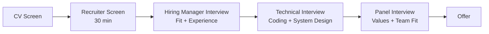

Involve the team in the panel stage — they will work with this person. Use structured interview questions consistently across candidates to avoid bias.

---

### Q132. How do you write a job description that attracts diverse candidates?
**Answer:** Use gender-neutral language (tools: Textio, Gender Decoder). List required skills vs nice-to-have separately. Focus on outcomes ("You will design APIs") not rigid credentials ("10 years experience"). Include salary range. Mention flexibility, learning culture, and team values.

---

### Q133. What are structured interviews and why do they reduce bias?
**Answer:** Structured interviews ask every candidate the same questions, in the same order, with pre-defined scoring rubrics. This prevents interviewers from rating rapport as skill, allows comparison across candidates, and surfaces bias (if scores consistently differ between demographic groups).

---

### Q134. How do you evaluate culture fit without introducing bias?
**Answer:** Define culture explicitly (company values, working norms) and assess "values alignment" — how the candidate has demonstrated those values in past behavior ("Tell me about a time you disagreed with a team decision"). Distinguish culture fit (shared values) from culture similarity (same background, interests) — the latter is bias.

---

### Q135. What makes a great onboarding programme?
**Answer:** First day: welcome, equipment ready, team introductions, lunch. First week: codebase walkthrough, shadow pair programming, 1:1 with manager. First month: deliver a small but real contribution, understand architecture, meet key stakeholders. 90 days: fully productive, independent on typical tasks. Use a written checklist and assign an onboarding buddy.

---

### Q136. How do you retain top engineers?
**Answer:** Key drivers: (1) interesting work (challenging problems, autonomy), (2) growth (learning, promotions, expanding scope), (3) recognition (public praise, compensation aligned to value), (4) team (working with people they respect), (5) manager (managers people respect and trust). Regular 1:1s, IDPs, and acting on feedback prevent attrition.

---

### Q137. What is a 30-60-90 day plan?
**Answer:** A structured ramp-up plan for a new employee:
- **30 days:** Learn (understand the role, team, codebase, processes).
- **60 days:** Contribute (take ownership of defined tasks, build relationships).
- **90 days:** Lead (drive own work independently, propose improvements).

Review at each milestone and adjust.

---

### Q138. How do you handle a "flight risk" team member?
**Answer:** Have a candid 1:1 — ask directly how they are feeling about their role and what would make it more engaging. Address the root cause: is it the work, the manager, the compensation, the growth path, or personal? Create a concrete plan. If they have an offer elsewhere, understand it — sometimes you can match; sometimes you should let them go gracefully.

---

### Q139. How do you manage a poor performer?
**Answer:**
1. Confirm it is a performance issue (not a clarity or support issue).
2. Have a direct conversation with specific examples and impact.
3. Create a written Performance Improvement Plan (PIP): clear goals, timeline, support provided, consequences.
4. Provide support, monitor weekly.
5. If goals are not met, escalate to HR for formal process.
6. Never surprise someone with termination — they should know the risk throughout.

---

### Q140. How do you handle a team member who wants to become a manager?
**Answer:** Assess their motivations — do they want impact (good) or status (risky)? Help them understand what management actually involves (less coding, more people complexity). Give them experiences: leading sprint ceremonies, mentoring, cross-team coordination. Create a growth plan. Be honest if the opportunity is not available in the near term.

---

# 12. Remote & Distributed Teams

### Q141. What are the unique challenges of managing a remote team?
**Answer:** Challenges: visibility (is work progressing?), communication (async gaps), isolation (social disconnection), timezone coordination, and unequal access (some team members in office, some remote). Address with: strong async communication norms, regular video connection, explicit team agreements, and equitable meeting practices.

---

### Q142. How do you run a Scrum ceremony effectively in a remote setting?
**Answer:** Every person on video (no hybrid where some are in a room). Use collaboration tools: Miro for retrospective boards, Jira for backlog, Zoom/Teams for meetings. Send the agenda in advance. Use breakout rooms for small group discussions. Record key decisions in writing.

---

### Q143. How do you build team culture in a fully remote team?
**Answer:** Invest in informal connection: virtual coffee chats, game sessions, non-work Slack channels. Create traditions (Friday wins, photo sharing, weekly fun question). Bring the team physically together at least annually. Create a team charter that makes culture explicit.

---

### Q144. How do you manage timezone differences effectively?
**Answer:** Define core overlap hours (minimum 2h where everyone is available for synchronous meetings). Schedule all mandatory meetings within core hours. Use async documentation: decision logs, video walkthroughs (Loom), written updates. Rotate meeting times so the same people don't always sacrifice their evenings.

---

### Q145. What is the "remote-first" mindset?
**Answer:** Remote-first means designing every communication as if everyone is remote, even if some are in the office. Benefits: equitable experience, no second-class remote members, stronger async practices. Office-first with remote accommodation creates a two-tier team.

---

### Q146. How do you assess productivity without micromanaging a remote team?
**Answer:** Measure outcomes (what was delivered?), not activity (are they online?). Use sprint goals and burndown, not timesheets. Trust adults to manage their own schedules within agreed delivery commitments. Set clear expectations; check in on blockers, not activity. Micromanagement signals distrust and drives away top performers.

---

### Q147. How do you onboard a remote employee effectively?
**Answer:** Extra attention to: pre-setup (laptop, accounts ready before day 1), assigned buddy for the first 30 days, daily short check-ins in week 1, more frequent 1:1s in the first month, deliberate introductions to team members (not just the immediate team). Send a welcome package to their home address.

---

### Q148. What are the signs of remote team burnout?
**Answer:** Signs: declining output quality, missed meetings, short or absent responses, working odd hours (indicates boundary collapse), physical health complaints, reduced social participation. Address immediately with a 1:1 — ask about workload, boundaries, and wellbeing. Never dismiss burnout concerns.

---

### Q149. How do you handle a remote team member who is disengaged?
**Answer:** Have a candid private conversation. Ask open questions: "How are you finding the work lately?" Understand whether it is the work (boring, too hard), the team (isolated, conflict), personal circumstances, or something else. Create an action plan together. Increase connection frequency for a period to monitor recovery.

---

### Q150. What tools are essential for a remote Scrum team?
**Answer:**

| Category | Tools |
|---------|-------|
| Backlog | Jira, Linear, GitHub Issues |
| Communication | Slack, Teams |
| Video meetings | Zoom, Google Meet |
| Retrospectives | Miro, FunRetro, RetroTool |
| Docs | Notion, Confluence |
| Async video | Loom |
| Pairing | VS Code LiveShare, Tuple |

---

# 13. Rapid-Fire Scenario Q&A

### Q151. A key engineer quits mid-sprint. What do you do?
**Answer:** Immediate: acknowledge the team's concern, assess sprint impact, re-plan remaining work (drop lower-priority items), notify the PO and client if delivery is affected. This week: begin knowledge transfer, identify critical knowledge held only by them, start recruitment. Document everything they know.

---

### Q152. The PO is unavailable for 2 weeks before a major release. What do you do?
**Answer:** Identify a proxy PO who is authorised to make backlog decisions in their absence. Clarify priorities before they leave. Raise any decisions that require PO input as risks. Avoid making assumptions about priority — park ambiguous items until the PO returns or the proxy decides.

---

### Q153. The client asks for a demo in 3 days but the increment is not ready. What do you do?
**Answer:** Communicate honestly to the client immediately: "The planned increment will not be ready in 3 days. We can demo X and Y, which are complete. Would you like to proceed with that, or reschedule?" Never demo incomplete work as if it is complete. Investigate why the demo was promised without checking readiness.

---

### Q154. A team member tells you they are being bullied by a colleague. What do you do?
**Answer:** Believe them and take it seriously. Listen fully. Document what they tell you. Depending on severity: (1) coach them to have a direct conversation (if safe and appropriate), or (2) involve HR immediately (if the behavior is severe, repeated, or the team member is fearful). Follow the company's formal process. Keep the person informed. Never let it drop.

---

### Q155. Two senior engineers want to use different technology stacks. What do you do?
**Answer:** Facilitate a decision workshop. Have each engineer present their case with criteria (performance, team expertise, support, cost, maintainability, community). Use a decision matrix. Involve the architect. Set a deadline for the decision. Use "disagree and commit" once decided.

---

### Q156. The team's velocity drops 40% unexpectedly in one sprint. What do you do?
**Answer:** Do not panic or assume. Investigate: Was it planned (holiday, training, reduced capacity)? Was it unplanned (unexpected bugs, blocked on dependencies, unclear stories, high cognitive load)? In the retrospective, analyse the root cause, not the symptom. Adjust the next sprint's planned points accordingly.

---

### Q157. A client contacts team members directly at 10pm expecting immediate responses. What do you do?
**Answer:** Set boundaries proactively with the client: define response time expectations ("responses within business hours for non-critical items, 1h for critical issues"). Establish the right escalation channel for urgent items. Internally, tell the team it is acceptable to respond the next business day. This protects team wellbeing and long-term performance.

---

### Q158. The sprint ends and 60% of stories are incomplete. What do you do?
**Answer:** Do not carry over stories automatically — reassess their relevance first. In the retrospective: understand why (overcommitment, blockers, unplanned work, underestimation). Adjust future sprint capacity. Communicate transparently to the PO and client about what was delivered vs planned. Plan 15–20% less next sprint.

---

### Q159. A team member is constantly working late and over-performing. What do you do?
**Answer:** This is a risk, not just a win. Have a private conversation: understand why (passion, fear of failure, compensation culture, overcommitment from the team). Excessive overtime leads to burnout, quality decline, and eventual turnover. Protect their sustainable pace. Redistribute work if needed. Make it clear that sustainable delivery is valued more than heroics.

---

### Q160. How do you handle a "brilliant jerk" on the team?
**Answer:** Brilliant jerks — high performers who undermine team culture — have a net negative impact when team effects are considered. Have a direct, private conversation with specific examples. Set non-negotiable behavioural expectations. Involve the manager and HR if unchanged. The team's ability to function and retain talent outweighs one individual's output.

---

### Q161. A client demands to know exactly who is working on their project. What do you do?
**Answer:** Share the team structure and each person's role at a high level. Acknowledge their desire for visibility. Set the expectation that the team may change over time and explain how continuity is managed (documentation, overlapping transitions). Do not share individual salary, performance ratings, or private information.

---

### Q162. How do you handle a situation where sprint ceremonies are skipped because "we're too busy"?
**Answer:** This is a symptom of a problem, not a solution to one. Skipping planning leads to misalignment. Skipping retrospectives compounds problems. Have a direct conversation with the team about the value of each ceremony relative to its time cost. Timebox and streamline ceremonies. If a specific ceremony is not valuable, examine why — fix the ceremony, don't skip it.

---

### Q163. How do you handle a situation where the QA team is a bottleneck every sprint?
**Answer:** Investigate the root cause: Is testing starting too late? Are stories too big? Is the team organised as a handoff (dev → QA) instead of a collaboration? Solution: shift testing left — testers write test cases at story creation, testers and developers work together daily during development, automate regression testing, include testing time in estimates.

---

### Q164. A team member asks to work part-time due to personal circumstances. How do you handle it?
**Answer:** Respond with empathy and flexibility first. Understand their situation and needs. Consult HR on what the company policy allows. Assess the impact on the team and project. If part-time is feasible, adjust their commitments accordingly — do not expect full-time output from part-time hours. Communicate the change to the team sensitively.

---

### Q165. The tech lead wants to refactor the entire codebase next sprint. How do you handle it?
**Answer:** Acknowledge the technical debt problem. Ask them to quantify the cost of delay (incidents, slow delivery, bugs). Work with the PO to allocate refactoring capacity sustainably — typically 15–20% of sprint capacity, not 100%. Break the refactoring into incremental stories rather than a big-bang rewrite. Track progress and demonstrate delivery alongside the refactoring.

---

### Q166. How do you manage the transition from Waterfall to Agile for a client used to Waterfall?
**Answer:** Manage expectations: Agile produces frequent releases, not one big release. Explain the benefits (early feedback, risk reduction). Start with the simplest Scrum — 2-week sprints, sprint reviews with the client. Adjust their reporting expectations (burnup instead of Gantt). Allow time for trust to build through consistent delivery.

---

### Q167. How do you handle a client who insists on knowing the exact features that will be delivered 6 months from now?
**Answer:** Explain the difference between a plan and a forecast. Provide a roadmap with confidence levels: high confidence for 1–2 sprints, medium for 1 quarter, directional for beyond. The further out, the less certain. This is not a weakness — it is honest. Early-stage planning is a hypothesis; commit as certainty only emerges.

---

### Q168. How do you manage the product backlog with 500+ items?
**Answer:** A large backlog is usually a symptom of poor grooming. Work with the PO to: archive items older than 12 months (you can always retrieve them), group related items into epics, aggressively delete items that no longer align to the product vision, and ensure only the top 2–3 sprints are refined to story level. Everything else stays at epic level.

---

### Q169. A major bug is discovered in production during a sprint. How do you handle it?
**Answer:** Stop the sprint if the bug is critical and the team must fix it. Assign a small sub-team to the bug if it's manageable. Remove equivalent sprint backlog items to maintain capacity. Communicate to the PO and client immediately. After the fix, conduct a blameless root cause analysis and add a regression test to the DoD.

---

### Q170. How do you handle a team that refuses to adopt automated testing?
**Answer:** Understand the objection: time, skill, or belief that it's not necessary. Present data: cost of bugs found in production vs test. Show them the time saved on regression. Run a workshop to build basic test skills. Add "unit tested" to the DoD as non-negotiable. Celebrate the first green CI pipeline.

---

### Q171. How do you handle back-to-back meetings that leave no focus time for the team?
**Answer:** Audit the meeting calendar — many recurring meetings no longer serve a purpose. Eliminate or reduce frequency of low-value meetings. Create "no-meeting blocks" in the team's calendar (e.g., Tuesday/Thursday mornings). Guard these blocks. Apply the "two-pizza rule" — if too many people are in a meeting, break it up.

---

### Q172. How do you handle a Scrum team where the developers don't update Jira?
**Answer:** Understand why — usually it is friction (slow Jira, unclear process) or not seeing the value. Simplify the process (fewer mandatory fields, automations). Show the team how their updates drive the burndown and client confidence. If the team genuinely finds Jira counterproductive, assess alternatives. Transparency is the value; the tool is secondary.

---

### Q173. How do you handle a situation where a sprint review is skipped?
**Answer:** Name the impact: "Without the Sprint Review, the PO and client lose the ability to redirect work, and we lose the feedback that improves our product." Find out why it was skipped (nothing to show, scheduling conflict, low energy). Address the root cause in the retrospective. Schedule the next one and protect it.

---

### Q174. How do you deal with pressure from leadership to increase team velocity?
**Answer:** Educate: velocity is a byproduct of capacity, not a performance metric to target. Increasing story-point estimates doesn't increase actual output. Sustainable increase comes from reducing waste, improving the codebase, and removing impediments. Offer leadership a burnup chart and forecast instead of a velocity target.

---

### Q175. What do you do when the client's project sponsor changes mid-project?
**Answer:** Schedule a meeting with the new sponsor within the first week. Brief them on: project goals, current status, risks, decisions made, and upcoming milestones. Understand their priorities and communication preferences. Update the stakeholder communications plan. Re-confirm the project scope and charter with the new sponsor.

---

### Q176. How do you handle a "pet project" that a senior executive keeps advocating for despite low business value?
**Answer:** Use data to have the conversation: show its position on the prioritisation matrix (high effort, low value, low user impact). Ask the executive to articulate the value hypothesis in business terms. Involve the PO in the prioritisation conversation. If the executive insists, escalate the trade-off clearly: "Adding this means delaying X and Y. Is that acceptable?" Get the decision in writing.

---

### Q177. How do you manage knowledge transfer when a key team member is leaving?
**Answer:** Start immediately — do not wait until their last week. Document: system architecture, operational runbooks, key contacts, tribal knowledge, and ongoing work. Pair the leaving member with their successor for key tasks. Record video walkthroughs (Loom). Run a "knowledge transfer sprint" if needed. Exit interview to capture final insights.

---

### Q178. How do you handle a retrospective where the team says "everything is fine"?
**Answer:** Use a different format to surface hidden concerns (1-on-1 pre-retro conversations, anonymous surveys, 5 Whys on a recent metric). Ask "If you could change one thing to make your work easier, what would it be?" Acknowledge that "fine" might mean the team doesn't feel safe raising issues — address psychological safety first.

---

### Q179. How do you scale Agile practices across 10 teams?
**Answer:** Establish a common framework (SAFe, LeSS, or custom). Create cross-team ceremonies (PI Planning, Scrum of Scrums, System Demo). Standardise the DoD across teams. Create a community of practice for Scrum Masters. Use a shared backlog for cross-cutting concerns. Identify and manage cross-team dependencies proactively.

---

### Q180. What is a Scrum of Scrums?
**Answer:** A coordination meeting among Scrum Masters (or team representatives) from multiple teams. Each team reports: what did we complete, what will we complete, what is blocking us, and what dependencies do we have on other teams. Typically 30 minutes, every 2–3 days.

---

### Q181. How do you handle a situation where technical debt is making new features slow to build?
**Answer:** Quantify the cost: "Adding a new payment method takes 3 sprints because of the legacy architecture — it should take 1." Build the case for the PO with business impact. Agree on a sustainable tech debt budget (20% of capacity). Prioritise debt by business value: fix debt that blocks the most valuable features first.

---

### Q182. How do you handle a situation where the team's estimates are consistently wrong?
**Answer:** Investigate the root cause: underestimation bias, unclear acceptance criteria, hidden dependencies, or technical uncertainty. Use historical data to show the pattern. Try #NoEstimates for a sprint — use story count and cycle time for forecasting. Run a estimation calibration workshop. Add a buffer for uncertainty.

---

### Q183. What is a team topology?
**Answer:** Team Topologies (Skelton & Pais) defines four team types: Stream-aligned (owns a user journey end-to-end), Platform (enables stream-aligned teams), Enabling (temporarily transfers capability), Complicated Subsystem (deep expertise). Interaction modes: collaboration, X-as-a-service, facilitation. Use to reduce cognitive load and enable fast flow.

---

### Q184. How do you manage the handoff between UX and development?
**Answer:** Best practice: no handoff — embed UX in the team. When separate: UX completes designs 1–2 sprints ahead, developers review designs before the sprint begins, acceptance criteria include design adherence, UX reviews implementations before closing stories. Use a shared design system to reduce repetitive work.

---

### Q185. What is the concept of "flow" in software delivery?
**Answer:** Flow (Mik Kersten) is the smooth, uninterrupted movement of work through the value stream. Flow is disrupted by: WIP excess, dependencies, unplanned work, and poor practices. Measure: flow velocity (features/week), flow time (cycle time), flow efficiency (active vs wait time), and flow load (WIP).

---

### Q186. How do you handle a situation where the team is being assigned to multiple projects simultaneously?
**Answer:** Research shows context-switching reduces productivity by 20–80%. Advocate for dedicated teams: one team, one product. If multi-project assignment is unavoidable, minimise context-switching by batching related work. Measure the actual cost of switching (track unplanned interruptions). Present the data to leadership.

---

### Q187. What is a sprint zero?
**Answer:** Sprint Zero is an optional pre-sprint used to: set up development environment, establish team norms, create initial backlog, design initial architecture, and establish CI/CD. It does not produce deliverable product increment. Use sparingly — the team should be building valuable software as early as possible.

---

### Q188. How do you handle a client who wants Agile but demands a fixed-price fixed-scope contract?
**Answer:** This is a fundamental tension. Options: (1) Fixed-time, fixed-price, variable-scope (the Agile approach) — fix the budget and timeline, flex the scope to what can be delivered at quality; (2) Time-and-materials with a not-to-exceed cap; (3) Phased fixed contracts (fix each phase but flex phases). Educate the client on why fixed-scope leads to over-specification and change orders.

---

### Q189. What is the Cynefin framework and how do you use it in project management?
**Answer:** Cynefin (Snowden) categorises problems:
- **Simple/Clear:** Best practice, known cause-and-effect. Use rules.
- **Complicated:** Expert analysis needed. Use good practice.
- **Complex:** Emergent, probe-sense-respond. Use Agile.
- **Chaotic:** No cause-and-effect. Act first, stabilise.

Software development is usually Complex — use Agile's empirical approach.

---

### Q190. How do you manage a project post-mortem?
**Answer:** Schedule within 2 weeks of project end. Invite the whole team plus key stakeholders. Use a blameless format: what went well, what could have gone better, what will we do differently. Document and share findings. Act on the top 3 improvements in the next project.

---

### Q191. How do you manage dependencies in a large enterprise with many teams?
**Answer:** Identify dependencies in PI Planning or sprint planning. Visualise on a dependency board. Assign an owner to each dependency. Create a "dependency contract" — a lightweight agreement on delivery date and interface. Raise at-risk dependencies in the Scrum of Scrums. Never silently absorb a delayed dependency — escalate.

---

### Q192. How do you create a stable team despite organisational restructuring?
**Answer:** Advocate loudly for team stability to leadership — show data on productivity loss during team changes. During restructuring: communicate to the team as early and transparently as possible. Run a team re-norming session if membership changes. Update the working agreement. Provide psychological safety through the transition.

---

### Q193. What is a Communities of Practice (CoP) and how do you establish one?
**Answer:** A CoP is a group of practitioners who share a craft (front-end dev, Scrum Masters, security) and meet to share knowledge and improve practice. Establish with: a volunteer leader, regular meeting cadence (bi-weekly), a backlog of topics, and a channel for async sharing. CoPs spread best practices across teams without mandating them.

---

### Q194. How do you help a team move from "output thinking" to "outcome thinking"?
**Answer:** Reframe goal-setting: instead of "complete 20 stories," ask "what user outcome will we move?" Use OKRs with measurable outcomes. In reviews, start with "what changed for users?" not "what did we ship?" Celebrate user metric improvements alongside delivery milestones.

---

### Q195. How do you manage the relationship between a Scrum Master and an Engineering Manager?
**Answer:** Clarify the boundary: SM owns the process and team health; EM owns the people (performance, growth, compensation). They should meet weekly. Neither should undermine the other in front of the team. The SM protects the team's process; the EM protects the team's people. When they conflict, resolve 1:1, not in front of the team.

---

### Q196. How do you handle a sprint review where stakeholders don't attend?
**Answer:** Understand why — inconvenient time, don't see the value, haven't been invited. Adjust the time to their availability. Make the preview compelling ("We'll be showing the new checkout flow you asked for"). Make it short and focused on what they care about. If they still don't attend, record the demo (Loom) and send it with a feedback form.

---

### Q197. How do you help a team define a compelling sprint goal?
**Answer:** A good sprint goal is a single sentence that describes why the sprint matters, not a list of features. Use the template: "In this sprint, we will [achieve outcome] so that [stakeholder] can [benefit]." Example: "Complete payment integration so that internal QA can run end-to-end order flow testing."

---

### Q198. How do you deal with an external audit that disrupts the team?
**Answer:** Treat the audit as a sprint item — allocate capacity (typically 10–20% of the sprint) in the sprint planning. Assign a team lead to coordinate with auditors. Protect the remaining team from interruption. After the audit, hold a retrospective to improve documentation and process readiness for future audits.

---

### Q199. How do you measure the ROI of Agile transformation?
**Answer:** Measure before-and-after: time-to-market (release frequency), customer satisfaction (NPS, support ticket volume), team health (retention, survey scores), defect rate, and business agility (time to pivot when market changes). Frame the ROI in business terms: "Release frequency increased 3× — that's 3× more customer feedback cycles per quarter."

---

### Q200. What is the most important quality for a Scrum Master?
**Answer:** Courage. Courage to give honest feedback to the team and PO, to protect the team from organisational dysfunction, to raise uncomfortable risks, to say "no" when the team is overloaded, and to hold up a mirror to the organisation about its own agility. Without courage, a Scrum Master is just a meeting scheduler.


---

# Advanced Scrum & Agile (continued)

### Q201. What is the difference between a Scrum Master and an Agile Coach?
**Answer:** A Scrum Master operates within one team, ensuring Scrum is applied correctly. An Agile Coach works across multiple teams and the organisation, transforming culture, processes, and leadership behaviour. An Agile Coach may mentor Scrum Masters, run transformation programmes, and work at the C-suite level.

---

### Q202. What is the concept of "last responsible moment" in Agile?
**Answer:** Delay decisions until you have enough information to make them well, but not so long that you foreclose options. Making decisions too early locks you into assumptions that may prove wrong. Making them too late creates crises. Use it to avoid premature architecture decisions.

---

### Q203. What is a "potentially shippable increment"?
**Answer:** At the end of every sprint, the increment must be in a state where it could, in principle, be released — it meets the DoD, is tested, and is integrated. The PO decides whether to actually release. This discipline prevents the "integration sprint" anti-pattern.

---

### Q204. What is #NoEstimates?
**Answer:** A movement that argues estimation of story points wastes time without proportionate value. Instead: use count of items (all roughly the same size), cycle time for forecasting, or Monte Carlo simulation from historical data. Useful for mature teams; harder for teams with highly variable story sizes.

---

### Q205. What is the "Wall of Work" anti-pattern?
**Answer:** A sprint board where everything is "In Progress" simultaneously — the team starts everything but finishes nothing. Fix with WIP limits (Kanban), swarm (team works on one story together), and a culture of "stop starting, start finishing."

---

### Q206. What is the concept of "sustainable pace" in Agile?
**Answer:** Teams should work at a pace that can be maintained indefinitely without burnout. Sustainable pace produces consistent, predictable velocity and better long-term quality. Overtime is a symptom of a planning or prioritisation problem, not a solution.

---

### Q207. What is a Product Vision and how does it relate to the backlog?
**Answer:** The Product Vision is the long-term goal of the product ("The world's most trusted tool for collaborative writing"). It guides every prioritisation decision. The Product Roadmap shows the path toward the vision. The Product Backlog contains the near-term steps. Vision → Roadmap → Backlog → Sprint.

---

### Q208. How do you handle "gold-plating" (over-engineering) by developers?
**Answer:** Gold-plating is adding features or quality beyond the acceptance criteria. Causes: perfectionism, uncertainty about requirements, boredom. Address by: ensuring clear acceptance criteria, valuing done over perfect, celebrating "just enough" solutions, and setting timeboxes for implementation.

---

### Q209. What is technical agility?
**Answer:** Technical agility is the team's ability to change and extend the codebase quickly and safely. Enabled by: clean architecture, automated tests, CI/CD, refactoring discipline, and pair programming. Without technical agility, Agile processes deliver decreasing value as the codebase becomes harder to change.

---

### Q210. What is a team charter?
**Answer:** A team charter is a co-created document that defines the team's purpose, goals, roles, working agreements, and communication norms. It is created at team formation and revisited when membership changes significantly. It answers: "Who are we, what are we here to do, and how will we work together?"

---

### Q211. What is the difference between intrinsic and extrinsic estimation?
**Answer:** Intrinsic estimation: the team estimates effort collaboratively based on their understanding of the work (Planning Poker). Extrinsic estimation: an external party provides estimates without the team's input. Extrinsic estimates are less accurate and damage ownership. Always estimate with the team doing the work.

---

### Q212. What is a dependency injection in team planning context?
**Answer:** A team "injects" its dependency by declaring it explicitly in planning, assigning an owner, and tracking it on a dependency board. The receiving team is a consumer; the providing team is a provider. Explicit injection reduces hidden dependencies that surface as surprises.

---

### Q213. What is an improvement backlog?
**Answer:** A dedicated backlog of team process improvements, populated from retrospective action items. Items are prioritised like product backlog items — highest impact improvements first. Each has an owner and a done-when criterion. Review at every retrospective.

---

### Q214. What is the "cone of uncertainty" in project planning?
**Answer:** Early in a project, estimates can be off by 4× in either direction. As the project progresses and uncertainty is resolved, the range narrows. The cone of uncertainty is why fixed-price fixed-scope contracts signed before design are almost always wrong.

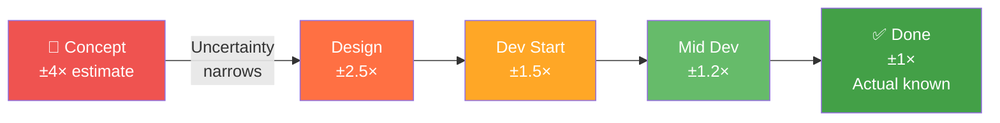

---

### Q215. What is a release readiness review?
**Answer:** A gate review before a production release that checks: all features tested, DoD met, security scan passed, performance benchmarks met, runbook updated, rollback plan in place, stakeholders notified. It is a safety net, not a bureaucratic hurdle. Automate as much of it as possible.

---

# Advanced Team Handling (continued)

### Q216. How do you foster innovation in a team under delivery pressure?
**Answer:** Create protected time (hackathons, 10–20% innovation time). Keep a list of "experiments we want to try." Celebrate experiments whether they succeed or fail. Distinguish between innovation risk (acceptable) and delivery risk (must manage). Demonstrate that leadership supports experimentation by not punishing failure.

---

### Q217. How do you handle a team that has lost faith in leadership?
**Answer:** Acknowledge that trust is earned. Ask the team what specific actions or events eroded trust. Work with leadership to address the root causes publicly. Create mechanisms for feedback to actually reach leadership and be acted on. Consistent, kept commitments from leadership rebuild trust over time — there is no shortcut.

---

### Q218. How do you handle a "hero culture" where only one person can fix production issues?
**Answer:** A hero culture creates a single point of failure and burnout. Address by: requiring documentation of every incident fix, running blameless post-mortems, rotating on-call responsibility, pair debugging, and cross-training. Make it a team norm that "if only one person can do it, it's a team risk."

---

### Q219. How do you support neurodiverse team members?
**Answer:** Create written agendas before every meeting. Allow async contribution to brainstorming (written ideas). Provide quiet focus time (reduce open-plan noise). Use visual facilitation. Give feedback in writing as well as verbally. Ask team members directly what works best for them — do not assume.

---

### Q220. How do you handle a situation where senior developers dismiss junior developers' ideas?
**Answer:** Set explicit team norms: all ideas are considered on merit, not seniority. Use round-robin or anonymous idea generation in retrospectives to level the playing field. After a junior idea is dismissed, ask the senior developer to explain their objection in technical terms — this separates expertise from status. Celebrate junior contributions publicly.

---

### Q221. How do you manage a team where remote members feel like second-class citizens?
**Answer:** Adopt a remote-first meeting policy (everyone on video, even if collocated). Rotate meeting times. Create the same information access for remote members (recordings, written decisions). Assign a "remote champion" who watches for exclusion in real-time meetings. Include remote members in social initiatives.

---

### Q222. How do you handle a team that is too large?
**Answer:** The ideal Scrum team is 4–10 people. Beyond that, communication overhead grows quadratically. Split into two focused teams with separate backlogs and goals. If they share a codebase, establish clear ownership boundaries. Run a Product Increment event to coordinate.

---

### Q223. What is pair programming and when do you encourage it?
**Answer:** Two developers work at one computer — one drives (writes code), one navigates (reviews, thinks ahead). Benefits: fewer defects, knowledge sharing, faster onboarding, better design decisions. Encourage for: complex problems, onboarding new members, spreading knowledge of critical areas.

---

### Q224. What is mob programming?
**Answer:** The whole team works on one problem at one computer, rotating the driver role every 15 minutes. Extremely effective for: complex architectural problems, knowledge sharing, onboarding, and removing blockers. Expensive on cost per hour but fast on cycle time.

---

### Q225. How do you handle a situation where the team's tooling is outdated and causing friction?
**Answer:** Quantify the friction: how much time is lost per week due to tool problems? Build a business case. Advocate for budget with data. Involve the team in tool selection (they will adopt what they chose). Plan the migration with a transition period (run old and new in parallel).

---

# Advanced Customer Handling (continued)

### Q226. How do you handle a client who always says "yes" in the meeting but then raises concerns afterwards?
**Answer:** This often means the client does not feel safe disagreeing in the meeting. Create conditions for real-time dissent: ask explicitly "What concerns do you have about this?" before wrapping up. Use anonymous feedback for sensitive topics. Send a written summary and ask for responses by email, which gives time to think.

---

### Q227. How do you manage a client's unrealistic expectations about AI?
**Answer:** Educate early about AI capabilities and limitations. Distinguish between: AI-assisted (AI + human validation), AI-automated (fully autonomous), and AI-enhanced (better than without AI). Set measurable expectations: "We expect accuracy of X% — here's how we'll measure it." Demonstrate with a proof of concept before committing.

---

### Q228. How do you handle a client who wants to micromanage the technology choices?
**Answer:** Have a transparent conversation about the boundary: the client defines WHAT (requirements, outcomes); the team decides HOW (implementation). Invite the client to explain their technology concern — often it is a risk they have not articulated. Address the underlying concern rather than arguing about the technology choice.

---

### Q229. What is a customer success strategy for a software product?
**Answer:** Customer success ensures customers achieve their desired outcomes with your product. Key activities: onboarding, adoption tracking, health scores, QBRs (Quarterly Business Reviews), renewal management, and expansion (upsell/cross-sell). Measure: NPS, retention rate, feature adoption, support ticket volume.

---

### Q230. How do you handle a client who compares your team's velocity to another vendor?
**Answer:** Different teams use different story-point calibrations — velocity is not comparable across teams. Redirect the comparison to outcomes: "Let's compare delivery of business value." Show what has been delivered relative to the roadmap. Offer to demonstrate your quality, process, and team health instead.

---

### Q231. How do you conduct a Quarterly Business Review (QBR)?
**Answer:** QBR structure: (1) Review previous quarter: achievements vs targets, (2) Business health: metrics that matter to the client, (3) Challenges and learnings, (4) Next quarter roadmap, (5) Relationship health: how are we working together?, (6) Decisions needed. Send the deck 48h in advance. Keep it to 90 minutes.

---

### Q232. How do you handle a client who requests a feature that is technically impossible within their budget?
**Answer:** Be honest immediately — false hope wastes their time and money. Present what is possible within the budget and explore alternatives: a simpler version of the feature, a workaround, a phased approach, or additional budget. Never say "yes" to something you cannot deliver.

---

### Q233. How do you manage client satisfaction measurement?
**Answer:** Use NPS (Net Promoter Score) quarterly with follow-up interviews for detractors. Track project health metrics (delivery vs plan, defect rate). Run post-sprint surveys. Create a "voice of the customer" process to surface feedback into the product backlog. Act on every detractor response within 2 weeks.

---

### Q234. How do you handle a client who wants 24/7 support but you only provide business hours?
**Answer:** Set clear expectations in the contract and during onboarding. Define what qualifies as an emergency (severity levels) and the out-of-hours process for genuine emergencies (on-call rotation, escalation hotline). Charge appropriately for 24/7 coverage — it has a real cost in team wellbeing and staffing.

---

### Q235. How do you handle a client who wants to hire your best team member?
**Answer:** This is a risk to flag to management. Have an honest conversation with the team member about their career goals (they may be open to a conversation with the client). Involve HR and legal — there may be non-poaching clauses. If the team member chooses to leave, manage the transition professionally.

---

# Advanced Escalation (continued)

### Q236. What is an incident severity level and how do you define it?
**Answer:**

| Severity | Definition | Response time |
|---------|-----------|--------------|
| P1 (Critical) | Total outage, all users affected | 15 minutes |
| P2 (High) | Major feature broken, most users affected | 1 hour |
| P3 (Medium) | Feature degraded, some users affected | Same business day |
| P4 (Low) | Minor issue, workaround exists | Next sprint |

Define these in the contract with the client. Never let the client define every bug as P1.

---

### Q237. How do you create an on-call rotation that is fair and sustainable?
**Answer:** Distribute on-call fairly — rotate so no one carries it continuously. Compensate on-call appropriately (comp time or financial). Set clear expectations: respond to alerts, not solve every problem during off-hours. Track toil — if on-call is consuming more than 25% of the week, fix the system.

---

### Q238. How do you handle an escalation that involves a contract dispute?
**Answer:** Involve legal counsel immediately. Collect and preserve documentation (emails, meeting notes, change requests, sign-off records). Keep the conversation professional and factual — not emotional. Separate the relationship issue (fix this) from the contract issue (legal team handles). Do not make verbal commitments without written confirmation.

---

### Q239. What is RTO and RPO in a client escalation context?
**Answer:** RTO (Recovery Time Objective): how quickly the system must be restored after an incident. RPO (Recovery Point Objective): the maximum acceptable data loss (how far back can we recover data to?). These should be defined in the contract. When a critical incident occurs, the client will ask about both.

---

### Q240. How do you conduct a post-incident stakeholder communication?
**Answer:** Within 24–48h of resolution, send a written incident report to affected stakeholders: (1) Timeline of events, (2) Root cause, (3) Customer impact, (4) What was done to restore service, (5) Prevention actions with owners and dates. Never send a vague "we're investigating" closure — be specific.

---

# Advanced Project Management (continued)

### Q241. What is Earned Value Management (EVM)?
**Answer:** EVM measures project performance objectively. Key metrics: Planned Value (PV), Earned Value (EV), Actual Cost (AC). Key indicators: SPI (Schedule Performance Index) = EV/PV (>1 = ahead), CPI (Cost Performance Index) = EV/AC (>1 = under budget). Use in large, fixed-price projects.

---

### Q242. What is a project charter?
**Answer:** A project charter authorises the project and defines: objectives, scope, timeline, budget, key stakeholders, risks, and success criteria. Signed by the sponsor. It is the foundation document. Without a charter, projects lack clarity on scope and authority.

---

### Q243. How do you manage scope in a T&M (Time and Materials) contract?
**Answer:** T&M has no fixed scope — the client pays for time and materials used. Risk: scope can grow without limit, burning the client's budget. Manage with: clear prioritisation, regular budget reviews, and a commitment to tell the client when they are nearing budget so they can re-prioritise.

---

### Q244. What is a project governance framework?
**Answer:** A set of policies, processes, and roles that ensure a project is managed consistently and accountably. Includes: decision-making authority levels, change control process, escalation paths, reporting cadence, and quality gates. Prevents "everyone deciding everything" and "no one accountable for anything."

---

### Q245. How do you manage multiple projects simultaneously as an Engineering Manager?
**Answer:** Prioritise ruthlessly — not all projects are equal. Delegate project-level execution to project managers or senior team leads. Reserve your time for: strategic decisions, risk escalation, stakeholder relationships, and team health. Use weekly one-pagers to stay informed without being in every meeting.

---

### Q246. What is a project post-implementation review?
**Answer:** An honest assessment of a completed project: were objectives met? Was it on time and budget? What was the actual quality? What would we do differently? Who contributed most and how can they be recognised? Findings feed into the next project plan.

---

### Q247. What is timeboxing and when do you apply it?
**Answer:** Timeboxing allocates a fixed time to an activity, regardless of whether the task is complete. This forces prioritisation within the time box and prevents Parkinson's Law (work expands to fill available time). Applied to: sprints, meetings, design sessions, spikes, and decision-making.

---

### Q248. What is the difference between a milestone and a deliverable?
**Answer:** A milestone is a point in time that marks a significant event (phase completion, decision gate, go-live). A deliverable is a tangible output (a working feature, a document, a deployed service). Milestones mark when deliverables are due.

---

### Q249. What is critical chain project management?
**Answer:** An extension of critical path that accounts for resource constraints and uncertainty. Uses buffers (project buffer, feeding buffers, resource buffers) instead of padding individual tasks. Protects the critical chain without inflating every estimate.

---

### Q250. How do you handle scope that arrives mid-sprint (unplanned work)?
**Answer:** Assess urgency and importance. True emergencies (production bugs, regulatory compliance): swap out equivalent scope with PO agreement. Everything else: add to the backlog and prioritise for the next sprint. Never silently absorb unplanned work — it makes the team look unreliable when sprint goals aren't met.

---

# Advanced Leadership (continued)

### Q251. What is situational leadership (Blanchard)?
**Answer:** Adjust your leadership style to the team member's development level for a specific task. Four styles: Directing (high directive, low support — new to task), Coaching (high directive, high support — learning), Supporting (low directive, high support — capable but uncertain), Delegating (low directive, low support — expert and confident).

---

### Q252. What is the SCARF model?
**Answer:** SCARF (David Rock) describes five social domains that trigger threat or reward responses: Status, Certainty, Autonomy, Relatedness, Fairness. Leaders who understand SCARF can design environments that feel safe and rewarding, reducing defensive behaviour and increasing collaboration.

---

### Q253. How do you use Nonviolent Communication (NVC) in team management?
**Answer:** NVC (Rosenberg) has four components: Observation (factual, without evaluation), Feeling (how you feel), Need (the underlying need), Request (a specific, positive action). Example: "When I see the sprint burndown still at 100% on day 7 (O), I feel worried (F) because I need visibility of progress to support the team (N). Would you be willing to update the board daily? (R)"

---

### Q254. What is a "difficult conversation" and how do you prepare for one?
**Answer:** A difficult conversation involves conflicting perceptions, strong emotions, or high stakes. Prepare with the "three conversations" model (Stone, Patton, Heen): (1) What happened (the facts), (2) The feelings layer (emotions on both sides), (3) The identity layer (what does this say about me?). Start by listening, not stating your case.

---

### Q255. How do you create a feedback-rich culture?
**Answer:** Model receiving feedback well (thank the giver, don't get defensive). Create regular feedback rituals (retrospectives, 1:1s, 360 reviews). Teach the SBI feedback model. Distinguish feedback (impact of behavior) from advice (what to do instead). Reward courage — giving honest feedback should be recognised.

---

### Q256. What is a "skip-level" meeting?
**Answer:** A meeting between a manager's manager and their direct reports, without the manager present. Purpose: understand team health independently, catch issues the manager may not surface, build relationships. Done regularly (quarterly), not as a reaction to complaints.

---

### Q257. How do you manage performance reviews fairly?
**Answer:** Use documented evidence (achievements, feedback from peers, deliverables) not recent memory. Calibrate ratings with other managers (reduces bias). Be specific: "You delivered the payment module 2 weeks ahead of schedule and mentored 2 junior engineers" beats "you did good work." Follow up with a development plan.

---

### Q258. What is the halo effect in team management?
**Answer:** The halo effect is when one positive trait (technical brilliance) makes you rate everything else higher (communication, teamwork). The opposite is the horns effect. Mitigate with structured evaluation rubrics, peer feedback, and calibration sessions.

---

### Q259. How do you manage a team through organisational change (merger, restructuring)?
**Answer:** Communicate early and honestly — even if the message is "we don't know yet." Acknowledge the uncertainty and its emotional impact. Provide as much stability as you can control (keep team rituals). Answer "what does this mean for me?" at every update. Advocate for the team's interests in leadership discussions.

---

### Q260. What is an "engineering culture" and how do you build one?
**Answer:** Engineering culture is the shared values, norms, and practices that define how engineers work and make decisions. Build it by: writing it down (team charter, engineering principles), hiring for it (not just skills), celebrating exemplars of the culture, and acting consistently with it yourself.

---

# Advanced Metrics & Improvement (continued)

### Q261. What is a value stream mapping?
**Answer:** Value stream mapping visualises every step from idea to production: who does it, how long each step takes, and how long items wait. Identify: waste (rework, waiting, unnecessary approval), bottlenecks (queues building up), and opportunities for automation.

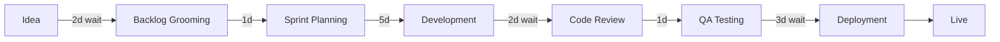

---

### Q262. What is lead time vs cycle time vs throughput?
**Answer:**
- **Lead time:** From customer request to delivery.
- **Cycle time:** From team starting work to delivery.
- **Throughput:** Number of items delivered per unit time.

Lead time includes waiting in the backlog. Cycle time starts when work begins. Throughput is a rate.

---

### Q263. What is a service-level agreement (SLA) for a development team?
**Answer:** An SLA defines: response time for incident types, bug fix timelines by severity, feature delivery lead time targets, uptime commitments. For a development team, also include: code review SLA (24h), PR deployment to staging (<1h with CI/CD), production deployment (same day for hotfix).

---

### Q264. What is a Net Promoter Score (NPS)?
**Answer:** NPS asks: "How likely are you to recommend us to a colleague? (0–10)". Promoters (9–10), Passives (7–8), Detractors (0–6). NPS = % Promoters − % Detractors. Use for: team health, client satisfaction, employee satisfaction (eNPS). Always follow up detractors within 2 weeks.

---

### Q265. How do you use flow metrics to improve delivery?
**Answer:** Collect: cycle time per story, throughput per sprint, WIP at each stage, blocked time. Analyse: where do items wait longest? Which story types have high cycle time? What is the WIP-to-throughput ratio (should be near 1 sprint's worth)? Use retrospectives to target the top bottleneck.

---

### Q266. What is an Agile maturity model?
**Answer:** A framework that assesses how well a team or organisation applies Agile. Levels typically range from: (1) initial/ad hoc, (2) managed/basic, (3) defined/consistent, (4) quantitatively managed, (5) optimising. Use for self-assessment, not ranking. The goal is continuous improvement, not achieving a level.

---

### Q267. What is a "retrospective of retrospectives"?
**Answer:** A periodic review (every quarter or after major milestones) of the retrospective format and outcomes themselves. Ask: Are we generating meaningful actions? Are actions being completed? Are we too comfortable with the same format? Identify improvements to the improvement process itself.

---

### Q268. How do you track and present sprint metrics to leadership?
**Answer:** One-page dashboard: sprint goal achievement (%), velocity trend, cumulative burnup (release progress), active risks, and customer satisfaction. Keep it visual. Lead with outcomes, not activity. Bring three items for leadership decision or awareness.

---

### Q269. What are the key indicators that a team is performing at high maturity?
**Answer:** High-maturity indicators: (1) consistently meets sprint goals, (2) DoD is strict and consistently met, (3) retrospective actions are implemented, (4) team resolves its own impediments, (5) team proactively communicates risks, (6) DORA metrics in elite range, (7) customer satisfaction is high, (8) minimal unplanned work.

---

### Q270. How do you create a continuous improvement culture at scale?
**Answer:** Communities of Practice for sharing improvements. A "golden path" of recommended practices that teams opt into. An internal conference or demo day where teams share what they learned. An "improvement showcase" at all-hands. Senior leadership visibly practicing and rewarding improvement.

---

# Conflict Resolution (continued)

### Q271. What is the "intent vs impact" framework in conflict resolution?
**Answer:** Conflicts often arise when someone's negative impact is greater than their intent. ("I didn't mean to dismiss your idea — I was just thinking out loud.") Acknowledge both: "I understand your intent was not to dismiss me. The impact was that I felt unheard." Focus on impact because impact is what others experience; intent is not visible.

---

### Q272. How do you handle a conflict between a team and their manager?
**Answer:** As SM, you are in a delicate position. Listen to both sides separately. Identify the specific behaviors and their business impact. Bring them into a structured conversation with you as a neutral facilitator. If the conflict involves the manager's conduct (not just style), involve HR.

---

### Q273. What is the "third side" approach to conflict?
**Answer:** William Ury's "third side" approach involves the broader community creating conditions for conflict resolution: witnesses (observe and name escalation), referees (maintain fair process), mediators (help parties communicate), arbitors (provide binding decisions). As SM, you typically play the mediator role.

---

### Q274. How do you manage passive-aggressive behavior in a team?
**Answer:** Name it privately and specifically: "When you agreed in the meeting but then didn't implement the decision, it created confusion." Understand the root cause — often the person felt unheard or overruled. Create a safe mechanism for them to dissent openly: "If you disagree with a decision, what would help you raise that in the moment?"

---

### Q275. What is "stonewalling" in conflict and how do you address it?
**Answer:** Stonewalling is withdrawing from a conflict conversation (silent treatment, dismissive responses, refusing to engage). It prevents resolution and often escalates the other person's distress. If someone is stonewalling, acknowledge that the conversation is uncomfortable and suggest a short break before resuming. Don't pursue someone who has completely shut down.

---

### Q276. How do you handle a conflict that has a power imbalance (senior vs junior)?
**Answer:** Create a safe space for the junior person to express their view — without the senior person present initially. Coach the junior on assertive communication. Mediate a structured conversation where both have equal speaking time. As SM, explicitly protect the junior voice: "Let's hear from everyone before we respond."

---

### Q277. What is cognitive dissonance in conflict?
**Answer:** People feel discomfort when new information conflicts with their existing beliefs. In team conflict, a developer might resist acknowledging a design flaw they created. Address by focusing on the solution ("What could we do differently?") rather than the error ("Why did you do it this way?").

---

### Q278. How do you handle a cultural conflict (different nationalities on a team)?
**Answer:** Educate the team on communication style differences (high-context vs low-context cultures, directness norms, hierarchy attitudes). Create shared team norms that explicitly bridge these differences. Never allow cultural stereotyping. Build relationships across cultures through informal interaction.

---

### Q279. What is "conflict capital" and how do you build it?
**Answer:** Conflict capital is the reservoir of trust and goodwill that allows teams to engage in productive conflict. Invest in it during calm periods: share meals, celebrate successes, do team-building. Teams with high conflict capital can disagree strongly and repair quickly. Teams with low capital let small conflicts become crises.

---

### Q280. How do you close a conflict?
**Answer:** Explicit closure: (1) summarise what was agreed, (2) confirm any action items and owners, (3) acknowledge the difficulty of the conversation, (4) express confidence in the team's ability to work through disagreements. Follow up 1–2 weeks later to ensure the resolution held and there is no residual tension.

---

# Hiring, Onboarding & Retention (continued)

### Q281. What is a panel interview and how do you structure it?
**Answer:** A panel interview has 2–4 interviewers with the candidate simultaneously. Each interviewer owns a specific area (technical, values, delivery). Agree on questions and scoring rubrics in advance. Debrief immediately after, before interviewers' memories fade. Use a structured scoring sheet to prevent dominant voices changing quieter interviewers' scores.

---

### Q282. How do you assess communication skills in a technical interview?
**Answer:** Ask the candidate to explain a technical concept to a non-technical person. Observe how they handle misunderstanding (do they rephrase or repeat louder?). Give them a vague requirement and see if they ask clarifying questions. Assess their written communication by reviewing their email/Slack history if visible (e.g. in a take-home context).

---

### Q283. How do you make a job offer effectively?
**Answer:** Call first — do not send an offer letter cold. Express enthusiasm. Summarise the role, compensation, and start date. Give them time to consider (3–5 business days is reasonable). Be ready to answer questions about the team, growth, and culture. Follow up with a written offer.

---

### Q284. How do you handle a counter-offer situation when a good engineer receives one from another company?
**Answer:** Understand the root cause — if they were looking, why? Address it honestly (if it's fixable). Share what you can offer (growth path, interesting work, team stability). Avoid a pure salary war — it creates resentment from peers and sets a precedent. If you counter, make sure you can sustain the commitment.

---

### Q285. What is an employer brand and how does it affect hiring?
**Answer:** An employer brand is the perception of your company as a place to work. Strong employer brand: candidates apply proactively, accept offers more readily, and refer friends. Build it through: engineering blog, conference talks, open-source contributions, glassdoor responses, and genuine employee advocacy.

---

### Q286. How do you create an inclusive hiring process?
**Answer:** Diverse interview panels. Structured questions (same for every candidate). Blind resume review (remove name and photo). Clear job descriptions without unnecessary requirements (e.g., "10 years experience" for technology that is 5 years old). Track demographic data and analyse where in the funnel diversity is lost.

---

### Q287. How do you handle an underperforming probationary employee?
**Answer:** Probation is designed for this. Have honest feedback conversations immediately — do not wait until probation end. Document concerns and provide specific, achievable targets within the probation period. If targets are met, confirm employment. If not, follow the company's process for not confirming probation. Be humane but clear.

---

### Q288. How do you structure a compensation review process?
**Answer:** Annual review with mid-year check-in. Align compensation to market data (use Radford, Levels.fyi, or Glassdoor for benchmarking). Separate performance discussion from compensation discussion (different meetings, different timing). Be transparent about the framework so people understand how decisions are made.

---

### Q289. What is a succession plan for a key engineering role?
**Answer:** Identify the top 2–3 potential successors for each critical role. Assess their readiness (now, 1 year, 3 years). Create development plans to close gaps. Cross-train so at least two people can perform each critical function. Review annually.

---

### Q290. How do you handle a team member who is a poor cultural fit?
**Answer:** Define "cultural fit" specifically in terms of behaviours and values, not personality or background. If the issue is a values violation (dishonesty, disrespect), address directly with management and HR. If it is a style difference, invest in relationship-building and communication coaching before concluding it is unfixable.

---

# Remote & Distributed Teams (continued)

### Q291. How do you run a distributed retrospective effectively?
**Answer:** Use Miro or FunRetro. Send the board link 10 minutes before the meeting. Use an icebreaker (temperature check, GIF of your mood). Allow 5 minutes for silent, individual brainstorming before grouping. Use dot voting asynchronously if the team spans timezones. Capture action items in writing.

---

### Q292. What is "asynchronous work culture" and how do you establish it?
**Answer:** Async culture values: written communication, documented decisions, pre-recorded demos (Loom), and working in ways that don't require immediate response. Establish with: defined response time expectations (not instant), meeting-free focus blocks, documentation as a first-class activity, and leaders who model async communication.

---

### Q293. How do you maintain team energy in a long-running remote project?
**Answer:** Celebrate milestones virtually (team dinner expense, digital gift cards, online game session). Share wins publicly. Rotate leadership of ceremonies to build ownership. Create a "highlights" Slack channel. Mark anniversary dates. Connect the work to user impact — show real users benefiting from what the team built.

---

### Q294. How do you handle time-zone inequality (always the same person up at odd hours)?
**Answer:** Rotate meeting times across quarters. Use async as the default for non-urgent communication. Create "async handoff" documents so the person who goes offline can hand off to the next timezone smoothly. Compensate those who regularly work outside business hours.

---

### Q295. What is "working out loud" and how does it help distributed teams?
**Answer:** Working out loud means sharing progress, questions, and blockers openly (Slack, project channels) rather than working silently. It builds visibility, enables colleagues to help or redirect early, and creates a natural audit trail. As SM, model it yourself.

---

### Q296. How do you build relationships in a team that has never met in person?
**Answer:** Invest in informal time: virtual coffee pairs (randomly assigned weekly), team game sessions, show-and-tell of non-work interests. Create a team Slack channel for personal sharing. When budget allows, invest in one annual team gathering — the return in trust and collaboration is very high.

---

### Q297. How do you handle a situation where a remote team member's home environment is not suitable for work?
**Answer:** Have a private, empathetic conversation. Provide a stipend for a co-working space or home office equipment (many companies have policies for this). Never mandate hours in a home environment that is chaotic. Create flexible hours if the standard schedule doesn't work.

---

### Q298. What is the "loophole" anti-pattern in remote work?
**Answer:** A remote team member technically attends meetings (camera on, microphone connected) but is actually doing other work. Symptoms: delayed responses in meetings, low contribution. Address by: reducing meeting count (fewer but more focused), making meetings interactive (questions, breakout rooms), and having a private conversation about engagement.

---

### Q299. How do you handle confidential conversations in an open remote environment?
**Answer:** Establish a clear protocol: sensitive topics (performance, compensation, personal issues) are always via video call, never Slack/email (too easily screenshotted). Use a "this is confidential" signal to set expectations at the start of the conversation.

---

### Q300. What tools and practices prevent knowledge silos in a distributed team?
**Answer:** Automated documentation (Confluence auto-links from Jira), recorded walkthroughs (Loom library), architectural decision records, public Slack channels for decisions (not DMs), pair programming, internal newsletters, and an onboarding wiki that is maintained by the most recent joiner (always current).

---

# Scenario Deep Dives

### Q301. You are asked to deliver a project in half the time with the same scope. What do you do?
**Answer:** This is a classic impossible request. Respond with a clear risk statement. Explore the trade-off: the iron triangle (scope, time, cost). Options: cut 50% of scope to MVP, double the team (with the caveats of Brooks' Law), or negotiate the timeline. Document the conversation. Never accept an impossible commitment silently.

---

### Q302. A new stakeholder joins late in the project and wants to redesign the product. What do you do?
**Answer:** Schedule a dedicated onboarding session. Walk them through the history, decisions made, and their rationale. Use the ADR log. Distinguish between: observations based on new context (valuable, consider for future iterations) and changing already-delivered scope (costly, requires impact analysis). Involve the PO to protect the roadmap.

---

### Q303. How do you handle a situation where the team is demotivated because a major feature was cut?
**Answer:** Acknowledge the disappointment genuinely — do not dismiss it. Explain the business reason honestly. Ask the team to separate their feelings about the decision from their commitment to the remaining work. If possible, give the feature a future date ("It's not cut permanently — it's deferred to Q3"). Celebrate what was delivered.

---

### Q304. You inherit a team with no documented processes or coding standards. What is your first month?
**Answer:** Month 1: Observe and listen — do not implement changes immediately. Understand the team's strengths, pain points, and existing informal norms. Build trust. Identify the two or three most painful problems. At the end of month 1, propose a roadmap of improvements with the team's input — not imposed from outside.

---

### Q305. How do you handle a "big bang" release that the client insists on instead of continuous delivery?
**Answer:** Understand the client's reason — often it is regulatory (one approval covers all changes), training (users need to be trained once), or risk perception (they want to test everything together). Work within their constraint: deliver continuously internally, but batch the client-visible releases. Gradually introduce them to the idea that smaller releases reduce their risk.

---

### Q306. How do you handle a team member who shares confidential client information externally?
**Answer:** This is a serious matter. If accidental: immediate conversation, assess what was shared and to whom, notify the client and legal if required, remediate (revoke access, patch the gap). If intentional: involve HR and legal immediately. Document everything. This is not a team facilitation matter — it is a conduct issue.

---

### Q307. You are asked to manage a team you have no technical expertise in. What do you do?
**Answer:** Be honest about your gap — do not pretend expertise you don't have. Establish technical credibility through learning (read the codebase, attend architecture discussions, ask questions). Leverage the team's expertise: they are the technical experts, you are the process and people expert. Ask: "What do you need from me that you're not getting?"

---

### Q308. A client asks to see your team's private Slack messages. How do you handle it?
**Answer:** Decline — private team communication is not client-deliverable content. Explain that internal team communication enables honest collaboration. Offer instead: Sprint Review demos, delivery metrics, burnup charts, and meeting minutes. If the client does not trust the team without surveillance, address the underlying trust issue directly.

---

### Q309. How do you handle a sprint where every story is blocked by another team?
**Answer:** This is an impediment at the team level. Escalate immediately — do not absorb it silently. Have a conversation with the other team's SM or manager. Identify whether the issue is priority (they don't see your dependency as important) or capacity (they are overloaded). Engage the PO to escalate if necessary. Plan for a potential sprint goal change.

---

### Q310. How do you manage a project where the client and the internal stakeholders have conflicting goals?
**Answer:** Get both parties in the same room and make the conflict explicit and transparent. Facilitate a conversation about shared goals (usually there is a common outcome). Use data to inform the discussion. The PO must be empowered to make a final prioritisation decision. Document the resolution.

---

### Q311. How do you handle a team that consistently underestimates technical complexity?
**Answer:** Use historical data: show the gap between estimates and actuals over 3 months. Introduce refinement techniques (three-point estimation, breaking stories to <1 day tasks before estimating). Run a "complexity checklist" (integration points, edge cases, test coverage needed). Add an explicit uncertainty buffer for high-complexity stories.

---

### Q312. How do you handle a situation where the company asks you to track developer productivity by lines of code?
**Answer:** Educate leadership on why this is a harmful metric: deleting code can be more productive than writing code, different tasks have vastly different line counts, and it incentivises verbose coding. Propose better alternatives: DORA metrics (delivery frequency, lead time, MTTR), cycle time, and customer satisfaction. If leadership insists, document your objection.

---

### Q313. How do you manage a "matrix organisation" where your team members have multiple managers?
**Answer:** Agree with the other managers on each person's allocation and primary accountability. Prioritise work collaboratively — do not compete for the person's time silently. Create a clear escalation path when allocation conflicts arise. Where possible, advocate for dedicated team membership (not shared resources).

---

### Q314. How do you handle a situation where a team member is promoted but struggles in the new role?
**Answer:** This is common (the "Peter Principle"). Have honest, supportive 1:1 conversations early. Provide training, mentoring, and time — promotion-level performance rarely comes in the first 3 months. Set clear milestones for the first 90 days. If they are genuinely unsuited, have a compassionate conversation about other paths — including reverting to the previous level if the company policy allows.

---

### Q315. What do you do when a client claims they never agreed to a feature that your team has been building for 2 sprints?
**Answer:** Pull the documentation: written acceptance criteria, sprint review meeting notes, any sign-off emails. Present the evidence factually and without blame. If the documentation is weak, acknowledge that and treat it as a learning. Assess the cost of change vs the cost of continuing. Negotiate a resolution (modify the feature, credit it toward future work, or accept it as-is with adjustments).

---

### Q316. How do you handle a situation where the team's tooling budget is cut?
**Answer:** Assess the actual impact on productivity (data-driven). Prioritise tools — which are essential vs nice-to-have? Explore open-source alternatives. Build the business case for the most critical tools, quantifying the cost of their absence (developer time wasted, bugs from lack of testing tools). Present to leadership with ROI data.

---

### Q317. How do you handle a client who wants status reports in a format that takes 4 hours to prepare weekly?
**Answer:** Quantify the cost: 4h × 50 weeks = 25 person-days per year. Propose an alternative: automated dashboards (Jira, Confluence), or a 30-minute template. Ask what decisions the client makes from the report — design a lightweight version that answers those questions only. Many long reports answer questions nobody is asking.

---

### Q318. How do you handle a "scope is done but client is not happy" situation?
**Answer:** Understand what "not happy" means specifically. Is it: (1) the feature doesn't do what they expected (requirements gap), (2) the experience is poor (UX), (3) business outcomes weren't achieved (product-market fit), or (4) the relationship has broken down? Each needs a different response. Never dismiss "I don't like it" — understand it.

---

### Q319. How do you handle a sprint that ends with no deployable increment due to a critical bug found in testing?
**Answer:** The sprint still ends on schedule — extend it only in exceptional, defined circumstances. Hold the Sprint Review anyway with what is complete. Add the bug fix to the next sprint as the top priority. Investigate why it was found so late (testing gaps, insufficient DoD, lack of continuous integration). Adjust the DoD.

---

### Q320. How do you handle a situation where a junior SM is struggling?
**Answer:** Provide coaching (not telling). Ask: "What do you think went well in that retrospective? What would you do differently?" Pair them with an experienced SM (buddy system). Review their ceremonies with them and give specific, positive and developmental feedback. Create a development plan with clear milestones.

---

# Management & Organisations

### Q321. What is an organisational anti-pattern that commonly undermines Agile?
**Answer:** "Zombie Scrum" — going through the Scrum motions without the mindset. Teams hold ceremonies but don't adapt, don't have a real PO, don't have a working increment, and don't improve. Symptoms: retrospectives with no actions, sprint reviews no stakeholder attends, sprint goals that are just a list of stories.

---

### Q322. What is the "feature factory" anti-pattern?
**Answer:** A team that produces features continuously without measuring their value. They are rewarded for output (how many features shipped) not outcomes (how many users were helped). Fix by: requiring outcome metrics on every feature, sharing user data with the team, making value measurement part of the DoD.

---

### Q323. What is technical leadership and how does it differ from people leadership?
**Answer:** Technical leadership guides the technical direction: architecture decisions, technology choices, code quality standards, technical mentoring. People leadership guides individuals: growth, wellbeing, performance, career. Both are essential. Many engineering managers must balance both. Delegation to a tech lead allows specialisation.

---

### Q324. What is a Principal Engineer and how do they relate to an Engineering Manager?
**Answer:** A Principal Engineer is the senior technical track (individual contributor). They drive technical strategy, architecture, cross-team technical alignment, and mentoring without managing people. The EM manages people, teams, and delivery. They are complementary peers, not competing roles.

---

### Q325. What is psychological safety assessment and how do you measure it?
**Answer:** Use Amy Edmondson's 7-item psychological safety survey (Likert 1–5): e.g., "It is safe to take a risk on this team." Score per item and overall. Benchmark against team norms. Use as a conversation starter in retrospectives, not as a comparison between teams.

---

### Q326. What is a "tech radar" and how do you use it?
**Answer:** A tech radar (popularised by ThoughtWorks) categorises technologies into: Adopt, Trial, Assess, Hold. Use it to guide technology decisions across teams, reduce proliferation of similar tools, and share learnings. Run a radar update session quarterly with senior engineers.

---

### Q327. What is Wardley Mapping and when do you use it?
**Answer:** See Q496 of the fullstack file (management context): Wardley Maps help managers make build-vs-buy decisions, anticipate competitive moves, and understand where their technology sits on the commodity curve. Use in annual planning and technology strategy sessions.

---

### Q328. How do you balance innovation and stability in a product team?
**Answer:** Allocate explicitly: 70% core delivery, 20% improvement and tech debt, 10% innovation. Track each category in the backlog. Create innovation time with real outcomes expected (not just R&D theatre). Give the team autonomy in the innovation bucket while holding the delivery bucket to SLAs.

---

### Q329. What is a "decision log"?
**Answer:** A record of significant decisions made: what was decided, who decided it, what options were considered, and why this option was chosen. Stored alongside the product documentation. Answers "why did we do it this way?" for future team members, auditors, and new stakeholders.

---

### Q330. How do you manage a team through a product pivot?
**Answer:** Communicate the reason for the pivot clearly and honestly. Acknowledge the work that is being deprioritised — do not pretend it didn't happen. Help the team see the opportunity in the pivot. Expect a period of uncertainty and reduced productivity (the team needs to re-orient). Re-establish clear goals quickly.

---

# More Rapid-Fire Scenarios

### Q331. How do you handle it when a developer pushes directly to main without a PR?
**Answer:** Have a private conversation immediately. Understand the reason (time pressure, thought it was minor, doesn't understand the importance). Explain the risk (breaking changes, no review, no audit trail). Establish branch protection rules (enforce PR process via tooling, not willpower). Make it a team norm in the working agreement.

---

### Q332. How do you handle a client who badmouths your team in a meeting with executives?
**Answer:** Stay calm. Do not retaliate or become defensive publicly. Ask for specifics: "Can you share an example so we can address it?" Acknowledge legitimate concerns without validating unfair characterisations. After the meeting, debrief with your manager and decide whether to address the client directly or involve senior leadership.

---

### Q333. What do you do when you receive conflicting instructions from two senior stakeholders?
**Answer:** Do not choose sides or proceed with one instruction while ignoring the other. Bring both stakeholders together to resolve the conflict. If you cannot get them in the same room, escalate to their common manager with a clear summary of the conflict and a request for a decision. Document everything.

---

### Q334. How do you handle a sprint goal that becomes irrelevant mid-sprint due to an external event?
**Answer:** Convene an extraordinary meeting with the team and PO. Assess the impact. If the goal is truly irrelevant (market event, regulatory change, client direction), cancel the sprint (allowed in Scrum) and re-plan. If the goal is partially relevant, adapt the sprint backlog and document the change.

---

### Q335. A client wants to attend the sprint retrospective. How do you handle it?
**Answer:** The retrospective is a team-only event — this is a core Scrum principle. The team needs safety to discuss challenges, including issues with the client relationship. Politely decline: "The retrospective is for the team to improve our internal processes — we'll incorporate relevant feedback into the Sprint Review and our regular check-ins." Offer them a separate feedback session instead.

---

### Q336. How do you handle a situation where the team's work is not visible to leadership?
**Answer:** Create visibility: a team dashboard, a weekly newsletter, a demo at all-hands. Invite leadership to Sprint Reviews. Share metrics (velocity, delivery rate, quality). Share user stories of impact ("This sprint, we reduced checkout time by 2 seconds — here's the data"). Visibility is a two-way responsibility.

---

### Q337. How do you handle a team that has fallen into "learned helplessness"?
**Answer:** Learned helplessness happens when a team tries repeatedly to improve something (escalate impediments, raise quality concerns) and nothing changes. They stop trying. Address by: making a visible win on a long-standing impediment, following through on every commitment you make, and re-establishing that the team's voice matters.

---

### Q338. How do you handle a situation where automated tests are failing but the team ships anyway?
**Answer:** This is a DoD violation. Hold a team conversation — not a blame session — about what the failing tests mean and why the DoD exists. Investigate: are the tests flaky (unreliable) or genuinely finding bugs? Fix flaky tests or the bugs. Reinforce: a failing test is not a "known issue" to work around, it is a stop-the-line signal.

---

### Q339. How do you handle a team that never raises impediments in the Daily Scrum?
**Answer:** This often indicates: (1) team doesn't understand what an impediment is, (2) impediments were raised but not resolved, so they stopped reporting, or (3) the culture makes raising issues feel risky. Address each cause specifically. Build trust that raised impediments will be acted on — and when they are, acknowledge it publicly.

---

### Q340. What is the difference between a symptom and a root cause in retrospectives?
**Answer:** A symptom is the observable problem ("we delivered late"). A root cause is the underlying cause ("we underestimated the integration complexity because we don't groom cross-service stories together"). Use 5 Whys or fishbone diagrams to move from symptom to root cause. Retrospective actions should address root causes.

---

### Q341. How do you handle a situation where you are the new Scrum Master on a dysfunctional team?
**Answer:** Month 1: build trust by listening, not fixing. Identify the team's perspective on their dysfunction. Find one small improvement you can facilitate that demonstrates quick value. Build credibility before challenging deeply held norms. The team changed slowly to get here — it will change slowly to get out.

---

### Q342. How do you handle a situation where every sprint has the same retrospective items?
**Answer:** This means retrospective actions are not being implemented. Have a direct conversation with the team: "I notice we keep raising the same items. What's stopping us from fixing them?" Assess whether actions are being tracked and followed up. Put improvement items in the sprint backlog with an owner.

---

### Q343. How do you handle a team that refuses to do story point estimation?
**Answer:** Understand their objection — often it is that they've seen estimates used against them (punished for being wrong). Establish a clear contract: estimates are a planning tool, not a commitment or performance measure. If resistance persists, try alternative approaches (T-shirt sizing, #NoEstimates with item counts).

---

### Q344. What is "yesterday's weather" in Agile planning?
**Answer:** A planning technique where the team plans the next sprint to the same capacity as the previous sprint's actual output. It is simple and historically accurate. It avoids the optimism bias of capacity-based planning ("we have 400 hours but we always achieve 300").

---

### Q345. How do you handle a PO who refuses to prioritise (wants everything done equally)?
**Answer:** Prioritisation is the PO's most important responsibility. Coach them on prioritisation frameworks (MOSCOW, WSJF, Business Value × Risk). Use hypotheticals: "If you could only deliver one item this sprint, what would it be? Why?" Connect prioritisation to business outcomes: "What will happen to the business if X is delivered vs Y?" Build confidence that saying "not now" does not mean "never."

---

### Q346. How do you handle the "this is how we've always done it" response to an improvement suggestion?
**Answer:** Acknowledge the history respectfully ("It has worked this way for a reason"). Ask "What problem did that way of working solve? Is that problem still present?" Use data to show whether the current approach is working. Run a time-boxed experiment with the new approach. Let the results speak.

---

### Q347. What is "Agile theatre"?
**Answer:** Agile theatre is performing Agile rituals without the underlying mindset or values. Teams use Jira, hold standups, and call themselves Agile — but management still dictates scope and timeline, the PO is absent, and no adaptation ever happens based on retrospective feedback. The antidote is focusing on outcomes and business agility, not ceremony compliance.

---

### Q348. How do you create a "Definition of Ready" (DoR)?
**Answer:** A DoR defines the conditions a backlog item must meet before it can be pulled into a sprint. Typical DoR: clear acceptance criteria, estimated, dependencies identified, design available. The DoR prevents "just grab it and figure it out" stories that block mid-sprint.

---

### Q349. How do you handle a team that works on the same story for the entire sprint?
**Answer:** A story that takes a full sprint is probably too large. Use the retrospective to identify the cause: unclear requirements, underestimated complexity, or poor decomposition. Establish a norm: no story should take more than half the sprint. Break large items in grooming using INVEST criteria (Independent, Negotiable, Valuable, Estimable, Small, Testable).

---

### Q350. What is the INVEST criteria for user stories?
**Answer:**
- **I**ndependent: No dependency on another story in the same sprint.
- **N**egotiable: Details are negotiable until committed.
- **V**aluable: Delivers value to the user or customer.
- **E**stimable: Can be sized by the team.
- **S**mall: Completable within a sprint.
- **T**estable: Has clear acceptance criteria.

---

### Q351. What is a "walking skeleton"?
**Answer:** A minimal end-to-end implementation that proves the architecture works — not for production, but to validate the full stack early. Frontend talks to backend talks to database, with the simplest possible feature. Identify architectural risks before building feature-rich code on a foundation that may need to be changed.

---

### Q352. How do you handle a team member who does not participate in retrospectives?
**Answer:** Understand the reason: introversion (use written brainstorming), feeling unsafe (address psychological safety), feeling retrospectives are pointless (show that actions were implemented). Try different formats. Create a one-on-one retrospective format for extremely introverted members. Never force participation — build the safety for it to happen naturally.

---

### Q353. What is a "pre-mortem"?
**Answer:** Before a project begins, ask: "Imagine it's 6 months from now and the project has failed badly. What went wrong?" This surfaces risks that people are hesitant to voice in a normal planning meeting. Identify the top 3 risks from the pre-mortem and create mitigation plans.

---

### Q354. How do you handle "analysis paralysis" when a team cannot choose between technical approaches?
**Answer:** Timebox the analysis: "We will decide by Friday." Build a simple decision matrix (3–4 criteria, weighted). Run a time-boxed spike on each option (1 day each). Set a decision rule in advance: "Whoever makes a stronger technical case wins" or "We defer to the most senior architect." Make a decision and move.

---

### Q355. What is a dependency mapping workshop?
**Answer:** A facilitated session where teams place their work on a timeline and draw lines (dependencies) between items that must be sequenced. Identify: circular dependencies (must resolve), long critical paths (may need early starts), and teams with the most inbound dependencies (potential bottlenecks).

---

### Q356. What is the role of humour in team culture?
**Answer:** Appropriate humour reduces stress, signals safety (people don't joke in hostile environments), builds relationships, and makes meetings more energising. Never: humour at another person's expense, exclusionary jokes, or humour during serious moments (incidents, sensitive conversations). Model it yourself.

---

### Q357. How do you handle a team that over-documents everything?
**Answer:** Documentation is valuable — but over-documentation consumes time and creates maintenance burden. Apply the "minimum viable documentation" principle: document decisions, not discussions; document "why" not just "what"; delete outdated documentation regularly. Set a policy: each piece of documentation has an owner and a review date.

---

### Q358. How do you handle a team member who takes too long in code reviews?
**Answer:** Establish a code review SLA in the working agreement (e.g., 24 hours). Understand why they take long: perfectionism, unclear scope, or uncertainty about standards. Provide guidelines on what to focus on in reviews (correctness, security, performance, readability — in that order). Pair review for the first few PRs if standards are unclear.

---

### Q359. How do you create a "demo culture" in a team?
**Answer:** Make demos a regular, celebrated ritual — not a stressful event. Provide a simple demo structure (here is the problem, here is what we built, here is the impact). Start with internal team demos (safe environment), then expand to wider stakeholders. Celebrate the first demo of a junior member with particular warmth.

---

### Q360. How do you handle a team that refuses to do pair programming because "it halves our productivity"?
**Answer:** Challenge the assumption. Research shows pair programming produces 15% more code with 15% fewer defects. Measure the actual impact: pick one complex story to pair on, then compare with a similar story done solo — cycle time, bugs found in QA, review time. Present the data. Never mandate pairing for all work — use it strategically.

---

### Q361. What is a "Sprint 0"?
**Answer:** A preparatory sprint before the first real sprint: set up tooling, CI/CD, architecture skeleton, team norms, backlog population. No customer-deliverable increment. Keep it short (1 sprint max). Some teams skip it and prefer to deliver value immediately from Sprint 1. Neither is wrong — context matters.

---

### Q362. What is "Conway's Law" and why does it matter for team design?
**Answer:** See Q495 of the fullstack file. Applied to management: if you design teams by technology layer (frontend team, backend team, database team), you will get handoff-heavy, slow delivery. If you design teams by business domain (order team, payment team), you get autonomous, fast delivery.

---

### Q363. How do you handle an organisation that doesn't understand what a Scrum Master does?
**Answer:** Educate through results, not explanations. Show the correlation between SM investment and team performance. Bring visible improvements to leadership ("Retrospective action reduced deployment time by 40%"). Create a one-page "What is a Scrum Master?" for stakeholders. Connect SM activities to business outcomes.

---

### Q364. How do you handle a situation where the Scrum team is asked to follow a waterfall plan?
**Answer:** This is a tension in many organisations adopting Agile. Educate: waterfall plans assume certainty that doesn't exist. Offer a hybrid: a high-level waterfall roadmap (for executive visibility) backed by an Agile delivery engine (for the team). Use a burnup chart to show actual progress vs plan.

---

### Q365. What is the difference between "done done" and "done"?
**Answer:** "Done" in common usage often means "code written." "Done Done" means fully meeting the DoD — coded, reviewed, tested (unit + integration), deployed to staging, documentation updated, security scanned. "Done Done" is what should be in the sprint review. Teams must distinguish these clearly.

---

### Q366. How do you handle a team where the developers and QA don't collaborate?
**Answer:** This is a handoff problem. Embed QA within the team. Have QA write test cases at story creation (before development). Create a "three amigos" practice (PO, dev, QA review stories together). Set a team norm that a story isn't "in dev" until QA has reviewed the test cases.

---

### Q367. How do you handle a situation where a team member is demotivated by repeated negative client feedback?
**Answer:** Acknowledge the difficulty of repeated criticism. Separate the person from the work: "Their feedback is about the product, not about you." Identify specific, actionable improvements so the feedback leads somewhere. Celebrate internal wins. If the client's feedback is unfair or abusive, involve the account manager and set boundaries.

---

### Q368. What is "emotional labour" and why is it relevant to management?
**Answer:** Emotional labour is the work of managing one's own emotions to meet professional expectations (staying calm in a crisis, being enthusiastic in a tough meeting). It is exhausting and invisible. As a manager, recognise it in yourself and your team. Create opportunities to decompress. Never require sustained false emotion.

---

### Q369. How do you handle a team where knowledge is not being shared?
**Answer:** Identify the cause: knowledge hoarding (perceived security), lack of time, or no mechanism for sharing. Create mechanisms: tech talks, pair rotation, documentation standards. Create psychological safety that sharing knowledge does not reduce someone's value. Celebrate the team member who shared knowledge that enabled someone else to succeed.

---

### Q370. What is "continuous discovery" and how does it complement Agile delivery?
**Answer:** Continuous discovery (Teresa Torres) is a practice where the product team continuously interviews users, tests prototypes, and validates assumptions — weekly, not quarterly. It feeds the product backlog with evidence-based priorities. The discovery team runs experiments; the delivery team builds validated solutions. Together they reduce the risk of building the wrong thing.

---

### Q371. What is the "Amazon working backwards" approach?
**Answer:** Before building a feature, write the press release, FAQ, and user guide as if the feature were already complete. This forces clarity on the user benefit before any code is written. If you can't write a compelling press release, the feature may not be valuable enough to build.

---

### Q372. How do you use empathy mapping in customer communication?
**Answer:** An empathy map captures: what the customer thinks, feels, says, and does. It shifts the conversation from "what do they want?" to "what do they need?" Use it in kickoff sessions to build shared understanding of the customer. Update it after user research.

---

### Q373. What is a "feedback sandwich" and why is it considered bad practice?
**Answer:** The feedback sandwich surrounds criticism with praise (positive-negative-positive). Problems: the recipient remembers only the positive, the negative message is diluted, and it feels manipulative. Use direct, specific, respectful feedback instead (SBI model). Positive feedback should be given on its own — don't use it as a vehicle for criticism.

---

### Q374. How do you handle a client who wants daily timesheets from the team?
**Answer:** Understand the concern (budget control, productivity). Offer an alternative: a burnup chart showing actual velocity vs planned, sprint-level delivery evidence, and a regular budget review. Timesheets are a low-trust indicator — building trust is the real solution. If timesheets are contractually required, automate them and minimise the team's burden.

---

### Q375. What is a "working group" vs a "task force" vs a "community of practice"?
**Answer:** Working group: defined deliverable, limited duration, cross-functional. Task force: urgent problem-solving, temporary, senior decision authority. Community of Practice: ongoing, voluntary, learning-focused, no deliverable obligation. Use each for the appropriate need — mixing them creates confusion.

---

### Q376. How do you handle a team that has poor estimation because stories are too vague?
**Answer:** Introduce the "three amigos" practice: before estimation, PO, developer, and QA review the story together and clarify until everyone can explain it in their own words. Use the DoR to enforce a minimum definition level before stories enter the sprint. Never estimate what you don't understand.

---

### Q377. What is "mob mentality" in team decision-making and how do you prevent it?
**Answer:** Mob mentality (Groupthink) occurs when the desire for harmony overrides critical thinking. Prevention: invite dissent explicitly ("Who sees the risk in this approach?"), use anonymous voting (silent Poll or Delphi technique), rotate devil's advocate roles, and welcome "stupid questions" — they often expose real gaps.

---

### Q378. How do you handle a team where the most vocal person is not the most insightful?
**Answer:** Use facilitation techniques that level the playing field: round-robin speaking, written brainstorming before verbal discussion, anonymous idea submission (Miro), and directing specific questions to quieter members. After the meeting, reflect on whose voices dominated and whose were absent.

---

### Q379. What is a "working software" demonstration and why is it the gold standard?
**Answer:** Working software (not slides, not demos in a sandbox with fake data) is the primary measure of progress in Agile. It is the only honest measure — slides can lie, working software cannot. Every Sprint Review should demonstrate working software in an environment as close to production as possible.

---

### Q380. How do you handle a client who wants "perfect" before they will accept anything?
**Answer:** Perfectionism leads to no delivery. Reframe: "perfect" is a moving target, and no software is ever finished — it evolves. Demonstrate with small releases that early feedback makes the product better than perfection up front. Set clear acceptance criteria so "good enough to release" is defined. Use the MVP concept.

---

### Q381. How do you handle a situation where the team's on-call burden is too high?
**Answer:** Measure: track alert volume, incident count, and time spent on on-call per engineer per month. If on-call exceeds 25% of work time, it is a systemic problem. Invest sprint capacity in reliability improvements (better logging, automated recovery, alerting tuning). Present the data to leadership as a delivery risk.

---

### Q382. How do you handle a team where retrospective feedback is not anonymous enough?
**Answer:** Some teams need anonymity to give honest feedback, especially in lower-trust environments. Use digital tools with anonymised input. Ensure the SM (not the team lead or manager) facilitates. If the SM is part of the dysfunction being discussed, bring in an external facilitator.

---

### Q383. What is a "social contract" for a team?
**Answer:** A written agreement the team makes with itself — covering how decisions are made, how conflicts are handled, how errors are treated (blame-free), how success is celebrated, and how the team will hold each other accountable. More informal than a working agreement; it focuses on relational norms.

---

### Q384. How do you manage a project post-launch, when the team transitions from "build" to "run"?
**Answer:** Define the run mode explicitly: different skills (ops, support, monitoring) become prominent. Create a "steady state" team structure. Establish SLAs for the run phase. Protect capacity for improvement and feature evolution. Acknowledge that "boring and stable" is a success in production.

---

### Q385. How do you handle a team that over-engineers everything?
**Answer:** Promote YAGNI (You Aren't Gonna Need It). Set timebox limits for design discussions. Celebrate shipped simplicity ("This solution is elegant because it's minimal"). Define "over-engineering" explicitly in code reviews. Connect engineering decisions to delivery timeline — "this will add 2 sprints — is that worth it?"

---

### Q386. What is a "product increment" in Scaled Agile?
**Answer:** At the ART level, the Product Increment is the cumulative output of multiple teams across a PI. It is demonstrated at the System Demo at the end of each sprint and the PI System Demo at the end of the PI. The focus is integrated value, not individual team output.

---

### Q387. What is Scrum's "empirical process control"?
**Answer:** Empiricism means working with facts, not assumptions. The three pillars: (1) Transparency — make the work visible, (2) Inspection — regularly examine progress, (3) Adaptation — change when inspection reveals a problem. All five Scrum events serve empirical process control.

---

### Q388. How do you handle a team that has low confidence in its own estimates?
**Answer:** This is common and healthy. Acknowledge that estimates are forecasts, not commitments. Track actuals vs estimates over time and show the trend improves. Celebrate improved accuracy. Avoid consequences for wrong estimates — they create gaming. Confidence improves with experience, psychological safety, and refined requirements.

---

### Q389. What is the "five dysfunctions of a team" (Patrick Lencioni)?
**Answer:**

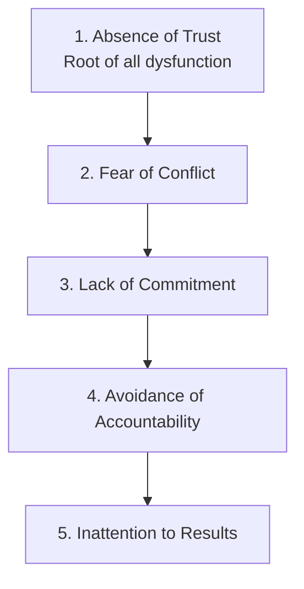

Build trust first (personal vulnerability). Safety creates healthy conflict. Conflict leads to real commitment. Commitment enables accountability. Accountability drives results.

---

### Q390. How do you handle a team member who wants to skip the retrospective?
**Answer:** Understand why: think it's a waste of time, have something urgent, or feel it's unsafe. Address the specific objection. The retrospective is the team's right and responsibility — it protects their ability to improve. Invite but don't force. If multiple people skip, the retrospective format or psychological safety needs attention.

---

### Q391. How do you create a "brilliant meeting" culture?
**Answer:** Every meeting needs: a clear purpose, the right participants (no more), a pre-distributed agenda, a facilitator, a note-taker, decisions documented, action items with owners and dates, and an end time respected. After the meeting: send minutes within 24h. Regularly review whether recurring meetings are still necessary.

---

### Q392. How do you handle a situation where the team is hiding technical problems from the client?
**Answer:** This is a trust and culture issue. Have an internal team conversation about why transparency matters and why hiding problems makes them worse. Establish a norm: bad news to the client is the SM/PM's responsibility, but the team must surface it internally first. Create a "no-blame, early warning" culture.

---

### Q393. What is "servant leadership" in the context of a manager (not just an SM)?
**Answer:** A manager practicing servant leadership: asks "what do you need?" before "what have you done?", removes obstacles instead of creating them, gives credit publicly and takes blame privately, develops their team members' skills and careers, and makes decisions in the team's interest rather than for personal visibility.

---

### Q394. How do you handle a client who is technically sophisticated and challenges every architectural decision?
**Answer:** Welcome it — a technically sophisticated client can be a valuable partner. Provide the rationale for decisions using ADRs. Be transparent about trade-offs. Engage them in architecture discussions at the right level (review sessions, not every daily standup). If their challenges are well-founded, adapt. If not, explain the specific reasons why.

---

### Q395. How do you manage a project where the requirements are genuinely unknown?
**Answer:** This is the domain of Discovery. Use design sprints, user research, prototype testing, and MVPs to discover requirements iteratively. Plan in 2-week discovery + 2-week delivery alternations (Dual-Track Agile). Accept that early estimates will be very rough and communicate this clearly to stakeholders.

---

### Q396. What is a "learning sprint"?
**Answer:** A sprint dedicated to learning, training, or addressing technical uncertainty (spikes). Used to onboard new technologies, resolve architectural unknowns, or complete team skill-building. The output is knowledge and reduced risk, not a user-facing feature. Use sparingly — delivery is still the primary goal.

---

### Q397. How do you handle a situation where the QA environment is unreliable and blocking releases?
**Answer:** Quantify the cost: blocked sprint percentage, bugs found in production that should have been caught in QA. Build the business case for environment investment. Treat environment reliability as a sprint backlog item. Advocate for a dedicated DevOps resource if the team is spending significant time on environment management.

---

### Q398. How do you manage a team through a merger or acquisition?
**Answer:** Communicate what you know, acknowledge what you don't. Address "what does this mean for me?" as directly as possible. Protect team stability during the transition. Understand and bridge cultural differences between the merging organisations. Advocate for the team's interests in the combined entity.

---

### Q399. What is the most important metric for measuring Agile success?
**Answer:** Value delivered to users/customers. All process metrics (velocity, cycle time, sprint goal achievement) are proxies. The ultimate measure is: are users getting what they need faster, with higher quality, and with fewer problems than before? Measure it with NPS, retention, feature adoption, and business outcomes.

---

### Q400. What is the most common reason Agile transformations fail?
**Answer:** Lack of genuine commitment from leadership. Agile transformations that are "Agile for the teams, waterfall for management" fail because teams cannot adapt when leadership still demands fixed-scope fixed-date commitments. True Agile requires leaders to embrace uncertainty, trust teams, and focus on outcomes. Without that, teams perform "Agile theatre."


---

# Final 100 Rapid-Fire Q&A

### Q401. What is "healthy tension" between a PO and the development team?
**Answer:** Healthy tension means the PO pushes for maximum value and fast delivery while the team pushes back with quality and sustainability constraints. Neither dominates. This tension produces better decisions than one side controlling everything. The SM facilitates this tension productively.

### Q402. What is the difference between "iterative" and "incremental" development?
**Answer:** Iterative: refine and improve something with each cycle (prototype → feedback → improve). Incremental: add new functionality with each cycle (MVP → add feature A → add feature B). Agile is both — each sprint adds an increment and also allows refinement of existing work.

### Q403. What is "technical coaching" and when does an SM need it?
**Answer:** Technical coaching helps teams adopt technical practices (TDD, CI/CD, pair programming, clean architecture). An SM who is not technically fluent can partner with a technical coach. The SM owns the process; the technical coach owns the practice. Neither role should substitute for the other.

### Q404. What is "systems thinking" in Agile?
**Answer:** Systems thinking looks at the whole system, not individual parts. In Agile: a team's local optimisation (maximising their velocity) may be suboptimal for the whole value stream (if downstream integration is the real bottleneck). SM uses systems thinking to identify where to improve for the most whole-system impact.

### Q405. How do you handle a team where "done" keeps getting redefined?
**Answer:** Redefining "done" mid-sprint undermines trust and predictability. Lock the DoD for the sprint. Retrospective is the place to evolve it. If a story genuinely needs a different standard, make it explicit in the acceptance criteria.

### Q406. What is "technical excellence" in the context of Agile?
**Answer:** Technical excellence (XP principle) means: clean code, automated tests, CI/CD, refactoring, simple design, TDD. Without it, the team accumulates debt that slows future sprints. Agile is not "move fast and ignore quality" — it requires excellent technical practices to sustain pace.

### Q407. What is a "PI Objective"?
**Answer:** A PI Objective is a business-level goal a team commits to for a Program Increment. Written as outcomes, not tasks. Each team has 5–10 PI objectives. Stretch objectives are ambitious targets. At PI end, objectives are scored (achieved/partially achieved/not achieved).

### Q408. What is a "Scrum of Scrums" vs a "Meta Scrum"?
**Answer:** Scrum of Scrums: SM-level coordination across teams. Meta Scrum: PO-level coordination — the chief PO and team POs align on priorities across the program. Both are SAFe/multi-team constructs.

### Q409. What is "continuous planning"?
**Answer:** Continuous planning replaces big upfront planning with ongoing, rolling planning at multiple levels: daily (Daily Scrum), sprint (Sprint Planning), quarterly (PI Planning), annual (strategy). Each level has appropriate fidelity — daily is detailed, annual is directional.

### Q410. How do you handle a situation where the team is not collocated and the sprint board is physical?
**Answer:** Migrate to a digital board (Jira, Linear, GitHub Projects). Physical boards work for collocated teams only. The switch is usually welcomed by remote members who have felt excluded. Keep the digital board as simple as the physical one.

### Q411. What is "psychological ownership" of a sprint goal?
**Answer:** When the team co-creates the sprint goal (not has it assigned), they feel psychological ownership — they are more motivated to protect and achieve it. Involve the team in goal formulation at Sprint Planning, not just receiving it from the PO.

### Q412. How do you handle a client whose organisation uses different terminology than your team?
**Answer:** Create a shared glossary at project kickoff. When a term is used differently, name it explicitly: "When you say 'module,' do you mean what we call a 'feature'?" Align terminology early and reference the glossary in every project document.

### Q413. What is "value stream" thinking for a Scrum Master?
**Answer:** A value stream is the full path from idea to value in users' hands. The SM thinks beyond the sprint: where is work waiting? What approvals slow delivery? What testing gaps cause rework? Value stream thinking extends the SM's impact beyond the team boundary.

### Q414. How do you handle a team that is afraid to refactor?
**Answer:** Fear of refactoring usually comes from lack of test coverage (how do I know I haven't broken something?). The solution is automated tests. Add tests before refactoring — this is the strangler pattern for internal code quality. Make refactoring a first-class activity in the sprint, not a secret side activity.

### Q415. What is an "impediment board"?
**Answer:** A visual tool (physical or digital) that makes impediments visible: the item, who owns it, when it was raised, and its current status. Keeps the SM accountable for resolving impediments and makes patterns visible (the same type of impediment recurring indicates a systemic problem).

### Q416. How do you handle a team that doesn't understand their users?
**Answer:** Bring users closer to the team. Invite real users to Sprint Reviews. Share user research data in the sprint. Run a "day in the life" session. Have developers shadow customer support. Empathy for the user is the most powerful driver of intrinsic motivation.

### Q417. How do you handle a situation where sprint planning takes half a day for a 1-week sprint?
**Answer:** Sprint planning for a 1-week sprint should be 2h max. If it's taking longer: stories aren't groomed well enough, the team doesn't have clarity on the DoD, or discussions about how to implement are happening (which should happen during the sprint). Fix with better refinement sessions.

### Q418. What is "impediment swarming"?
**Answer:** Instead of one person owning an impediment, the whole team (or a subset) focuses on removing it together. Used for critical blockers that threaten the sprint goal. Demonstrates that sprint goal achievement is everyone's responsibility, not just the SM's.

### Q419. What is the role of data in retrospectives?
**Answer:** Data makes conversations objective rather than emotional. Use: velocity charts, burndowns, cycle time, bug counts, on-call alerts, test coverage. Present data as "this is what happened" — not "this is whose fault it is." Let the data surface the retrospective topic; let the team surface the analysis.

### Q420. How do you handle a PO who writes stories as technical tasks?
**Answer:** Technical tasks are "how" — that is the team's domain. PO stories should be "what" and "why." Coach the PO to write from the user perspective: "As a [user] I want [outcome] so that [benefit]." Offer to write the first few stories together as a learning exercise.

### Q421. What is a "dependency risk" in Agile delivery?
**Answer:** A dependency on another team, vendor, or system that can delay your sprint goal. Best practice: identify all dependencies in sprint planning, track them on the board, escalate delays within 24h of discovering a risk. Never absorb a dependency risk silently into the sprint.

### Q422. What is "team cognitive load" and how do you manage it?
**Answer:** Cognitive load (Team Topologies concept) is the mental effort required to understand and maintain a team's domain. Symptoms of high cognitive load: errors, slow delivery, context-switching overwhelm. Manage by: reducing team scope, simplifying architecture, automating toil, improving documentation.

### Q423. How do you handle a client who wants the development team's full capacity on a single feature?
**Answer:** Assess the risk: single-feature focus creates no buffer for defects, technical debt, or unplanned work. Explain the trade-off. If the feature is genuinely the highest priority, allocate 80% capacity (not 100%) and use the remaining 20% for stability and quality. No sprint should be 100% new feature work.

### Q424. What is "failure mode thinking" in sprint planning?
**Answer:** At the end of sprint planning, ask: "What could cause us to fail to achieve the sprint goal?" Identify the top 3 risks. Assign mitigation actions. This is not pessimism — it is proactive risk management that dramatically increases sprint goal achievement rates.

### Q425. How do you handle a team that never reaches "performing" (Tuckman)?
**Answer:** Persistent non-performance usually means: team is too large, membership is unstable, psychological safety is low, or there is unresolved interpersonal conflict. Address systematically: stabilise membership, reduce team size, build safety, resolve conflict. High-performing teams do not happen by accident.

### Q426. What is "continuous feedback" in team management?
**Answer:** Feedback given in real-time (or same-day), not saved for the annual review. Positive feedback given immediately ("That was an excellent question in the client meeting") is 10× more effective than praise given 3 months later. Developmental feedback given promptly allows the person to change while the event is fresh.

### Q427. How do you manage a Scrum team that is embedded in a large programme?
**Answer:** Protect the team's Scrum process within the programme constraints. Translate programme deliverables into sprint-level goals. Manage programme-level dependencies in Scrum of Scrums. Push back when programme pressures violate Scrum principles (no sprint extension, no PO substitution). Be the team's advocate at the programme level.

### Q428. What is the difference between "coaching" a team and "consulting" for a team?
**Answer:** Consulting: provide answers and solutions ("Do it this way"). Coaching: ask questions that lead the team to their own answers ("What approach do you think would work here? What are the trade-offs?"). Coaching builds sustainable capability; consulting builds dependency. Use consulting for genuine knowledge gaps; coaching for skill development.

### Q429. How do you handle a situation where the team's demos don't engage stakeholders?
**Answer:** Ask stakeholders what they care about — often demos show too much technical detail and not enough business impact. Structure demos as: problem → solution → result (measured). Let stakeholders interact with the product (not just watch). Keep demos under 30 minutes. Send a recording for those who can't attend.

### Q430. What is "outcome-based roadmapping"?
**Answer:** Instead of a feature roadmap ("we'll build X, Y, Z"), an outcome-based roadmap shows business goals: "Increase checkout completion rate by 15%." Features are hypotheses about how to achieve the outcome. This empowers teams to find the best solution rather than just building what was specified.

### Q431. What is "story mapping"?
**Answer:** Story mapping (Jeff Patton) organises user stories in a 2D grid: horizontal axis = user journey (chronological activities), vertical axis = priority (must-have at top, nice-to-have at bottom). Horizontal slices show MVP releases. Vertical slices show user journeys. Provides context that a flat backlog cannot.

### Q432. How do you handle a situation where the same team member always volunteers for the most visible work?
**Answer:** Distribute high-visibility work explicitly in sprint planning. Create a rotation for work that is both visible and growth-producing. Have a team conversation about equitable opportunity. Recognise contributions from all team members, not just those on high-visibility stories.

### Q433. What is "technical risk poker"?
**Answer:** An estimation technique where, instead of estimating complexity, the team estimates risk — the probability of unknowns, integration failures, or performance surprises. High-risk items get a spike (timebox investigation) before being estimated for delivery.

### Q434. How do you handle a client who expects the team to be available 24/7 through WhatsApp?
**Answer:** Establish channel norms at kickoff. Define: emergency (P1) → on-call phone, urgent (P2) → response within 1h during business hours, standard → Slack/email within 1 business day. WhatsApp blurs work/personal boundaries and creates always-on anxiety. Set the boundary professionally and early.

### Q435. What is "scope management" vs "scope control"?
**Answer:** Scope management is proactive: defining, documenting, and verifying scope. Scope control is reactive: managing changes to scope once it is established. Both are needed. Good Agile scope management uses a clear product vision, a prioritised backlog, and a change control process.

### Q436. How do you handle a sprint where every story has an external dependency?
**Answer:** This is an impediment at the team level — not a sprint planning problem. Escalate the dependency situation immediately. Plan the sprint with contingency (what can we do if dependencies don't arrive?). Create "ready alternatives" — stories the team can work on if blocked.

### Q437. What is "value delivered per sprint" and how do you measure it?
**Answer:** Value is the business impact of completed stories: revenue generated, users served, errors reduced, time saved. Approximate it with: business value points (PO assigns a value rating to each story), or retrospectively with actual business metrics (did the feature achieve its stated KPI?).

### Q438. How do you handle a team that "estimates in hours" instead of story points?
**Answer:** Hour-based estimates are precise but rarely accurate for complex work. They create false confidence and are hard to aggregate. If the team insists on hours, use them — the goal is good planning, not a specific unit. Over time, show how hour-based estimates compare to actuals and introduce relative sizing as an alternative.

### Q439. What is a "ROAM" process for risks in PI Planning?
**Answer:** At the end of PI Planning, identified risks are ROAMed: Resolved (addressed and closed), Owned (assigned to a person), Accepted (risk acknowledged and accepted), Mitigated (action taken to reduce it). Every risk must be ROAMed — no risk can be left unaddressed.

### Q440. How do you handle a team that is not cross-functional (all frontend, no backend)?
**Answer:** A team that cannot deliver end-to-end creates handoff dependencies and cannot be fully self-sufficient. Advocate for cross-functional membership: front-end, back-end, QA, and DevOps skills within one team. If not immediately possible, establish clear SLAs with dependent teams and treat them as external dependencies.

### Q441. What is a "demo day"?
**Answer:** An event where multiple teams showcase their sprint or PI work to a wide audience. Creates: shared understanding across teams, stakeholder engagement, team pride and recognition, and cross-team learning. Best when interactive (attendees can try the product) rather than presentation-only.

### Q442. How do you handle a team that is not co-located in an office but has a mandated return-to-office policy?
**Answer:** Advocate for team-day colocation (the team comes in together on specific days) rather than individual seat attendance (which creates empty office theatre). The value of colocation comes from team interaction, not individual presence. Present research on collaboration outcomes.

### Q443. What is "product thinking" vs "project thinking"?
**Answer:** Project thinking: a temporary effort with a defined start, end, and deliverable. Product thinking: a continuous investment in something that evolves based on user feedback and market needs. Software is best treated as a product. Project thinking leads to teams being disbanded when the "project" ends, losing hard-won knowledge.

### Q444. How do you handle a team where the architect makes all technical decisions?
**Answer:** This creates a bottleneck and reduces the team's ownership. The architect should be an enabler, not a gatekeeper. Create a decision log that the team maintains. Use Architecture Decision Records where the team and architect co-create decisions. Gradually transfer decision authority to the team with the architect as a consultant.

### Q445. What is "inner source"?
**Answer:** Inner source applies open-source practices within an organisation: any team can contribute to any codebase, following a contribution protocol (PR, review, documentation). It breaks down silos and allows the best person to fix a problem regardless of team ownership.

### Q446. What is a "mob retrospective"?
**Answer:** A whole-team retrospective run as a mob — everyone participates simultaneously on the same board, brainstorming collaboratively rather than in silence. Useful for teams that are physically co-located or highly comfortable with each other. Less suited for teams with significant power dynamics.

### Q447. How do you handle an underperforming team you've inherited?
**Answer:** Follow "observe before changing." Build relationships and trust first. Run a team health check. Identify the top 2–3 root causes (not symptoms) of underperformance. Address them one at a time. Quick wins build credibility for bigger changes. Avoid mass restructuring in the first 90 days.

### Q448. What is "shadow work" in a team context?
**Answer:** Shadow work is real work that is not tracked, estimated, or accounted for in sprint capacity: responding to Slack messages, attending unplanned meetings, helping other teams, reviewing PRs outside the sprint, and fixing "quick" production issues. Making shadow work visible is the first step to managing it.

### Q449. How do you handle a situation where a sprint is derailed by an emergency?
**Answer:** Acknowledge it, adapt the sprint goal, and document what happened. At the retrospective, discuss: how to prevent the same emergency next time, whether the emergency was truly unforeseeable, and whether the team has sufficient capacity buffer. If emergencies are frequent, build a formal "interrupt buffer" into sprint capacity.

### Q450. What is the most valuable skill for a Scrum Master to develop?
**Answer:** Facilitating difficult conversations — when it matters most. Any SM can run a good retrospective on a happy team. The best SMs run productive retrospectives, planning sessions, and customer meetings when the team is under pressure, relationships are strained, and stakes are high. This skill separates good SMs from great ones.

### Q451. How do you handle a sprint where the team finishes all stories by day 7 of a 10-day sprint?
**Answer:** This indicates under-commitment. Have the team pull in the next highest-priority backlog items (they should always be in a "ready" state from grooming). Investigate the cause of under-commitment: overly conservative estimates, low confidence, or previous experience of being penalised for incomplete work. Use the retrospective to recalibrate.

### Q452. What is "mob testing"?
**Answer:** The whole team (developers, QA, PO) gathers to test a feature together — clicking through flows, trying edge cases, and finding bugs. It is fast (many perspectives at once), educational (developers see how QA thinks), and builds shared quality ownership.

### Q453. How do you handle a client who wants status reported in a tool they own (not yours)?
**Answer:** Understand the cost: dual-entry wastes time and creates inconsistency. Automate the export where possible (Jira → their tool via API or CSV). If manual, minimise frequency. Raise the hidden cost clearly: "Maintaining both systems takes X hours per week — is there a way to consolidate?"

### Q454. What is "appreciative inquiry" in retrospectives?
**Answer:** Appreciative inquiry focuses on strengths rather than problems: "What worked particularly well this sprint and how can we do more of it?" It is energising and surfaces underutilised capabilities. Use it after a successful sprint or when the team is in a low-energy period. Balance with traditional "what to improve" retrospectives.

### Q455. How do you handle a team where junior members are over-reliant on senior members?
**Answer:** Assign junior members to lead stories (with senior support, not senior doing). Create a "you must be stuck for 20 minutes before asking" norm. Run deliberate pair sessions where the junior drives. Celebrate junior solutions publicly. The goal is progressive independence.

### Q456. What is "dependency inversion" at the team level?
**Answer:** Teams should depend on abstractions (APIs, contracts) not on the internal implementations of other teams. This allows teams to work in parallel and change their internals independently. Establish API contracts early and use mocks/stubs for development independence.

### Q457. How do you handle a PO who keeps changing the sprint goal after the sprint starts?
**Answer:** Sprint goals are set at Sprint Planning and stable for the duration. Mid-sprint goal changes are allowed only in extreme circumstances (major market event, critical bug invalidating the goal). Educate the PO on the purpose of stability. If the PO's business context changes so rapidly that goals cannot be held for 2 weeks, the sprint length may need to be shorter.

### Q458. What is a "confidence vote" at the end of sprint planning?
**Answer:** At the end of Sprint Planning, the team holds up fingers (1–5) indicating confidence in achieving the sprint goal. 1 = not confident, 5 = very confident. Any person voting 1–2 must explain their concern. This surfaces hidden risks before the sprint starts, not mid-sprint.

### Q459. How do you handle a situation where the team has no time for retrospectives due to delivery pressure?
**Answer:** This is precisely when retrospectives are most needed — delivery pressure often reflects process problems that retrospectives would fix. Hold a 30-minute emergency retrospective focused on a single question: "What one change would make the next sprint less pressured?" Protect that 30 minutes.

### Q460. What is "psychological contract" in employment?
**Answer:** The unwritten expectations between employer and employee: what the employee expects (interesting work, fair compensation, respect, growth) and what the employer expects (commitment, quality, reliability). Violations of the psychological contract (unexpected role changes, broken promotion promises) damage engagement more than compensation issues.

### Q461. How do you handle a situation where a team member's performance declines after a personal loss?
**Answer:** Respond with humanity first. Offer flexibility (adjusted schedule, reduced load, temporary remote work). Connect them with employee assistance programmes (EAP). Discuss with HR what leave options are available. Do not formally manage performance during a bereavement period — allow time for recovery before assessing.

### Q462. What is "psychological bandwidth"?
**Answer:** Decision fatigue and cognitive resource depletion affect productivity. When someone is dealing with significant personal stress (financial, health, family), they have less mental bandwidth for complex work. Managers who understand this do not judge reduced performance during crisis periods — they adjust load and support recovery.

### Q463. How do you handle a team that frequently re-opens "closed" items?
**Answer:** This indicates the DoD is insufficient or not applied consistently. Investigate: were the re-opened items actually meeting the DoD when closed? If not, enforce the DoD strictly. If yes, the DoD needs to include the type of issue causing re-opens. Never close a story that doesn't fully meet the DoD.

### Q464. What is a "quality gate"?
**Answer:** A defined checkpoint that work must pass before moving to the next stage. Examples: PR requires 2 approvals and green CI before merge; deployment to production requires QA sign-off and load test results. Quality gates prevent defects from cascading downstream.

### Q465. How do you handle a client who cancels the Sprint Review at the last minute?
**Answer:** Send the sprint summary async (video demo + written summary). Record the demo with Loom. Ask for written feedback by a specified date. Flag in the account meeting that skipped Sprint Reviews reduce the client's ability to steer the product. After 2 consecutive cancellations, have a direct conversation about the value of the Review.

### Q466. What is "discovery kanban"?
**Answer:** A visualisation tool for the product discovery process (user research, hypothesis testing, prototype testing), separate from the delivery kanban/board. It shows: opportunity areas under investigation, experiments running, validated insights, and ideas ready for development backlog.

### Q467. How do you handle a team that is working but not improving?
**Answer:** "Working but not improving" is stagnation. Use retrospective data to show: quality metrics, cycle time, team health scores — are they improving over time? Introduce the concept of "deliberate practice." Set explicit improvement goals (not just "do our jobs"). Use guest speakers, training, and new technical challenges to inject novelty.

### Q468. What is an "engineering principles" document?
**Answer:** A team-authored document that codifies how decisions are made when there is no specific standard: e.g., "We prefer readability over cleverness," "We build for failure — assume any service can fail," "We test at the right level — not everything needs a unit test." Engineering principles align decisions across the team without micromanagement.

### Q469. How do you manage the transition from one SM to another?
**Answer:** Transition period of 2–4 weeks minimum. The outgoing SM introduces the incoming SM to the team, PO, and key stakeholders. Handover document: team norms, working agreement, impediment log, improvement backlog, relationship context, and known risks. The incoming SM observes before facilitating. The team's trust must be re-earned.

### Q470. What is "psychological safety debt"?
**Answer:** Just as technical debt accumulates when shortcuts are taken, psychological safety debt accumulates when leaders react poorly to bad news, dismiss concerns, or fail to follow through on commitments. It compounds — each broken promise or negative reaction makes future honesty less likely. It is very slow to pay back.

### Q471. How do you create a compelling argument for Agile to a sceptical CFO?
**Answer:** Frame in financial terms: Agile reduces the cost of change (discovered early vs late is 10–100× cheaper), increases return on investment (early releases enable early revenue), and reduces risk (MVPs test assumptions before full investment). Share case studies: organisations that adopted Agile and their business results. Avoid Agile jargon — speak about outcomes, not practices.

### Q472. What is "time to value" and why does it matter?
**Answer:** Time to value is how long it takes from a customer request to the customer receiving value. Shorter time to value: faster feedback, faster revenue, faster competitive response. Agile reduces time to value by delivering smaller increments more frequently rather than large releases infrequently.

### Q473. How do you handle a team where everyone agrees but nothing changes?
**Answer:** This is a symptom of low accountability or high political safety. Create accountability structures: publicly assign action items with names and due dates. Review at every retrospective: "What was our action from last time? Was it done?" If not, understand why — is it not resourced? Not prioritised? Use the retrospective to surface the real obstacle.

### Q474. How do you handle a Scrum Master who is also a developer on the team?
**Answer:** This dual role is challenging. The SM role requires impartiality that is compromised when you are also a contributor. If unavoidable, be explicit about which hat you're wearing at any time. Prioritise SM responsibilities during ceremonies. Ensure someone else can facilitate retrospectives to keep them safe. Transition to a full-time SM role as the team grows.

### Q475. What is "backlog refinement"?
**Answer:** An ongoing activity (not a formal Scrum event) where the team and PO groom the backlog: clarify stories, add acceptance criteria, estimate, split large items, remove obsolete items, and order by priority. Best done as a regular (weekly or bi-weekly) session of 1–2 hours. Keeps the top of the backlog "sprint-ready."

### Q476. What is "scope creep by stealth"?
**Answer:** Scope that grows through small, individually justifiable additions that are never collectively reviewed. Each addition seems minor; together they represent a significant unplanned expansion. Prevent with a cumulative scope tracking mechanism and a formal review when cumulative additions exceed a threshold (e.g., 20% of sprint capacity).

### Q477. How do you handle a situation where the client misremembers what was agreed?
**Answer:** Always confirm significant agreements in writing (email summary after every key meeting). When a discrepancy arises, present the documentation neutrally: "My notes from our February 3rd meeting say X — let me know if that doesn't match your recollection." Avoid a confrontational "you're wrong" posture — focus on alignment going forward.

### Q478. What is "anti-fragility" in teams?
**Answer:** Nassim Taleb's concept: an anti-fragile system gets stronger under stress rather than just surviving it. Build anti-fragile teams by: treating failures as learning, running controlled experiments (chaos engineering), rotating roles to build resilience, documenting knowledge to remove single points of failure, and building a culture that welcomes difficult feedback.

### Q479. How do you handle a team that is not adapting despite retrospective insights?
**Answer:** The retrospective is not the problem — the follow-through is. Create a tighter feedback loop: implement one improvement within the next sprint (not "someday"). Assign a specific owner. Add the improvement item to the sprint backlog. Review the status at the next retrospective before discussing new topics.

### Q480. What is a "team health dashboard"?
**Answer:** A one-page visual summary of team health indicators: team satisfaction, sprint goal achievement %, velocity trend, defect rate, cycle time, and on-call burden. Updated after each sprint. Reviewed with the team in retrospective and with leadership monthly. Surfaces problems before they become crises.

### Q481. How do you handle a team where the PO and the client have different visions?
**Answer:** This is a governance problem. The PO should represent the client's vision — if they don't, the alignment is broken. Facilitate a joint session between the PO and client to establish a shared product vision. Use an elevator pitch format: "For [user], who [problem], our product [solution], unlike [alternatives], it [differentiator]."

### Q482. What is a "value hypothesis"?
**Answer:** A testable assumption about the value a feature will deliver: "We believe that adding one-click checkout will increase conversion rate by 10% for returning customers." Define the measurement before building. After release, assess the hypothesis. This is the foundation of outcome-based delivery.

### Q483. How do you handle a team that is purely reactive (no proactive improvement)?
**Answer:** Reactive teams respond to problems after they occur. Build proactivity by: running pre-mortems before sprints, tracking leading indicators (cycle time trends), making risk management a routine activity, and rewarding team members who raise concerns early.

### Q484. What is "iterative and incremental release"?
**Answer:** Combining both: each release adds new functionality (incremental) AND refines existing functionality based on user feedback (iterative). The best Agile teams do both — they ship new features and continuously improve existing ones based on what they learn.

### Q485. How do you handle a client who provides no feedback on Sprint Reviews?
**Answer:** No feedback is feedback — it may mean: they aren't engaged, the demo didn't connect to their concerns, or they don't feel their feedback will be acted on. Probe with direct questions: "What surprised you most? What would you change if you could?" Show evidence of previous feedback being implemented: "You mentioned X last sprint — here's what we changed."

### Q486. What is "cognitive diversity" in teams?
**Answer:** Teams with diverse thinking styles (analytical, creative, detail-oriented, big-picture) make better decisions than homogeneous teams. Cognitive diversity reduces groupthink, increases problem-solving range, and surfaces blindspots. Build it intentionally in hiring and team formation.

### Q487. How do you handle an overly complex sprint board?
**Answer:** A board with 20 columns, sub-tasks nested 3 levels deep, and 15 custom fields is a symptom of process complexity. Simplify to: To Do, In Progress, Done (at minimum). Add columns only when the team demonstrates a need. The board should reflect actual workflow, not aspired workflow.

### Q488. What is "dark launching"?
**Answer:** Deploying a feature to production but not making it visible to users. Run it behind a feature flag. Test performance and integration with real production traffic without user impact. When validated, turn on the flag. Reduces release risk dramatically.

### Q489. How do you handle a situation where the team needs to adopt a new compliance requirement mid-project?
**Answer:** Assess impact immediately: which stories are affected? What new activities are required (security review, audit logging, documentation)? Add compliance tasks as explicit sprint backlog items — not invisible extras. Communicate to the client the impact on timeline or scope.

### Q490. What is "psychological safety at scale"?
**Answer:** Creating safety across a whole organisation, not just within one team. Requires: leaders who model vulnerability at the top, blameless post-mortems for all incidents, skip-level meetings, anonymous feedback channels, and genuine action on feedback. Safety at scale is a leadership project, not an SM project — but SMs can advocate for it.

### Q491. How do you handle a situation where a team member is reporting to two managers?
**Answer:** Matrix management creates confusion: who sets priorities? Who evaluates performance? Who do I go to with concerns? Clarify: one manager is primary (owns performance, compensation, development). The other provides work direction within defined boundaries. Establish a clear escalation path. Meet with both managers regularly to align.

### Q492. What is "ruthless prioritisation"?
**Answer:** Removing items from the backlog that do not clearly deliver user or business value — not just ranking them lower, but actively deleting them. Most backlogs accumulate thousands of items, most of which will never be built. Ruthless prioritisation keeps the backlog actionable and focuses energy on the highest-value work.

### Q493. How do you handle a team where the DoD is met inconsistently?
**Answer:** Make the DoD visible (on the wall, top of the board). Add a DoD checklist to every story card. During sprint review, before accepting a story, the PO explicitly confirms DoD compliance. Inconsistency is usually a habit, not a values problem — make compliance as frictionless as possible.

### Q494. What is a "structured dialogue" technique for difficult team conversations?
**Answer:** Structured dialogue: (1) State the purpose, (2) Set ground rules (listen to understand, not respond), (3) Each person speaks uninterrupted, (4) Reflect and paraphrase before responding, (5) Build on common ground, (6) Identify action. Used for high-stakes conversations where normal discussion has failed.

### Q495. How do you handle a sprint that is "technically done" but not "done done"?
**Answer:** Call it out explicitly. The increment is not "done done" — it cannot be shown at the Sprint Review as potentially shippable work. Add the missing DoD items to the next sprint as the top priority. Use the retrospective to find why DoD items were left incomplete: time pressure, unclear expectations, or inadequate test automation.

### Q496. What is "outcome over output" thinking?
**Answer:** Output thinking: "We shipped 15 features this quarter." Outcome thinking: "We reduced customer churn by 8% this quarter." Outcomes are the actual business or user changes that features are intended to cause. Teams focused on outcomes make better prioritisation decisions because they ask "will this actually change user behaviour?"

### Q497. How do you handle a situation where the entire team is too junior to self-organise?
**Answer:** A very junior team needs more guidance initially. The SM takes on a more directive facilitation role (while being transparent that this is temporary). Pair juniors with external mentors. Bring in a tech lead who can enable technical decisions. Gradually increase autonomy as skills develop. Document this as the current team stage and revisit in every retrospective.

### Q498. What is "value-based pricing" and how does it affect project conversations?
**Answer:** Value-based pricing charges based on the value delivered to the customer, not on time and materials. It aligns incentives — the development team is rewarded for outcomes, not outputs. It requires clear measurement of value. Relevant when negotiating project scope changes: "Adding this feature will increase customer revenue by X — that changes our conversation."

### Q499. How do you handle a situation where an AI tool is producing bugs in team-generated code?
**Answer:** Treat AI-generated code like any other code: requires review, testing, and adherence to the DoD. Update the working agreement: AI-generated code must be reviewed by a human before merging. Add a checklist item to code review: "Was any AI-generated code reviewed for correctness, security, and performance?" Build team literacy in evaluating AI output.

### Q500. What is the most important thing a Scrum Master or Engineering Manager can do for their team?
**Answer:** Create the conditions in which the team can do their best work: psychological safety, clear goals, autonomy, appropriate challenge, removed obstacles, and genuine care for each person's growth and wellbeing. The leader's job is not to be the best performer — it is to make everyone around them perform better than they would without the leader.


---

# SUPPLEMENT — Production Issues, Practical Examples & Mermaid Diagrams

> This supplement adds missing detailed answers, Mermaid diagrams, real-world practical examples, production incident handling, and environment-related Q&A for every major section of this file.

---

## Practical Deep-Dive: Scrum & Agile

### Q501. Walk through a real sprint from planning to retrospective with a practical example.
**Answer:** A team of 6 builds an e-commerce checkout feature.

```mermaid
gantt
    title Sprint 23 — 2-Week Timeline
    dateFormat YYYY-MM-DD
    section Planning
    Sprint Planning (3h)         :done, plan, 2024-01-15, 1d
    section Development
    Guest Checkout Feature       :active, dev1, 2024-01-16, 5d
    Payment Integration          :dev2, 2024-01-16, 7d
    section Review & Test
    QA Testing                   :qa, 2024-01-22, 2d
    Sprint Review (2h)           :review, 2024-01-25, 1d
    section Retrospective
    Retrospective (1.5h)         :retro, 2024-01-26, 1d
```

**Day-by-day practical flow:**
- **Day 1 (Planning):** PO presents sprint goal — "Enable users to check out as a guest." Team selects 5 stories (34 points). Confidence vote: team holds up 4/5 fingers. One engineer flags dependency on payment API.
- **Days 2–8 (Development):** Daily Scrum at 9:30 AM, 15 minutes. On Day 4, payment API access is blocked — SM escalates to the PO who contacts the vendor. Resolved Day 5.
- **Day 9–10 (QA + Review):** QA finds 2 bugs — both fixed same day. Sprint Review: PO, 3 stakeholders, and 2 customer reps attend. Guest checkout demo — customer reps provide immediate feedback ("Add a progress bar"). PO adds feedback to backlog.
- **Day 11 (Retrospective):** Facilitator uses "Sailboat" format. Wind (what helped): clear sprint goal, quick escalation. Anchor (what slowed): payment API dependency surfaced too late. Action item: add external dependency check to Definition of Ready.

**Result:** Sprint goal achieved. 1 actionable improvement identified.

---

### Q502. How do you handle a sprint goal that is at risk on Day 6 of a 10-day sprint?
**Answer:**

```mermaid
flowchart TD
    Day6[Day 6 — Sprint goal at risk] --> Assess[Assess remaining work\nvs capacity]
    Assess --> Options{Options}
    Options --> Scope[Negotiate scope\nwith PO — drop lower-priority stories]
    Options --> Swarm[Team swarms on\nblocker together]
    Options --> Escalate[Escalate external\nblocker immediately]
    Scope --> Goal[Protect the sprint goal\nnot all stories]
    Swarm --> Goal
    Escalate --> Goal
    Goal --> Review[Transparent at Sprint Review\nwhat was planned vs delivered]
```

**Practical example:**
> "It's Day 6. We committed to 3 stories for the sprint goal. Story A is done. Story B is 80% done but blocked on a third-party API. Story C hasn't started. I call a 30-minute team huddle. We decide: (1) one developer swarms with the blocked developer on Story B, (2) Story C is moved to next sprint with PO agreement, (3) I call the third-party vendor's account manager directly. By Day 8 the block is resolved. Sprint goal met with 2 of 3 stories."

---

### Q503. How do you facilitate a retrospective when the team says "nothing to improve"?
**Answer:**

**Practical facilitation technique — the "Silent 1-10" survey:**
```
Before the meeting, send anonymously:
Q1. How productive was this sprint? (1=terrible, 10=excellent)
Q2. How much did we learn as a team this sprint?
Q3. How clear were our sprint goals?
Q4. How well did we collaborate with the PO?
Q5. What one thing would you change about how we work?

Average scores below 7 almost always reveal hidden friction.
```

```mermaid
flowchart LR
    Survey[Anonymous pre-survey] --> Data[Surface data\nin retrospective]
    Data --> Items[Team discusses\nlow-scoring items]
    Items --> Root[5 Whys to find\nroot cause]
    Root --> Action[1 specific action\nwith owner + date]
    Action --> Track[Track in improvement\nbacklog]
```

**Example using 5 Whys:**
> Score: "Sprint goal clarity = 5/10"
> Why? "We didn't know what 'done' looked like for Story B."
> Why? "Acceptance criteria were added after planning started."
> Why? "PO wrote them during the sprint when we asked."
> Why? "PO didn't have time to refine before planning."
> Why? "No refinement session was scheduled this sprint."
> **Action:** Add a 1-hour refinement session every Wednesday to the team calendar.

---

## Practical Deep-Dive: Team Handling

### Q504. Walk through a real example of building psychological safety in a struggling team.
**Answer:**

**Context:** A new team where engineers don't speak up in meetings, problems are hidden until too late, and the retrospective is silent.

```mermaid
flowchart TD
    Problem[Team does not\nspeak up] --> Diagnose[1-on-1 conversations\nto understand why]
    Diagnose --> Fear[Past experience:\npeople were punished\nfor raising problems]
    Fear --> Model[Manager publicly\nadmits a mistake\nin all-hands]
    Model --> Signal[Signal: safe to be\nhuman and fallible]
    Signal --> Retro[First retrospective\nwith anonymous input]
    Retro --> Action[Manager acts on\nevery item raised]
    Action --> Trust[Trust begins\nto build]
    Trust --> Open[Team raises issues\nin real time]
```

**Practical 8-week programme:**
| Week | Action | Outcome |
|------|--------|---------|
| 1 | 1:1s with every member — listen only | Identify fear of blame |
| 2 | Manager shares own mistake in team meeting | Models vulnerability |
| 3 | Retrospective with anonymous sticky notes (Miro) | First real issues surfaced |
| 4 | Act on every item — visibly | "They actually did it" |
| 5–6 | Blameless post-mortem for a production bug | Celebrates learning, not blame |
| 7–8 | Members start raising risks proactively | Safety achieved |

---

### Q505. How do you handle a situation where a senior developer intimidates juniors in code reviews?
**Answer:**

**Practical example:** Comments like "This is obviously wrong," "Did you even test this?" on junior PRs.

```mermaid
flowchart LR
    Junior[Junior flags\nuncomfortable PR comments] --> SM[SM reads PR thread\nidentifies specific comments]
    SM --> SeniorPrivate[Private 1:1 with senior\nSBI feedback model]
    SeniorPrivate --> SBI["Situation: In John's PR on Jan 12\nBehavior: Comment said 'obviously wrong'\nImpact: John told me he considered quitting"]
    SBI --> Agreement[Agree on specific\nalternative behaviors]
    Agreement --> CodeReviewNorms[Team creates\nCode Review Charter]
    CodeReviewNorms --> Monitor[SM monitors\nnext 3 PRs]
```

**Code Review Charter template:**
```markdown
## Our Code Review Principles
- Comments are about the code, never the person
- Use "Consider..." or "What if we tried..." not "This is wrong"
- Ask questions: "Can you help me understand why you chose this approach?"
- Acknowledge what works: at least one positive comment per review
- P1 (must fix): security/correctness. P2 (should fix): performance. P3 (nit): style.
- Nitpicks are prefixed with "Nit:" and do not block merge.
```

---

### Q506. How do you manage a team through the loss of a key engineer mid-project?
**Answer:**

```mermaid
flowchart TD
    Resign[Key engineer\ngives notice — 2 weeks] --> Day1[Day 1: Acknowledge,\nthank them, start plan]
    Day1 --> KT[Knowledge transfer\nsprint — pair on everything they own]
    KT --> Doc[Document: architecture,\ncritical paths, operational runbooks]
    Doc --> CrossTrain[Cross-train 2 engineers\non their primary areas]
    CrossTrain --> Backlog[Adjust sprint backlog\nreduce scope for 2 sprints]
    Backlog --> Client[Communicate proactively\nto client/PO]
    Client --> Recruit[Start recruitment\nimmediately]
    Recruit --> Recovery[Team stabilises\nin 4–6 weeks]
```

**Practical knowledge transfer checklist:**
```markdown
[ ] Record a walkthrough of the system architecture (Loom)
[ ] Document every on-call runbook they own
[ ] Pair on the 3 most complex areas they own
[ ] Update README with current local dev setup
[ ] Transfer ownership of all critical AWS/GCP resources
[ ] Introduce them to external vendor contacts they manage
[ ] Review any undocumented tribal knowledge (ask: "What would break if you weren't here?")
```

---

## Practical Deep-Dive: Customer Handling

### Q507. Walk through a real escalation from an unhappy client — step by step.
**Answer:**

**Scenario:** A client calls your manager at 4pm to complain that they've had no update on a P2 bug for 3 days.

```mermaid
sequenceDiagram
    participant Client
    participant YourManager as Your Manager
    participant You as You (SM/PM)
    participant Team

    Client->>YourManager: 4pm call — angry, no update on P2 bug
    YourManager->>You: "Call me at 4:30, explain what happened"
    You->>Team: 4:05pm — What is the status of this bug?
    Team-->>You: "In progress — was deprioritised for sprint goal"
    You->>YourManager: 4:30pm briefing — full context
    You->>Client: 4:45pm call — "I'm calling to apologise for the lack of communication..."
    Client-->>You: Explains their frustration (SLA was 1 business day)
    You->>Client: "I understand. Here's the current status and our plan..."
    You->>Client: Next day update — bug resolved
    You->>Client: Weekly check-in call established
```

**The 4-part client recovery conversation:**
1. **Acknowledge:** "I understand why you're frustrated — a 3-day wait with no update is not acceptable."
2. **Own it:** "We should have proactively communicated the delay. That's on us."
3. **Status:** "Here is exactly where we are right now: [specific status]."
4. **Plan:** "We will have this resolved by [date]. I will personally update you at [time] tomorrow."

---

### Q508. How do you handle a client who requests changes after UAT sign-off?
**Answer:**

```mermaid
flowchart LR
    SignOff[UAT signed off\non Jan 10] --> NewReq[Client requests\nchange on Jan 15]
    NewReq --> Classify{Nature of change?}
    Classify -->|Bug in signed-off scope| Fix[Fix at no charge\ndocument clearly]
    Classify -->|New requirement| Impact[Impact analysis:\ntime + cost + risk]
    Impact --> ChangeRequest[Formal Change Request\nwith PO approval]
    ChangeRequest --> Agree[Agree scope + timeline\nin writing]
    Agree --> Deliver[Deliver in next sprint\nor mini-release]
```

**Practical change request document:**
```markdown
## Change Request #CR-047
**Date:** January 15, 2024
**Requested by:** Client Name / Sponsor
**Change description:** Add CSV export to the orders table
**Reason for change:** Business need identified post-UAT

**Impact analysis:**
- Effort: 3 story points (1 sprint)
- Cost: 2 engineer-days
- Risk: Low
- Dependencies: None

**Options:**
1. Add to next sprint — delivery by Jan 29. No timeline impact.
2. Add to current sprint — removes "Advanced filters" story from scope.
3. Defer to next release (March).

**Decision required by:** January 17, 2024
**Approved by:** ____________ Date: _______
```

---

### Q509. How do you create and present a project health dashboard to a client?
**Answer:**

**Practical one-page dashboard structure:**
```
┌─────────────────────────────────────────────────────────┐
│  PROJECT HEALTH DASHBOARD — Week 23 (Jan 15–19, 2024)  │
├──────────┬──────────┬──────────┬──────────┬────────────┤
│ Delivery │  Quality │   Risk   │  Budget  │ Relationship│
│  🟢 ON  │  🟡 AMBER│  🟢 LOW  │  🟢 ON  │   🟢 GOOD  │
│  TRACK  │          │          │  TRACK  │            │
├──────────┴──────────┴──────────┴──────────┴────────────┤
│ THIS WEEK'S ACHIEVEMENTS                                │
│ ✅ Guest checkout delivered (ahead of schedule)         │
│ ✅ Payment integration — 95% complete                   │
│ ⚠️  Mobile responsiveness — delayed 3 days (see risks)  │
├─────────────────────────────────────────────────────────┤
│ TOP RISKS                              MITIGATION       │
│ 🟡 Payment API vendor SLA uncertain    Escalated to AM  │
│ 🟢 All others within tolerance         —               │
├─────────────────────────────────────────────────────────┤
│ NEXT WEEK                                               │
│ → Payment integration complete + tested                 │
│ → Mobile responsiveness catch-up sprint                 │
│ → Sprint Review — Wed Jan 24, 2pm                       │
├─────────────────────────────────────────────────────────┤
│ DECISIONS NEEDED FROM CLIENT                            │
│ 1. Approve Change Request #CR-047 (CSV export) by Jan 17│
└─────────────────────────────────────────────────────────┘
```

```mermaid
quadrantChart
    title Project Health Indicators
    x-axis Low Concern --> High Concern
    y-axis Low Impact --> High Impact
    quadrant-1 Act Now
    quadrant-2 Monitor Closely
    quadrant-3 Low Priority
    quadrant-4 Watch
    Payment API SLA: [0.6, 0.7]
    Team Capacity: [0.3, 0.4]
    Mobile Delay: [0.5, 0.5]
    Budget: [0.2, 0.3]
```

---

## Practical Deep-Dive: Escalation Management

### Q510. Walk through a complete production incident escalation with a client — from alert to resolution.
**Answer:**

**Scenario:** E-commerce site checkout is down. Saturday 10pm.

```mermaid
sequenceDiagram
    participant Monitor as Monitoring
    participant OnCall as On-Call SM/PM
    participant Client as Client CTO
    participant Tech as Dev Team
    participant Exec as Your Director

    Monitor->>OnCall: 10:02pm PagerDuty — Checkout error rate 85%
    OnCall->>Client: 10:05pm "Riya — we have a P1 checkout outage. Investigating."
    OnCall->>Exec: 10:06pm "P1 in prod. Client notified. I'm coordinating."
    OnCall->>Tech: 10:07pm War room opened: #incident-089
    Tech->>OnCall: 10:18pm "Root cause: DB migration failed — table locked"
    OnCall->>Client: 10:20pm "Root cause found — DB issue. ETA to fix: 30min."
    Tech->>OnCall: 10:47pm "Fix deployed — error rate falling"
    OnCall->>Client: 10:52pm "Checkout restored. Monitoring for 15min to confirm."
    OnCall->>Client: 11:08pm "Fully stable. 46-minute outage. PIR within 24h."
    OnCall->>Client: Next day "Post-incident report attached. Calls to discuss?"
```

**Client communication cadence during P1:**
| Time after incident | Communication |
|---------------------|---------------|
| 0–5 min | First notification — "We're aware and investigating" |
| Every 20 min | Progress update even if no new info |
| On resolution | Immediate confirmation + duration |
| 24–48h | Written post-incident report |
| 1 week | Follow-up: prevention actions in progress |

---

### Q511. How do you handle a production SLA breach?
**Answer:**

```mermaid
flowchart TD
    SLA[SLA breached\n99.9% uptime — actual 99.5%] --> Calc[Calculate breach:\nAgreed: 43.8 min/month downtime\nActual: 3.6h downtime]
    Calc --> Contract[Review SLA contract:\nWhat are the remedies?]
    Contract --> Credit[Service credit triggered:\nTypically 10-25% of monthly fee]
    Credit --> Notify[Proactively notify client\nbefore they calculate it themselves]
    Notify --> Plan[Present recovery plan:\nHow will we prevent recurrence?]
    Plan --> Trust[Proactive honesty\nbuilds long-term trust]
```

**Practical SLA breach notification letter:**
```markdown
Subject: Service Level Report — January 2024 & Credit Notice

Dear [Client],

This month's uptime was 99.5%, against our contracted SLA of 99.9%.

The shortfall (0.4%) was caused by the January 15 checkout outage (46 minutes) 
and two minor incidents totalling 29 minutes.

As per our agreement (Section 4.2), we are applying a service credit of 15% 
of your January invoice (£1,200) to your February statement.

Prevention actions already implemented:
✅ DB migration now runs in maintenance window only (not business hours)
✅ Blue-green deployment added to prevent migration-related rollbacks
✅ Automated rollback trigger if error rate > 1% within 5min of deploy

We take our commitments seriously and apologise for the disruption. 
I'd welcome a 30-minute call to walk you through our preventive measures.

Best regards,
[Your Name]
```

---

## Practical Deep-Dive: Project & Delivery Management

### Q512. How do you create a release plan for a 6-month project?
**Answer:**

```mermaid
gantt
    title 6-Month Release Plan — E-Commerce Platform
    dateFormat YYYY-MM-DD
    section Foundation
    Auth & User Profiles         :done, f1, 2024-01-15, 3w
    Product Catalogue            :done, f2, 2024-02-05, 3w
    section MVP Release (Apr 1)
    Guest Checkout               :active, m1, 2024-02-26, 2w
    Payment Integration          :m2, 2024-03-11, 2w
    MVP Buffer + Testing         :m3, 2024-03-25, 1w
    section Phase 2 (Jun 1)
    User Accounts + Order History:p2a, 2024-04-01, 3w
    Promotions Engine            :p2b, 2024-04-22, 3w
    Admin Dashboard              :p2c, 2024-05-13, 2w
    Phase 2 Buffer               :p2d, 2024-05-27, 1w
```

**Release plan assumptions document:**
```markdown
## Release Plan Assumptions — Q1 2024

| Assumption | Risk if wrong | Mitigation |
|------------|---------------|------------|
| Team at full capacity (6 engineers) | Timeline slips | Buffer sprint |
| Payment provider API available Jan 20 | MVP delayed | Mock integration first |
| Design assets ready by sprint start | Stories blocked | PO owns design schedule |
| No major tech debt uncovered | Velocity drops | 20% tech debt budget |

**Velocity basis:** Average of last 6 sprints = 42 points/sprint
**Confidence level:** Medium (±2 weeks on Phase 2)
```

---

### Q513. How do you recover a project that is 4 weeks behind schedule?
**Answer:**

```mermaid
flowchart TD
    Behind[4 weeks behind\nat midpoint] --> Diagnose[Why are we behind?]
    Diagnose --> Causes{Root causes}
    Causes -->|Scope grew| ScopeCut[Cut low-priority features\nwith PO + client agreement]
    Causes -->|Velocity low| VelocityFix[Fix blockers\nAdd resource carefully]
    Causes -->|Bad estimates| Replan[Re-estimate remaining work\nwith team]
    ScopeCut --> NewPlan[Revised delivery plan\nwith client]
    VelocityFix --> NewPlan
    Replan --> NewPlan
    NewPlan --> Communicate[Honest conversation\nwith client + sponsor]
    Communicate --> Recovery[Sprint-by-sprint\nrecovery tracking]
```

**Client conversation framework for schedule recovery:**
```
1. State the fact: "We are currently 4 weeks behind our original plan."
2. Explain why: "The integration complexity was significantly higher than estimated, 
   and we had 3 unplanned team changes."
3. Show the analysis: "Here is the revised estimate based on current velocity."
4. Present 3 options:
   Option A: Extend timeline by 4 weeks (original scope, full quality)
   Option B: Reduce scope by 20% (original date, reduced features)
   Option C: Increase team by 1 engineer (original scope + date, higher cost)
5. Make a recommendation: "We recommend Option A..."
6. Ask for a decision by [date].
```

---

## Practical Deep-Dive: Risk Management

### Q514. Walk through a complete risk register for a 3-month software project.
**Answer:**

```mermaid
quadrantChart
    title Risk Register — Quarter 1
    x-axis Low Probability --> High Probability
    y-axis Low Impact --> High Impact
    quadrant-1 Mitigate Urgently
    quadrant-2 Accept or Transfer
    quadrant-3 Monitor
    quadrant-4 Mitigate Proactively
    Payment API Downtime: [0.4, 0.8]
    Key Dev Resigns: [0.2, 0.9]
    Scope Creep: [0.7, 0.6]
    Infra Costs Exceed Budget: [0.3, 0.5]
    Third-Party Library Deprecated: [0.2, 0.3]
    Security Vulnerability Found: [0.3, 0.7]
```

**Complete risk register:**
```markdown
| ID | Risk | Prob | Impact | Score | Owner | Mitigation | Contingency |
|----|------|------|--------|-------|-------|------------|-------------|
| R1 | Payment API unavailable | M | H | 🔴 High | Dev Lead | Contract SLA + mock | Fallback to manual payment |
| R2 | Key engineer resigns | L | H | 🟡 Med | EM | Knowledge sharing, docs | Contractor on standby |
| R3 | Scope creep | H | M | 🟡 Med | SM/PO | Change control process | Buffer sprint |
| R4 | Security vulnerability | M | H | 🔴 High | SecEng | Weekly SAST scan | Hotfix process ready |
| R5 | Cloud costs overrun | L | M | 🟢 Low | DevOps | Cost alerts at 80% | Reduce non-prod envs |
```

---

### Q515. How do you manage a risk that becomes a production issue?
**Answer:**

**Scenario:** R4 (Security Vulnerability) was identified as a risk. It becomes an issue.

```mermaid
flowchart TD
    RiskR4[R4: Security vulnerability\nidentified as RISK] --> Found[SAST scan finds\nSQL injection — ISSUE]
    Found --> Assess[Assess severity:\nIs it exploitable in prod?]
    Assess -->|Yes - Critical| Hotfix[Emergency hotfix\nP0 — deploy today]
    Assess -->|No - Low risk| Sprint[Add to next sprint\nas P1 story]
    Hotfix --> WAF[Temporary WAF rule\nblocks attack vector]
    WAF --> Patch[Fix and deploy\nparameterised query]
    Patch --> Test[Security test\nconfirms fix]
    Test --> PIR[Post-incident review\nAdd to SAST rules]
    PIR --> UpdateReg[Update risk register:\nR4 Closed. New R7: SQL in legacy module]
```

---

## Practical Deep-Dive: Leadership & Coaching

### Q516. Walk through a real coaching conversation with an underperforming engineer.
**Answer:**

**Context:** Ravi has missed his last 3 sprint commitments. His code review comments are sparse. His communication in standups is minimal.

```mermaid
flowchart TD
    Data[Gather data:\n3 missed commitments\nSparse reviews\nMinimal standups] --> Prepare[Prepare:\nSpecific examples\nOpen questions]
    Prepare --> Meet[Private 1:1\nSafe environment]
    Meet --> Listen[Listen first\nOpen question:\nHow are you finding the work lately?]
    Listen --> Discover{Root cause}
    Discover -->|Personal issue| Support[Adjust workload\nOffer EAP]
    Discover -->|Skill gap| Train[Pairing + training plan]
    Discover -->|Motivation| Career[Career conversation:\nWhat excites you?]
    Discover -->|Clarity| Groom[Better story refinement\nclearer acceptance criteria]
```

**The actual conversation:**
> **You:** "Ravi, I've noticed you seem less engaged over the last couple of sprints. How are you finding things?"
> **Ravi:** "Honestly, I've been struggling. The stories aren't clear when we start them, and I feel like I'm coding blind."
> **You:** "That's really useful to hear. Tell me more about what 'not clear' looks like for you."
> **Ravi:** "The acceptance criteria are always added after we start. I never know what done looks like."
> **You:** "What would help you most?"
> **Ravi:** "If we could have clearer stories before the sprint, even a 30-minute call with the PO."
> **Action:** Add a "3 amigos" story review 3 days before sprint planning. Ravi's performance improves within 2 sprints.

---

### Q517. How do you give a performance review to a high performer who wants a promotion?
**Answer:**

**Practical performance review conversation flow:**

```mermaid
flowchart LR
    Prep[Collect evidence:\nDeliveries, peer feedback,\nleadership moments] --> Review[Review meeting:\n1h, no agenda ambush]
    Review --> Strengths[Celebrate specific\nachievements with data]
    Strengths --> Gap[Honest gap analysis:\nWhat does senior level look like?]
    Gap --> Plan[Co-create IDP:\n2-3 development actions\nwith timelines]
    Plan --> Commit[Commit to\nprogress check in 90 days]
```

**Example using the SOAR framework:**
```markdown
## Priya's Mid-Year Review

**Strengths (what you've done exceptionally):**
- Led the payment integration project independently — delivered 3 days early
- Your code reviews reduced team bug rate by 18% last quarter
- Mentored 2 junior engineers — both now contributing independently

**Opportunities (what senior level looks like):**
- Design decisions: I need to see you drive architecture choices, not just implement them
- Stakeholder communication: Presenting technical decisions to non-technical audience
- Ambiguity: Leading a project where requirements are still being discovered

**Actions (how we'll get there):**
1. Lead the Q2 analytics module — full ownership from design to delivery
2. Present the architecture decision for the new data model at the next engineering all-hands
3. 1:1 coaching with our Principal Engineer monthly

**Review:** 90-day check-in on June 15. Promotion decision at year-end review.
```

---

## Practical Deep-Dive: Metrics & Reporting

### Q518. How do you present DORA metrics to executive leadership?
**Answer:**

```mermaid
graph TD
    subgraph DORA["DORA Metrics — Our Team vs Elite"]
        DF["🚀 Deploy Frequency
Ours: 3×/week 🟡
Elite: Daily ✅"]
        LT["⏱ Lead Time
Ours: 3 days 🟡
Elite: &lt;1 day ✅"]
        CF["🛡 Change Fail Rate
Ours: 4% ✅
Elite: &lt;5% ✅"]
        MT["🔧 MTTR
Ours: 45 min ✅
Elite: &lt;1h ✅"]
    end
    style DORA fill:#f5f5f5
    style CF fill:#c8e6c9
    style MT fill:#c8e6c9
    style DF fill:#fff9c4
    style LT fill:#fff9c4
```

**Executive one-pager:**
```markdown
## Engineering Health Report — Q1 2024

### DORA Performance vs Industry Benchmark

| Metric | Our Team | Elite | Status |
|--------|----------|-------|--------|
| Deployment Frequency | 3×/week | Daily | 🟡 Improving |
| Lead Time for Changes | 3 days | <1 day | 🟡 Improving |
| Change Failure Rate | 4% | <5% | 🟢 Elite |
| MTTR | 45 min | <1h | 🟢 Elite |

### Business Impact
- 3× faster time-to-market than Q4 2023
- 4% change failure rate = £18K estimated cost of incidents (down from £45K Q4)
- 45-min MTTR = minimal customer impact during incidents

### Investment Needed
To reach Elite on Deploy Frequency and Lead Time:
- 1 sprint on CD pipeline automation (~£8K)
- Estimated ROI: 2× faster feature delivery = competitive advantage
```

---

### Q519. How do you use a burnup chart to have a difficult scope conversation with a client?
**Answer:**

```mermaid
graph LR
    subgraph Scope["📈 Total Scope (grew from 150 → 185 pts)"]
        S1(Wk1
150) --> S4(Wk4
185) --> S8(Wk8
185)
    end
    subgraph Done["✅ Completed Work (steady pace)"]
        D1(Wk1
20) --> D4(Wk4
74) --> D8(Wk8
136)
    end
    Gap["⚠️ Gap at Wk8:
185 − 136 = 49 pts
≈ 3 sprints remaining"]
    style Gap fill:#ffcccc
    style S8 fill:#ffe0b2
    style D8 fill:#c8e6c9
```

**Reading the chart:**
- **Top line (scope):** Keeps growing — scope creep is visible
- **Bottom line (completed):** Growing consistently but won't reach the top line by week 8

**The conversation:**
> "This chart shows two things. Our team is delivering consistently — same slope each week. But scope has grown by 23% since week 1 from new requests. At current pace, we'll deliver 136 of 185 points by the release date. That gap represents about 3 sprints of work. Would you like to: (A) extend by 3 weeks, (B) prioritise which 73% we deliver first, or (C) reduce the new additions?"

---

## Production Issues: Scrum & Agile Management

### Q520. How do you handle a production incident that falls mid-sprint and derails the team?
**Answer:**

```mermaid
flowchart TD
    Incident[P1 Production Incident\nmid-sprint Day 5] --> Triage[SM/PM immediate triage:\nImpact? Team needed?]
    Triage --> Decision{Full team needed?}
    Decision -->|Yes| Suspend[Suspend sprint\nfocus entire team on incident]
    Decision -->|No| Subteam[2 engineers on incident\nRest continue sprint]
    Suspend --> Resolve[Resolve incident]
    Subteam --> Resolve
    Resolve --> Assess[Assess sprint impact:\nWhat can still be delivered?]
    Assess --> PO[Communicate to PO\nadjust sprint goal]
    PO --> Review[Modified Sprint Review\ntransparent to stakeholders]
    Review --> Retro[Retrospective includes\nincident review]
```

**Practical sprint recovery decision tree:**
```
Hours lost to incident:
  < 8h (1 day):  Continue sprint, may miss 1 story — communicate to PO
  8–16h (1-2 days): Drop 1-2 stories, protect sprint goal
  > 16h (2+ days): Cancel sprint, re-plan — do not force a half-sprint into the Review
```

**Post-incident sprint retrospective addition:**
```markdown
Retrospective Agenda — Sprint 23 (included incident)

Standard items (30 min):
  - What went well
  - What to improve

Incident-specific items (30 min):
  - What helped us resolve this quickly?
  - What made it harder?
  - What process change would prevent this category of incident?
  - Action: Who owns the preventive change? By when?
```

---

### Q521. How do you manage a sprint when a critical production hotfix is needed during planning?
**Answer:**

**Practical protocol:**
```mermaid
flowchart LR
    Hotfix[Critical hotfix needed\nduring Sprint Planning] --> Prioritise[Stop planning\nhotfix is P0]
    Prioritise --> Fix[2 engineers fix hotfix\nRest continue planning]
    Fix --> Deploy[Deploy hotfix\nto production]
    Deploy --> Resume[Resume planning\nadd hotfix story retroactively]
    Resume --> Adjust[Adjust sprint capacity\n2 engineer-days lost]
    Adjust --> PO[PO drops 1 story\nto maintain sustainable pace]
```

**The key principle:** Production stability always takes priority over sprint ceremonies. Never let a ceremony prevent a team from fixing a production problem. Resume the ceremony immediately after stabilisation.

---

### Q522. How do you manage environment promotion (dev → staging → production) as a Scrum Master?
**Answer:**

```mermaid
flowchart LR
    Dev[Developer's\nLocal Environment] --> FeatureBranch[Feature Branch\ndev environment]
    FeatureBranch -->|PR Merged| CI[CI Pipeline\nUnit + Integration tests]
    CI -->|All pass| Staging[Staging Environment\nFull integration test + UAT]
    Staging -->|PO sign-off| ProdGate[Production Gate\nSM + PO approval]
    ProdGate -->|Sprint Review passed| Prod[Production\nDeployment]
    Prod --> Monitor[72h monitoring\nalert thresholds]
```

**SM's role in environment management:**
- Ensure the DoD includes "deployed and tested in staging"
- Create a release calendar so deployments don't surprise operations
- Coordinate with DevOps when environment issues block the team
- Track environment-related impediments in the impediment log
- Establish a production deployment approval process (who signs off?)

**Environment readiness checklist:**
```markdown
## Sprint Release Checklist

### Staging (before Sprint Review)
[ ] All sprint stories deployed to staging
[ ] Automated test suite passing (green CI)
[ ] PO has tested all acceptance criteria
[ ] Performance: no regression vs baseline
[ ] Security: SAST scan clean

### Production (after Sprint Review approval)
[ ] SM + PO sign-off confirmed
[ ] Deployment window agreed (avoid Friday 4pm)
[ ] Rollback plan documented and tested
[ ] On-call engineer notified
[ ] Client communications sent if user-facing change
[ ] 72h monitoring window open
```

---

### Q523. How do you handle a situation where staging and production environments behave differently?
**Answer:**

**Common causes and fixes:**

```mermaid
flowchart TD
    Diff[Works in staging\nFails in production] --> Investigate[Investigate differences]
    Investigate --> Config[Config differences\nEnv vars, secrets]
    Investigate --> Data[Data differences\nProd data edge cases]
    Investigate --> Scale[Scale differences\nMore load, more replicas]
    Investigate --> Time[Time-dependent\nScheduled jobs, timezone]
    Config --> Parity[Environment parity\nchecklist]
    Data --> Seed[Anonymised prod data\nseeded to staging monthly]
    Scale --> LoadTest[Load test staging\nat 2× expected prod load]
    Time --> UTC[Standardise on UTC\nacross all environments]
```

**SM's escalation protocol for environment issues:**
```markdown
Day 1: Raise as impediment in Daily Scrum
Day 1: SM contacts DevOps/Infra team directly
Day 2: If unresolved, escalate to Engineering Manager
Day 3: If still blocking sprint goal, brief the PO and client
Day 3: Consider moving story to next sprint or adjusting sprint goal

Questions to ask the Infra team:
1. What is different between staging and prod (config, resources, data)?
2. Can we get a production-like data snapshot in staging?
3. Can we add staging health checks identical to production?
4. Can we run a load test to simulate production traffic?
```

---

## Practical Deep-Dive: Conflict Resolution

### Q524. Walk through a real team conflict mediation — step by step.
**Answer:**

**Scenario:** Two senior engineers (Arun and Sam) have a persistent conflict over API design choices. Meetings become tense. Others disengage.

```mermaid
sequenceDiagram
    participant SM
    participant Arun
    participant Sam
    participant Team

    SM->>Arun: Separate 1:1 — "Tell me your perspective"
    Arun->>SM: "Sam dismisses my REST approach without explanation"
    SM->>Sam: Separate 1:1 — "Tell me your perspective"
    Sam->>SM: "Arun keeps proposing approaches that won't scale"
    SM->>SM: Identify common ground:\nboth want scalable, maintainable APIs
    SM->>Arun: Joint session invite with ground rules
    SM->>Sam: Joint session invite with ground rules
    SM->>Arun: "Explain your approach using criteria, not preference"
    Arun->>Sam: "REST with versioning — here's why: consistency, caching, familiarity"
    SM->>Sam: "Now explain your concerns using same criteria"
    Sam->>Arun: "My concern is query flexibility for the mobile client — GraphQL handles that"
    SM->>Team: "Shared understanding found — let's evaluate against agreed criteria"
    SM->>Team: Decision matrix exercise
    Team->>SM: "REST for internal, GraphQL for mobile BFF — both win"
```

**Conflict mediation ground rules (displayed on screen):**
```
1. One person speaks at a time — no interrupting
2. Describe behaviors and impacts — not character or intent
3. Ask "can you say more about that?" before responding
4. Look for shared interests — not positions
5. We will leave with a decision or a clear next step
```

---

### Q525. How do you facilitate a "disagree and commit" after a contentious technical decision?
**Answer:**

```mermaid
flowchart TD
    Debate[2h debate — no consensus] --> TimeBox[SM: We've spent 2h.\nLet's make a decision.]
    TimeBox --> Vote[Decision: Use GraphQL\n5 agree, 2 prefer REST]
    Vote --> DisagreeCommit[Disagree and commit:\nYou can disagree with the decision\nbut commit to making it succeed]
    DisagreeCommit --> ADR[Document decision\nin ADR with both perspectives]
    ADR --> Review[Review at 90 days:\ndoes this decision still serve us?]
    Review --> Revisit[Open to revisiting\nwith new data]
```

**ADR template for contentious decisions:**
```markdown
## ADR-012: Use GraphQL for Mobile API

**Date:** 2024-01-18
**Status:** Accepted

**Context:**
Mobile app requires flexible data queries. REST creates over-fetching. 
Two engineers prefer REST for consistency and caching.

**Decision:**
Use GraphQL for the mobile BFF layer. Keep REST for internal service-to-service APIs.

**Consequences:**
Positive: Mobile gets flexible queries, reduced payload size.
Negative: Team needs GraphQL training (2 days planned). Added complexity.

**Dissenting view recorded:**
Arun and Sam preferred a consistent REST approach. Revisit in 90 days with performance data.

**Review date:** 2024-04-18
```

---

## Practical Deep-Dive: Remote & Distributed Teams

### Q526. How do you run an effective PI Planning session for a distributed team?
**Answer:**

```mermaid
flowchart TD
    Prep[2 weeks before:\nSend pre-reads, set up Miro boards] --> Day1AM[Day 1 AM:\nBusiness context, vision\nAll remote on video]
    Day1AM --> Day1PM[Day 1 PM:\nTeam breakouts in Miro\nPlan sprints 1-5]
    Day1PM --> Day2AM[Day 2 AM:\nDraft plan review\nRisk identification - ROAM]
    Day2AM --> Day2PM[Day 2 PM:\nFinal plan adjustments\nPI Objectives confidence vote]
    Day2PM --> Commitments[Teams commit to\nPI Objectives]
```

**Virtual PI Planning setup:**
```markdown
## Tools Configuration
- Miro board: Pre-configured with team boards, PI timeline, dependency map
- Zoom: Main session + 8 team breakout rooms pre-configured
- Slack channels: #pi-planning, #team-[name], #risks, #dependencies
- PI timer: Visible countdown in each breakout room

## Facilitator Tips for Virtual
1. Assign a co-facilitator to monitor Slack and flag raised hands
2. Use Miro's timer for breakout sessions
3. Record all plenaries (some time zones may replay)
4. Send physical PI Planning kit to each participant (sticky notes, timer, Sharpies)
5. Build in 10% more time than in-person — tech issues add overhead
6. Use Miro voting for confidence votes — faster than show of hands
```

---

### Q527. How do you manage a distributed team's sprint ceremonies across a 9-hour timezone gap?
**Answer:**

```mermaid
graph TD
    subgraph LON["🇬🇧 London UTC"]
        L1["09:00 — Standup 15 min"]
        L2["09:15–12:00 — Focus time"]
        L3["12:00–14:00 — Shared sync window 🔗"]
        L4["14:00–17:00 — Afternoon work"]
    end
    subgraph IND["🇮🇳 India UTC+5:30"]
        I1["03:30–08:00 — Morning India work"]
        I2["12:00–14:00 — Shared sync window 🔗"]
        I3["17:30 — India standup 15 min"]
    end
    L3 <-->|"Core overlap
12:00–14:00 UTC"| I2
    style L3 fill:#bbdefb
    style I2 fill:#bbdefb
```

**Practical protocol:**
```markdown
## Distributed Team Ceremony Schedule (UTC)

| Ceremony | Time | Attendees | Format |
|---------|------|-----------|--------|
| Sprint Planning | Mon 10:00 UTC | All (London 10am, India 3:30pm) | Live Zoom + Miro |
| Daily Standup | Daily 09:00 UTC | London live, India async update by 08:30 UTC | Loom video + Slack |
| Sprint Review | Fri 10:00 UTC | All + stakeholders | Live Zoom |
| Retrospective | Fri 11:30 UTC | All team | Live Zoom + Miro |

## Async Daily Protocol
- India team: Record 3-min Loom by 08:30 UTC (What done? What next? Blockers?)
- London team: Watch before standup, raise blockers in Slack
- Shared Slack update posted by 09:15 UTC for the full team

## Fairness rotation
- Sprint Review: Alternate between 10:00 UTC (good for London) and 14:00 UTC (good for India)
- Retrospective: Same rotation — no one always sacrifices their evening
```

---

## Practical Scenario: Management Decisions

### Q528. How do you make a data-driven case to leadership for investing in technical debt reduction?
**Answer:**

```mermaid
flowchart LR
    TechDebt[Technical debt\nproblem] --> Measure[Measure cost:\nExtra time per feature\nBug rate\nOnboarding time]
    Measure --> Calculate[Calculate:\n20% extra time per feature\n= 2 sprints/quarter lost]
    Calculate[2 sprints/quarter\n= £40K opportunity cost] --> ROI[ROI of 1 sprint investment:\n2 sprint velocity recovered\nPayback: 2 months]
    ROI --> Present[One-pager to leadership\nwith chart]
```

**Executive presentation (1 page):**
```markdown
## Investment Case: Technical Debt Reduction

**Current situation:**
Our legacy authentication module adds ~3 days to every feature that touches it.
In 2023, 18 features touched it. That's 54 engineer-days (£27,000) of avoidable rework.

**Bug data:** Auth-related bugs = 34% of all production incidents (£18,000 in MTTR cost).

**Team impact:** Onboarding new engineers takes 3 weeks instead of 1 for auth-adjacent code.

**Investment required:** 1 sprint (2 weeks, 2 engineers) to refactor the auth module.
**Cost:** £8,000

**Expected return:**
- Save 2.5 days per feature touching auth (immediate)
- Reduce auth-related incidents by est. 70% (£12,600/year)
- Payback period: ~2 months

**Recommendation:** Allocate Sprint 24 to auth module refactoring.
```

---

### Q529. How do you handle a performance improvement plan (PIP) fairly and humanely?
**Answer:**

```mermaid
flowchart TD
    PoorPerf[Documented poor performance\nover 2+ months] --> Prior[Prior coaching\nconversations documented?]
    Prior -->|No| Coach[Start coaching first\nPIP is last resort]
    Prior -->|Yes| HR[Involve HR\nbefore PIP conversation]
    HR --> PIPDoc[Create PIP document\nspecific, measurable, timebound]
    PIPDoc --> Meeting[PIP meeting:\nempathetic, direct, private]
    Meeting --> Support[Provide genuine support:\ntraining, mentoring, 1:1s]
    Support --> CheckIns[Weekly check-ins\ndocument progress]
    CheckIns --> Outcome{Outcome}
    Outcome -->|Improved| Confirm["Off PIP — formally confirmed\nCelebrate improvement"]
    Outcome -->|Not improved| HR2[HR formal process\nfor termination]
```

**PIP document structure:**
```markdown
## Performance Improvement Plan

**Employee:** [Name]
**Manager:** [Name]
**Period:** 60 days (Feb 1 – Mar 31, 2024)
**HR Partner:** [Name]

### Performance Concerns (with specific examples)
1. Sprint commitment: Missed 5 of last 6 sprint goals — specific stories listed
2. Code quality: 8 bugs introduced in production in January (team average: 1)
3. Communication: PR reviews pending > 3 days on 12 occasions (SLA: 24h)

### Expected Standard
1. Meet sprint commitment 80%+ of sprints (industry norm)
2. Zero production bugs from new code for 60 days
3. All PR reviews completed within 24h

### Support Provided
- Weekly 1:1 with manager (45 minutes)
- Pairing with Senior Engineer twice/week
- Access to [specific training course]
- Clearer story acceptance criteria before sprint start

### Review Dates
- Midpoint check: Mar 1
- Final review: Apr 1
```

---

### Q530. How do you structure a retrospective after a failed project or cancelled initiative?
**Answer:**

```mermaid
flowchart TD
    Cancel[Project cancelled\nafter 4 months] --> Acknowledge[Acknowledge:\nThis is hard. The work mattered.]
    Acknowledge --> What[What did we build\nthat has value?]
    What --> Why[Why was it cancelled?\nHonest context from leadership]
    Why --> Learn[What did we learn\nthat we can use next time?]
    Learn --> Celebrate[Celebrate team effort\nand individual contributions]
    Celebrate --> Next[What's next\nfor each person?]
    Next --> Close[Formal closure:\nnot a failure, a learning]
```

**Facilitation guide for project closure retrospective:**
```markdown
## Project Closure Retrospective — Format

**Opening (10 min):**
"Before we reflect, I want to acknowledge: you shipped real code, made real
technical progress, and learned things that will make our next project better.
The business decision to cancel was not a reflection of your work."

**Round 1 — What we built (15 min):**
Each person shares: "One thing I'm proud we built or learned"

**Round 2 — What we'd do differently (20 min):**
"If we started this project again tomorrow, what would we change in the first sprint?"

**Round 3 — What we carry forward (15 min):**
"What did you personally learn that you'll use in your next project?"

**Closing (10 min):**
Manager shares: each person's specific contribution and its value.
Announce next assignment / project context.

**No blame. No "why did leadership cancel this." That conversation is for leadership, not this room.**
```

